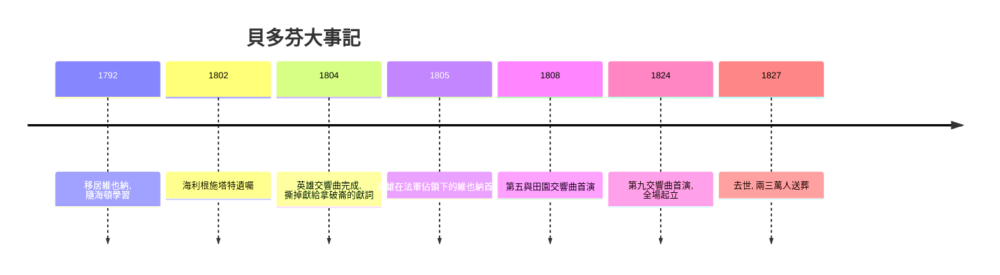

# 5.2 貝多芬的《英雄》：音樂成為個人意志

時間：1770年至1827年

## 一份獻給拿破崙的樂譜，一場撕頁的憤怒

1804年春，路德維希·范·貝多芬（1770年至1827年）完成了《第三號交響曲》，總譜標題頁上寫著獻詞：波拿巴。這位出生於波昂的作曲家深受法國大革命影響——他19歲時波昂大學裡迴盪著革命思想，他曾在題獻給約瑟夫二世的康塔塔（1790年）中表達共和理想。他把《英雄》交響曲視為獻給這位「共和國的解放者」的讚歌。

同年5月，拿破崙稱帝的消息傳到維也納。據貝多芬的學生費迪南德·里斯回憶，貝多芬憤怒地把標題頁撕成兩半（學生夏特勒的說法是擦掉獻詞，撕頁說出自里斯，兩說並存），改題「英雄交響曲——為紀念一位偉人」。這個改題本身就是音樂史的宣言：作品不再是獻給某位君主的供品，而是獻給一個抽象的「偉大人格」。音樂的主題，第一次是一個「人」——一個奮鬥、受挫、犧牲、復活的英雄。

## 《英雄》做了什麼

1805年4月7日，這部交響曲在維也納首演，長度約五十分鐘，是當時交響曲的近兩倍。第一樂章以兩個強力和弦開場，主題是三個單調的重複音E♭——批評家當時罵它「野蠻」、「太長」、「缺乏統一」。但這正是貝多芬的方法：用最簡單的材料，透過持續的動機發展，製造前所未有的緊張與張力。第二樂章是葬禮進行曲（實為法國大革命的儀式音樂類型），第三樂章詼諧曲取代了小步舞曲（貴族禮儀的音樂被民間舞曲的能量取代），第四樂章以變奏曲形式呈現主題（此主題出自貝多芬自己的《普羅米修斯的創造物》芭蕾配樂——普羅米修斯，偷火給人類的英雄，正是這部交響曲的隱喻）。

《英雄》標誌著一場社會學變革：音樂的敘事主體從「宮廷的莊嚴」轉為「個人的奮鬥」。這與啟蒙運動的政治哲學同構：人的價值先於制度；個體可以與命運對抗。1805年11月拿破崙軍隊佔領維也納，《英雄》在佔領下的維也納首演——法國軍官出席，貝多芬對法國的複雜情感（革命理念 vs 民族屈辱）濃縮在這個歷史瞬間。

## 失聰的孤島與《第九號交響曲》

貝多芬26歲起逐漸失聰，1802年他在海利根施塔特寫下遺囑（Heiligenstadt Testament），坦言曾想自殺，最終選擇「為藝術而活」——這份文件是藝術史上最沉重的自我剖白。他此後的創作（中期至晚期）在完全或近乎完全失聰中完成：第五交響曲（命運敲門）、第六《田園》、《皇帝》協奏曲、晚期弦樂四重奏、最後的《第九號交響曲》（1824年首演）。

《第九》以席勒的《歡樂頌》為詞，是人類音樂史上第一次在交響曲中加入人聲合唱。首演時貝多芬完全聽不見掌聲，女中音翁格爾拉著他轉身面向觀眾——全場起立，揮舞手帕（此情節出自施德勒的回憶，細節略有出入，但掌聲如雷確鑿）。這部作品後來成為1972年起歐盟的盟歌、1989年柏林圍牆倒塌時伯恩斯坦在柏林指揮的《自由頌》（將Freude改為Freiheit）、日本年底「第九」演出的傳統。一部寫於專制復辟時期（梅特涅時代的維也納警察國家）的作品，成為人類普世團結的象徵——藝術的意義，不斷被後來的歷史重新發明。

## 制度背景：從僕人到「天才」

貝多芬的社會地位與海頓、莫札特截然不同。他從未依附宮廷（雖然魯道夫大公等貴族資助他），靠出版、訂購與教學為生；他是第一位被視為「創造者」而非「匠人」的作曲家——葬禮（1827年3月29日）有兩萬至三萬人出席，悼詞由詩人格里爾帕策撰寫，稱他「領我們進入了精神的無限」。這種「天才崇拜」是浪漫主義的思想準備：藝術家從服務者變成先知。同時代的德國（康德的美學、歌德與席勒的文學）正在構建「天才」的概念：不受規則束縛、創造規則的人。貝多芬不是適應了這個概念，他就是這個概念的化身。下一章，浪漫主義將全面展開。

