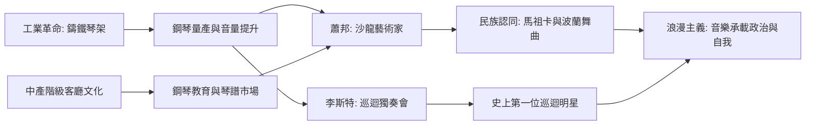

# 6.1 蕭邦與李斯特：鋼琴上的詩人與琴魔

時間：1810年至1849年

## 鋼琴：工業革命的樂器

19世紀上半葉，一種樂器佔領了歐洲的中產階級客廳：鋼琴。工業革命讓鑄鐵琴架、精密擊弦機與大量生產成為可能（1825年美國的巴布科克取得鑄鐵架專利，鋼琴音量與穩定性大幅提升）；城市中產階級有錢、有客廳、有女兒要受「良好教育」——彈鋼琴成為中產女性的必修課（這也催生了大批女性鋼琴教師與琴譜市場）。1830年代巴黎的鋼琴製造商（艾拉爾、普萊耶爾）與維也納（博森多夫）競爭激烈，琴的觸鍵與音色深刻影響了作曲風格：蕭邦只愛普萊耶爾與艾拉爾，李斯特偏好更強勁的琴。鋼琴不只是樂器，它是19世紀的「個人音響中心」——正如今天的手機。

## 蕭邦：沙龍裡的詩人

弗雷德里克·蕭邦（1810年至1849年）生於華沙附近的熱拉佐瓦沃拉（父親是法裔家教，母親波蘭人），16歲入華沙音樂學院，1830年11月起程西行（臨行前朋友們送他一只盛滿波蘭泥土的銀杯——兩週後華沙起義爆發，他終生未歸）。1831年到巴黎後，他沒有走公開音樂會的路線，而是成為沙龍的寵兒：在貴族與銀行家的客廳演奏（羅斯柴爾德家族、德拉克洛瓦、巴爾扎克都是座上賓），以高薪私人授課為生（一小時法郎20至30法郎，遠高於同行），出版作品版稅豐厚。他終生只有約三十場公開音樂會——他是史上第一位「沙龍藝術家」：作品多為夜曲、馬祖卡、波蘭舞曲、前奏曲，篇幅精緻，專為親密的房間而寫。

馬祖卡與波蘭舞曲不只是民俗風情，而是政治：1831年後波蘭亡國（被俄、普、奧瓜分），巴黎的波蘭流亡社群以音樂維繫民族認同。舒曼1836年評論蕭邦的《降B大調奏鳴曲》時寫下：「假若北方強權（沙皇）知道在蕭邦的作品裡，在他的馬祖卡的簡單節奏裡，藏著多麼危險的敵人，他一定會禁掉這些音樂。」蕭邦1849年死於肺結核（39歲），葬於巴黎拉雪茲神父公墓，心臟依其遺願被取出，密封於白蘭地酒瓶中，後運回華沙，存於聖十字教堂——一副心臟的政治之旅，沒有比這更激烈的民族主義宣言。

## 李斯特：史上第一位超級巨星

弗朗茨·李斯特（1811年至1886年）是匈牙利的德裔（本人終身以德語書寫），父親是艾斯特哈齊家族的管家。他11歲隨家人移居巴黎（因不得入巴黎音樂學院——非奧地利人不收，凱魯比尼的規定），以鋼琴演奏為生。1830年代他聽到帕格尼尼的小提琴演奏後（1832年他在信中寫道：我要成為鋼琴上的帕格尼尼），徹底重造了鋼琴演奏技術：八度連奏、跨十度音程、炫技華彩。

1839年至1847年間，李斯特進行了音樂史上第一次大規模「巡迴演奏會」：足跡遍佈歐洲數百城，從里斯本到莫斯科，從愛爾蘭到奧斯曼。他發明了「獨奏會」（recital）一詞——此前音樂會總是多種節目混搭，李斯特讓一個人、一架鋼琴撐滿全場。現場瘋狂程度是後世搖滾明星的預演：女性爭奪他的手套與鼻菸壺、為他掉落過的雪茄菸蒂鑲金鍊（Heine報導：柏林一場演奏會上，女士們為爭奪他的手帕幾乎打起來——這些誇張報導半是海涅的諷刺筆法，但人潮確鑿）。李斯特本人聰明地把名氣轉化為文化資本：他把其他作曲家的作品改編成鋼琴獨奏（貝多芬交響曲、歌劇詠嘆調），既推廣了曲目，也把自己變成音樂傳播的中心節點。

1847年他急流勇退（在基輔認識了卡羅琳·維特根斯坦公主），隨後在魏瑪任宮廷樂長（1848–1861），指揮推廣華格納、柏遼茲等人的新作，培養學生，開創「新德意志樂派」。晚年他成為神父（1865年接受低階聖職），但拒絕獨身戒律的束縛，在羅馬、魏瑪、布達佩斯之間穿梭教學——他被稱為「李斯特修士」，門下學生（包括大量女性，如索菲·門特）成為20世紀鋼琴教育的骨幹。

## 兩種浪漫，一場革命

蕭邦與李斯特同生於1810年、同為鋼琴家、同在巴黎成名，卻代表浪漫主義的兩極：蕭邦內向、精緻、為私密空間寫作；李斯特外向、宏大、為公開劇場表演。但他們共同確認了同一件事：演奏家可以成為明星，音樂會可以成為大眾事件。這條線從李斯特延伸到帕格尼尼，再到20世紀的卡魯索（歌唱家與留聲機的第一代明星）、貓王與披頭四——明星制度是19世紀資本主義與大眾傳媒的發明，鋼琴家是第一批受益者。

