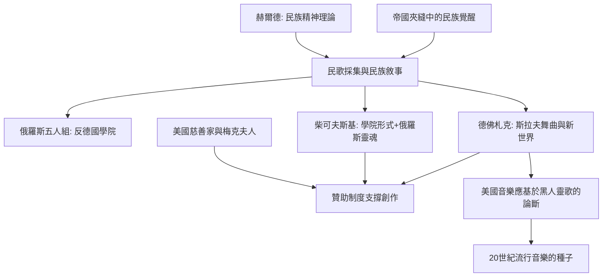

# 6.2 柴可夫斯基與德佛札克：民族樂派的崛起

時間：1840年至1904年

## 為什麼音樂要有「民族」

19世紀中葉，歐洲的政治版圖正在重組：德意志與義大利走向統一，斯拉夫、匈牙利、捷克、北歐各民族在帝國夾縫中覺醒。民族主義的思想工具（赫爾德的「民族精神」Volksgeist理論：每個民族有獨特的靈魂，存在於民間歌謠、神話與語言中）催生了文化民族主義——採集民歌、編寫民族史詩、創造民族藝術。音樂在此扮演特殊角色：它是無需翻譯的語言，最容易承載「民族的靈魂」。俄羅斯五人組（巴拉基列夫、鮑羅定、穆索斯基、里姆斯基-科薩科夫、居伊）主張擺脫德國學院傳統，直接從俄羅斯民歌、教會聖歌與東方色彩中創造俄羅斯音樂；捷克、挪威（葛利格）、芬蘭（西貝流士）各有自己的民族樂派。這是音樂史的一個新現象：音樂不僅服務宮廷或自我，而成為建構民族認同的工具——政治目標與藝術創作在此交織。

## 柴可夫斯基：在德國形式與俄羅斯靈魂之間

彼得·柴可夫斯基（1840年至1893年）生於沃特金斯克的礦業家庭，先是司法部的公務員，22歲才辭職進入新成立的聖彼得堡音樂學院（1862年，安東·魯賓斯坦創立——這是俄國第一所按德國模式辦學的音樂學院，教育制度本身就是西化政策的產物）。他的處境尷尬：學院派訓練使他精通德國形式，民族樂派卻批評他「太德國、太世界主義」；他一生的創作就在這兩極之間尋找平衡——《第四》、《第五》、《第六》交響曲用的是德國形式，內裡卻流動著俄羅斯的憂鬱、舞曲節奏與東方色彩。

他的一生有兩個關鍵的外部因素。其一，梅克夫人：這位鐵路大王的遺孀從1877年起資助他每年六千盧布，條件是兩人永不見面——這持續了十三年的「純書信贊助」讓柴可夫斯基得以辭去音樂學院教職專心創作。這是藝術贊助史上的奇特案例：金錢與人格的徹底分離（1890年梅克夫人突然斷絕資助，原因至今不明）。其二，同性戀身份與社會壓力：1877年他與學生安東尼娜·米留科娃的災難性婚姻（據傳他曾在莫斯科河邊企圖自盡），以及法律禁止的性傾向，使他的作品充滿壓抑與悲劇張力——《第六號交響曲「悲愴」》（1893年，首演九天後他死於霍亂，死因至今有自殺說與疾病說的爭論）被廣泛解讀為生命的自白。

他的《天鵝湖》（1877）、《睡美人》（1890）、《胡桃鉗》（1892）三大芭蕾舞劇，把舞劇音樂從伴奏提升為交響詩，直接塑造了俄羅斯芭蕾的國際形象；而《一八一二序曲》（1882，慶祝莫斯科救主大教堂落成）以真炮與鐘聲入樂，是民族主義宣傳音樂的極端案例。

## 德佛札克：波希米亞的聲音與新世界的啟示

安東寧·德佛札克（1841年至1904年）是布拉格附近農家出身，父親是屠夫兼旅店老闆。他先在布拉格管風琴學校就讀，長年在劇院樂團拉中提琴（曾在斯美塔那指揮下工作），1870年代以《摩拉維亞二重唱》獲得奧地利國家獎學金（評委包括布拉姆斯），布拉姆斯成為他的伯樂與終生推手（親自推薦給柏林的出版商辛洛克）。他的音樂融合捷克民謠節奏（富里安特舞曲、杜姆卡）、斯拉夫色彩與德國古典形式——《斯拉夫舞曲》（1878年第一集為鋼琴四手聯彈，出版後全歐暢銷）使國際名聲確立。

1892年至1895年，德佛札克受邀出任紐約國家音樂學院院長（年薪一萬五千美元，約當時他在布拉格的十倍——美國的富豪慈善家瑟伯夫人想為美國建立自己的音樂學派）。在紐約期間，他寫下《第九號交響曲「自新世界」》（1893年，卡內基音樂廳首演），並發表著名的論斷：美國音樂的未來應建立在黑人靈歌與印第安旋律之上——他讓學生（黑人男中音哈利·伯萊，親自唱靈歌給他聽）收集靈歌，並公開撰文主張這是美國的「民族音樂」種子。此論在當時的種族語境下極具爭議（部分美國評論家拒絕承認黑人音樂是美國音樂的基礎），但這正是德佛札克的深刻之處：民族音樂不是血統，而是土地與人民的實際聲音。他1893年夏天到愛荷華州的捷克移民小鎮斯皮爾維爾度假，在那裡完成《美國》弦樂四重奏——移民、殖民、民族、土地，在這部四重奏裡交織。1895年他返回布拉格，1901年任布拉格音樂學院院長，1904年去世。

## 民族樂派的遺產

民族樂派證明了一件事：音樂的「普遍價值」可以是多聲部的。巴赫與貝多芬的形式可以被俄羅斯、捷克、波希米亞的靈魂重新填充，而這些填充反過來豐富了形式本身（德佛札克的大提琴協奏曲至今被視為該樂器的最高峰之一）。這條線在20世紀延續為：巴托克（匈牙利，以科學方法採集民歌——他是史上第一位用愛迪生留聲機做民族音樂學田野調查的作曲家之一）、柯達伊（匈牙利音樂教育體系）、以及世界各地的「民謠採集—藝術化」運動。當錄音技術成熟後（下一章），這條線將與爵士、藍調匯流，成為整個20世紀流行音樂的基礎。

