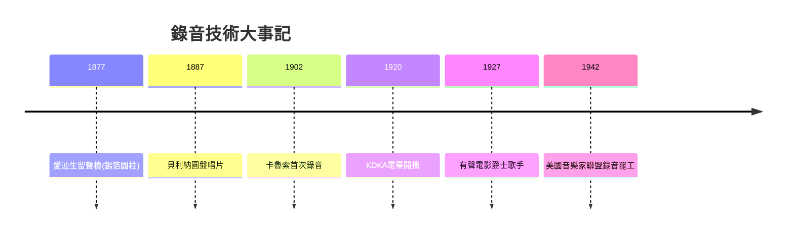

# 7.1 愛迪生的留聲機：聲音第一次被囚禁

時間：1877年起

## 一臺會說話的機器

1877年，托馬斯·愛迪生（1847年至1931年）在研究電話與電報的改良時，意外發現了聲音可以刻錄在可動材質上。他設計了一臺以錫箔包裹的圓柱裝置：對著喇叭說話，振動膜帶動鋼針在錫箔上刻出深淺紋路；回放時，鋼針沿紋路震動振動膜，聲音重現。1877年12月，愛迪生對著機器唱了童謠〈瑪莉有隻小綿羊〉，然後回放成功——世界上第一臺留聲機問世。他隨即申請專利（1878年2月獲准），並預測了十種用途：口述書信、有聲書、家庭教育、音樂複製、家庭錄音、玩具、鐘錶報時、語言教學等。有趣的是，他自己的排序裡「音樂複製」只排第四——他更看好商業與教育用途，而非藝術。

這個排序的錯位說明了技術史的常態：發明者無法預見技術真正的社會歸宿。留聲機最終成為「音樂的載體」，徹底改寫了音樂的存在方式。

## 從玩具到產業

愛迪生的留聲機起初音質粗糙、錫箔一放即損，商業上失敗。真正的商業突破來自競爭者：1887年德裔美國人埃米爾·貝利納（Emil Berliner）發明圓盤唱片（gramophone），相較圓柱，圓盤易於壓模複製、成本低、儲運方便——這是「可量產的音樂」的關鍵一步。貝利納1895年創立公司（後來的Victor Talking Machine Company，RCA的前身），1900年代起以「His Master's Voice」（小狗聽留聲機的商標）行銷。同時期，哥倫比亞唱片公司（後與愛迪生的競爭者合流）發展圓柱與圓盤並行。到1910年代，唱片產業已在歐美成形：錄音室、藝人合約、版稅制度、零售渠道——一個全新的經濟部門誕生了。

錄音技術的第一批受益者與受害者同時出現。受益者是擁有獨特聲音的表演者：男高音恩里科·卡魯索1902年為英國Gramophone公司錄音（他成為史上第一位透過唱片行銷全球的歌劇明星，唱片銷量使他成為當時收入最高的表演者）；拒絕錄音的表演者（如部分著名女高音）逐漸失去與新生代的競爭力。受害者是現場音樂產業的邊緣從業者——餐廳鋼琴師、街頭樂手、小劇院的伴奏者：一臺留聲機取代了一個人的工作。這場「錄音 vs 現場」的職業衝突，在電影、廣播、電視、串流時期反覆重演（1942年美國音樂家聯盟的錄音罷工、1980年代合成器罷工、2023年AI音樂爭議，都是同一個問題的變奏）。

## 音樂文化的深層改變

留聲機帶來的不只是產業，而是「聆聽」本身的變化。其一，音樂脫離了空間限制：以前聽歌劇要去劇院，現在一個移民家庭在公寓裡就能聽到卡魯索。其二，音樂脫離了時間限制：貝多芬的交響曲可以被反覆重聽，一個旋律可以被「放大檢視」——這改變了音樂教育的深度（學生可以逐句模仿名家的演奏）。其三，「標準錄音」的概念誕生：一首曲子有了「官方版本」，演奏的個性與現場的即興性被固定下來——這對爵士樂尤其關鍵（早期爵士的即興傳統在唱片中留下了珍貴的檔案，也同時被唱片「標準化」）。其四，民族音樂的全球流通：唱片公司派出錄音師到世界各地錄製民謠（1920年代的巴爾幹、非洲、亞洲錄音之旅），世界音樂的相互聆聽從此開始。

## 連鎖反應

留聲機的直接後果是廣播（1920年KDKA電臺開播）與電影配音（1927年《爵士歌手》有聲電影）——聲音成為20世紀的基礎設施。而對音樂本身而言，錄音技術與兩場藝術革命同時發生：一是德布西、史特拉汶斯基、荀白克對和聲法則的解構；二是紐奧良的爵士樂與藍調的爆發。下一節與下下節，我們分別聽這兩個故事。

