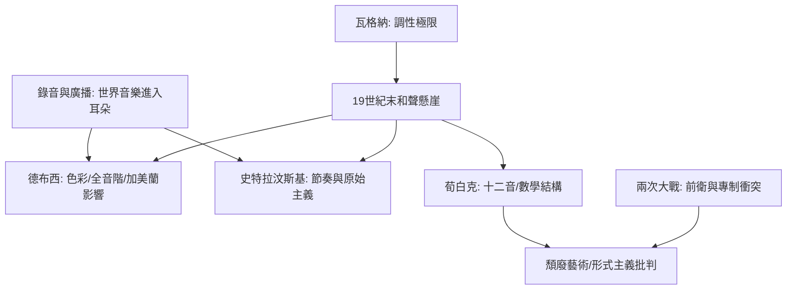

# 7.2 德布西、史特拉汶斯基與荀白克：打破千年和聲法則

時間：1890年代至1930年代

## 和聲法則的崩塌

自巴洛克以來，西方音樂的和聲體系建立在功能理論之上：主音（I）是家，屬音（V）是張力，下屬（IV）是過渡，和弦按照功能推進，最終解決回主音。這套體系在巴赫、莫札特、貝多芬、瓦格納手中達到極致——瓦格納1859年《崔斯坦與伊索德》的前奏曲，以一個持續懸而未決的「崔斯坦和弦」開場，四小時不解決，被視為調性和聲的極限（音樂學家經典的說法是：它「敲響了調性的喪鐘」）。到了19世紀末，半音化和聲愈演愈烈，調性中心愈發模糊——音樂已經站在懸崖邊。接下來的三位作曲家，從三個不同方向跳了下去。

## 德布西：色彩取代功能

克勞德·德布西（1862年至1918年）1880年代兩度以法國青年作曲家身份獲羅馬大獎。他的關鍵滋養來自法國之外：1889年巴黎世界博覽會上，爪哇的加美蘭樂團（以青銅鑼與編鐘演奏的複雜節奏層疊）與越南、非洲的表演讓他震撼——他說爪哇音樂有一種西方對位法無法企及的「多層疊影」。他還接觸了俄羅斯五人組（穆索斯基《圖片展覽會》的粗獷色彩）、瓦格納的音響、以及象徵主義詩歌（馬拉梅）與印象派繪畫（雖然他本人不喜歡被稱為印象派）。

德布西的方法是「聲音即色彩」：和弦不再是功能的階梯，而是獨立的色彩事件——九和弦、十三和弦、平行五度（學院禁忌）、全音階（六個音等距）、五聲音階與教會調式。〈月光〉、〈牧神午後前奏曲〉（1894年，開篇長笛的音型像霧中呼吸）、〈海〉、《映象》：這些作品的和聲不「走向」什麼，它們漂浮、閃爍、消散。1905年後他完成歌劇《佩利亞斯與梅麗桑德》（梅特林克腳本），以宣敘化的歌唱與朦朧的管弦樂，被視為法國對瓦格納的回應。德布西打破了功能和聲的桎梏，但仍留在「美」的疆域內——他的革命是審美的，不是數學的。

## 史特拉汶斯基：節奏的原始主義

伊戈爾·史特拉汶斯基（1882年至1971年）生於聖彼得堡，師從里姆斯基-科薩科夫。他為謝爾蓋·佳吉列夫的俄羅斯芭蕾舞團（Ballets Russes——巴黎最成功的文化輸出機構，把俄羅斯藝術帶到西歐）寫作了三部芭蕾：《火鳥》（1910）、《彼得魯什卡》（1911）與《春之祭》（1913年5月29日，巴黎香榭麗舍劇院）。

《春之祭》首演是音樂史上最著名的醜聞。首演當晚（編舞尼金斯基），觀眾在開場幾分鐘內開始噓聲、鬥毆、甚至有人互相出手（歷史細節：大量證據顯示騷亂主要針對編舞而非音樂——當時觀眾聽到音樂本身的部分很少，因為噪音過大；具體衝突程度在後世記述中有所誇大）。音樂本身的挑釁是：不規則的強音（原始的、脈動般的節奏取代了旋律的歌唱性）、極端的不協和和弦（e-flat七和弦與f-flat大和弦疊加）、以及俄羅斯異教儀式的獻祭主題（少女跳舞至死以祭祀春神）。史特拉汶斯基晚年回憶稱此為「一次醜聞的成功」。此後他的風格多次轉向：新古典主義（1920年代起，回到巴赫式的冷靜結構，如《士兵的故事》、《浪子的歷程》）、十二音技法（晚年吸收荀白克），證明他的天才是「重新發明」而不屬於任何一個流派。

## 荀白克：十二音的數學

阿諾爾德·荀白克（1874年至1951年）是維也納人，自學成才（唯一的老師是學長策姆林斯基），銀行職員出身。他起初是華格納的追隨者（《昇華之夜》1899年是後期浪漫風格的完美之作），但很快走向極端：1908年前後他放棄調性（atonality）——音樂不再有任何主音中心。這在當時是不可理解的：《弦樂四重奏第二號》（1908，末樂章加入女高音，歌詞是「我感到別種行星的空氣」）首演時聽眾大笑、跺腳；1913年維也納的荀白克作品音樂會演後釀成騷亂（被稱為「Skandalkonzert」，警察出動，音樂會被迫中止——這與《春之祭》同年，20世紀音樂的雙重革命）。

1923年，荀白克正式提出「十二音技法」（twelve-tone technique）：一首作品使用一個由十二個半音組成的序列（row），此序列可以倒影、逆行、逆行倒影，任何一音重複使用前必須先用完其他十一音——徹底排除調性中心，用數學規則取代聽覺直覺。這與同時代的邏輯實證主義、維也納學派的哲學同構：一種「不訴諸感受，只訴諸結構」的美學。荀白克的學生（韋伯恩、貝爾格）與戰後的序列主義（布列茲、施托克豪森）把這種思維推向極致。1933年納粹上台，荀白克（猶太裔）流亡美國，在加州任教（1947年他的《華沙倖存者》以集中營為題，是十二音技法最撼人的政治作品）。

## 三種「不可能」，一個時代

德布西革命了色彩，史特拉汶斯基革命了節奏，荀白克革命了結構。他們共同的歷史條件是：其一，19世紀末和聲的極限已到，路已走到盡頭；其二，錄音與廣播使各種音樂（爪哇、非洲、東歐民謠）得以進入西方作曲家的耳朵，音樂的「正常」被拓寬；其三，兩次大戰之間的意識形態動盪使「新與舊」成為政治問題——納粹譴責德布西與荀白克為「頹廢藝術」，蘇聯批判史特拉汶斯基為「形式主義」，藝術前衛與政治專制的衝突貫穿整個20世紀。下一節，我們把鏡頭轉向大西洋彼岸：一種從碼頭與棉花田裡長出來的音樂，即將重新定義「流行」。

