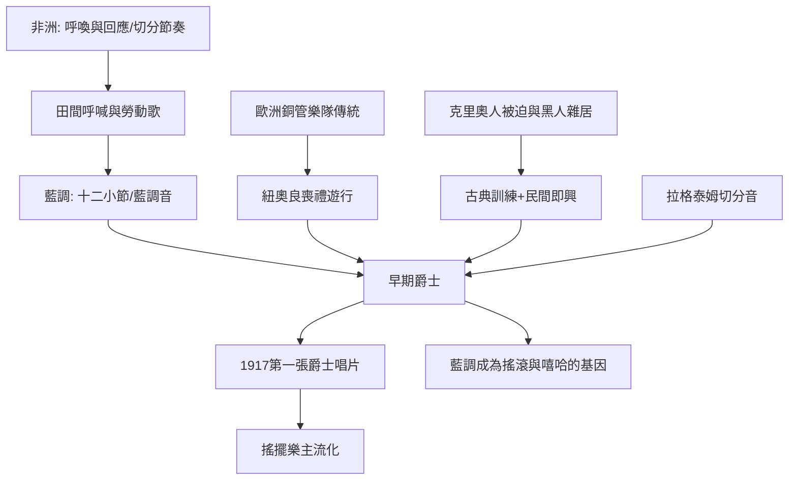

# 7.3 紐奧良與爵士樂：藍調與切分音的基因

時間：1890年代至1930年代

## 密西西比河口的交叉路口

要理解爵士樂，得先理解紐奧良的社會結構。這座位於密西西比河口的港市，1718年由法國建立、1768年割讓給西班牙、1803年隨路易斯安那購地歸美國，融合了法國、西班牙、非洲、加勒比與英美的文化。最特殊的群體是克里奧人（Creoles of color）：非洲與歐洲混血的自由人後裔，多受法語教育、會演奏古典音樂，社會地位在奴隸之上。1877年聯邦軍隊撤出南方後，吉姆·克勞法（種族隔離法）逐步強化，克里奧人被法律重新劃入「有色」階層，與非洲裔窮人被迫雜居——這個制度性的屈辱，反而造成了一場文化會合：受過古典訓練的克里奧樂手與自學的藍調、拉格泰姆樂手在城市街頭、妓院與酒吧中混在一起。爵士樂，誕生在制度的裂縫裡。

紐奧良的另一個音樂溫床是喪禮遊行（funeral parade）：非洲傳統與天主教的融合儀式，銅管樂隊在送葬路上奏哀歌，返程時奏歡快的舞曲（「第二線」second line——遊行隊伍後面跟著跳舞的群眾）。銅管樂隊的編制（小號、單簧管、長號、鼓）加上藍調與拉格泰姆的節奏，成為早期爵士的基本配置。

## 藍調：十二小節的靈魂

藍調（blues）來自密西西比三角洲的黑人勞動歌、田間呼喊（field hollers）與靈歌，19世紀末成形。它的結構是十二小節：四小節主題、四小節重複、四小節回應——這來自非洲的「呼喚與回應」（call and response）傳統。它的和聲只有三個和弦（I、IV、V），卻因為「藍調音」（blue notes，第三、五、七音降低或彎音）而擁有無法以五線譜精確記錄的苦澀。藍調的歌詞是個人苦難的詩：貧窮、失戀、洪水、旅行、監獄。

1908年起藍調開始被出版與錄音。1920年，梅米·史密斯錄下〈Crazy Blues〉（OKeh唱片），成為史上第一張以「種族唱片」（race records）分類發行的藍調唱片，意外熱銷數萬張——唱片公司驚覺黑人消費市場存在，遂大規模錄製藍調。貝西·史密斯（「藍調皇后」）與羅伯·強生（三角洲藍調傳奇，生前寂寂無名，死於1938年，遺留的29首錄音1961年重發後成為藍調的聖經——傳說他在十字路口與魔鬼交易換取琴藝）成為經典。藍調對20世紀音樂的影響無法估計：爵士、節奏藍調、搖滾、嘻哈的和聲與旋律語法，全部建立在十二小節之上。

## 拉格泰姆與切分音

拉格泰姆（ragtime）是爵士的直接前驅：1890年代在聖路易斯與密蘇里州興起，以鋼琴為主，核心是切分音（syncopation）——重音落在弱拍上，打破歐洲傳統的規整節奏。史考特·喬普林（Scott Joplin，約1868年至1917年，生於德州的黑人音樂家）1899年的〈楓葉拉格〉（Maple Leaf Rag）是史上第一首百萬銷量的樂譜（以樂譜銷售為主，當時錄音尚不發達）。拉格泰姆是黑人社區的鋼琴音樂，但它的切分節奏迅速滲入白人主流（歐文·柏林的〈亞歷山德拉拉格泰姆樂隊〉1911年是白人拉格泰姆的代表）。1917年美國國會通過禁酒令後，地下酒吧（speakeasy）與舞廳成為拉格泰姆與早期爵士的溫床——制度的禁止，反而擴大了音樂的傳播。

## 故鄉樂隊與第一張爵士唱片

1917年2月26日，紐奧良的「正宗迪克西蘭爵士樂隊」（Original Dixieland Jass Band）在紐約為Victor唱片錄製〈Livery Stable Blues〉——史上第一張爵士樂唱片。這支樂隊是白人（這不是偶然：早期唱片公司優先錄製白人樂團），他們的錄音銷量爆炸，讓「爵士」一詞席捲全美。真正的大師路易斯·阿姆斯壯（1901年至1971年）生於紐奧良最貧困的區域，少年時在感化院學習吹奏（因為朝天開槍被捕），1920年代在芝加哥與紐約成為爵士的第一位超級獨奏家：他的小號與歌聲（〈West End Blues〉1928年開場的華彩被視為爵士史上最著名的即興）確立了「獨奏」在爵士中的核心地位——爵士從集體遊行音樂轉向個人才華的展現。1930年代搖擺樂（Big Band，班尼·古德曼、艾靈頓公爵）把爵士推為全美主流；1940年代比波普（Charlie Parker、Dizzy Gillespie）把爵士推向藝術的前衛。

## 爵士的社會學

爵士樂的誕生與傳播是20世紀種族、階級與商業的縮影。它是黑人音樂，早期被白人社會視為「低俗」（1920年代爵士被教會與報紙譴責為墮落之音）；但白人樂手（如古德曼）吸納爵士後成為主流明星，黑人樂手長期被排擠在錄音與場館之外（古德曼1936年率先打破種族隔閡，讓黑人鋼琴手泰迪·威爾遜與白人樂手同台）。這個「黑人發明、白人獲利」的模式，在搖滾（貓王翻唱黑人音樂）與嘻哈（採樣黑膠）中反覆重演，是20世紀流行音樂的核心張力。1938年古德曼在卡內基音樂廳的爵士音樂會、1939年比莉·哈樂黛錄製〈Strange Fruit〉（歌詞是南方私刑，被視為最早的抗議歌曲之一），顯示爵士正在從娛樂轉向藝術與政治。這條線，將在下一章的搖滾樂中再次爆發。

