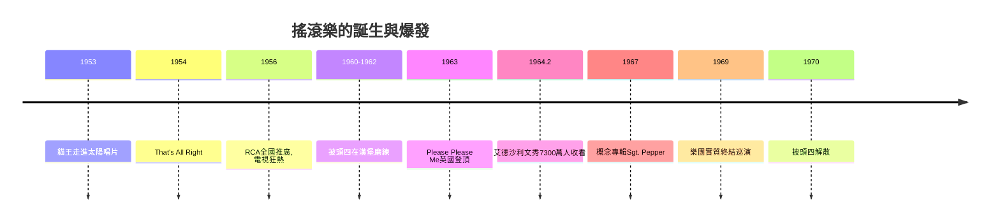

# 8.1 貓王與披頭四：全球青年的精神圖騰

時間：1956年至1970年

## 一輛卡車司機與孟菲斯的一間錄音室

1953年夏，18歲的卡車司機埃爾維斯·普雷斯利（Elvis Presley，1935年至1977年）走進孟菲斯的太陽唱片公司（Sun Records），自稱想錄一張唱片送母親。創辦人山姆·菲利普斯（Sam Phillips）當時正有一個明確的構想：他在尋找「一個黑人歌手的感覺，卻是白人面孔」——種族唱片市場巨大，但美國的種族隔離讓黑人音樂難以進入白人主流；若有白人能唱出藍調的感覺，將是巨大的市場縫隙。1954年7月，埃爾維斯錄製〈That's All Right〉（翻唱黑人歌手阿瑟·克魯達普的曲子），地方電臺播放後引起轟動。1955年，菲利普斯因財務壓力將埃爾維斯的合約賣給RCA唱片（約4萬美元，另有補償，總計約4萬美元量級），RCA開始全國性推廣。

1956年是貓王之年：〈Heartbreak Hotel〉奪冠，〈Hound Dog〉、〈Love Me Tender〉接連登頂，他在電視節目（包括《艾德·沙利文秀》，攝影機被要求只拍上半身——因為他的胯部搖擺被視為猥褻）上的表演引發全國性的狂熱與憤怒。這場狂熱有深刻的社會結構：二戰後嬰兒潮一代進入青春期，他們是史上第一代擁有零用錢、擁有自己的收音機與唱片機、在文化上與父母斷裂的年輕人——「青少年」作為消費群體正在被製造出來（行銷學與唱片業共同催生）。貓王把黑人的節奏藍調、鄉村白人的鄉村音樂與流行唱法熔為一爐，他的成功是種族音樂的「洗白」與市場化的縮影——同時代的黑人歌手（如Little Richard、Chuck Berry，後者直接影響了貓王與披頭四）的商業回報遠低於他，這是搖滾史無法迴避的經濟種族主義。1958年貓王入伍（德國服役兩年），1960年代轉向好萊塢（拍了31部電影，多為商業流水線作品），1977年因藥物相關的心臟問題去世（42歲）。

## 利物浦的四個工人階級青年

約翰·藍儂（1940年至1980年）、保羅·麥卡尼（1942年生）、喬治·哈里森（1943年至2001年）、林哥·史達（1940年生）來自利物浦的工人階級家庭。利物浦是港口城市，1950年代水手們從美國帶回節奏藍調唱片（特別是Chuck Berry、Little Richard），這是英國青年第一次直接接觸美國黑人音樂的原始文本。樂團原以藍調翻唱起家（名稱屢次更換，1960年定名The Beatles），在漢堡的紅燈區酒吧（1960–1962，白天到深夜連續演出，有時一晚八小時）完成「一萬小時」的磨練，1962年與製作人喬治·馬丁（Parlophone唱片，EMI子公司——馬丁受過古典音樂訓練，貢獻了編曲、錄音技術與商業判斷）簽約，同年10月首支單曲〈Love Me Do〉發行。

1963年〈Please Please Me〉登上英國榜首，英國掀起披頭熱（Beatlemania）。1964年2月7日，他們抵達紐約甘迺迪機場，數千名青少年擠爆現場；2月9日《艾德·沙利文秀》約7,300萬人收看（當時美國史上最高的電視收視之一）——英國文化入侵美國的「英倫入侵」（British Invasion）開始。隨後的唱片史是一部技術與藝術的雙人舞：馬丁的四軌錄音機（EMI的技術優勢）、〈Tomorrow Never Knows〉的迴圈與磁帶實驗、〈Strawberry Fields Forever〉的變速合成、《Sgt. Pepper's Lonely Hearts Club Band》（1967年，史上第一張概念專輯之一，錄音時間超過700小時）——披頭四把錄音室從「記錄演奏」的場所變成「創作工具」，這徹底改變了流行音樂的生產方式（自此，專輯而非單曲成為藝術單位）。

歌詞層面，他們從愛情（〈I Want to Hold Your Hand〉）走向內省與政治：〈Eleanor Rigby〉的孤獨老人、〈A Day in the Life〉的新聞拼貼、〈Revolution〉（1968）對政治暴力的反思、以及藍儂的〈Imagine〉（1971）。他們還做了一件改變產業的事：1967年開始抵制巡迴演出（現場音響技術跟不上他們的錄音野心，粉絲尖叫聲淹沒音樂），轉而專注錄音室創作——這是流行音樂史上第一次，唱片取代現場成為核心產品。1970年樂團因商業糾紛（蘋果公司Apple Corps的財務）與個人分歧解散，1980年藍儂在紐約自家門前被槍殺。

## 為什麼是他們、為什麼是此時

貓王與披頭四的共同點值得注意：他們都不是「音樂革命」的發明者，而是「轉譯者」——把黑人音樂轉譯成大眾傳媒可以傳播、白人青年可以消費的形態。他們的成功需要四個條件同時到位：其一，電視（1950年代美國電視普及率從9%躍至90%以上）與頂級唱片工業；其二，嬰兒潮世代作為新的消費主體；其三，戰後長和平與經濟繁榮提供的青少年文化空間；其四，技術（電吉他、大功率擴音、多軌錄音）使小樂團能製造巨響。任何一個條件缺席，「青年文化」這個現象都不會存在。搖滾樂因此不只是音樂，它是戰後資本主義、大眾傳媒與代際政治的複合產物——下一節的伍斯托克，將把它推向政治的高峰。

