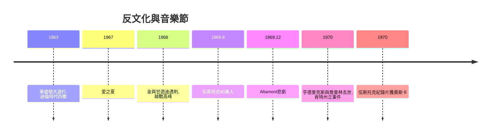

# 8.2 伍斯托克1969：反戰思潮與搖滾黃金年代

時間：1969年8月15日至18日

## 一場失控的烏托邦

1969年8月，紐約州貝瑟爾的乳牛場，一場原估計5萬人的音樂節，湧入了約40萬人（官方數字估計約40萬以上，具體無法精確統計——高速公路封閉、票務系統崩潰、最後主辦方宣布免費開放）。伍斯托克音樂與藝術節（Woodstock Music & Art Fair）的主辦者是四個二十多歲的創業者（羅伯特、約翰、阿蒂、喬爾），最初定位為收費商業音樂節，選址原在伍斯托克鎮（鎮民反對後遷至貝瑟爾）。

音樂節的過程是一場烏托邦式的秩序失控：大雨使場地成為泥沼，糧食短缺，醫療棚應接不暇，紐約州州長一度考慮出動國民兵——最後依靠的是自組織（搭便車、分享食物、Hog Farm公社的「支援隊」幫忙維持秩序）。音樂持續四天：瓊·貝茲、桑塔納、Crosby, Stills, Nash & Young、誰人（The Who）、吉米·亨德里克斯。亨德里克斯在18日清晨（多數觀眾已離場）以電吉他演奏美國國歌，用回饋與泛音把〈星條旗〉扭曲成戰機轟炸與尖叫——這是搖滾史上最著名的政治表演之一，它不是一首歌，而是一個時代的音聲註解。

## 為什麼是1969：反戰、民權與代際政治

伍斯托克不是憑空的事件。1960年代美國的背景是：越戰升級（1968年美國在越兵力超過50萬人）、民權運動（1963年華盛頓大遊行、1964年民權法案）、反文化運動（舊金山的愛之夏、嬉皮士公社）、以及一連串的政治暗殺（1968年馬丁·路德·金與羅伯特·甘迺迪）。年輕一代在電視上看到越戰的屍體與國內的警棍，對制度的信任崩塌——反文化的口號「Make love, not war」不是虛無，而是對具體戰爭的回應。音樂是這場運動的膠水：瓊·貝茲與鮑勃·迪倫把民謠變成抗議工具（迪倫1963年的〈The Times They Are a-Changin'〉是時代的主題曲）、Crosby, Stills, Nash & Young的〈Ohio〉（1970年，回應國民兵槍殺肯特州立大學學生）是即時的政治新聞音樂。伍斯托克的40萬人，是這一代人的自我確認儀式：他們第一次看見彼此。

## 技術與商業的基礎

1960年代搖滾的黃金年代，有賴於三個技術經濟條件。其一，電聲樂器與放大系統的成熟：Fender（1950年電吉他、1951年Precision Bass）、Marshall音箱（1962年）、大功率PA系統——沒有這些，露天40萬人的音樂節在技術上不可能。其二，長壽唱片（LP，1948年哥倫比亞推出）與高傳真音響使專輯成為藝術與商業單位，唱片公司（大西洋、A&M、Warner）有能力投資大型音樂節。其三，票務與旅遊基礎設施（高速公路、大學生假期）使大規模人口流動成為可能。同時，媒體的拍攝（伍斯托克紀錄片1970年上映，獲奧斯卡最佳紀錄片）把現場的48萬人變成全球數千萬觀眾的影像經驗——這是音樂節從「活動」變成「媒體商品」的起點。

## 黃金年代的陰影與餘波

黃金年代有其代價。1969年12月，滾石樂隊在加州Altamont的免費音樂會上雇用地獄天使摩托黨維持秩序，釀成觀眾被刺死的悲劇——媒體稱之為「六○年代的終結」。1970年，吉米·亨德里克斯與珍妮絲·喬普林在數月內相繼死於藥物相關問題。商業機器隨即接管：音樂節從「免費開放」的烏托邦變成高度商業化、保險化、票務化的產業（1970年代起全球音樂節產業成形，1990年代的Lollapalooza、2000年代的Coachella、Glastonbury，都是這個產業鏈的延伸）。而反戰運動的音樂遺產（迪倫、CSNY、貓王之後的搖滾主體）在1990年代Rage Against the Machine、2000年代的反伊拉克戰爭音樂中延續。

## 從現場到媒體

伍斯托克還標誌著一個更深的轉折：音樂的「現場性」開始被影像記錄與複製——觀眾體驗不再依賴親臨。這條線通往MTV（1981年開播）：當影像成為音樂的主要載體，音樂的「視覺性」將徹底改變流行產業。而在音樂製作端，合成器、取樣機與嘻哈文化正在同一時期醞釀，它們將在1980年代把「音樂製作」從演奏樂器變成操作機器。下一章，我們進入數位時代。

