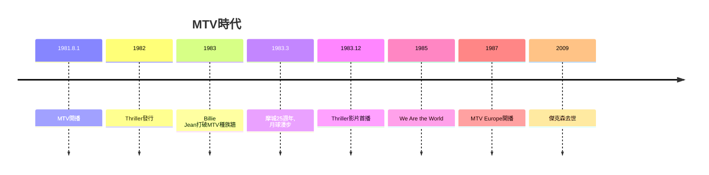

# 9.1 麥可·傑克森與MTV：音樂從聽覺走向視覺

時間：1981年至1990年代

## 1981年8月1日：I want my MTV

1981年8月1日午夜，美國有線電視開播了一個全新的頻道：MTV。開播的第一支影片是The Buggles的〈Video Killed the Radio Star〉——標題本身就是節目宣言。MTV的概念簡單而革命性：24小時播放音樂影片，像廣播電臺一樣輪播，靠廣告與有線電視訂閱費盈利。它誕生在特定的技術與經濟土壤上：有線電視的普及（1970年代末美國有線電視用戶突破千萬）、錄影帶技術（1975年Sony Betamax、1976年VHS問世）、以及唱片工業的行銷預算（70年代專輯時代累積的巨額利潤）。

MTV的早期片單幾乎全是白人搖滾（這是節目策略也是歧視：早期選曲刻意偏向專輯搖滾與英國新浪潮，黑人歌手的影片長期被排除——CBS唱片負責人沃爾特·葉特尼科夫公開抗議）。打破這道牆的是一位已經紅了十五年的歌手。

## 麥可·傑克森：從摩城童星到月球漫步

麥可·傑克森（1958年至2009年）五歲起作為Jackson 5的領唱在摩城唱片（Motown，黑人音樂家柏瑞·戈迪1960年在底特律創立，以「The Sound of Young America」為口號，是黑人企業家在主流市場的成功範本）成名。1979年他與製作人昆西·瓊斯合作《Off the Wall》，確立融合迪斯可、放克與流行歌謠的個人風格。1982年的《Thriller》是流行音樂史的斷點：全球銷量數千萬張（各種統計在6,700萬以上，史上最暢銷專輯），單曲〈Billie Jean〉、〈Beat It〉、〈Thriller〉連續登頂。

〈Billie Jean〉的音樂影片（1983年）是MTV史的分水嶺：傑克森在人行道上踩亮燈磚、舞步與鏡頭的精確配合，讓MTV首次為黑人藝術家進行高強度輪播——MTV的文化牆由此打破（傑克森本人回憶，CBS總裁威脅MTV：若不播傑克森，「我會公開這個事實並且永不再讓我的藝人上你們的節目」）。1983年3月的摩城25週年特別節目上，傑克森以〈Billie Jean〉表演中首次做出「月球漫步」（moonwalk，此舞步非他發明，舞者如Tap舞蹈傳統已有前身，但由他全球化），一夜之間成為全球現象。

《Thriller》的影片（1983年，導演約翰·蘭迪斯，14分鐘，預算近百萬美元）是音樂影片史上第一支真正的「短片電影」：劇情、特效、舞蹈、恐怖片致敬。它證明了一件事：音樂影片可以是電影藝術，也可以是產品行銷——《Thriller》影片帶動專輯銷量二次爆發（據業界估計每周銷量翻倍），音樂與影像、藝術與商業的界線從此模糊。此後，麥當娜（《Like a Prayer》1989年以宗教爭議行銷）、A-ha（〈Take On Me〉的動畫技術）、彼得·加百列（〈Sledgehammer〉的黏土動畫）把音樂影片推向視覺藝術的高峰。

## 音樂產業的視覺轉向

MTV帶來的變化是結構性的。其一，「外表」的商業價值劇增：歌手從「聲音的提供者」變成「形象與故事的提供者」，造型、舞蹈、影像美學成為產業核心（造型師、攝影指導、導演成為新職業）。其二，宣傳邏輯改變：一支影片的投資（數十萬至數百萬美元）必須由專輯銷量回收，音樂產業的資本密集度上升。其三，全球化的加速：MTV透過有線電視與衛星傳播到歐洲（1987年MTV Europe開播）、亞洲（1991年MTV Asia），使全球青少年第一次共享同一批影像與歌曲——流行音樂從此真正全球化（同時引發文化同質化的批評）。

傑克森本人的後續值得公允地記錄：1987年《Bad》與1991年《Dangerous》延續商業成功，他推動了音樂產業在版稅與版權上對藝術家的讓步（1985年他購入Beatles版權目錄，引發產業震撼），並在慈善（〈We Are the World〉1985年，他與Lionel Richie共寫，為非洲饑荒募款）與種族議題上有實質影響。但1993年起，他被控兒童性侵（2005年加州聖塔巴巴拉的刑事審判被判無罪，2019年紀錄片《Leaving Neverland》再掀爭議），晚年財務危機，2009年為復出演唱會排練時去世（50歲）。他的遺產因此無法簡化：他是流行音樂史上最具影響力的表演者之一，同時也是複雜爭議的中心。

## 從視覺到數位

MTV時代的邏輯——影像化、全球化、資本密集化——將在1990年代與數位技術相遇：合成器、取樣機與嘻哈把音樂製作變成機器操作，而網路將在2000年代摧毀MTV時代的整個商業模式。下一節，我們進入機器的時代。

