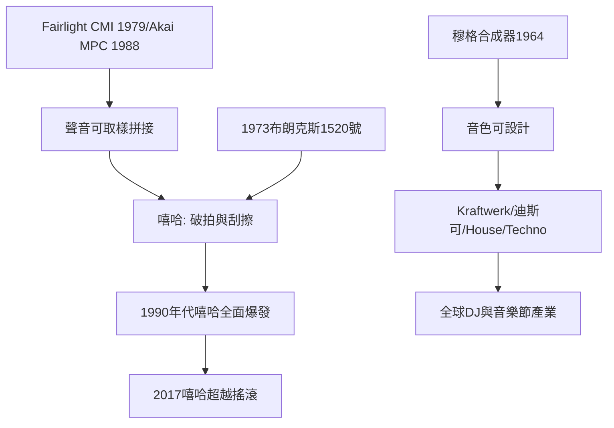

# 9.2 合成器、取樣機與嘻哈：街頭躍升主流

時間：1964年至2000年代

## 機器接管音色的發明

電子音樂的科學根基在20世紀初就打下（1950年代RCA的實驗室合成器、法國的具體音樂musique concrète），但把電子聲音帶進流行音樂的是兩個關鍵發明。1964年，羅伯特·穆格（Robert Moog）推出便攜式Moog合成器：電壓控制振盪器、濾波器與包絡，使音樂家可以「設計」全新的音色。溫蒂·卡洛斯1968年的《Switched-On Bach》以合成器演奏巴哈，銷量破百萬，證明電子聲音可以進入主流。1970年代，合成器成為搖滾與迪斯可的核心（Yes、Pink Floyd、Kraftwerk——德國的Kraftwerk以全機器樂團與自動化美學，直接影響了後來的電子舞曲與嘻哈）；1983年，Yamaha DX7上市（FM合成，數位音源），合成器從實驗室儀器變成一般音樂店的商品——音色的「發明權」從樂器工匠轉移到程式設計師。

與合成器並行的是取樣機（sampler）：把一段真實的聲音（鼓的節奏、別人的旋律、環境音）數位化儲存，再重新觸發、拼貼。1979年Fairlight CMI（澳洲研發）是第一部商品化取樣機（售價數萬美元，Peter Gabriel與Stevie Wonder是早期用戶）；1988年Akai MPC60（羅傑·林恩設計，原本為電子音樂家設計）以實惠價格把取樣與節奏編程放進了臥室與街角。

## 嘻哈：從布朗克斯的派對到全球產業

嘻哈的誕生地是1970年代初的南布朗克斯——紐約最貧困的社區之一（種族隔離、都市更新拆遷、火災頻繁）。1973年8月11日，牙買加移民庫爾·賀克（DJ Kool Herc）在塞奇威克大道1520號的公寓地下室舉辦派對，他發現舞客最喜歡的是放克歌曲中的「鼓聲段落」（break），於是他用兩臺唱盤交替播放，把鼓聲段無限延長——這就是「破拍」（breakbeat）。在場的年輕人開始跟著鼓聲即興說唱（MCing，master of ceremonies），另一批人開始在街頭用噴漆作畫（graffiti）與跳舞（breakdancing）——嘻哈的四個元素（DJ、MC、塗鴉、舞）在同一個街區同時誕生。

技術的核心是「轉盤主義」（turntablism）：DJ用兩臺唱盤、混音器與雙手，把唱片當樂器演奏（Grand Wizzard Theodore發明了刮擦scratching，Grandmaster Flash發明了快速切換與節奏疊加的技術）。取樣機成熟後（1980年代末），嘻哈製作人開始大量「取樣」舊唱片：Marley Marl、Pete Rock、DJ Premier等人把詹姆士·布朗的放克、與爵士樂的老唱片剪成全新的節奏。這引發了版權的法律問題（1991年Grand Upright Music, Ltd. v. Warner Bros. Records案後，取樣開始付費，嘻哈產業的法律遊戲規則被重寫）；也引發了文化辯論（取樣是創作還是偷竊？——這與百年前的民俗採集、與今天的AI訓練，是同一個問題）。

嘻哈的商業突破在1979年（Sugarhill Gang的〈Rapper's Delight〉，第一首全國熱門饒舌歌）、1980年代（Run-DMC、LL Cool J、Def Jam唱片創立）、1990年代全面爆發：東岸的The Notorious B.I.G.與西岸的Tupac Shakur（兩人1996–1997年相繼被槍殺，是產業內部暴力與幫派文化問題的悲劇頂點）、以及後來的Jay-Z、Eminem。2017年，嘻哈首次超越搖滾，成為美國最受歡迎的音樂類型（Nielsen數據）——五十年間，從布朗克斯的後院派對，到全球第一大音樂類型，這是音樂史上最戲劇性的階級流動之一。

## 電子舞曲的全球浪潮

與嘻哈並行的另一條線是電子舞曲（EDM）。1970年代末的迪斯可（Disco，從黑人與同志夜店文化中誕生，1977年《週末夜狂熱》推向主流，1979年「迪斯可毀滅夜」的種族與恐同情緒導致產業反彈）退潮後，其技術（DJ、混音、機器節奏）在地下的芝加哥（House，1980年代，Trax唱片）、底特律（Techno，1980年代，Juan Atkins、Derrick May——他們以Kraftwerk與P-Funk為靈感，用機器描繪後工業都市的聲音）、英國（Acid House、Rave文化，1988年的「第二次愛之夏」）開花。1990年代起，Trance、Drum & Bass、Dubstep等流派在全球擴散，DJ取代樂團成為夜店與音樂節的主角（今天全球最大音樂節的頭牌常是DJ——一個人、一臺筆電，演出收入可達千萬美元級別）。

## 從機器到演算法

合成器與取樣機完成了一次深刻的觀念轉移：音樂的「聲源」從物體（琴弦、鼓皮、人聲）變成數據與程式。樂器不再需要被演奏——它可以被編程、被取樣、被拼接。這個轉移的邏輯終點，是下一章的串流與AI：當音樂完全是數據，它就可以被演算法生成、被推薦系統分配、被雲端儲存。音樂不再是「演奏的藝術」，而成為「資訊的藝術」——這個過程的社會後果，是我們最後要面對的問題。

