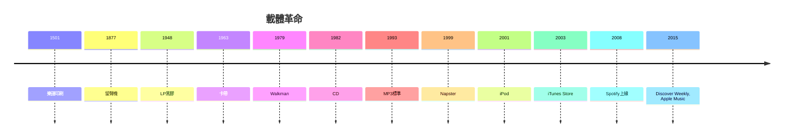

# 10.1 從Walkman到Spotify：載體的消逝

時間：1979年至2010年代

## Walkman：音樂的個人化

1979年7月1日，Sony推出Walkman TPS-L2：一部沒有錄音功能（初期型）、只有耳機輸出的卡帶播放機。當時業界普遍質疑「沒有錄音的隨身聽誰會買」，但Walkman以極佳的設計與行銷（東京街頭的年輕試聽活動）大獲成功。它的革命性不在技術（隨身卡帶機早已存在），而在「使用情境」：音樂第一次可以完全私人化、行動化——你可以一邊走路、一邊被自己選擇的音樂包圍，與周遭世界隔絕。城市成為個人的原聲帶，公共空間成為私人劇院。這是音樂聆聽史上的一場空間革命：從客廳（唱片機）、從汽車、從演唱會，轉移到每一個行走的身體上。耳機從此成為現代人的器官延伸。

## Napster與MP3：產業的地震

載體的下一場革命來自網路。MP3（1993年確定標準，由德國Fraunhofer研究所團隊主導開發）以有損壓縮把一首歌壓縮到原本的十分之一，使「在網路上傳一首歌」第一次變得現實。1999年，19歲的Shawn Fanning與Sean Parker創立Napster：一款P2P（點對點）軟體，用戶可以免費下載任何別人分享的MP3。高峰期Napster擁有近8,000萬用戶——音樂史上最大規模的免費發行。

唱片工業的反應是訴訟：RIAA（美國唱片業協會）2000年控告Napster，2001年法院下令關站。但數位盜版已成為全球行為（Kazaa、BitTorrent、各種檔案分享），唱片銷量從1999年的高峰一路下滑：據RIAA統計，美國唱片業收入從1999年約238億美元跌到2010年代中期的約150億美元以下（以名目計），實質跌幅更劇烈。產業的應對遲緩而混亂：蘋果2001年推出iPod、2003年iTunes Store（99美分一首歌，數位版權管理）證明合法下載有市場，但下載的模式仍舊是「購買檔案」——真正顛覆的模型還在後面。

## 串流：擁有變成訂閱

2006年，瑞典的Daniel Ek與Martin Lorentzon創立Spotify（2008年正式上線），提出「免費（含廣告）＋付費訂閱」的串流模型：用戶不擁有任何檔案，隨時隨地聽整個目錄。蘋果（2015年Apple Music）、YouTube Music、Amazon Music、Tidal（2015年，Jay-Z參與，主打高音質與藝術家分潤）相繼入場。串流的勝出有明確原因：寬頻與行動網路普及、智慧型手機（2007年iPhone）成為隨身音樂終端、演算法推薦（Spotify的Discover Weekly 2015年上線）解決了「聽什麼」的問題。

串流改寫了整個產業的會計邏輯：收入從「一次性販賣」變成「持續訂閱的分潤」（以播放次數計價），音樂從「商品」變成「服務」。這帶來三個後果。其一，單曲與播放清單重新取代專輯成為消費單位（專輯時代的結束）；其二，唱片業收入自2015年起反彈回升（IFPI數據：2022年全球錄音產業收入約262億美元，超過1999年的高峰），但分配極度頭部化——極少數巨星獲得大部分串流收入，長尾藝術家的串流分潤微薄（每千次播放約數美元，需千萬播放才有像樣收入）；其三，音樂的「作品感」稀釋——串流世代聽音樂的方式是「背景化」的（搭配工作、健身、通勤），專注聆聽成為少數人的行為。

## 載體消逝的哲學

回顧這條線：活字印刷的樂譜（1501年）→ 留聲機（1877）→ 錄音帶與卡帶（1960s）→ CD（1982）→ MP3（1993）→ 串流（2008）。載體的物理性一路遞減：從羊皮紙、錫箔、黑膠、磁帶、光碟到「無體」的串流。音樂從「可以觸摸的物件」徹底變成「無所不在的服務」。聽眾的場所也從神廟、教堂、宮廷、音樂廳，縮小到一副耳機裡的私人宇宙。這個趨勢的邏輯終點是：音樂的「物質性」歸零，只剩下數據、演算法與注意力。當聲音徹底成為資訊，下一步就是：資訊可以被生成——下一節，我們面對演算法作曲的時代。

