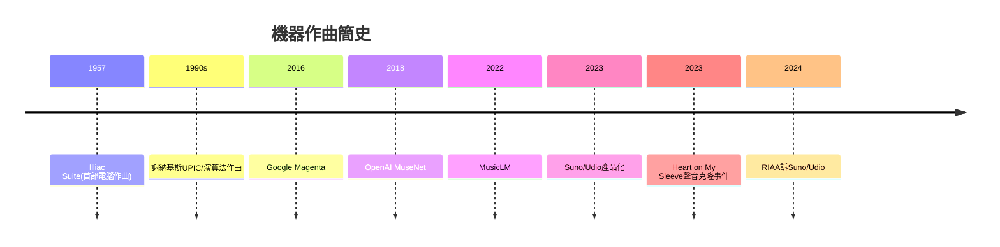

# 10.2 生成式AI音樂：演算法時代音樂家的靈魂

時間：2020年代至今

## 從規則到神經網路

機器作曲的夢想比電腦還老。1950年代，伊利諾大學的Lejaren Hiller與Leonard Isaacson用ILLIAC電腦生成《Illiac Suite》（史上第一部電腦作曲的弦樂四重奏，1957年演出），用的是統計與規則方法；伊恩尼斯·謝納基斯以數學（隨機、集合論、博弈論）設計《Pithoprakta》等作品，並親手設計了UPIC數位合成系統。這些先驅的方法是「人寫規則，機器執行」。真正的斷點是深度學習：2016年Google Magenta專案、2018年OpenAI的MuseNet（以大量MIDI資料訓練，可模仿巴哈到披頭四的風格）、2020年OpenAI的Jukebox（直接生成原始音訊含人聲）、2022年Google的MusicLM（文字提示生成音樂）。技術路徑與圖像生成同構：用海量音訊訓練神經網路，使模型學會「音樂的統計結構」，然後以文字或旋律提示生成新作品。

2023年至2024年，生成式音樂產品化：Suno與Udio以一段文字提示，數十秒內生成完整歌曲（含人聲、歌詞、編曲、混音），品質已接近專業demo；NetEase與騰訊音樂、YouTube（與環球合作）也相繼推出AI音樂功能。生成一首歌的成本從數萬美元的錄音室時程，降到幾乎為零。

## 三個尖銳問題

第一個問題是訓練資料的合法性。2023年起，環球音樂集團（UMG）對Anthropic提起訴訟（指控歌詞訓練侵權），美國唱片業協會（RIAA）2024年6月對Suno與Udio提起大規模版權訴訟，指控其未經授權使用受版權保護的錄音訓練模型——這場訴訟的核心問題（訓練是否屬於合理使用）與圖像AI的訴訟（2023年Getty訴Stability、2023年畫家訴Midjourney）同構，全球法院尚未有終局判決。歐盟2024年通過AI法案，要求披露訓練資料概要；英國、日本的立法路徑各異。音樂產業的強硬態度不難理解：錄音產業剛從Napster的傷口恢復，AI直接威脅的不只是收入，而是「錄音作品的稀缺性」本身。

第二個問題是聲音的「人格權」。2023年，一首以AI模仿Drake與The Weeknd聲音的〈Heart on My Sleeve〉在TikTok與串流平臺病毒式傳播（數百萬播放），環球音樂迅速下架，並公開質疑平臺的責任。這引出一個全新的法律與倫理問題：一個人的聲音是否是可被保護的財產？美國多個州（加州、田納西州2024年的ELVIS Act——以貓王命名，保護藝人聲音免於AI克隆）相繼立法。與此同時，虛擬歌手的商業化早已先行：初音未來（2007年，Crypton Future Media的Vocaloid歌聲合成軟體）讓「任何人都可以為她寫歌」成為一種開放的創作生態（使用者投稿的〈甩蔥歌〉、〈World is Mine〉等歌曲構成一個集體創作宇宙），成功證明「無人類歌手」在情感與商業上都可以成立——這為AI歌手鋪路，也提出了一個微妙問題：當「歌手」是一個品牌與社群的共同創作，「靈魂」屬於誰？

第三個問題是創作的意義。如果一首歌的生成成本趨近零，音樂的價值將重組。歷史提供了兩個線索。其一是攝影的先例：1839年攝影術問世後，繪畫放棄了「記錄現實」的職能，轉而開發機器做不到的表達（印象派、表現主義、抽象）——音樂也可能放棄「以最低成本提供好聽的旋律」（這將被AI全面接管），轉向機器無法複製的層面：現場的身體性（演唱會的集體情感是AI無法生成的）、作品與創作者生命經驗的綁定（一首歌背後的真實人生無法被合成）、以及倫理與署名的承擔（誰為這首歌的意義負責）。其二是取樣與民俗的先例：嘻哈的取樣爭議（1990年代）、巴爾托克的民歌採集（1900年代）都曾面對「誰的聲音、誰的財產」問題，最終在法律與文化上形成了新的規範——AI訓練的爭議，很可能走上同樣的路：技術不可逆，但制度可以談判。

## 三萬年的回望

從賈湖的鶴骨到演算法的權重，音樂的故事其實只有一個母題：人類總是在尋找把「內在的顫動」固定下來、傳遞出去、與他人共鳴的方法。骨笛用氣流與孔位，聖歌用修道院的作息與記譜，宮廷用金錢與體制，浪漫主義用自我與痛苦，留聲機用針與錫箔，搖滾用電與叛逆，串流用數據與推薦——每一次技術躍進都改變了音樂的形態，卻從未取消音樂的根源：一群人聚在一起，因為聲音而感動。演算法可以生成旋律，但「為什麼要寫這首歌」——失去、愛、抗爭、慶祝——仍然只能來自一個活著的人。這個「為什麼」，是三萬年來音樂家真正的稀缺品，也是AI時代最後的疆界。

