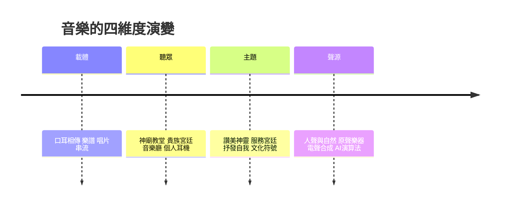

# 音樂的故事：從神聖律動到演算法浪潮的聲響史詩

音樂比文字更古老，比繪畫更無形。它無法保存、無法觸摸，卻貫穿了人類文明的每一個層面：祭祀、王權、信仰、愛情、抗爭與商業。本書沿著四條主線展開——載體與傳播、聽眾與場所、創作主題、聲響來源——從賈湖的骨笛，一路聽到演算法生成的聲音。

## 第一篇：遠古的律動與神聖的秩序

* 第1章-洞穴裡的骨笛與神話之聲
    * [1.1-賈湖骨笛：九千年前的七聲音階](01.1-賈湖骨笛：九千年前的七聲音階.md)
    * [1.2-畢達哥拉斯與天體和諧：音階裡的數學](01.2-畢達哥拉斯與天體和諧：音階裡的數學.md)
* 第2章-教堂的詠唱與五線譜的誕生
    * [2.1-葛利果聖歌：單聲部的神聖秩序](02.1-葛利果聖歌：單聲部的神聖秩序.md)
    * [2.2-阿雷佐的圭多：四線譜與Do-Re-Mi](02.2-阿雷佐的圭多：四線譜與Do-Re-Mi.md)

## 第二篇：人性的復甦與巴洛克的秩序

* 第3章-複音音樂與歌劇的黎明
    * [3.1-帕勒斯替那與複音音樂的黃金時代](03.1-帕勒斯替那與複音音樂的黃金時代.md)
    * [3.2-蒙特威爾第的《奧菲歐》：歌劇的誕生](03.2-蒙特威爾第的《奧菲歐》：歌劇的誕生.md)
* 第4章-巴洛克的建築學與音樂之父
    * [4.1-韋瓦第與《四季》：協奏曲的戲劇性](04.1-韋瓦第與《四季》：協奏曲的戲劇性.md)
    * [4.2-巴哈與《平均律鍵盤曲集》：數學的巔峰](04.2-巴哈與《平均律鍵盤曲集》：數學的巔峰.md)

## 第三篇：古典的榮光與浪漫主義的咆哮

* 第5章-維也納的黃金時代
    * [5.1-海頓與莫札特：平衡、理性與形式之美](05.1-海頓與莫札特：平衡、理性與形式之美.md)
    * [5.2-貝多芬的《英雄》：音樂成為個人意志](05.2-貝多芬的《英雄》：音樂成為個人意志.md)
* 第6章-詩人、琴魔與民族的聲音
    * [6.1-蕭邦與李斯特：鋼琴上的詩人與琴魔](06.1-蕭邦與李斯特：鋼琴上的詩人與琴魔.md)
    * [6.2-柴可夫斯基與德佛札克：民族樂派的崛起](06.2-柴可夫斯基與德佛札克：民族樂派的崛起.md)

## 第四篇：聲響的解構與錄音技術革命

* 第7章-留聲機、爵士樂與不諧和音
    * [7.1-愛迪生的留聲機：聲音第一次被囚禁](07.1-愛迪生的留聲機：聲音第一次被囚禁.md)
    * [7.2-德布西、史特拉汶斯基與荀白克：打破千年和聲法則](07.2-德布西、史特拉汶斯基與荀白克：打破千年和聲法則.md)
    * [7.3-紐奧良與爵士樂：藍調與切分音的基因](07.3-紐奧良與爵士樂：藍調與切分音的基因.md)
* 第8章-搖滾樂崛起與青年文化的誕生
    * [8.1-貓王與披頭四：全球青年的精神圖騰](08.1-貓王與披頭四：全球青年的精神圖騰.md)
    * [8.2-伍斯托克1969：反戰思潮與搖滾黃金年代](08.2-伍斯托克1969：反戰思潮與搖滾黃金年代.md)

## 第五篇：數位時代、流行巨星與未來聲音

* 第9章-MTV、電子舞曲與嘻哈帝國
    * [9.1-麥可·傑克森與MTV：音樂從聽覺走向視覺](09.1-麥可·傑克森與MTV：音樂從聽覺走向視覺.md)
    * [9.2-合成器、取樣機與嘻哈：街頭躍升主流](09.2-合成器、取樣機與嘻哈：街頭躍升主流.md)
* 第10章-串流媒體、AI算力與聲音的終極邊界
    * [10.1-從Walkman到Spotify：載體的消逝](10.1-從Walkman到Spotify：載體的消逝.md)
    * [10.2-生成式AI音樂：演算法時代音樂家的靈魂](10.2-生成式AI音樂：演算法時代音樂家的靈魂.md)

## 核心線索

