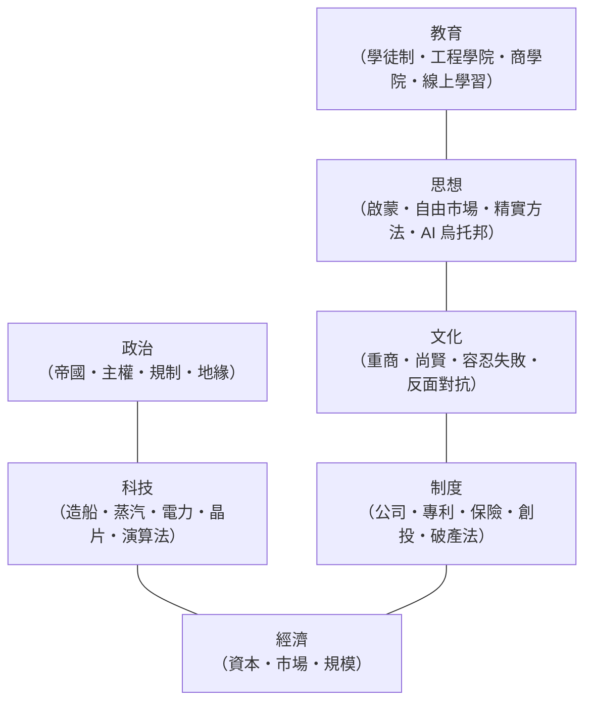

# 前言：人類最瘋狂的冒險——創業精神如何推動文明的巨輪？

## 荒野上的第一個腳印

文明史通常由帝王、將軍、聖人書寫，但真正推動巨輪的另一群人往往只留下商號名稱——他們是**創業者**：把身家性命押注在一個還不存在的世界的人。

本書的主軸是一個簡單而深刻的問題：

> **一個社會要具備什麼條件，才敢讓人去冒那種「賭上全部」的險？**

答案從來不是單一因素，而是一組**互相驅動的系統**：

創業史每一章劇變，都是其中幾條線同時繃緊的結果：**沒有制度，資本不敢下注；沒有資本，技術不肯成形；沒有文化容忍失敗，人才不敢跳出體制。**

## 本書的五個時代，五種「冒險的形狀」

| 篇章 | 時代 | 風險的形狀 | 關鍵發明 |
|------|------|-----------|---------|
| 第一篇 | 古代–19 世紀初 | 一艘船沉了，就是全船家當 | 股份公司・保險・有限責任 |
| 第二篇 | 19 世紀–20 世紀初 | 一座鋼廠倒閉就是全城失業 | 鐵路管理・垂直整合・科學管理・研發部門 |
| 第三篇 | 20 世紀中–末 | 辭掉大公司丟掉金飯碗 | 車庫創業・創投・股權稀釋 |
| 第四篇 | 1990s–2010s | 一年燒光一輪融資 | 流量經濟・平台網路效應 |
| 第五篇 | 2010s–今 | 一個模型訓練費十億美元 | 精實創業・獨角獸・AI 槓桿 |

**風險的絕對量在增加，但制度的進化讓「承受風險的人」越來越安全**——這是創業史最正面的弧線。

## 三條貫穿全書的線索

1. **制度發明的譜系**：股份公司（1602）→ 保險（14 世紀–18 世紀）→ 專利（1624）→ 有限公司（1855）→ 創投（1957）→ MVP（2010）。每一次制度創新都釋放了一波技術浪潮。
2. **資本形態的演化**：家族信託 → 王室特許 → 銀行貸款 → 股票市場 → 創投基金 → 私募獨角獸。**錢敢去哪裡，創業就到哪裡。**
3. **「創業者」定義的擴張**：遠洋船主 → 廠主 → 發明家 → 工程師創辦人 → 程序員創辦人 → 一人公司。**創業的門檻每次下降，人類的創造力就重新定價一次。**

## 如何閱讀本書

每一節都以具體的人、公司與事件為錨，展開四層分析：**事實（發生了什麼）→ 機制（為什麼成立）→ 前因後果（推動它的科技/經濟/制度/文化）→ 遺產（留給今天的什麼）**。歷史不會重複，但商業的結構性邏輯始終押韻。

現在，讓我們從一艘滿載香料的商船開始。

---
[下一節：1.1 絲綢香料](01.1-絲綢香料.md)
