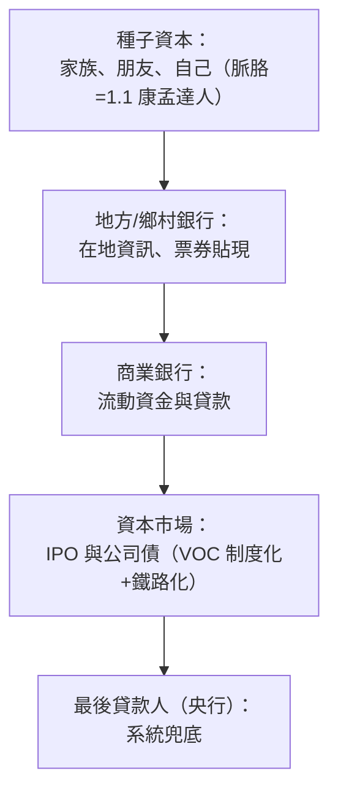

# 2.3 早期銀行體系：資本如何流向敢於下注的實業家？

## 資本的長征：從金匠的保險箱到工業貸款

廠主有了機器與模式，還缺一樣東西：**錢從哪裡來？** 本節追蹤資本供給側的三段進化——**金匠銀行 → 鄉村銀行 → 中央銀行與商業銀行系統**——每一階段都把「敢於下注的實業家」的融資半徑推大一圈。

## 第一段：金匠、匯票與「信用」的人口

17 世紀倫敦：

- 金匠們保管貴金屬，開始**發行可轉讓存條（promissory notes）**——存條在市場上直接流通
- 他們發現不必始終留 100% 金屬——**部分儲備金（fractional reserve）**墮落於發明出來（同樣的 17 世紀荷蘭阿姆斯特丹匯兌銀行最初保有高儲備，以額外勤奮證明其信用價值）
- 匯票（bill of exchange）已經在 14 世紀義大利商人手上誕生，用以跨城結算而無須運送現金——**這是「信用作為貨幣」最早的商業奇觀**；1683 年**以匯票貼現**（discounting）正式商業化

**意義**：貨幣的形態第一次分離出「金屬實物」——**信用可以創造購買力**。這是往後每一波創業資本膨脹的數學前提。

## 第二段：鄉村銀行與工業信用

18 世紀英國地方銀行（country banks）：

- 由**地方布商、鐵商、律師兼營**——他們既知貸款需求也知產業信譽（**「知道借給誰」的在地資訊優勢**）
- **票據貼現 → 定期貸款 → 過渡性流動資金**為工業擴產輸血
- **結果**：1775–1825 年，英國鄉村銀行由 150 家暴增至 700 家，蘭開夏的棉廠、鐵路修築與鋼廠基本由他們輸血——**「金融跟著產業走，而非產業跟著金融走」**（與今天投資人臆想相反：資本供應側通常出現在產業爆發之後）

範例人物必須記錄：**Boulton & Watt 的夥伴 Matthew Boulton** 分身「Birmingham 熱和鐵品商+鄉村銀行主」的雙重身分（Soho 造幣所也供應規格化硬幣）——**產業主自己成為金融中介**，是這時代的典型人格。

## 第三段：中央銀行、商業銀行與「系統性風險」的誕生

- **1694 英格蘭銀行成立**：本質是「政府為戰爭（九年戰來為補給）籌款的特許銀行」——**現代央行誕生於財政需求**，此後它逐漸演成**最後貸款人**（Lender of Last Resort）
- **1825 危機與「最後貸款人」正式確立**：1837 年 Baring 危機、1847 鐵路信用擠兌——**Bagehot 的名言（倫敦經濟學人創辦人 1873《Lombard Street》）**：危機時央行應「以高息，貸予好質押的自由貸」——**這是今天每場金融危機（1929、2008、2020）的劇本初稿**
- **1856 有限公司法**（1.3 已述）與銀行股權結構攜手，讓銀行本身也能規模化圈儲轉借

## 資本流向產業：鐵路金融是決定性一戰

鐵路（3 章主角）在此先種下金融的地基：

- 鐵路是**史上第一次由**股票市場**（而非政府或銀行）**主導融資的巨型基礎設施**——一條主線的資本需求高於此前所有工廠相加
- 英倫 1840s「鐵路狂熱」：議會頒管的鐵路公司 1846 立案超過 600 條——**資本市場第一次成為「產業規劃的替代品」**，規制與垃圾股欺詐同步誕生（1844《公司注冊法》）
- 殷鑑不遠：1847 年的金融危機——**資本市場中型科技大潮的第一次演習**（與 1929 電力收音機、2000 網路、2021 SPA/新經濟的神級排跤結構全同）

## 制度的小結：資本的五層金字塔

到 19 世紀中，英國形成了延續至今的**資本結構**：

**每一層各自發明過一次「資本的勇氣」**——而創業者與資本的相遇，永遠依賴**資訊與信任的結構**（家族的親、地方的知、市場的價、央行的底）。**「如何讓陌生人放心地把錢交給敢於下注的人」**——這個問題的答案在未來 300 年被層層重寫，5.2 的創投僅是它的最新頁。

---
[下一節：3.1 鐵路網大戰](03.1-鐵路網大戰.md)
