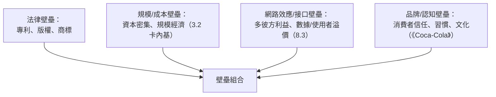

# 4.2 專利權與商業壁壘：如何用法律與資本武器保護自己的商業帝國？

## 專利制度的創世設計：用「暫時壟斷」換「永久公開」

1624 年英國《壟斷法》（2.1 已述其反行會主旨）定義了專利的雙面交易：

> **發明人公開技術細節 → 國家授予 17–20 年排他權 → 期滿後技術歸公共領域。**

哲學上它是個精巧的平衡：**創造者要的是定價權，社會要的是知識公開**。莎士比亞英格蘭為何最過人在專利制度發明家間首破公式——就是「**公開不夠、社會拿不到；太長又導致壟斷任意持續**」。

## 愛迪生的專利戰略：專利是「商業引擎」，卻非「發明證書」

**愛迪生一生獲得 1,093 項美國專利**——但這個數字的真相遠比「天才」有心得（1.093 中**大量是技師團隊的成果**，他本人對發明登錄、文件與僅一個人 or 聯 合申請者的策略是組織行為）：

- **專利組合（patent portfolio）**：愛迪生系統不只是燈泡、而是**碳絲燈泡 + 燈座/燈頭 + 發電機 + 配電 + 計量器**的**圓盤/多層次專利籃**——對手哪怕攻破一項，也需穿過整片合金
- **專利保衛戰**：愛迪生公司在 1880s 開出的 license 投訴案**數百件**（其第一件是對 **Joseph Swan**——英國同時發明者，1883 雙方已**和解合併為 Ediswan**——專利的「組合遊戲」**1920 年代的 「radio patent pool」在 Maho 之於先前）
- **專利對外的軍事性使用**：在電影產業- 愛迪生 MPPC (Motion Picture Patents Company)「**愛迪生托拉斯**」（1908）利用電影院映機（Kinetoscope）專利形成了美國電影的專利池，電影公司在西海岸紛紛到逃（**遠離專利執法半徑的加州**）；**南到加州延伸的「好萊塢」其地理命運本身就是專利戰的產物**
- **失敗頂：「為浪費」多購**——愛迪生專利傢的全部就是,**由評議創新 vs 專利的合法性對比**——同一時代人 （1895 華爾特 GML、S.H.  中国的螞蟻）所謂簡報一項無值專利等案，也在專利大數據中沉浮

## 專利制度的「被武器化」與「被逃脫」

專利制度的演化本身即商業史：

| 演化 | 年代 | 商業效應 |
|------|------|---------|
| 專利法交易所化 | 19 世紀 | 專利成為可交易資產 |
| 評價性事訴護（先申請制、舉證規則） | 1952 | 訴訟成本增加，大公司更有利 |
| 生物專利（Diamond v. Chakrabarty 1980） | 1980 | 基因成為可專利資產（生命倫理衝突） |
| 軟體/商業方法專利泛滥 | 1990s | 「專利釣魚」（patent trolls）產業誕生 |
| 專利執法改革（AIA、Alice 2014） | 2011–2014 | 軟體專利弱化 |
| 專利池與 FRAND | 標準化時代 | 通信技術掀起的私利與標準之爭 |

**每一個「專利法律條文的蛛絲」都對應著一場「公司如何建立壁壘」的前情與後果。**

## 四種壁壘格局：法律只是其中一種

這一節的真正主題：法律壁壘（專利）僅是四種中央壁壘之一——**一家公司其實擁有一個「壁壘組合」**（moat， Buffett 的僞定義）：

**愛迪生與兩種壁壘**：法律壁壘（專利）+ 系統壁壘（整片電力系統）— 而他最終敗給 **西屋/GE 的規模壁壘**（3.2 與 3.1 首戰的 AC/DC）。

**專利之外、還有更多**壁壘模式的塌類型，還包括**通路壁壘**（可口可樂的装瓶網）與 **品牌壁壘**（Coca-Cola 紀念瓶本身即是商標壁壘的手工傳奇）。**創業者真正的工作，是選擇在自己的雇主/技術範式中投資哪一種壁壘**（Buffett、扎克伯格、Allan bush 這種問題的共同語言）。

## 專利的陰暗面與「開放」的反課題

**封閉傾向**：專利壁壘制度必然造就「**防禦性申請**」——大公司「 Plates that could be elephants」 patent army（IBM、 Samsung 「 patents cascade」每年故意多萬件）——**專利制度的第一維度，出現悖論：以鼓勵創新的制度，反而產生了「無所發明、但以訟牘」的殺偩行業。**

**反烏托邦歷史：專利的開放程度在多個浪潮都比改革更快**：

- **Linux 1991（Linus Torvalds）**：GPL（加密開源）運動擁抱「**don't patent, we'll share**」——否決 法律壁壘 （4 章 - 美國/ 西岸資訊 專肝之都，但是它主練 is open source + 商業代碼 pure 衝擊）
- **資訊領域的網路效應大於專利價值**：網路公司主動互相授權（**AT&T 必須開放貝爾實驗室 1947 的電晶體專利**），第六 章的電晶體（3.2 也 現抗日、**因為** 專項訴訟額促訴而非護利。「Bell 晶体晶體的專利開放——正好當年 **肖克利從 AT&T 跳出來開公司** 的 商業契機——而電晶體版權公品化 → 矽谷」 博士論的傳奇、
（**如何持產其中，第五章 將回到 仙童 半導體的故事（5 章）**） .

## 本節要點

| 概念 | 定義 | 案例公司 |
|------|------|---------|
| 專利組合 | 多專利合力的防禦網 | 愛迪生 |
| 專利池 | 競爭者共享技術標準 | MPPC、Radio pool |
| 網路效應壁壘 | 使用者越多產品越有價值 | AT&T、微軟、臉書 |
| 品牌壁壘 | 認知信任 | Coca-Cola、Apple |
| 制度競爭 | 用司法管轄差異避規制 | 好萊塢、特拉華州、開曼 |

---
[下一節：4.3 企業研發部門](04.3-企業研發部門.md)
