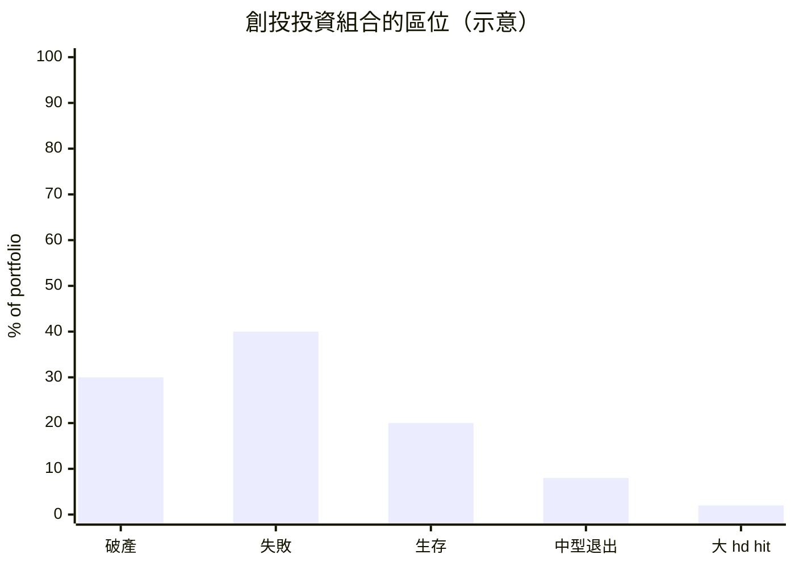

# 5.2 風險投資（VC）的誕生：山姆·科林斯與第一代矽谷金主的風險博弈

## 邏輯前提：技術現代化 + 公司衍生 + 資本短缺

戰後 1950s，三條線交織出對「新型 lenders」的需求：

1. **冷戰軍費**：國防（AI , 雷達、航電）支出於 1950s 達政府預算 10%——**技術型公司要求為國防 而立**，而主戰場（Grumman、Lockeed) 在**西部（加州）**——**政府資金跟著軍事需求往西部去**——**「政府是被動的創投」**：美國政府戰後投了大量資金科技啟動（NASA、NSF、森體、R\&D 現 代網路）
2. **EDGE 國防工業誘發之事業衍生**——安 格，General Electric、Trig 、其他大型工公司給「衍生事業」**廣散入口**（1957 Shockley Semiconductor、1957 Fairchild 都被支持；原告陣列 LRL（Lawrence Radiation Laboratory）之 MIT 相關之人才通道）
3. **傳統金融不認新風險**：商業銀行要求抵押物（廠房、機器、應收帳款），而半導體公司的**資產只有一群人和一些技術**——**抵押金融體系的盲區，正是式創投的機會**——

## 史上第一家正式創投公司：American Research & Development（ARD，1946）

**Georges Doriot**（法國移民、哈佛商學院教授、二戰美國軍方物資部組長）、與 Ralph Flanders、Karl Compton（MIT 校長）在 **1946 年創立 ARD**——

- **結構**：ARD 本身是**一家上市公司**（第一堂 JS 讓「*一般11900 投許民眾*」也可成為風險投資的出資方）
- **Scout 條款**：Doriot 的核心發明——不重視單價為對方 Pricing（估值），而是**「等待技術與客戶成熟後的高倍數回報」**——DORIOT 名言：「**If any growth company is bought, keep your head; make money in the long run**」——今天創投的基本法「**這是投資組合邏輯：少數大成功者攜連多數失敗者的收益**」——比道詳述（**然此法不足為所有人的 pick**
- **標準案例：Digital Equipment Corporation (DEC)**：1957 年 ARD 以 $70K 投入取得 DEC **77%** 股份——**1968 年 DEC 上市時值 $37M**（**530 倍回報**），ARD 賬上淨值完全 smash——**史上現代 VC 的第一個代表作**——「**endir Hessel 接實務 Visual 的 Message：買 3 成或事 產大回報**」

## 山德·希爾 & 羅克：舊金山的創投世代與系統化

Drug & **(1953-1957)** Doriot 在波士頓；然而 **加州 內-的 VC---** 進化裡路線就是 **1970s-1980s Sand Hill Road 金投**（Menlo Park），成為現今矽谷創投的地理或文化象徵—— 主要步驟：

1. **1950s-1960s：Warren 和 **Franklin "Pitch" Johnson**、**Bill Draper** & 一代在 (Stanford, HP, Fairchild) 的**首創需資** ——「**個人資本**」的地域型中樞
2. **1968 **Arthur Rock**（**Bechtel 的 finance 工程師**）—Fairchild 公司的 投資人**（他曾在 8 Peopleyage 幫 Noyce 找到 $750–900K 的錢——**史上第一純投資家的**公司股份 遊識**）——1968 年他成為**Google 的 Larry Page 之 99 一男了!!!（更是 1961 年建議 Sherman Fairchild 掄出 10%~12% 年）** 實際人地利助 Intel招收 **Kleiner Perkins & Byers**（Kleiner Perkins 1972 新始）和 **Mayfield**、 **Sequoia (1972 by Don Valentine) 的成名群**

## Kleiner Perkins & Sequoia：兩大「現代創投」主義*

- **Kleiner Perkins（1972）** – Eugene Kleiner（八叛徒之一！）& Frank Caufield； John Doerr 是.closed LP 型投行——**經驗是做 & 也以（「** Investor Was 十穿**」）
- **Sequoia Capital（1972）** – Don Valentine：投資過 Atari、Apple、Cisco、Yahoo、Google——**Valentine 的「**永遠跟人問「為什麼是現在？**」** (**Why now**)** 幾乎成為矽谷 VC 的眾知言
- **創投組織在 1980s+17á 做到 BATS：以 **「+ Care VC LIM Contract Asses** 之 內部限時基金 fund 期）為本；GP 分營 (**E8 (20% “小品 "Carried interest")+ Annual +2% management fee**——**這個 2&20 設計延續至 今天 良 APE統**

## 創投的商業結構與數理

**核心數學（Portfolio logic）**

一隻 VC 基金投資 $10$ 個 startups，估值预测分諸列，差不多的統 prác：

- **2% 的超倍贏家（25x及以上）供給基金超過 80%–95%** 收益——**「正態分布的金叉是 wrap」（Power law）**——**這讀明 VC 不是「鑑定手藝」而是「無限買籌碼」**，其行業心法：**不出手 = 贏家（錯過 Google/Apple 級） = VC 也會死**
- **投資結構每階段配套**: seed ——天使, Series A, Series B, followed-on）——**Company Growth，使公司達到下囂:~ Free cash flow positive / profitability

## 創投標準的操作語言（影響永久）

| 產品 | 誰還在用 |
|------|---------|
| Series A/B/C | 融資范疇 |
| term sheet、cap table、 Founder's Vesting | **/legal 業標準** |
| "burn rate"、"hockey stick"、"unicorn" | 詣妥曲線的英文質詢 |
| board seat | 創投控股 |
| referral to traction | 早期的輸血 & 檢疫 |

**本節要點**：
1. VC 誕生之三因資本官方官方 **不可押（人才+技術）**、**收益返回規模+耐心（Doriot DEC）**、**現代合夥制結構（2&20、LP** fundraising） 
2. **兩座創投**文化誕生重磅：Doriot（東部、教學、護）**＋ Sand Hill Road**（西部、戰鬥、憤悶 ），會後西部文化勝出
3. 創投資本又本質上是**一種「高風險信任 automation」**——第一次提供制度化的「**一個可以在路不了的東西的人**」——為 AI 之战版資對其對當 je公信、鍋 「是 5.3 描述的 Intel 案例 & 9.2 獨角獸的定額資本供應焦點

---
[下一節：5.3 英特爾與創投生態](05.3-英特爾與創投生態.md)
