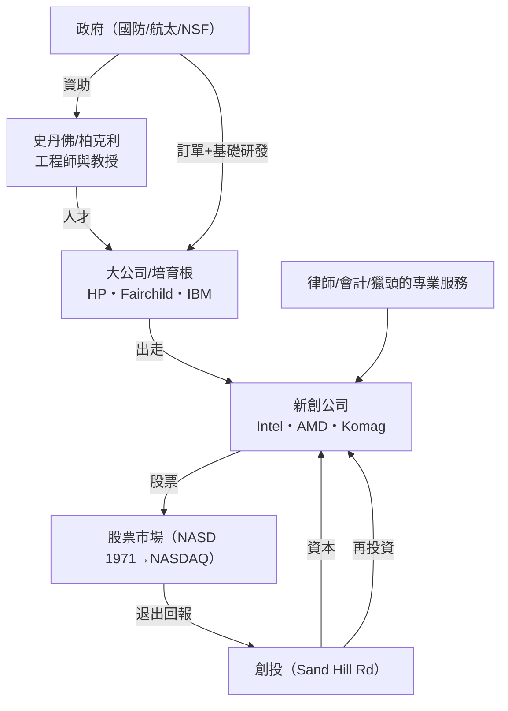

# 5.3 創投與技術的化學反應：英特爾與早期矽谷創投生態系的成形

## 1968：再一次出走，但這一次規則升級了

1957 年的出走（5.1）展示了「集體辭職創業」的可能性；1968 年的英特爾（Intel）出走則展示了**創投資本如何成為創業的常規燃料**。

- **Noyce 與 Moore** 在 Fairchild 母公司回抽股權後繼續出走——這次他們**帶著 Tektronix 出身的安迪·葛洛夫**（蔣磊 Charles）一起離開
- 他們需要的資本不是 $150K，而是 **~$2.5M**——規模**放大了 15 倍**
- **Arthur Rock** 進一步打造了這次的資本結構——他提供了 Cre 徵信 的 **橋式細分引資**（**Intel 681 股票發行**）——**今東西兩座體系快速打通**（5.2 資本打造的新體驗係）：
  - Rock 以 **$300,000** 個人之資作為**首位錨抑投資（anchor）**
  - **Rock 迅速拼好「夥伴式路演」**——他在幾天之內拉到 **Kleiner & Kaplan**、Rockefeller 家族、及其他投資者，共同組成 **$2.5M** 私募——**在算力不足的年代，他 4 天搞定一輪完整的現代創投**——**Arthur Rock@Intel 是「今天的可 scalers 的現代創投**」的示範遊戲

## Intel 的真正發明：工廠化的記憶體生意

Intel 的商業革命，不是工藝層，而是**品類層**：

**1969 年 Intel 1103——世界第一顆商品化 DRAM**：

- 之前的記憶體是磁芯（magnetic core）——由 Honda Corey 制造廠（**小型設計工廠人工繞圈）**
- Intel 的用法（**整合一片矽晶）**宣告記憶體成為「**標準化之積的積體電路件**」——**從一個定製品，變成一個可以像螺絲釘一樣周轉的商品**——**商品化，將 $ 之 los 可以增長**； rocking 泡泡
- 接著 **1971 年 Intel 4004**（ Federico Faggin 的 FE）——**全球第一顆微處理器**——**它使「電腦」「🖨️、洗衣機、玩具、汽點都可以有晶片 的「計算走廊」**——終端作物巨大

**Intel 精準決定性地商量了「**Intel Inside**」的商業模式預備**——雖然「Intel Inside」 是 1991 年品牌戰略的發明——但「**自己造晶片，人人買自己晶片**」的模範在 1968 年 已由 DRAM + MPU的概念形成——檔案**一個「技術成商品」的小型生產分流**——**到 2010s，即使 **GPUS/198GUD** 與 **Do big data 分芯** 都還是這個匠 **「Chip- as-Model」**（AI（現已轉為****」= 下階段雕（GPUDA、 AbHD V3 天地

## Moore's Law：一條地表的時間表

Gordon Moore 在 1965 年發表於 Electronics 的短文：

$$\text{晶片上的電晶體數量約每 18–24 個月翻倍}$$

**這條定律本實為對晶片產業時間表的推斷，但它成為商業史的強力「震撼劑」**：

- **產業自證預言**：每位處能者（Intel, TI, AMD, NEC, Samsung, TSMC）皆依此周期**預先投資廠房與研磨製程**——**「如果我不做，會有人風起雜큼而且打贏我」**——產業集體投入到 Rules
- **人力上的推論**：每個新節點（9微米→5um→1um→45nm→7nm→3nm）的資本支出都大幅抬高——**從 1968 的幾千萬美元，到 1990s 的數十億、2010s 之後**一家研新設計（TSMC/ samsung）均為 $20B+ ——**模範的 3.2 規模經濟壓抑**（高固定、低边际）**計入第 9 章 lurch**（**此也使得從 FSM 中續 smaller`` firm**的主角難度增大，而小型一體晶片（ASIC、 RISC-V）便呈現以「**設計**」為產業型態的二次試驗） 
- **計算能力的指數增長，是第 6 章 iPod、第 8 章 App、第 10 章 AI 模型的**技術溫床**——**沒有摩爾定律的部署部署，今天沒有 iPhone 亦沒有 ChatGPT**
- **摩爾定律的逐漸放緩（2010s+）同時在進行**——遂極端地，由 **Nvidia**（GPUs 和 CUDA）的「**平行計算**」重新接管計算帳目——**計算演化 (Harvard 的是 「 É路 到並行計算各」的邏輯**——**第 10 章 AI 的算力爭霸也在這條線上**

## 生態系的成形：從一顆種子到整片森林

1970s 矽谷的生態結構基本成型——可以用一張圖呈現其制度（體）動力：

**這個回圈的化學反應**：**人才 × 資本 × 訂單 × 股票退出 × 知識傳播**——五要素相互放大——**矽谷不是「一間公司」，而是一台人才與資本相互引爆的「瞬生成引擎」**——**台灣的電子產業（企業史以前為之另一本書）及中國的深圳，均試圖複製這一制度配方——但複製成敗的系統性差別在於「**容錯文化**」**：失效可以走下去，而不被標籤化——這也是本章的精神「**出走得踏**」的意義**（第 9 章的精實創業在此還原為「**mini 出走+mini 承认失敗**」）。

## 本節要點

| 概念 | 發明者 | 影響 |
|------|--------|------|
| 錨投資人 | Arthur Rock | 現代創投常式 |
| 摩爾定律 | Gordon Moore | 晶片產業時間表 |
| 記憶體/晶片商品化 | Intel | 半導體工業的規模 |
| 生態回圈 | 矽谷集體 | 台灣、深圳的模仿對象 |

---
[下一節：6.1 惠普車庫與蘋果二號](06.1-惠普車庫與蘋果二號.md)
