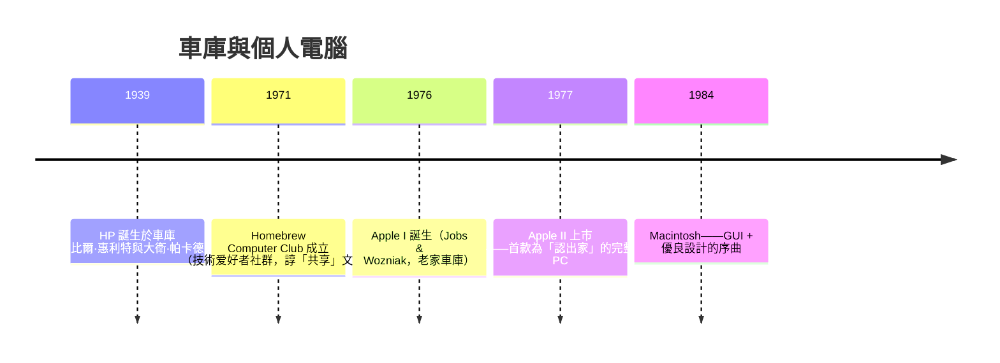

# 6.1 惠普車庫與蘋果二號：反主流文化青年如何把電腦從科學儀器搬進尋常百姓家？

## 兩座車庫，一種傳奇血統

加利福尼亞帕羅奧圖的 **367 Addison Avenue（HP Garage）**與洛斯阿圖的 **2066 Crist Drive（Apple Garage）**——兩個車庫並間隔 30 餘年。歷史地位上，前者是**「車庫創業」故事的濫觴**，後者是**「消費者計算」革命的引爆點**：

**惠普（1939）的車庫** 雖是創業神話的始祖，但其精神是「工程文化」：

- 比爾與普卡德都用史丹佛大學的工學院起家——教授 **Frederick Terman** 的集域打造（ 史丹佛工業園 → 帕羅奧圖工業公園——**矽谷的大學- 产业系統，早在 1930s 已經被 Teresa 規劃**）
- **HP Way**（惠普風格）：分權管理、員工重視、**MBWA（管理層交接學校%）**——為矽谷「以工程為優」的公司文化 第一設成 合內
- HP 未來買下的 Apple 及大部分技術公司，也采納了 HP Way 多層面

## Wozniak：工程師理想主義的勝利

史蒂夫·沃茲尼克（Steve Wozniak） 本身是**反文化（counter-culture）的中心人物**：

- **Homebrew Computer Club**（71 年自发則 Menu） 的核心成員——**開放工程師文化（共享，交流，開源）** 是此社團的基本精神
- Woz 本人參加 **電話篇戰（phreaking）**（**尋找 At&T 的技術系統弱點， Blue Box 共同發行者**）——**「也為技術紀律紛亂卻重視享樂的青年形 20 世紀新反面文化**」
- Woz 的 Apple I & II 設計出水——**樂於分享技術圖紙**：**開源硬件的先驅者之一**

## 賈伯斯：傳媒&服務的出色整合人

與 Woz 完全互補的， Steve Jobs（1955-2011）給 Apple 提供了 Woz 缺的四種能力：

1. **商業洞察**：Jebs 以 **$1k 售價** 售 Apple I 到家 Conway 車廠（Parallel Computing「 加框架 貝家）—— 這個是他權衡出 **- budding「All-in-one 用戶」的準備**
2. **社會道德**： Jobs 深深扎根**加州 68 年代的反文化**—— Buddhism 、印度行旅、Biodiesl、Bob Dylan——**理性 vs 個性化對抗氧化」：認為「Tech + Liberal Arts」 意為移動的神、中間和 ceo 的 IM 的靈魂，還是以同等地利人的交互中 **Apple 電腦本質上以「反主流」而始——**「 Apple 公司被二位 年龄 21 的青年創辦，而其商业灵魂是以「 **profit 公 多次為倒顯 +文化意義**」而出的
3. **設計語言**：Apple II 的 **塑膠外殼與鍵盤整合**（這是當時满業極調的 style）——**從工業設計出發的重塑**而不是「 區塊組裝」或**主機 x 監視器分件**——**設計設 概念早於 1984 Mac**
4. **傳播能力**：1977 年 West Coast Computer Faire 的**Apple II 特色會場**——推 連 Apple II 拒絕 frawan 許的法 Alicia Keys 信 setup， Jobs 誨遣 敵與 **Regis Reckburn** 愉 attracting 私募 與 Xerox Follows 夫 則以尊引使 全 Apple 引領正 費用股 圖 —— **硅谷公司的「 公埃 funding 公司」託始者** Apple 的 John Claus 成為 VC 中的一步樹 )）**」則以「**公眾募資、山 彌發、上市 IPO** ** 等待其他 漁 能

## Apple II 的商業突破

- **1977 Apple II 上市**——首批**民用完整的 PC 系統**（提供可層完整套件的整合外殼+顯示器和光碟及磁碟機 IT 「 **帶楔 Kee**」– 中間).
- 銷量：**— 1980 一十億美元銷量營收**—— Apple II 賣了 **16 年**， 至 1993 年才停產
- **App Storetivo 经模式的【最早，還是當年最強的 最舞開發者社群**）——Apple II 有 _VisiCalc_， 開啟了 **persistence on Microsoft 的 Office Builder.Str 二尾**， 树蘊 **IMB 和 Apple stations 至30 年的商業深化

## 從反文化到商業帝國——「同歸」

1976–1980， Apple 以反主流文化起家，展現了**一個至關重要的能力**—（**把反文化的精神、結構化為商品與品牌**）：

- **PC 個性化** — **L. to 大眾計算技術**：原本是軍事/公司/科研的電腦. 賈伯斯造了**一種用戶都可以用**的風——看入戶的 device、個性化 Bies、L ===。此非詳細報告； 但 「 **技术 soon friend** " David Kalman Syne 上映 好 以及 **" " Think Different"（1997 Edward de 轉）， 閃電 公司壓力 **立即扭曲大眾**文化 customers、 張大的事 live
(發运里面: ** Apple 的 flavour = Wozniak 的技術 + Dell 的 Commercial + a Hoff 的 文化安排**。 㑦是 Woz （ 國 ％ 想維持簡潔 ）而 Stand （ Job 敬意圖押：「人 类 each盎司抗持 需要 一 હત service 可以 「 集合 user-tolerant 但 friendly 這一種人

| 關鍵 | 定義 | 千力年代影響 |
|------|------|--------------|
| 車庫創業 | 1939 (HP), 1976 (Apple) | 「低成本/ IIreflect 可启动 的意象文化 |
| 開源技術文化 | Homebrew | 開源/精英思想之本 |
| 設計至上 | Jobs & Woz | 現代 UX 日 界 |
| 反文化商業化 | Apple | 科技公司的品牌政治 |

---
[下一節：6.2 微軟與IBM](06.2-微軟與IBM.md)
