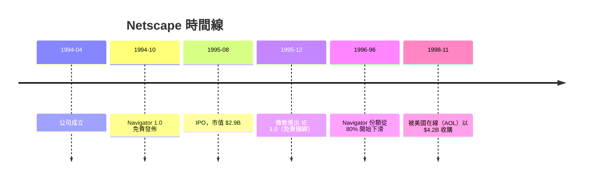

# 7.1 1995 年網景上市：一個沒有營收卻市值驚天的網路神話

## 網景：16 個月從零到 IPO

**1994 年 4 月**，22 歲的馬克·安德森（Marc Andreessen，伊利諾伊大學 NCSA Mosaic 瀏覽器的主要開發者）與矽谷創業家**吉姆·克拉克**（Jim Clark，SGI 創辦人）共同創立了 Mosaic Communications，後更名為 **Netscape Communications**。

- **安德森**：技術天才，親手寫出讓普通人第一次「逛網站」的瀏覽器
- **克拉克**：出資約 $4M 起家，並引來 **John Doerr**（Kleiner Perkins）的創投支持——**典型的「連續創業家 + 天才工程師 + VC」三位一體**（5 章確認的矽谷配方）
- **1994 年 10 月**，Netscape Navigator 1.0 發佈——**對教育與非營利用戶免費**
- **1995 年 8 月 9 日上市**：距公司成立僅 **16 個月**，定價 $28、開盤 $71、市值一度 $2.9B——**一家上市時幾乎沒有營收的公司，估值超過兩家百年老牌銀行**

## 免費瀏覽器：用「入口」換「市場」

Netscape 對個人用戶免費，但其商業邏輯極為精準：

1. **瀏覽器免費 = 搶佔「上網入口」**——誰的瀏覽器被裝得越多，誰就定義網路的使用方式（HTML/JS 等標準的演進）
2. **真正的收費對象是企業**——Netscape 靠銷售**企業級伺服器軟體**（Web Server、安全套件、目錄服務）賺錢——因為企業想建網站，就需要伺服器端產品
3. 這就是**「免費試用 + 企業付費」**模式的原始版本——今天 SaaS 的「freemium」、**Google 免費搜尋 + 企業 G Suite** 的結構，都是同一邏輯

**免費的戰略意義在於「把非消費者轉為使用者」**——這是 20 世紀零售價格戰從未做到、網路時代卻天然成立的新遊戲規則。

## 「網路神話」的心理意義

網景 IPO 的文化意義遠大於財務意義：

- **確認了「網路是一個新生產業」**——1995 年前，網路只在學術與技術圈存在
- **證明「無營收公司也能上市」**——打破了「先盈利後上市」的鐵律，**直接催生 1996–2000 年的 dot-com 春潮**（Amazon 1997 年上市時虧損、Yahoo 1996、Priceline 1999……）
- **把「技術公司可以指數增長」寫進了大眾投資心理**——**NASDAQ 成為新的黃金場**

## 隕落：三大致命傷

網景之死是**一本完整的教科書**：

1. **微軟免費捆綁**（IE 隨 Windows 內建）——**「作業系統 + 瀏覽器」的捆綁策略**讓 IE 在兩三年內從零增長到 90%+。微軟在反壟斷訴訟中失去信任（1998–2001 美國司法部控告微軟捆綁瀏覽器），但**市場份額之座已經易主**
2. **營收結構脆弱**——網景企業伺服器市場被微軟（IIS）與開源（Apache）**
3. **衝突無序**——1998 年網景開源瀏覽器代碼（**Mozilla 專案**），但組織早已失去工程人才與市場動能

**1998 年被 AOL 以 $4.2B 收購時，網景已無力回天。**

## 遺產： Firefox、Web 標準、以及一場重要的爭議

網景失敗，但她生了三樣永不停息的孩子：

- **Mozilla / Firefox**（1998 年開源的 Netscape 瀏覽器代碼 → Firefox 2004）——「**開源瀏覽器對抗壟斷**」是後續二十年的主旋律
- **Web 標準**（HTML / HTTP / JavaScript）——網景迫使整個行業共同走向標準化
- **「免費 + 平台」模式**成為整個網路經濟的商業基礎（Google、臉書、Spotify 都由這條路出發）

**大歷史位置**：網景上市 **16 個月**就完成了不可思議的市值躍升，證明了**「入口即帝國」** 的網路商業律——但也揭示了它的**軟肋**：

> **入口的護城河，依賴的是「使用者習慣」與「市場技術速度」——而不是傳統的資產（廠房、原料、專利）。**

**入口的護城河極為脆弱**——這正是第 8 章（社群、行動互聯網與平台）的核心問題。

---
[下一節：7.2 泡沫破裂](07.2-泡沫破裂.md)
