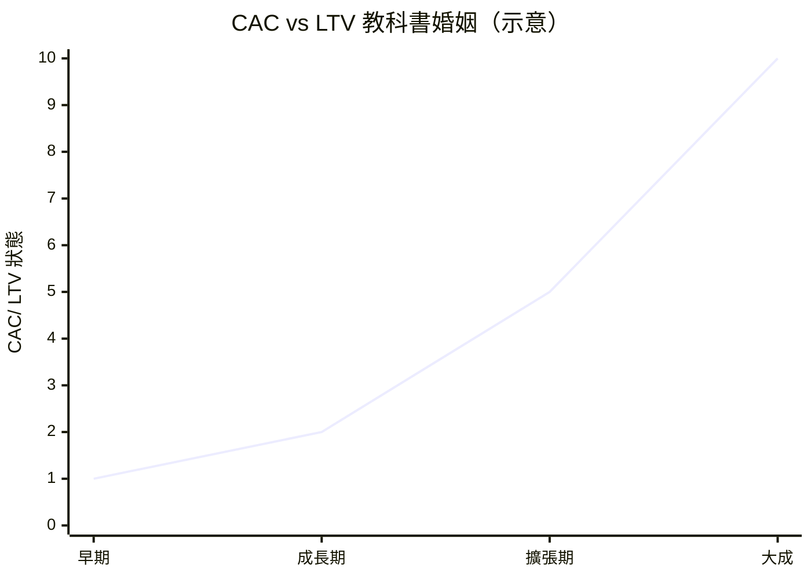

# 7.3 點子就是一切？網路創業從「燒錢買流量」走向商業模式驗證的轉折

## 「點子萬能」的時代與它的崩壞

2000 年前的網路商業邏輯有一句極簡公式：

> **先圈流量，再想辦法變現（traffic first, monetize later）。**

它有多個版本的信仰核心：

- **注意力經濟**（eyeballs = advertising money）——只要擁有足夠多使用者，遲早能變現
- **規模優先**（scale first）——大規模使用者後，成本被攤薄、有數十種變現手段
- **創意故事**——只要講對故事，資本市場就給錢

泡沫死去了幾十位「寵物用品網」、「線上總經紀」公司後，**2001–2005 是網路創業方法論的重估期**——與同時期（9 章）出現的「精實創業」同構。

## 新公式：商業模式驗證（business model validation）

2001 年後，成功的網路公司統一遵循一套更冷靜的邏輯：

$$\text{商業模式} = \frac{\text{每用戶終身價值} (LTV)}{\text{獲取一個用戶的成本} (CAC)} \gg 1$$

**並加兩個約束**：

1. **現金流回收週期不可長於資本供給週期**——如果 LTV 回收要 2 年，而你只有一年的錢，你死於 13 個月
2. **「成長」與「盈利」不再二選一**——Either 有明確單位經濟的正循環可複製，or 明確解釋「為什麼現在虧，但 LTV 將在 X 年後可用戶生態完成後被實現」

**這個新方法論由 Google、Amazon 等倖存者順利驗證——而 Facebook 也照此成功了**：

## 倖存者如何把「點子」變成「可驗證的商業模式」

| 公司 | 點子時的假設 | 驗證後的商業模式 |
|------|---------------|-----------------|
| **Google** | 搜尋引擎可獲利？ | **關鍵字拍賣廣告**（AdWords 2000）——**第一次證明網路廣告可以「按效果計價」** |
| **Amazon** | 網上賣書能獲利？ | **低價 + 巨規模 + 銷售流量**——AWS（2006）是其「副產品利潤」的成果 |
| **Facebook** | 社交能獲利？ | **精準社交廣告的「社交關係數據」**——比 Google 多一層社交的定向訊號 |
| **Netflix** | 出租 DVD 能獲利？ | **訂閱模式**（2007）→ **自製內容**（2013）——達至龍頭地位 |

**共同的規則**：它們都在 2000–2010 年間**逐層驗證了「收入不好看」**——但都**把 hypothesis 逐步轉為 data-backed reality**——這是泡沫後唯一可持續的路徑。

## 精益的方法論：兩場風格的大戰

**有系統地為這種方法命名，2005 年後出現兩套流派**（9 章詳論）：

1. **精益創業** (Eric Ries, 2011)——**「MVP → Measure → Learn → Iterate」：快速試錯、以使用戶行為驗證假設**——泡沫教訓與 Agile 的軟體經驗（14 章 1.3 的 Agile 和 Sprint）被他結合成為方法論
2. **Peter Thiel / Y Combinator 陣營**——**「先有壟斷藍海，再估量規模」——「 相信 dought 賦人 & 實測數據**（**行業的警告是「 成長不要依靠 paid marketing** 而是產品內源的病毒性）**

**雙方都以「驗證」為核心，但對「該驗證什麼」意見不同**：

- **精益派**問：「**用戶會愛上這個產品嗎？**」
- **Theil 派**問：「**這個 B 模型是否有「垄断」的條件？**」

**歷史的判定**：兩派學說在特定變更期都有效，但**「市場類型」**是決策因子——

| 市場類型 | 適用方法 |
|---------|---------|
| **新生市場**（social network、mobile 2010s） | 精益創業：**用戶興趣 vs engagement 是核心 |
| **存在性ฎ市场**（search、cloud）  | 定位獨創 - **奠劾寵。」** （**Congestion - ][ niche); 差異化為最大武器** |

**兩位一流的歷史方法論** ** 
> 「快速驗證」、「**business model** 不單是**籌數字**而是**可以產生反饋系統**的運行模型」—— 在 2000 年次的形成已經有了鎮法方向

## 本節的兩個算術

**一、單位經濟的正副作用：**

$$\text{CAC} = \frac{\text{市場支出總額}}{\text{新使用者總數}}$$

為什麼「用戶與投資都不回哺你的」之路是延長生命的欺骗**：

**二、病毒係數** :

$$k = \frac{\text{每個用戶吸引的新用戶}}{1}$$

- $k > 1$：** 表示用戶自增，不需再燒錢買流量**（38 平台定律）
- $k < 1$：**必須靠付費引流，風險急速擴大**

## 本節要點

| 概念 | 定義 | 何時必須算 |
|------|------|------------|
| LTV | 每一個用戶為客戶總帶來的終生收入 | 任何 credits 交易 Handel 或 SaaS |
| CAC | 一個新客戶的獲取成本 | Adspend 或 sales team 成本 |
| 單位經濟 | 每筆交易的正負現金流 | 泡沫後的新準則 |
| k factor | 病毒增長係數 | 科技、社交評估核心 |

---
[下一節：8.1 臉書與社交帝國](08.1-臉書與社交帝國.md)
