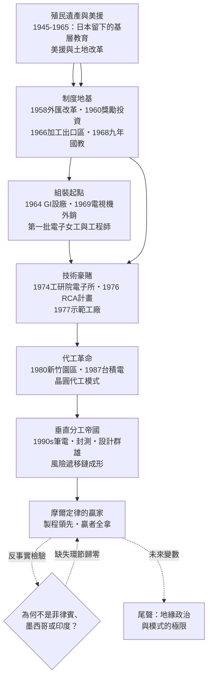

# 01.1 核心謎題：無資源小島為何成為全球電子中心

## 案情

1945 年的台灣，是剛脫離日本殖民、飽受戰火轟炸的農業島：沒有石油、沒有鐵礦、沒有矽礦，電力設施半毀，識字率雖然不低但高等工程教育近乎從零開始。以任何一本發展經濟學教科書的檢查表核對，這座島嶼都不該與「高科技」三個字有任何關係。

然而八十年後，全球先進晶圓代工九成以上的產能在這裡，封裝測試過半的產能在這裡，從晶片、面板到筆電的供應鏈在方圓數百公里內閉環。這不是一份產業報告的開場，這是一樁懸案。

本書的偵查立場由此確立：**我們不問「台灣為何會強」（那是人人都會強的問題——勤奮、教育、後發優勢，每個成功經濟體都能說一遍），而問「為何偏偏是台灣」**。反轉問題之後，答案不再是列舉美德，而是尋找一連串特殊事件與體制的串聯——找出那些缺一不可、且恰好只在此地齊備的環節。

## 前因：案發現場的三個反常細節

把鏡頭對準 1945–1973 這段「前傳」，現場有三個反常：

**第一，台灣的每個「優勢」單獨拆開來，都不是台灣的發明。** 加工出口區這個制度是台灣首創，但出口導向工業化本身南韓、墨西哥都在做；IC 技術來自美國 RCA；資金來自美援與外銷外匯；人才出自留美工程師。台灣像是把別人的零件重新組裝，卻組出了一台別人都開不動的機器。

**第二，同時期起步者眾，抵達終點者寡。** 1960 年代設立加工出口區、承接電子組裝的國家不只台灣：菲律賓、墨西哥、印度都試過。半世紀後，只有台灣與南韓爬上了半導體的階梯——而台灣走的還是南韓沒走的路：不做系統品牌、不做 IDM，只做「專業代工」。

**第三，升級的路線幾乎沒有先例。** 從收音機組裝到晶圓代工，中間隔著封裝、設計、製造三道技術鴻溝，每一步都沒有教科書保證能跨過。1974 年政府以一千萬美元賭一個 IC 計畫時，這座島的人均 GDP 還不到當年美國的十分之一。

## 線索與推理：全書核心公式

本書的偵查結果，可以寫成一條連乘公式：

$$
\text{台灣模式}=\underbrace{\text{地理與人才}}_{\text{留美工程師回流}}\times\underbrace{\text{政策設計}}_{\text{加工出口區}\cdot\text{工研院}\cdot\text{科學園區}}\times\underbrace{\text{技術移轉}}_{\text{RCA計畫}}\times\underbrace{\text{垂直分工}}_{\text{專業代工}\cdot\text{風險遞移鏈}}\times\underbrace{\text{摩爾定律}}_{\text{贏者全拿}}
$$

**這是連乘，不是連加。** 任何一項為零，積便為零——這正是「缺一不可」的數學表述：

$$
P = g \times p \times t \times v \times m, \qquad \exists\, x_i = 0 \;\Rightarrow\; P = 0
$$

五個乘數各自的案情如下，也是全書各章的偵查地圖：

| 乘數 | 內容 | 本書主要偵查對象 |
|------|------|----------------|
| 地理與人才 | 太平洋航線樞紐、留美工程師回流 | 1950s 留學政策、新竹園區選址 |
| 政策設計 | 加工出口區、工研院、科學園區 | 1966 高雄 EPZ、1973 十大建設、1980 新竹 |
| 技術移轉 | RCA 計畫——史上最划算的技術授權之一 | 1974–1977 電子所計畫 |
| 垂直分工 | 專業代工與風險遞移鏈 | 1987 台積電、1990s 筆電代工 |
| 摩爾定律 | 技術週期快到只有專業分工能跟上 | 台積電的製程競賽 |

注意乘數之間還有**互相驅動**的關係：美援（金融通道）養活了土地改革（制度通道），土地改革釋出的農村青年進入加工出口區（經濟通道），家電外銷賺的外匯支付了 RCA 計畫（科技通道），工程師回流又倚賴九年國教與大學擴張（教育通道）。沒有任何一條通道能單獨運作。

## 全書因果鏈總圖

## 理論：偵查方法的說明

本書借用兩套工具。其一是金觀濤式的「理論—實驗—技術」迴路：科學指導實驗、實驗催生技術、技術反哺科學，迴路在哪裡閉合，工業化就在哪裡起飛。台灣的特殊處在於，它不是自行閉合迴路，而是**把迴路的外包做到極致**——研發外包給美國客戶與矽谷，設備外包給應材、艾司摩爾，但把迴路中「製造」這一環的規模與良率做到無人能及。

其二是連乘模型的量化直覺。若每個環節的「兌現率」是機率性的，長期結果是：

$$
\mathbb{E}[P] = \prod_{i=1}^{5} x_i \quad\text{vs.}\quad \mathbb{E}[\text{連加}] = \sum_{i=1}^{5} x_i
$$

連加模型裡少一項，總分還有八成；連乘模型裡少一項，總分是零。這解釋了為何照抄台灣的國家這麼多、成功的這麼少——多數國家抄的是「加了什麼」，而不是「哪些項一個都不能少」。

## 後果

第一章的時間範圍止於 1973 年石油危機前夜。此時台灣還沒有一座 IC 晶圓廠，但偵查已可確認：地基已澆灌完成。土地改革造就了小農社會的均等與教育投資意願，美援支撐了匯率與基建的穩定，九年國教供給了第一批工業勞動力，GI 與加工出口區帶來了第一批電子工人與品管知識，電視機外銷累積了第一批外匯與零組件供應鏈。1974 年那場一千萬美元的技術豪賭，賭注早在此前二十年就備齊了。

## 反事實

- **若美援 1950 年代就停止**：外匯見底，土地改革難以用實物債券和平推動，加工出口區不會有起步資本——乘數一歸零。
- **若台灣維持進口替代路線**：島內市場五百萬人，家電工業達不到學習曲線的臨界產量，無從累積外匯與中階製程能力——乘數三、四歸零。
- **若沒有九年國教**：加工出口區找得到廉價勞工，卻找不到讀得懂作業手冊的品管員，更找不到二十五年後的工程師大軍——乘數二歸零。

三個反事實任何一個成立，1945 年那座農業島就停留在農業島。這就是「為何偏偏是台灣」的第一層答案：不是台灣做對了某一件事，而是台灣在關鍵的二十年裡，**沒有搞砸任何一件事**。

## 小結

本章提出全書核心公式，並確認其為連乘結構。後續各章將逐一偵查每個乘數的「何時、何地、由誰、如何」被裝上台灣這台機器：01.2 偵查制度地基，01.3 偵查組裝起點，之後是 RCA 豪賭、台積電誕生與垂直分工帝國。偵探不迷信天才與運氣，只追蹤環環相扣的因果鏈。
