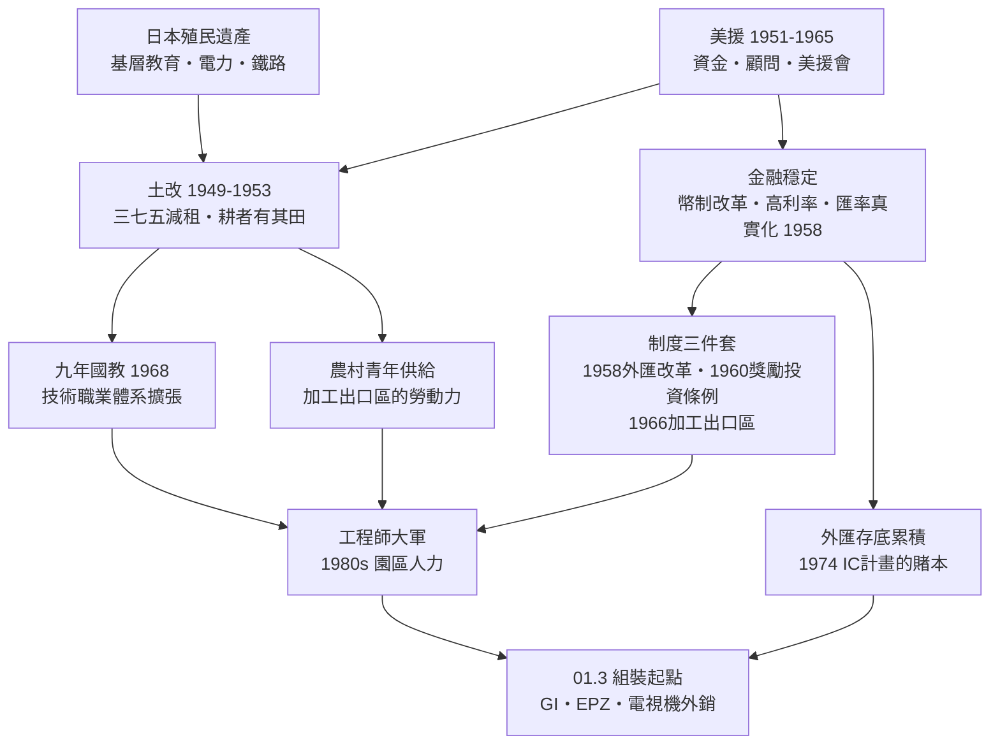

# 01.2 制度地基：土地改革、教育與美援

## 案情

1949 年，國民政府剛遷台，通貨膨脹率以三位數計，外匯儲備幾近於零，島內人口六百萬即將暴增為包括百萬軍民的新局面。任何財政部長看到這張資產負債表都會辭職。然而接下來二十五年，就在這片廢墟上，台灣澆灌出了讓 1974 年 IC 豪賭成為可能的三塊地基：**均等的農村社會、普及的國民教育、穩定的金融秩序**。三塊地基分別由三個看似與電子業無關的事件澆灌：土地改革、九年國教、美援。

## 前因

- **日本殖民遺產（1895–1945）**：台灣在 1945 年已有約七成的初等教育入學率（日據末期的學齡兒童就學率），以及密度居亞洲前列的鐵路、電力與灌溉系統。這是殖民者為自身利益鋪設的，卻成為戰後台灣最意外的遺產。
- **1948–1949 新台幣改革**：金圓券崩盤的前車之鑑就在眼前，台灣以較早的幣制改革與高利率政策壓住通膨。
- **1950 年韓戰爆發**：美國第七艦隊協防台灣，美援重新恢復——1951 年起十五年间，總額約 14.8 億美元的經濟援助流入這座島。

## 線索與推理

### 線索一：土地改革不是正義問題，是資本形成問題

1949–1953 年的三階段土改（三七五減租、公地放領、耕者有其田）常被講成社會正義的故事，但對本書的偵查而言，重點是它完成了兩件經濟學上的事：

1. **把地主的財富轉成工業資本**：補償地主的是四大公營事業的股票與實物債券，部分地主因此成為台灣第一批民營工業股東（如後來的 textile 與水泥業）。
2. **把農村變成教育的土壤**：自耕農的所得提高且不再被抽租，家庭投資子女教育的意願與能力大增——這批受過小學教育的農村子弟，正是 1966 年之後加工出口區的作業員，以及他們的弟弟妹妹。

用發展經濟學的語言：土改壓低了基尼係數（所得分配均等化），而**均等社會對公共教育與出口勞動力的供給彈性遠大於不均等社會**。若以人力資本積累寫成簡式：

$$
H_{t+1} = H_t \,(1 + e) + s \cdot Y_t, \qquad s = s_0 + \alpha \cdot \text{土地均等度}
$$

均等度越高，儲蓄與教育投入 $s$ 越高，人力資本 $H$ 的成長越快。

### 線索二：美援買的不是物資，是「穩定」本身

美援占 1950 年代台灣投資毛額的三成以上、進口外匯的四成以上，但它的真正作用比帳面數字更結構性：

| 通道 | 美援的作用 | 後續因果 |
|------|-----------|---------|
| 金融 | 穩定物價、彌補貿易逆差 | 讓 1958 年匯率改革有本錢實施 |
| 制度 | 美方顧問（如懷特公司的狄寶賽）直接參與規劃 | 技術官僚（尹仲容、李國鼎）與美援會成為改革引擎 |
| 政治 | 換取台灣接受「出口導向」而非封閉發展 | 奠定後來加工出口區的政策取向 |

美援會（行政院美援運用委員會）是台灣第一個「現代計畫官僚」的搖籃——尹仲容、李國鼎、陶聲洋都在其中受訓。**1974 年決定做 IC 的，正是這批人；沒有美援會，就沒有工研院那個決策網絡。**

### 線索三：九年國教——為二十五年後預訂的工程師

1968 年，財政仍然吃緊的台灣實施九年國民義務教育，教育經費占總預算比例大幅拉高。當年沒有人把這件事與半導體連在一起，但因果鏈清晰可算：

$$
\text{1968 年入學的小學生} \xrightarrow{\;9\text{ 年}\;} \text{1977 年國中畢業} \xrightarrow{\;3\text{ 年}\;} \text{1980 年的高職/大學新生}
$$

1980 年新竹科學園區開幕、1987 年台積電成立時，正好是九年國教第一屆學生進入職場與研究所的時間。**園區需要的三層人力（作業員、技術員、工程師）的最底層兩層，就是九年國教與技職體系量產的。**

## 理論：制度作為「乘數的乘數」

以全書核心公式檢驗本章：「地理與人才」與「政策設計」兩個乘數，都由本章的三塊地基供電。發展經濟學的長期爭論是「制度 vs. 地理」孰為發展主因，台灣案給出第三種答案：**制度本身可以被外援與危機快速安裝**——美援是安裝程式，戰亂與退無可退是安裝動機。

## 後果

- **1953–1962**：土改完成，農業生產力提升，農村釋出勞動力；四大公營公司股票製造第一批民營工業資本家。
- **1958–1961**：尹仲容主導外匯貿易改革，匯率貶至反映真實成本，單一匯率取代多元複式匯率——出口導向的前提。
- **1960**：《獎勵投資條例》通過，租稅減免制度化。
- **1965**：美援經濟援助正式結束。台灣在美援停止的前一年，已經準備好「自己養自己」的體質——這不是巧合，是美援會刻意設計的退場（「美援會」的 KPI 就是讓自己失業）。
- **1968**：九年國教上路。
- **1971–1973**：外匯存底轉正且快速累積，出口占 GDP 比重逼近四成——一座島徹底綁上全球貿易，也綁上了下一場風暴（石油危機）的引信。

## 反事實

- **若土改以暴力方式進行**（如同時期若干國家的土地革命）：地主階層被消滅而非轉化，公營事業股票不存在，民營工業資本家的種子無從萌芽，且社會動盪嚇跑美援與外商。
- **若美援用於扶植重工業而非穩定與制度建設**：台灣可能走上與拉美相似的進口替代黑洞，外匯永遠短缺，1964 年 GI 來台時不會有穩定的匯率與電力可承諾。
- **若 1968 年因財政困難延後九年國教十年**：1980 年代園區設廠時將面臨技術員斷層，台積電創立時的基層人力成本將大幅上升。

## 小結

本章確認了核心公式的前兩個乘數的供電來源：土地改革供給均等社會與勞動力，教育供給人力資本，美援供給穩定、資本與制度安裝程式。三者共同指向下一章的案發現場：1964 年新竹的第一座半導體工廠、1966 年高雄的全球首座加工出口區、1969 年外銷破百萬台的電視機——台灣電子產業的組裝起點。
