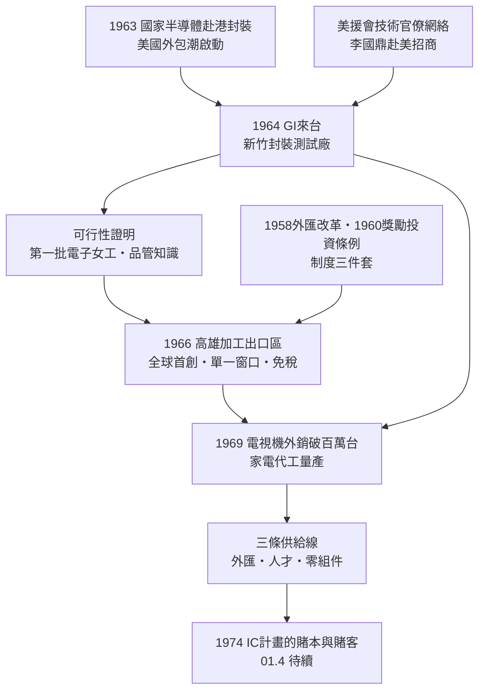

# 01.3 組裝起點：通用儀器、加工出口區與電視機外銷

## 案情

三件 1960 年代的事，構成本案的現場：

1. **1964 年**，美商通用儀器（General Instrument, GI）來台設廠，從事電晶體與二極體的封裝測試——台灣第一座半導體工廠，雖然只做最低階的後段工序。
2. **1966 年 12 月**，全球第一個加工出口區（EPZ）在高雄前鎮誕生：區內原料免稅進口、產品全數外銷、單一窗口服務。
3. **1969 年前後**，台灣電視機年產量突破百萬台，成為僅次於日本的亞洲電視出口國。

三件表面無關的事件，其實是同一條因果鏈的三個節點：GI 證明了「美國技術＋台灣勞力」可行，加工出口區把這個實驗從個案變成制度，電視機外銷則是這套制度量產的第一個大型戰果。本章偵查的問題是：**為何這三步恰好都在台灣接連成功？**

## 前因

- 1950 年代末，美國電子業工資持續上漲，封裝測試這類勞力密集工序急尋海外基地。1963 年國家半導體（National Semiconductor）已把封裝搬到香港，示範了可行路徑。
- 台灣這邊：美援將於 1965 年截止，外匯與就業壓力迫在眉睫；技術官僚（李國鼎、尹仲容留下的美援會網絡）在美國親自招商——李國鼎在波士頓拜會 GI 高層是本案的直接觸媒。
- 1958 年外匯改革與 1960 年《獎勵投資條例》已把匯率與租稅的誘因裝好，只缺一個物理載體。

## 線索與推理

### 線索一：GI 為何選封裝測試，而非晶圓製造？

IC 生產線各工序的資源稟賦需求差異極大：

| 工序 | 資本密集度 | 勞力密集度 | 技術門檻 | 適合 1960s 台灣？ |
|------|-----------|-----------|---------|-----------------|
| 晶圓製造 | 高 | 低 | 極高 | ✗ |
| 電路設計 | 低 | 低 | 極高 | ✗ |
| **封裝** | 低 | 極高 | 低 | ✓ |
| **測試** | 中 | 高 | 低 | ✓ |

外包決策可用一個簡單不等式刻畫：

$$
V = \frac{w_{US} - w_{TW}}{c_{\text{運輸與關稅}} + c_{\text{品質風險}}} > 1 \;\Rightarrow\; \text{離岸封裝有利}
$$

1960 年代這個比值遠大於 1，而**加工出口區的作用正是把分母再壓近零**：關稅歸零、行政摩擦以「單一窗口」壓縮、基礎設施由政府集中供給。

### 線索二：為何是「區」，而不是全島開放？

這是本案最精彩的政治經濟學推理。全島自由化在理論上更優，在政治上不可能——保護主義的既得利益、數十種法規、官僚的層層審批，沒有一項能在短期內搬動。加工出口區是「**改革飛地**」：在舊體制旁圈出一塊新體制，讓新舊競爭，倒逼全面改革（深圳特區 1980 年的做法明顯師法高雄）。

真實成本的拆解：

$$
C_{\text{real}} = \underbrace{w}_{\text{工資：台灣低}} + \underbrace{c_{\text{infra}}}_{\text{區內集中供給}} + \underbrace{c_{\text{admin}}}_{\text{單一窗口}\to 0} + \underbrace{t_{\text{tariff}}}_{\text{免稅}\to 0}
$$

把後三項壓到趨近於零，台灣的工資優勢才真正兌現。世界銀行日後把 EPZ 當藥方推薦給數十國，成功率卻極低——因為多數國家只抄了「區」，沒有抄「區裡的人」。

### 線索三：電視機和 IC 有什麼關係？

表面上沒有，實質上是三條供給線：

1. **外匯線**：家電外銷累積的外匯存底，是 1970 年代政府敢花一千萬美元引進 IC 技術的財政基礎。
2. **人才線**：電視機生產需要的電路板插件、迴焊、品管測試，是 IC 廠作業員與領班的預備訓練營。
3. **零組件線**：電視帶動電阻、電容、PCB、變壓器等被動元件工業——日後主機板與筆電供應鏈的地基。

家電量產的學習曲線，也在訓練整個產業的「成本直覺」：

$$
C_n = C_1 \cdot n^{-b}, \qquad b = \log_2(\text{學習率})
$$

累積產量每倍增，單位成本以固定百分比下降。台灣在家電上以數百萬台累積產量練出的「量大→成本低」肌肉記憶，日後完整移植到 PC 與晶圓代工。

## 理論：產品生命週期與比較利益的制度實作

Vernon（1966）的產品生命週期理論：產品從創新到成熟，生產地會從創新國遷往低工資國；台灣從成熟期工序（封裝、組裝）切入，再沿階梯上爬。李嘉圖的比較利益則指出：即使台灣在所有工序都「較差」，只要相對成本差存在，專業化代工仍可獲利。

**高雄 EPZ 是李嘉圖理論在制度設計上的第一次完整實作。** 理論沒說怎麼做，台灣的技術官僚用一紙條例做了出來。

## 後果

- **外商群聚效應**：GI 成功後，德州儀器、飛利浦（1966，建元電子）、RCA、艾德蒙等美商接連來台設廠。台灣成了美國電子業離岸封裝的標準選項。
- **人的後果**：數十萬農村青年成為電子作業員；GI、飛利浦廠內的第一批本地工程師與領班，就是台灣半導體管理階層的種子部隊。其中與 RCA 的合作關係，直接成為 1974 年 IC 技術移轉案的前身。
- **制度的後果**：1971 年楠梓、台中加工出口區相繼設立，電子業占區內產值一半以上；「前店後廠」（接單在美、製造在台）模式成形，是 1980 年代資訊硬體業的放大版原型。
- **財政的後果**：外匯存底由負轉正。1973 年石油危機衝擊前台灣，已是一個有賭本的玩家——只差一個下注的機會與一份技術標的（RCA 的 CMOS）。

## 反事實

- **若 GI 來台失敗**（品質不達標、交期失控）：美國外包潮將轉向香港與韓國，台灣失去「被驗證過的基地」標籤，1966 年加工出口區可能招商困難而夭折。
- **若 1966 年不設區、堅持全島同步改革**：法規整備至少多花十年，台灣將錯過 1965–1973 這段美國外包潮的黃金窗口。
- **若家電業止於內銷保護**：沒有百萬台量產，學習曲線不成立，外匯線與人才線雙斷——1974 年的 IC 豪賭既無賭本也無賭客。

## 小結

本章確認了組裝起點的三個節點互為因果：GI 提供可行性證明，加工出口區提供制度載體，電視機外銷提供量產訓練與賭本。以全書核心公式檢驗，本章貢獻的是「政策設計」乘數的第一次完整兌現，以及「技術移轉」乘數的預備（RCA 關係的種下）。1973 年石油危機前夜，地基已實、通路已開——下一位登場的，是把這一切押注在 IC 上的工研院電子所與 RCA 計畫。
