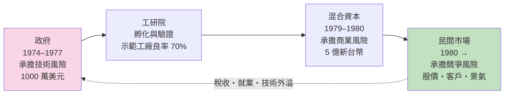
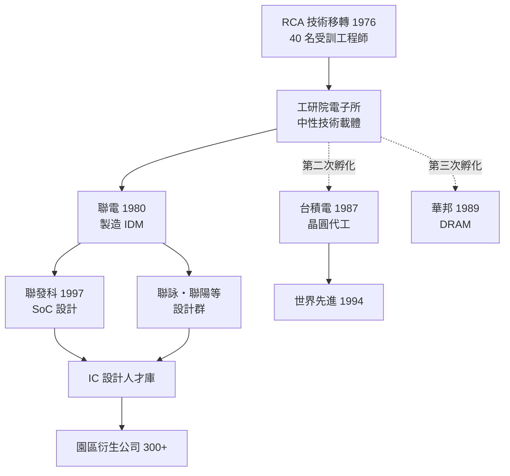

# 02.3 衍生公司模式：國家研發如何變成民間企業

## 一、案情

1979–1980 年，工研院電子所做了一件在當時的公營研究機構史無前例的事：把示範工廠的技術、設備與**整隊人才**移出院牆，連同政府與民間合組的資本，成立一家民營公司——**聯華電子**。1980 年 5 月，聯電在新竹科學園區開幕，副所長曹興誠率宣明智等「RCA 計畫」班底集體轉任。

從此，台灣確立了一條獨特的路徑：**國家做研發 → 工研院孵化 → 衍生民營公司 → 政府退出**。此後的台積電（1987）、華邦（1989）、世界先進（1994）乃至聯發科（1997），都是同一劇本的重演。

偵探要查的問題是：政府為什麼養到會下蛋就放走母雞？而這個「放走」的設計，為什麼反而是整個案例裡最聰明的一步？

## 二、前因：示範工廠之後的岔路

到 1978 年，證據已經齊備：技術移轉成功、良率 70%、委託生產有客戶上門。國家面前出現三條路：

1. **擴大示範工廠**，由工研院直接量產——研發機構做生產，角色錯置；
2. **成立國營 IC 公司**——走台電、中油的舊路；
3. **衍生民營公司**，政府孵化後退出。

孫運璿與李國鼎在這個岔路口的選擇，定義了此後四十年：**政府只做第一哩路，之後交給市場。** 1979 年，行政院核定由工研院移轉技術衍生電子公司；1980 年，聯電在甫成立的新竹科學園區掛牌，資本額約新台幣 5 億元，由政府（含開發基金）與交通銀行等民間股東共同出資。

時機也非偶然。示範工廠證明技術之後，電子所面臨一個結構性難題：它的預算與編制是「研究機構」規格，無法也不該無限擴充成量產集團；而民間資本此時已經開始試探——示範工廠的客戶名單與良率報告，就是最好的招募廣告。**政府的動作必須在民間信心完全成熟之前發生（否則衍生失去槓桿價值），又必須在民間信心初步成形之後（否則無人敢認股）。** 1979–1980 正是這個窗口。

## 三、線索與推理

### 線索一：為什麼不走國營路線？——制度比較

| 比較項 | 國營 IC 公司 | 衍生民營公司 |
|--------|-------------|-------------|
| 投資決策 | 預算受立法院節制，僵化 | 董事會決策，快速 |
| 經營壓力 | 無淘汰機制，易老化 | 市場與股價直接淘汰 |
| 人才誘因 | 公務員敘薪 | 股票分紅（後來的園區文化燃料） |
| 技術升級 | 靠預算年度 | 靠競爭自發 |

當時台灣的國營事業績效乏善可陳，這張對照表在決策圈內是有共識的。問題只剩下一個：民營公司憑什麼願意接手一個還沒被證明能賺錢的產業？

### 線索二：衍生模式的三大機制

以聯電為樣本，拆解這筆「技術如何變成公司」的交易：

1. **資本混合**：政府開發基金出資約一半，交銀等民間股東認購其餘——政府是股東，不是老闆。
2. **技術授權而非無償撥用**：工研院以授權方式移轉 CMOS 製程，收取權利金——保持「技術有價」的紀律。
3. **人才整隊遷移**：曹興誠、宣明智等整批研究人員轉任，連同在 RCA 與示範工廠累積的隱性知識一起搬家。

第三項是台灣模式的獨門配方。一般的企業孵化器只給錢、給辦公室；台灣模式搬走的是**整個團隊**——隱性知識零損耗。這直接回應了 02.2 的結論：文件可以影印，手感只能跟著人走。

還有一個常被忽略的細節：**轉任的人放棄了什麼**。研究員轉任民營公司，意味著放棄公職的終身保障；對這批人而言，聯電的股票分紅不是額外的甜頭，而是補償風險的對價。日後「員工分紅配股」成為園區文化的引擎，其制度起點不是模仿矽谷選擇權，而是這次轉任的風險補償設計——**讓承擔風險的人持有下檔不保護、上檔無上限的資產**，這正是把人才與股東利益綁在同一條船上的原始碼。

### 線索三：良率優勢如何轉成商業模式

聯電從消費性 IC（電子錶、電話機晶片）切入，而非電腦用 IC。這個選擇的數學在於能力─市場的匹配：

$$
\pi = (P - C(y)) \cdot Q, \qquad C(y) = \frac{c_0}{y}
$$

單位成本 $C$ 隨良率 $y$ 上升而下降。聯電繼承示範工廠的 70%+ 良率管理能力，在「客戶只在乎便宜、穩定供貨」的消費性 IC 市場，恰好是相對優勢的最大化區間——先進製程反而是用不上的屠龍刀。低階市場的現金流，再供養製程世代升級（1980 年 7μm → 1984 年 3.5μm，後者正是工研院的二次移轉），形成「以戰養戰」的閉環。

### 線索四：風險的遞移路徑

把 1974–1980 的賭局連起來看，風險經歷了一次乾淨的接力：

$$
\text{國家}(1974\text{–}1977) \;\longrightarrow\; \text{半國營孵化}(1979\text{–}1980) \;\longrightarrow\; \text{民間市場}(1980\to)
$$

- 第一段：政府承擔「技術學不學得會」的不確定性（1000 萬美元）；
- 第二段：混合資本承擔「會不會做生意」的風險（5 億新台幣）；
- 第三段：民間資本市場承擔「能不能長大」的全部競爭風險。

每一段的賭注都比上一段大，但承擔者的風險定價能力也更強。**國家買的是別人不會買的風險，賣掉的是自己不該持有的風險。**

用選擇權的語言重述：政府在不同階段持有的部位不斷轉換——

- 1974–1977：持有「技術可行性」的買權（權利金 1000 萬美元）；
- 1979–1980：將買權履約，換成聯電的**股權**（實物部位）；
- 1980 年代後：透過釋股與市場競爭，逐步讓股權稀釋——部位最終歸零，但產業留下來了。

風險遞移的路徑可以畫成一張接力圖：

接力棒每換一次手，賭注放大一級，但持有者也從「不會定價風險的國家」換成「以風險定價為業的市場」。這條單行道不能回頭：政府若在任何一站下車失敗（捨不得賣股、捨不得放人），系統就會退化回國營的老路。

## 四、理論：演化經濟學的分株模型

### Klepper 的 spin-off 理論

Steven Klepper 對底特律汽車業與矽谷的研究指出：新產業的企業多由既有組織的員工帶著知識外出創業，且分株傾向在地理上群聚。新竹科學園區是這個理論最完整的東亞驗證：

分株數量近似指數增長：

$$
N_{spinoff}(t) \sim N_0 \, e^{\lambda t}
$$

四十年間，從電子所這一株母體衍生、間接催生的 IC 相關公司超過三百家——工研院成了名符其實的「黃埔軍校」。

### 國家創新系統的閉環驗證

回到 02.1 的國家創新系統框架，此案補上了最後一塊：**退出機制**。Freeman 意義上的創新系統，關鍵不是政府投入多少，而是知識能否在節點之間流動；工研院的「研發→孵化→退出」節奏，使知識每三到五年就完成一次從公共部門到民間部門的輸血，而且政府股權的退場讓系統不會累積官僚資本。這個三段式後來被韓國、新加坡、中國與以色列的研究者反覆解剖與模仿——模仿得像的不多，因為多數國家卡在「捨不得退出」。

可以說，工研院在整個系統裡扮演的是一個精確設計過的角色——**中性技術載體**：

- **對官僚系統而言，它是外部**：不受立法院逐案審預算、不受政府採購法綁手腳，能用業界的速度談技術、買設備；
- **對民間企業而言，它是內部**：技術不是外國廠商的商業機密，而是「全台灣都能授權」的公共財；
- **對市場而言，它是暫時的**：每一項技術的終點都是被釋出，工研院從不與民爭利。

這三個「同時是與不是」，是一般研發機構做不到的制度雜技，也是衍生模式成功的制度前提。

## 五、後果

- 1980 年 5 月聯電開幕，台灣第一家民營 IC 製造公司問世；同年，新竹科學園區設立——公司與園區互相成就。
- 1985 年聯電上市，並開始承接客戶委託代工——比台積電更早實驗代工模式，為 1987 年台積電的「純代工」構想提供了本土先例。
- 「研發在工研院、量產在民間」的節奏制度化：1983 年電子所開發 3.5μm 成功後直接移轉聯電量產，此後每一個製程世代都照此節奏跳躍。
- 衍生模式複製成功：台積電（1987）、世界先進（1994）、華邦（1989，由前電子所／聯電系人馬創立）——國家研發轉化為民間企業的路徑成為標準作業程序。
- 建立園區文化：技術是唯一信仰、股票分紅是燃料、創業是榮耀——這套文化最初的人事檔案，全都是 1976 年那批 RCA 實習生。
- 一個插曲：聯電成立時也是台灣第一次「政府主導的混合所有制」實驗，後續衍生案（台積電、世界先進）都沿用了「開發基金＋民間股東＋工研院技術與人才」的三合一配方。

把風險遞移的全景畫出來，是本書到目前為止最重要的一張圖：

## 六、反事實

- **若當年成立國營 IC 公司**：最可能的圖景是一家台灣版的 NEC——受預算年度綁架、無淘汰壓力、人才領公務員薪水。1980 年代全球 IC 景氣劇烈波動（1985 年大崩盤），一個不能快速裁撤轉向的組織，極可能在第一次谷底就被政治否決，台灣 IC 史在 1986 年前後草草收場。
- **若工研院捨不得放人**：技術留在院內、人才領研究薪資，示範工廠將永遠是「示範」工廠。沒有 1980 年的人才整隊遷移，就不會有 1987 年台積電創業時那個現成的、被市場檢驗過的工程師團隊。
- **若政府不出資、全靠民間**：1979 年的民間資本對 IC 一無所知，風險溢酬要求會高到交易談不攏。混合出資的本質，是政府用股權為這樁交易做「信用增級」——沒有這半張鈔票，另外半張不會出現。
- **若衍生時把股權全部留給政府**：聯電變成準國營，經營層無分紅誘因、無汰壓力，曹興誠們的創業家精神將在第一次虧損時被問責文化絞殺。「政府是股東不是老闆」這半步之差，是孵化與國營的分水嶺。
- **反面警訊**：衍生模式的成功也餵養了後來的過度自信——1990 年代政府以同樣的姿態押注 DRAM 與面板，卻在缺乏「示範工廠」這種中間驗證機制的情況下直接擴廠。同一個劇本，少了第二幕，結局迥異。這提醒讀者：**模式可複製，前提不可省略。**

## 小結

本案的定論：**衍生的價值不在「成立一家公司」，而在「完成一次風險的轉手」。** 國家以 1000 萬美元買下技術選擇權，以 5 億新台幣把它鍛造成一張可以交給市場的商業入場券，然後——最關鍵的動作——放手。孫運璿那句「政府只做第一哩路」，用經濟學的語言重述就是：國家創新系統的任務不是經營產業，而是不斷地把「沒有人敢承擔的風險」轉化成「市場願意定價的資產」。第一哩路走完，路就歸市場所有；而台灣日後的每一哩，都比第一哩寬闊。

### 冷案檔案

- 時間：1979（核定衍生）–1980 年 5 月（聯電開幕）
- 地點：新竹（工研院→科學園區，步行可達的距離，象徵性也是實質性的一步）
- 案由：政府以「孵化→退出」策略建立市場，而非直接經營市場
- 核心證物：轉任名單——整隊遷移的人才，是隱性知識唯一可靠的運輸工具
- 深遠影響：這個模式被稱為「台灣奇蹟的制度核心」，並成為 1987 年台積電的直接前例
- 懸而未決之處：衍生模式的天花板在哪裡？當產業前沿的成本超過任何單一國家的承受度（如 2020 年代的三奈米與二奈米競賽），「國家做第一哩路」的劇本是否還寫得下去——這是留給本書尾聲的問題。
