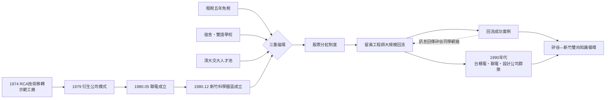

# 第三章之一：新竹科學園區——租稅、宿舍與人才回流的三重磁場

> 侦查檔案編號：03.1　案發時間：1980 年 12 月　案發地點：新竹

## 案情

1980 年 12 月 15 日，新竹科學工業園區正式掛牌。這塊最初只有約 210 公頃的土地，往後四十年間孕育出台灣半導體與資訊電子業的核心：聯電（1980）、台積電（1987）、以及上百家的衍生與回流創業公司。到了二十一世紀，僅竹科及後續科學園區群，就撐起台灣超過一成的 GDP。

但若把時間撥回 1980 年，這個案子在當時的觀察者眼中幾乎是「不可能的任務」：台灣沒有全球品牌、沒有龐大內需市場、沒有風險資本產業、薪資只有美國的三分之一。憑什麼讓在矽谷拿高薪的華人工程師放下一切回來？

這正是本案要偵辦的謎題：**園區的真正產品是什麼？**

## 前因

要把 1980 年的案發現場拼完整，必須先清點前三十年留下的物證：

1. **技術與人才**：1974 年工研院電子所的 RCA 技術移轉計畫、1977 年示範工廠，培養出第一批真正「做過 IC」的台灣工程師（見本書第二章）。
2. **衍生模式**：1979 年電子所衍生公司模式確立，聯華電子於 1980 年 5 月掛牌，證明「國家實驗室 → 民營公司」這條路走得通。
3. **外商訓練營**：1964 年起通用儀器（GI）、德州儀器、飛利浦來台設封裝廠，累積了二十年的人力池。
4. **地理巧合**：清華大學與交通大學恰好在新竹，工程師供給近在咫尺。
5. **拉力初始化**：1970 年代已有零星留美工程師回流，但缺乏一個「落點」——回去要去哪裡工作？孩子去哪裡讀書？

疑點在於：拉力（pull）明明存在，為何大規模回流遲至 1980 年代才發生？答案指向一個尚未出現的「設施」。

## 線索與推理

### 線索一：園區的真正產品不是土地，是「信任的物理化」

歸國學人與外商最怕的三件事：官僚摩擦、供電不穩、土地產權糾紛。園區用一部《科學工業園區設置管理條例》，把這些風險一次清空。逐一檢視物證：

| 誘因 | 具體內容 | 對應的風險 |
|------|---------|-----------|
| 租稅優惠 | 五年免營利事業所得稅、進口設備免稅、股利部分免稅 | 對沖政治與政策風險，拉高投資報酬率 |
| 單一窗口 | 園區管理局一站式審批，公司設立、通關、簽證一個機關搞定 | 消除官僚摩擦成本 |
| 宿舍與雙語學校 | 園區宿舍、實驗中學雙語部 | 解決子女教育的最大痛點 |
| 穩定供電 | 專屬電力系統、雙迴路 | 半導體停電一小時，損失以百萬計 |
| 毗鄰兩大學 | 清大、交大 | 工程師供給＋研究合作 |

**推理**：這五項誘因中，租稅其實是最容易被模仿、也最不重要的；真正難以複製的是「單一窗口＋雙語學校＋大學鄰居」的組合——它們共同構成一個對工程師家庭友善的微型環境。園區賣的是**回流的總體驗**，而非個別優惠。

### 線索二：推拉理論的量化檢驗

用移民研究中經典的推拉模型（push-pull model）來表示：一位在美國的工程師決定回台，取決於兩地效用之比，再除以家庭阻力：

$$
P_{\text{回流}}=\frac{U_{\text{台灣}}(\text{薪資}+\text{股票}+\text{成就感})}{U_{\text{美國}}(\text{薪資}+\text{生活})}\times\frac{1}{\text{家庭阻力}}
$$

1980 年前後， $U_{\text{美國}}$ 在薪資與生活品質上全面壓倒 $U_{\text{台灣}}$ 。台灣唯一的對沖工具是**股票分紅**：園區公司普遍以面額配股給員工，將員工與公司的長期成長綁定。這是台灣版的員工期權——比美國的 stock option 更早、也更慷慨。當一家衍生公司上市，早期員工的身家可能在一夜之間超過矽谷同儕十年薪水。

同時，**宿舍與雙語學校**直接壓低了分母中的「家庭阻力」項。許多回流者的口述回憶都指向同一個細節：決定因素不是薪水，而是「孩子有學校可以讀」。

**推理結論**：園區同時操作了方程式的三個變項——拉高分子（股票＋成就感）、降低分母（家庭阻力），最終讓 $P_{\text{回流}}$ 越過臨界值。1980 年代起，矽谷 150 英里內每一家重要科技公司，新竹幾乎都能對上一家「台灣分身」或由其離職員工創立的公司。

### 線索三：磁場的自我增強

回流一旦啟動，磁場便自我增強：回流的工程師在園區創業或任職 → 公司成功、股票增值 → 訊息傳回矽谷同學網絡 → 更多人回流。Saxenian 稱這種矽谷—新竹之間的雙向人流與知識流為「人脈資本主義」——技術循環是雙向的，而非單向的技術擴散。

### 線索四：第一批回流者的口供

把 1980 年代的回流者名單攤開來檢驗磁場強度：

- **工研院—園區軸線**：1980 年聯電的曹興誠、宣明智等 RCA 計畫工程師，是「就地轉任」而非回流，但他們的成功向海外同學展示了第一個樣板。
- **矽谷—新竹軸線**：1980 年代中期起，Intel、HP、IBM 的華人工程師開始成批返台。Saxenian 的研究指出，這批人不是「回國」，而是**在兩個叢聚之間往返**——他們把矽谷的最新製程知識帶回，把台灣的生產問題帶去矽谷的同學網絡解決。
- **創業型回流**：1980 年代末至 1990 年代初，回流工程師在園區創立的公司數以十計，多數從事 IC 設計與電腦周邊——這些正是台積電模式之後的新棲位。

**推理**：回流不是一次性的搬家，而是一條**太平洋通勤線**。園區管理局的統計顯示，1980 年代末園區內歸國學人創辦或任職的公司占比迅速攀升；到了 1990 年代，「在矽谷工作過」幾乎成為新竹科技公司高階主管的標準履歷。磁場強度的最好證明，是它開始**自我複製**：台積電與聯電的成功，又成為下一波回流的拉力——迴路閉合了。

### 線索五：負面證詞——哪些誘因沒有生效

偵查也要看沒有被使用的工具：

- **直接補貼**：園區對廠商的補貼其實有限，真正的資源投注在基礎設施與行政效率上——這說明制度設計者理解「造環境優於挑贏家」。
- **保護關稅**：園區沒有走進口替代的老路，公司從第一天就必須外銷、面對全球競爭——這過濾掉了只會尋租、沒有國際競爭力的申請者。
- **入園審查**：管理局對技術水準與投資計畫有實質審查，園區不是免稅天堂，而是有門檻的人才與技術篩選器。

**推理結論**：磁場的成分是「減少阻力」而非「增加補貼」——這是它與後世許多失敗園區（以補貼與免稅為主）的根本差異。

## 理論

### 人才回流模型的敏感度分析

把推拉方程式再往前推一步。設回流決策在時間軸上重複出現，累積回流人數為一個臨界動力學過程：

$$
N(t+1)=N(t)+\beta\cdot N(t)\cdot\big(P_{\text{回流}}(N(t))\big)
$$

其中 $P_{\text{回流}}$ 本身是已回流人數 $N$ 的增函數——同學網絡越密、樣板越多，回流機率越高。當 $N$ 越過臨界值 $N^*$ 時，回流從線性涓流轉為指數湧入。1980 年代初園區做的事，本質上就是把 $N^*$ 之前那段最難熬的冷啟動期用制度（宿舍、學校、單一窗口、股票分紅）撐過去；一旦越過 $N^*$ ，磁場便不需要政府再推。

### 馬歇爾外部性與叢聚效應

園區的理論基礎是 Alfred Marshall 在十九世紀末提出的產業區（industrial district）概念。一家位於叢聚中的公司，其生產力不僅來自自身投入，還來自鄰居帶來的外部性：

$$
\text{生產力}_i=f(\text{自身投入})+\underbrace{g(\text{鄰居數量},\ \text{知識溢出},\ \text{勞動池})}_{\text{叢聚外部性}}
$$

新竹園區具備馬歇爾所說的三種外部性：

1. **投入共享**：特用化學品、製程氣體、石英坩堝、設備維修商都在車程一小時內，每家公司的供應鏈固定成本被攤薄。
2. **勞動力池（labor pooling）**：工程師跳槽不離開園區，配對成本趨近於零；公司倒了，人才留在原地被下一家公司吸收——創業失敗的社會成本大幅降低。
3. **知識溢出**：同學網絡、跨公司交流、離職創業。矽谷的技術與新竹的製造know-how在一條太平洋航線上往返。

### 關鍵的乘法結構

必須強調：三重磁場是**連乘**而非連加。

$$
\text{回流規模}=\text{租稅與制度}\times\text{生活設施（家庭）}\times\text{人才密度（大學＋產業）}
$$

任何一項為零，積便為零。這解釋了後續數十個國家「抄作業」的失敗：他們多半只抄了租稅優惠（第一項），卻沒有大學鄰居（第三項），也沒有願意配股的創業文化——磁場始終建立不起來。

## 後果

- 1980 年代：聯電、台積電先後落腳；留美華人工程師回流加速，園區從「工研院的延伸」變成「矽谷的鏡像」。
- 1990 年代：園區產值每三到四年翻一倍；IC 設計、晶圓製造、封測在數公里半徑內形成完整分工（見 03.3）。
- 2000 年代之後：模式複製到南部（南科 1996 年籌設、1997 年開發）與中部（中科 2002），形成科學園區群；「叢聚效應」成為台灣電子業最深的護城河。
- 制度遺產：管理局單一窗口、股票分紅、員工認股，成為台灣科技業人事制度的標準配備，並隨台商擴散到整個華人科技圈。

## 反事實

**如果 1980 年沒有設立園區，會發生什麼事？**

1. 聯電與 1987 年的台積電仍可能成立（它們分別綁在工研院與行政院開發基金上），但**回流潮不會發生**。散落各工業區的公司無法提供雙語學校與工程師社區， $P_{\text{回流}}$ 的分母（家庭阻力）始終降不下來。
2. 沒有回流潮，就沒有 1990 年代的 IC 設計創業潮；台積電成立後也找不到足夠的 fabless 客戶在地茁壯——垂直分工革命（03.2、03.3）會推遲至少十年，甚至讓位給新加坡或韓國的版本。
3. 台灣電子業將停留在加工出口區模式的延長線上：OEM 組裝、低毛利、無根性——外商一撤資，產業就空了。

**反向檢驗**：全球模仿新竹的園區數以十計（印度、馬來西亞、韓國、俄羅斯都有），成功者極少。缺的從來不是法規條文，而是三個乘數同時到位：工程人才密度、執行連續性（數十年不改規則）、以及一個恰好存在的海外人才蓄水池（冷戰時期留美的華人工程師群體）。園區是必要條件，不是充分條件——但沒有它，其他條件無處安放。

---

## 小結

新竹科學園區的偵查結論：**它賣的不是土地與租稅，而是一台把「回流阻力」逐步歸零的機器**。租稅對沖資本風險，宿舍與學校消解家庭阻力，大學與股票分紅提供人才與誘因。三重磁場連乘成立，才有 1980 年代的人才回流、才有 1987 年台積電可以動用的四百名工研院工程師、才有下一節要偵辦的那樁「物種大爆發」。
