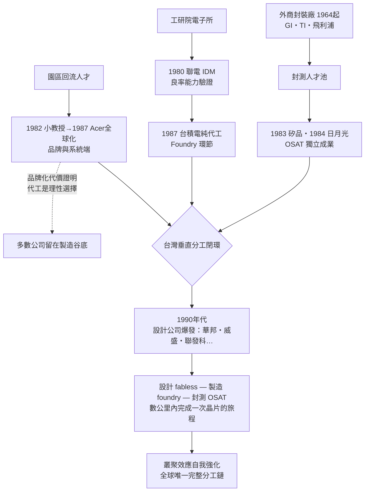

# 第三章之三：生態成形——宏碁、OSAT 與垂直分工革命

> 侦查檔案編號：03.3　案發時間：1982–1995 年間　案發地點：新竹、彰化、高雄

## 案情

1987 年前後，一場安靜的生態改造在台灣島內同時進行。案發現場有三處：

1. **品牌端**：宏碁 1982 年以「小教授」學習機賣出台灣第一個成功的自有品牌電腦，1987 年更名 Acer、收購美國 Counterpoint、進軍美國市場——台灣品牌全球化的第一次冒險。
2. **封測端**：1983 年矽品精密在彰化成立，1984 年張虔生的日月光在高雄成立——半導體產業鏈的第三段（封裝測試）在台灣「獨立成業」（OSAT）。
3. **製造端**：台積電的純代工模式（03.2）正在度過虧損期。

到 1990 年代中葉，三條線索合流：台灣成為全球唯一擁有「IC 設計（fabless）—晶圓製造（foundry）—封裝測試（OSAT）—系統品牌（Acer）」完整垂直分工鏈的經濟體。本案要偵辦的是：這條分工鏈的每一環，為何偏偏在台灣獨立成形？

## 前因

- **封測的人才池**：1964 年起通用儀器、德州儀器、飛利浦來台設封裝廠，二十年間訓練出大批封測工程與管理人才（見第二章）。
- **IDM 的閒置煩惱**：聯電等 IDM 發現封測產能利用率難以維持，外包比自製划算。
- **品牌的種子**：施振榮 1971 年設計出全球第一支電子錶計算機晶片，1976 年創立宏碁前身 Multitech；1981 年 IBM PC 問世，相容機市場爆發。
- **園區磁場**：03.1 的人才回流，為設計公司與品牌公司提供了工程師供給。

## 線索與推理

### 線索一：宏碁——從利基滲透到品牌豪賭

1982 年「小教授二號」（MicroProfessor-II）蘋果二號相容學習機，是本案第一件關鍵物證。其可行性的技術鏈：

1. 6502 CPU 可取得授權（MOS Technology 允許）；
2. Apple II 的 ROM 韌體由宏碁工程師**自行重寫**而非複製——成功避開版權訴訟；
3. 電路板佈局自製。

商業邏輯：

$$
\text{利潤}=(P_{\text{Acer}}-C_{\text{台灣製造}})\times Q_{\text{教育市場}}
$$

Apple II 一台約一千美元，小教授賣三百美元仍有四成毛利。教育市場對品牌敏感度低、對價格敏感度高，是弱勢品牌的最佳灘頭堡——這是 Christensen 式破壞式創新的早期案例：從在位者不願打的價格帶切入，再沿性能軸向上侵蝕。

1987 年，施振榮更進一步：更名 Acer（拉丁文「敏銳、積極」）、收購美國 Counterpoint、直營美國市場。隨後的證詞顯示這步棋的代價：通路、品牌、服務三種台灣公司當時**沒有**的能力，都得用現金買；Counterpoint 併購因文化衝突與管理半徑過長，兩年後虧損收場，宏碁 1989–1992 年在美國累計虧損數億元。施振榮把教訓總結為**微笑曲線**：製造在谷底，品牌與 IC 在兩端高處——但從谷底爬上兩端，學費遠比想像中大。1992 年的修正「全球品牌、結合地緣」（聯邦制授權當地子公司），是台灣企業第一次的組織理論創新。

**推理**：宏碁證明了「品牌可以試」，但也證明了品牌之路的高成本與高風險。這個反面證詞至關重要——它讓絕大多數台灣電子公司心悅誠服地**選擇留在微笑曲線谷底（代工）**，把品牌留給少數倖存者。台灣模式的核心特徵由此定型。

### 線索二：OSAT——封測為何獨立成業

矽品（1983）與日月光（1984）幾乎同時創業，本案要問的是獨立的經濟理由。設 IDM 自營封測的總成本為：

$$
C_{\text{自製}}=F_{\text{封測線}}+v\cdot Q
\quad\text{vs}\quad
C_{\text{外包}}=p\cdot Q
$$

封測是勞力密集＋品管密集的工序，固定成本 $F$ 遠低於晶圓廠，但 IDM 的封測需求 $Q$ 隨景氣劇烈波動，自製產能的閒置成本高。獨立封測廠彙集多家 IDM 的需求，把波動平均化：

$$
Var\Big(\sum_i Q_i\Big)=\sum_i Var(Q_i)+\sum_{i\neq j}Cov(Q_i,Q_j)\;<\;\text{單一 IDM 需求的波動}
$$

**產能波動平均化**是 OSAT（Outsourced Semiconductor Assembly and Test）存在的數學基礎。用交易成本理論判斷：封測屬於「資產專用性中等＋需求波動大」，理論上外包占優——1980 年代全球 IDM 逐步外包封測，台灣 OSAT 承接了這個全球趨勢。

### 線索三：矽品 vs 日月光——同案兩種結局

兩家創業時間相近，結局差異的關鍵在**客戶策略**：

| 策略 | 矽品（早期） | 日月光 |
|------|-------------|--------|
| 客戶 | 以台灣 IDM 為主（聯電、華邦） | 直接進攻美國大廠（Motorola、Intel、TI） |
| 佈局 | 台灣本島 | 高雄＋馬來西亞等多元基地 |
| 資本 | 保守 | 激進擴產、1989 年 NYSE 上市 |

張虔生的推理：台灣 IDM 總量有限，封測的成長天花板由**全球 IDM 的外包率**決定。而美國大廠更換封測供應商的期望損失為：

$$
E[L]=p_{\text{失誤}}\times L_{\text{產品召回}}\gg \text{省下的封測費}
$$

封測的真正門檻不是技術，而是**信任**：一旦通過大廠品質認證，客戶極少更換——訂單具有黏著性，先行者優勢以複利放大。日月光以學習曲線壓低成本、以認證累積信任資本，四十年後成為全球最大 OSAT（2013–2018 年與矽品從競合到聯姻，合組 ASE Technology Holding）。

### 線索四：合流——垂直分工閉環的完成

把三條線索放在同一張圖上：

到 1990 年代，一顆台灣設計的晶片，可以在新竹下線、數公里內完成封裝測試、再裝進宏碁的系統出海。**分工鏈的每一環都在別處存在過，但從未在數十公里半徑內同時齊備**——這正是叢聚（cluster）的定義。

## 理論

### 交易成本與分工深度

整條垂直分工鏈可以用統一框架解釋。對每一個環節 $s$ （設計、製造、封測），獨立化的條件是：

$$
TC_s(\text{標準化程度},\ \text{通訊成本})+AC_s(\text{規模經濟})\;<\;GC_s(\text{內部協調成本})
$$

- **封測**最先獨立：工序標準化程度高、固定成本低、需求波動大。
- **製造**隨後：PDK 與 EDA 標準化（1980 年代末）壓低 $TC$ ，先進製程資本門檻推高 $GC$ 。
- **設計**最後爆發：一旦 foundry 提供標準製程介面，fabless 的進入門檻只剩人才與創意。

### 叢聚效應的量化

用馬歇爾外部性表述（見 03.1），分工鏈的完整性本身會放大叢聚優勢：

$$
\text{產業競爭力}\;=\;\prod_{s\in\{\text{設計},\text{製造},\text{封測},\text{系統}\}}\big(\text{環節競爭力}_s+\text{鏈內外部性}_s\big)
$$

這是連乘：任一環節缺席，整條鏈的競爭力大打折扣。台灣的護城河不在任何單一環節的技術領先，而在**四環同時到位且彼此距離一小時車程**——客戶換供應商的搜尋、驗證、運輸成本被壓到全球最低。

### 微笑曲線與台灣的理性選擇

施振榮的微笑曲線可寫成毛利函數：

$$
m(\text{價值鏈位置})\;:\;\text{IC／專利}\;>\;\text{品牌行銷}\;>\;\text{組裝製造}
$$

理論上台灣應該爬向兩端。但宏碁的實證顯示爬向品牌端的學費巨大；而爬向 IC 端（設計）的路，恰好被 foundry 的棲位開拓（03.2）鋪平。多數公司的理性選擇：留在谷底做代工、把 IC 設計外包給新竹的 fabless 新物種。台灣模式＝**極致的谷底＋選擇性的兩端**。

## 後果

- **OSAT 稱霸**：1990 年代台灣封測業全球市占率躍居第一，2010 年代超過全球五成；日月光與矽品合併後成為全球最大 OSAT。
- **品牌倖存者**：宏碁在多次重整後於 2000 年代成為全球前五 PC 品牌，連同華碩、HTC，成為台灣極少數的微笑曲線左端代表。
- **設計爆發**：1989 年華邦、旺宏，1990 年代威盛、聯發科——fabless 公司持續湧現，回頭餵養 foundry 的成長。
- **分工鏈的戰略價值**：2020 年代晶片地緣政治中，「設計—製造—封測一島完成」成為台灣不可取代性的來源；CoWoS 先進封裝更讓 1983 年被視為「低階工序」的封測，反轉為 AI 晶片的戰略瓶頸。
- **組織遺產**：宏碁系（明碁、緯創、友達前身等）與聯電系（聯發科、聯詠、聯陽等）——兩個「企業家族」成為台灣電子業的人才黃埔軍校。

## 反事實

**若垂直分工鏈缺了任何一環：**

1. **缺 OSAT**：台積電的產能再強，晶片出廠仍是裸晶，無法交付；封測外包必須跨海運至東南亞或美國，交期與良率反饋迴路被拉長。fabless 的快速迭代（一季一次投片）不可能——整個分工鏈的節奏會慢一半。
2. **缺宏碁的品牌實驗**：台灣不會早早知道品牌化的真實成本。可能會有更多公司在 1990 年代把資本燒在品牌冒險上，而非專注代工；「谷底極致化」的集體選擇或許要更晚、以更多失敗為代價才會形成共識。
3. **缺台積電**（反向檢驗）：矽品與日月光將失去最大的成長引擎——OSAT 的需求有七成以上最終來自代工與 fabless 客戶。分工鏈會退化為「IDM 外包封測」的舊模式，叢聚的連乘結構崩塌。

**終極反事實**：如果台灣在 1980 年代選擇了「扶植一兩家國家冠軍級 IDM」的路線（如韓國三星模式），短期可能產出漂亮的營收數字，但會與日韓在資本與品牌的主戰場正面消耗，且不會有 fabless 棲位讓設計人才爆發式創業。垂直分工不是次優選擇，而是**台灣資源稟賦下的最優解**——沒有品牌與內需市場的經濟體，把「信任與良率」做成了產品。

---

## 小結

生態成形的偵查結論：**垂直分工革命不是台積電一家公司的發明，而是一場四個環節同時到位的生態事件**。封測先行（1964–1984 的人才池），代工立柱（1987），品牌試錯（1982–1992）劃定了集體的理性邊界，設計爆發（1989–1997）完成最後一環。四環以一小時車程為半徑連乘起來，構成全球唯一的完整分工鏈——台灣電子產業史的「物種大爆發」至此閉環，並在接下來的章節中，接受市場週期與地緣政治的長期檢驗。
