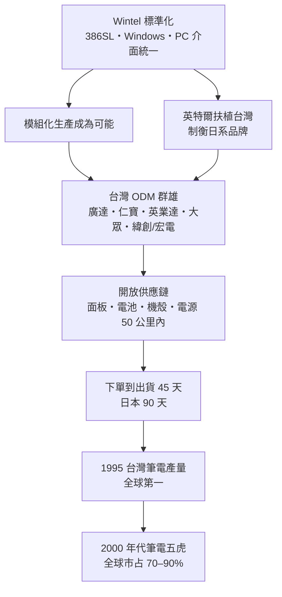

# 04.1 筆電代工群雄：Wintel 底下的彈性製造

## 一、案情

1990 年，林百里離開他參與創立的宏碁，與梁次震在台北士林一間不起眼的廠房裡成立廣達電腦。同一段時間，英業達、大眾電腦、仁寶、神達、倫飛相繼投入筆記型電腦；宏電（宏碁）內部也在做，後來衍生出緯創。到了 1990 年代中葉，這批「筆電群雄」把台灣推上全球筆記型電腦產量第一的寶座——此後二十五年不曾讓位。

案發現場的疑點：筆電的原始發明者是日本的東芝，最早的品牌玩家是蘋果與 IBM。**為什麼一個日本人發明、美國人定義的產品，最後整座工廠搬到台灣海峽這一側？**

## 二、前因：三條伏線在 1990 年交會

**伏線一：Wintel 標準的確立。** 1990 年 Intel 推出 386SL 行動處理器，微軟的 Windows 版圖擴張。PC 產業的介面——匯流排、記憶體、周邊連接——被兩家公司定死。規格標準化，聽起來是壟斷者的勝利，實際上卻是模組化生產的前提：**介面統一之後，每個模組才可以獨立外包。**

**伏線二：台灣主機板產業的成熟。** 1980 年代末，華碩、技嘉、微星把主機板做成了一門全球生意。主機板是 PC 裡「設計密集度最高、變化最快」的板子——會做主機板的公司，離做筆電只差機構、散熱、電池三件事。

**伏線三：人才的分岔。** 林百里這一代宏碁工程師學會了系統設計，也學會了品牌是怎麼燒錢的。他們選擇了一條反直覺的路：**不做品牌，做別人品牌的工廠——但連設計一起做（ODM）。**

## 三、線索與推理：誰最能「快」過時

偵探把三位嫌疑人並排審問：

| 因素 | 日本（東芝） | 美國（Apple/IBM） | 台灣 |
|------|-------------|------------------|------|
| 機構／模具能力 | 強 | 弱 | 中 → 強 |
| 成本結構 | 高 | 高 | 低 |
| 供應鏈彈性 | 封閉（日系集團內） | 封閉 | **開放，可自由組合** |
| 上市速度 | 慢（決策層級多） | 中 | **快（中小企業彈性）** |

筆電是所有 PC 產品中「最快過時」的：每六個月一次規格更新，一季押錯機種就是一整季的庫存。在快速迭代的市場裡，**速度壓倒品質極致**：

$$
V_{\text{公司}} = \frac{\text{良率}}{\text{上市時間} \times \text{單位成本}}
$$

台灣的開放供應鏈——主機板、LCD 面板、電池、機殼、電源供應器全在半徑 50 公里內——讓廣達能把「下單到出貨」壓到 45 天，日本同業需要 90 天。產品的生命週期是 12 個月，45 天與 90 天的差距，就是賺錢與賠錢的差距。

**ODM 的深意**：OEM 只是照圖施工；ODM 是客戶出規格、代工廠出設計。廣達養了上千名工程師做研發，卻把品牌與行銷完全讓給 Dell、HP。表面上這是「微笑曲線的谷底」，實際上谷底被挖深挖專業，變成了別人爬不進來的護城河。

### 線索三：大眾電腦與「主機板思維」的擴散

1991 年前後投入筆電的台灣公司，出身背景值得逐一檢視：

| 公司 | 成立/投入 | 出身 | 特徵 |
|------|----------|------|------|
| 廣達 | 1990（1988 組班） | 宏碁工程師團隊（林百里、梁次震） | 研發密度最高，客戶以 Dell、Apple 為主 |
| 仁寶 | 1984 | 金寶電子（許勝雄） | 從計算機、監視器延伸，製造紀律見長 |
| 英業達 | 1975 | 計算機與翻譯機老廠（葉國一） | 最早做筆電代工之一，工程師文化 |
| 大眾 | 1980s | 主機板起家（簡明仁） | 主機板思維直接上移到系統 |
| 緯創/宏電 | 宏碁 1976 衍生 | 品牌與代工分家前體 | 2001 年代工部門獨立為緯創 |

五家公司沒有一家是「大集團轉投資」，全部是工程師或專業經理人為主體的中型公司——決策鏈短，押注新機種不需要開三天董事會。這正是與日系大廠最大的組織差異。

### 線索四：45 天的供應鏈解剖

「下單到出貨 45 天」不是口號，而是可以被拆解的物理事實：

- **備料**：主機板、面板、電池、機殼的供應商全在北台灣，緊急插單當天可到廠——日本同業的日系供應鏈採「集團內調度」，緊急插單要走採購流程；
- **設計變更（ECO）**：客戶臨時改規格，台灣 ODM 的機構、電路、韌體團隊坐在同一層樓，隔天就能出新版樣機；
- **海運**：45 天時程的後段是海運，出貨排程精算到船期——「快」的極限不是工廠，是物流。

偵探在此得到關鍵推論：**台灣贏的不是單一環節，是環節之間的距離**。距離短，資訊衰減少，疊代次數就多。

### 線索五：客戶為何願意交出設計權

Dell、HP 為什麼敢把產品設計交給一家台灣公司？答案有三層：

1. **規格已標準化**：Wintel 世界裡，設計差異的空間本來就小，客戶讓渡設計權的損失有限；
2. **客戶的資本邏輯**：美國品牌商在 1990 年代相繼出售或外包製造部門，把資本報酬率做漂亮——ODM 等於替客戶扛下資本支出與庫存風險；
3. **信任的複利**：每季準時出貨、每機種良率達標，這種紀錄累積十年，設計權就一寸一寸讓渡過來。ODM 不是一天簽下的合約，是十年複利的信任。

### 線索六：組織雙元性的三角結構

台灣筆電公司的內部編制，本身就是一幅偵查地圖：

| 單位 | 功能 | 節奏 |
|------|------|------|
| ODM 研發中心（台灣） | 機構、電路、散熱、無線設計 | 12–18 個月一代 |
| 生產基地（大陸/台灣） | 大量製造、良率爬坡 | 每日 |
| 客戶團隊 | 對接 Dell/HP/Apple，即時報價 | 即時 |

「台灣研發 + 大陸製造 + 全球出貨」的三角結構在 1991 年前後成形，2000 年代成為產業標準。它同時回答了一個問題：為什麼筆電代工的門檻看似低、卻始終只有五家公司——**三角結構的每一角都要重資本與長期磨合，後進者沒有十年堆不出來。**

## 四、理論：模組化生產理論

Baldwin 與 Clark（2000）指出，PC 產業是模組化的教科書案例：

$$
\text{產品} = \sum_{i=1}^{n} \text{模組}_i, \quad \text{模組間介面標準化}
$$

模組化帶來三個後果，恰好逐一落在台灣身上：

1. **可外包性**：介面標準 → 各模組獨立生產 → 專業代工成為可行策略；
2. **競賽轉移**：設計差異空間被 Wintel 壓縮，戰場只剩成本與速度——正是台灣最強的項目；
3. **冠軍叢生**：每個模組都長出一個台灣冠軍——面板（友達）、電池（新普）、機殼（可成）、電源（台達電）、散熱（超眾）。

而 Wintel 在此扮演了弔詭的角色：**英特爾表面上是霸權，實質上是台灣的恩人**。它為了制衡 NEC、東芝等日系廠商，刻意扶植台灣作為供應側的第二勢力；標準化又替台灣清除了「設計能力」這道門檻。台灣公司在標準化的世界裡只比一件事——執行效率。

### 學習曲線的複利

彈性製造的核心資產是「換線能力」——在同一條產線上切換不同客戶、不同機種的能力。這個能力隨機種數累積：

$$
T_{\text{換線}}(n) = T_0 \cdot n^{-\lambda}, \quad \lambda > 0
$$

$n$ 是歷史上做過的機種數。每多一個機種，換線時間就再降一點——五家公司各自做了上千種機型，換線時間壓到小時級。這是 RBV 意義上的「不可模仿動態能力」：競爭者可以買一樣的 SMT 機台，買不到上千次換線的經驗曲線。

## 五、後果

- 1995 年台灣筆電出貨量躍居世界第一，此後保持到 PC 時代結束——25 年不曾讓位。
- 2000 年代「筆電五虎」（廣達、仁寶、緯創、英業達、和碩）合計拿下全球七到九成的筆電產量，營收合計超過新台幣四兆。
- 「台灣研發 + 大陸製造 + 全球出貨」的三角結構在 1991 年前後成形，成為標準營運模型。
- 台灣資訊硬體出口占 GDP 比重一度超過兩成，「矽島」之名由此而來——這座島的矽，一半是 IC，一半是塑膠殼裡的系統組裝。
- 「台灣製造」的概念逐漸被稀釋：實際生產移往大陸崑山、重慶與後來的越南，台灣保留研發與供應鏈協調的總部功能。
- 2010 年代 PC 成長停滯、代工毛利壓縮到 3–5%，群雄被迫轉型：AI 伺服器、雲端基礎設施、車用電子——2020 年代廣達、緯創、緯穎在 AI 浪潮中再度暴漲，證明這批「組裝廠」累積的其實是系統整合與供應鏈調度能力，而非單純的勞力。

### 本案時間線

| 年份 | 事件 |
|------|------|
| 1988 | 林百里離開宏碁，組班籌設廣達 |
| 1990 | 廣達成立；Intel 推出 386SL 行動處理器 |
| 1991 | 大眾、英業達、仁寶等筆電戰線全面展開 |
| 1995 | 台灣筆電出貨量躍居全球第一 |
| 2001 | 宏碁代工部門獨立為緯創，五虎格局確定 |
| 2000s | 五虎合計全球市占 70–90%，生產重心移往大陸 |
| 2010s | PC 見頂，毛利 3–5%，轉型啟動 |
| 2020s | AI 伺服器浪潮，ODM 能力再定價 |

## 六、反事實

**如果台灣當年選擇做品牌而非代工，會怎樣？** 案情推演如下：

- 品牌之路要同時對抗 Dell、HP 的通路與 IBM、東芝的品牌信任——以台灣公司的資本規模，多半重演宏碁全球化之役的苦戰，且無法形成「五虎分進」的產業結構。
- 代工之路則把所有雞蛋放進「標準化市場」這個籃子：一旦 Wintel 的雙頭壟斷動搖（例如蘋果 2008 年自建晶片、2010 年代 PC 停滯），谷底毛利立即見血。
- 但在 1990 年的資訊條件下，代工是期望值最高的選擇：模組化已不可逆，設計能力的變現管道就是替標準的受益者打工。

**教訓**：不是最強的公司贏，是最快學會整合的公司贏。而「快」的背後，是一整座島的開放供應鏈在替一家公司加冕。

### 冷案檔案

- 時間：1990–1995 年
- 案由：「快速過時」的產品為何落入「彈性供應鏈」之手
- 深層結構：Wintel 標準是台灣資訊硬體業的制度性基礎設施——霸權制定規則，台灣在規則內比誰執行得快
- 判決：品牌與代工不是道德選項，是資本條件下的期望值計算；1990 年的台灣，代工的期望值更高
