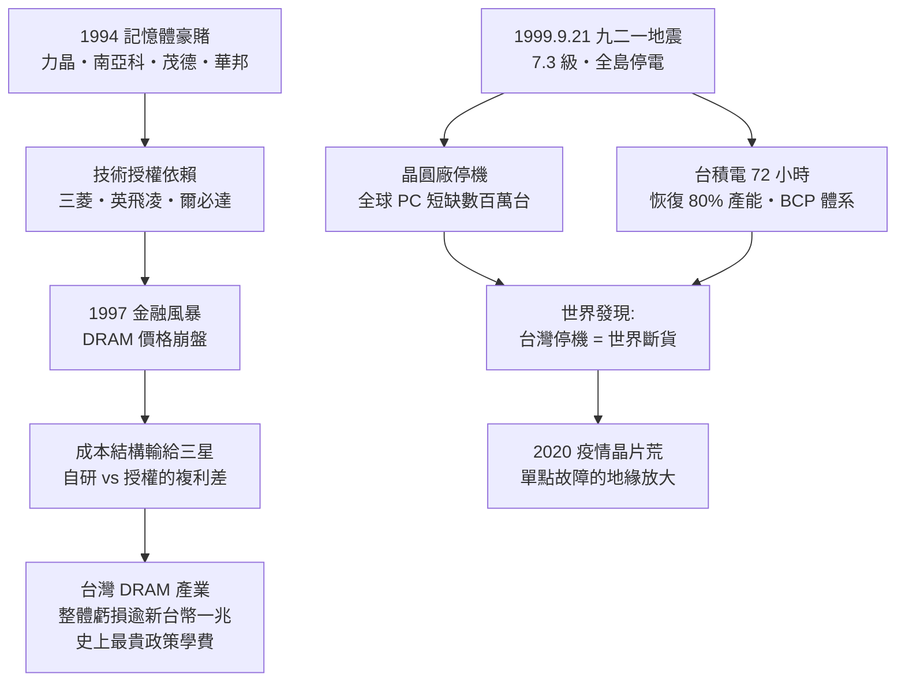

# 04.2 記憶體豪賭與九二一地震：全球供應鏈的單點故障實驗

## 一、案情

1994 年，黃崇仁創立力晶半導體，與日本三菱電機技術合作，在新竹科學園區興建 8 吋 DRAM 晶圓廠。同一時期，政府主導的「次微米計畫」技術移轉給台塑集團（南亞科技），華邦、茂德、華邦系與世大積體電路也先後投入 DRAM。短短數年，台灣掀起一場以「政府台塑合資、引進日歐技術」為範本的記憶體豪賭。

五年後的 1999 年 9 月 21 日凌晨 1 時 47 分，規模 7.3 的強震重創台灣中部。震央不在竹科，但大停電讓晶圓廠全面停機。全球電子公司第一次體驗到：**台灣停機，等於世界斷貨。**

兩起案件表面無關，實為一案：前者問「台灣該不該賭 DRAM」；後者問「世界敢不敢把命放在台灣」。答案，都藏在供應鏈結構裡。

## 二、前因：景氣、政策與技術依賴

**DRAM 的誘惑**。1993–1995 年 DRAM 景氣大好，價格高漲，全球搶建晶圓廠。政府宣示 DRAM 是「國家戰略產業」，次微米計畫（工研院主導的 0.5/0.35μm 自研製程）把成果移轉給民間；台塑以合資模式成立南亞科技，走「資本 + 授權」的路。

### 參賽者名冊

| 公司 | 成立 | 技術夥伴 | 背景 |
|------|------|---------|------|
| 華邦電子 | 1989 | 東芝 | 聯電系老將（楊丁元等）創立，先攻 SRAM 再轉 DRAM |
| 力晶 | 1994 | 三菱電機 | 黃崇仁創立，與日本合作最深的 8 吋廠 |
| 南亞科技 | 1995/1996 | 工研院次微米計畫 → 後與英飛凌合作 | 台塑集團出資，政府技術移轉的「政府+台塑合資」模式 |
| 茂德 | 1999 | 英飛凌 | 茂矽與英飛凌合資 |
| 世大 | 1990s | — | 後於 2000 年被台積電購併 |
| 瑞晶 | 1990s 末 | 爾必達 | 台塑系與爾必達合資 |

模式高度一致：**台灣出資本、出土地、出工程師；外國母廠出技術、收授權費**。這是一場事先張揚的豪賭——賭的是景氣夠長、學得夠快，能在依賴斷裂之前長出翅膀。

**但 DRAM 與邏輯晶片是兩種動物**：

| 面向 | 邏輯晶片（可代工學） | DRAM |
|------|---------------------|------|
| 電路設計 | 客戶提供 | **自己必須有設計能力** |
| 製程 | 標準 CMOS | 特殊結構（電容、埋層） |
| IP 來源 | 客戶累積 | 深度依賴授權母廠 |

台灣沒有 DRAM 自研能力，只能買技術——三菱（力晶）、英飛凌（茂德、華亞）、爾必達（瑞晶）、Qimonda。**技術授權的代價是永久性依賴**：每一代新製程都要重新付授權費，母廠倒閉時（爾必達 2012 年破產），自己跟著斷糧。

## 三、線索與推理（上）：豪賭的成本結構

$$
C_{\text{DRAM}} = \frac{\text{設備折舊} + \text{技術授權費}}{\text{產出位元數}}
$$

台灣廠的設備折舊與三星相當，但**授權費是一筆純成本**——三星自己研發製程，同樣的錢轉成了內部能力。長期競賽中，自研者以能力複利，授權者以現金流血。

更致命的是市場結構。DRAM 是典型的贏者全拿商品市場：三星採「反週期投資」，景氣最差時大擴產，用資本擠死對手。數學上，三星的平均成本曲線因規模而全面低於對手：

$$
AC_{\text{三星}}(Q) < AC_{\text{對手}}(Q) \quad \forall Q
\;\Rightarrow\;
\text{價格跌破對手變動成本，三星仍有毛利}
$$

1997 年亞洲金融風暴，DRAM 價格崩盤——這個公式第一次兌現：力晶靠「以廠養廠」苦撐，茂德、華亞則在之後的每一輪週期中反覆失血。

## 四、線索與推理（下）：九二一的單點故障實驗

1999 年 9 月 21 日，地震驗證了另一條公式。為什麼一場區域性地震撼動全球 PC 產業？三個放大器：

1. **庫存低**：JIT（即時生產）讓全球下游庫存只剩 2–4 週；
2. **產能集中**：台灣晶圓代工占全球產能六成以上，筆電占四成以上，無替代來源；
3. **不可替代性**：IC 不是「換個廠就能做」——製程不同、設計須重新驗證，轉換時間六個月起跳。

$$
\text{系統風險} = P_{\text{災難}} \times \text{下游損失} \times \frac{1}{\text{恢復時間}}
$$

震後測算：全球 PC 產業因 IC 短缺少產數百萬台，損失數十億美元——**遠大於**台灣晶圓廠自身的直接損失。單點故障的代價由整個網路支付。

**台積電的應對堪稱教科書**：72 小時內恢復八成產能（備用電源、機台重新校準 SOP）；張忠謀親自主持記者會，對客戶公開透明的受損報告；事後全面建立「營運不中斷（BCP）」體系——雙迴路電力、地下水備援、異地備援。

### 線索三：為什麼恢復得這麼快

72 小時的背後有兩個被低估的細節：

1. **晶圓廠的震害模式**：強震對潔淨室的直接破壞有限，真正致命的是**斷電瞬間**——機台內高溫製程中斷、真空破壞、wafer 報廢，以及重新開機後的機台參數漂移。九二一的損失主要來自停電與震動位移，而非建築倒塌。這決定了「恢復」的本質是校準與清點，不是重建。
2. **竹科的自救網絡**：園區有自己的變電系統與部分備用發電；地震當天，各廠工程師自動返廠——沒有任何人下動員令，工程師文化自己動了起來。

偵探的批註：韌性不是買來的設備，是**人願意半夜返回機台的組織文化**。這個無法寫進 BCP 文件的變數，才是 72 小時的真正來源。

### 線索四：良率學習曲線的岔路

同一年，DRAM 廠與代工廠的良率曲線走出岔路。學習曲線的形式是：

$$
Y(t) = Y_{\max} \left(1 - e^{-t/\tau}\right)
$$

學習時間常數 $\tau$ 取決於「製程事件的樣本量」：投片越多、客戶設計越多，缺陷模式被發現得越快。台積電一百多個客戶的設計在同一代製程上奔跑，統計上比 DRAM 廠「單一產品線」多出數十倍的驗證樣本——**代工模式的隱藏優勢，在良率學習速度上具現化**。DRAM 廠受制於授權製程（母廠給什麼就做什麼），學習自由度低；這條岔路，正是兩案共通的解釋變數。

## 五、理論：樞紐節點與效率—韌性的 trade-off

供應鏈是一個網路，台積電是其中的超級樞紐（hub）：

$$
\text{網路韌性} \propto \text{樞紐的冗餘度}
$$

單一樞紐的網路，任一樞紐故障都會級聯崩潰。九二一之後，全球客戶開始做多源採購（dual sourcing），卻發現一個無解的矛盾：**先進製程只有台積電能做，無法雙源**。這個矛盾在 2020 年代的疫情晶片荒與地緣政治中全面爆發。

## 六、後果

- DRAM 案：2000 年代力晶一度是全球第三大 DRAM 廠、市值數千億；2008 金融海嘯的「雙 D 慘案」後負債超過資產，2012 年下市重整，轉型晶圓代工與記憶體模組。台灣 DRAM 產業整體虧損超過新台幣一兆——史上最貴的政策學費。
- 九二一案：台灣晶圓廠全面升級耐震建築與電力冗餘（如今可耐七級地震）；諷刺的是，台灣供應鏈的集中度在震後**不降反升**——因為台積電的技術領先使替代者更少。
- 「台灣停機 = 世界斷貨」從此成為全球電子業的認知模板，為 2021 年的世紀晶片荒預演。

### 本案時間線

| 年份 | 事件 |
|------|------|
| 1989 | 華邦成立，開啟記憶體路線 |
| 1993–95 | DRAM 景氣高峰，全球搶建廠 |
| 1994 | 力晶成立，與三菱技術合作 |
| 1995–96 | 南亞科技成立（政府次微米計畫 + 台塑合資） |
| 1997 | 亞洲金融風暴，DRAM 價格崩盤 |
| 1999.9.21 | 九二一地震，7.3 級，全島停電；台積電 72 小時恢復八成產能 |
| 1999–2000 | 全球客戶啟動多源採購，發現先進製程無法雙源 |
| 2008 | 金融海嘯，雙 D 慘案 |
| 2012 | 力晶下市重整；爾必達破產，瑞晶斷糧 |

## 七、反事實

**如果 1994 年台灣把 DRAM 的錢全部押在晶圓代工與邏輯製程上會怎樣？**

- 推演：沒有 DRAM 週期的失血，茂德、華亞的資本會留在代工與 IC 設計；三星的價格戰失去台灣這批「授權式」對手，仍會擠死日商爾必達，但台灣躲過一兆學費。
- 但也要誠實：DRAM 大投資培養了數萬名製程工程師、拉高了設備與材料供應鏈的密度——力晶後來轉型代工能活，靠的正是這批資產。
- 九二一的反事實更刺骨：**如果震後恢復不是 72 小時而是 72 天**，全球 PC 業將重排供應鏈，台積電的樞紐地位可能被聯電或新加坡廠分食。72 小時，是 BCP 意識誕生前、靠紀律與運氣湊出來的偶然。

**教訓**：效率與韌性是 trade-off——JIT 模式把韌性全部換成效率，九二一是這筆帳的第一次催繳；而 DRAM 豪賭證明，在贏者全拿的商品市場裡，資本若不帶著自研技術入場，就只是替對手的規模經濟添柴。

### 冷案檔案

- 時間：1994–1999 年（雙案並偵）
- 案由：一場資本豪賭與一場地震，如何共同暴露台灣供應鏈的結構位置
- 判決一：DRAM 缺的不是資本或良率，是「技術自足」——授權模式在規模經濟賽局中是結構性弱勢
- 判決二：台灣從此不只是商業主體，而是全球電子系統的單點故障（single point of failure）
- 附註：南科叢聚（1995 核定、1997 動工）在本案之後承接了園區擴張——叢聚放大了效率，也放大了單點故障的半徑
