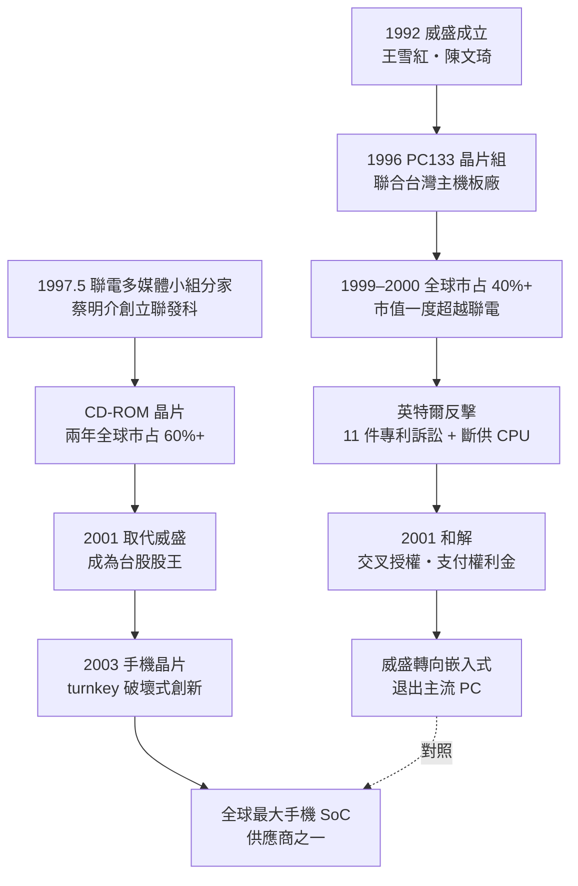

# 04.3 IC 設計群雄：威盛對抗英特爾與聯發科崛起

## 一、案情

1996 年起，王雪紅與陳文琦的威盛電子（VIA，1992 年成立）推出支援 Pentium 的 PC133 晶片組，性能與價格俱強，一度拿下全球晶片組市場四成以上——台灣 IC 設計公司第一次正面擊敗英特爾。英特爾以 11 件專利訴訟與斷供 CPU 反擊，雙方纏訟五年，2001 年和解。

隔年的 1997 年 5 月，聯華電子內部的多媒體團隊在蔡明介帶領下整隊出走，成立聯發科技（MediaTek），專攻光碟機晶片。兩年後拿下全球 CD-ROM 晶片六成市占；2001 年取代威盛成為台股股王；2003 年切入手機晶片，日後成為全球最大手機 SoC 供應商之一。

同一座島、同一個年代，兩家 fabless 公司走出兩條路：**威盛選擇正面攻打壟斷者的城牆，聯發科選擇繞到壟斷者看不見的側翼。** 城牆下與側翼上的結局，構成了台灣 IC 設計產業的雙案卷宗。

## 二、前因：晶片組為何是入門戰場，分家為何勝過內部創業

**晶片組的戰略窗口**。台灣主機板產業（華碩、技嘉、微星）崛起，需要大量晶片組；1990 年代晶片組由英特爾壟斷，但英特爾力推高價的 Rambus DRAM 路線，留下了規格空窗。晶片組不需要 x86 授權就能做「周邊橋接」，技術門檻低於 CPU——是 fabless 的第一個可攻市場：

| 需求特性 | 晶片組 | CPU | 顯示晶片 |
|---------|--------|-----|---------|
| 技術門檻 | 中 | 極高 | 高 |
| 市場規模 | 大 | 大 | 中 |
| Intel 在位優勢 | 強但非壟斷 | **壟斷（x86 專利）** | 中 |

**聯電的激勵難題**。1995 年起聯電內部多角化，蔡明介的多媒體小組開發 DVD 晶片。但 IDM 體制下，內部設計部門的報酬是：

$$
\text{內部員工報酬} = \text{薪資} + \alpha \cdot \text{部門利潤} \quad (\alpha \ll 1)
$$

分家後：

$$
\text{創辦人報酬} = \text{薪資} + \text{股票} \propto \text{公司價值}
$$

聯電的解法是**把 $\alpha$ 拉到接近 1**：讓多媒體小組整隊出去，母公司持股但不控股。台積電成熟的代工模式又消除了「沒有工廠」的障礙——fabless 的兩個前提（激勵 + 產能），在 1997 年同時齊備。

## 三、線索與推理：規格戰與夠用哲學

**威盛的戰術**：聯合台灣主機板廠推「PC133 + 威盛晶片組」，對抗英特爾的「Rambus + 自家晶片組」——用規格戰造反：

$$
\text{總成本}_{\text{PC133+VIA}} < \text{總成本}_{\text{Rambus+Intel}}
$$

主機板廠、記憶體廠、PC 廠全部跟進。規格戰的本質是網路外部性：

$$
U_i = a + b \cdot N_{\text{用戶數}}
$$

誰的使用者數先過臨界量，誰贏。威盛的策略是以台灣主機板產業（全球供應鏈樞紐）作為「臨界量加速器」——一週之內，全球通路就能鋪貨。這是台灣產業鏈以**集體行動**對抗單一巨頭的第一次成功。

**聯發科的戰術**：戰場選在光碟機晶片。1997 年 CD-ROM 出貨量爆炸（每台 PC 必備），但晶片被松下、東芝、Sony 等日商壟斷、價格高昂。聯發科的組合拳：

$$
\text{聯發科策略} = \text{整合度}\uparrow + \text{價格}\downarrow + \text{客戶支援}\uparrow
$$

日商做「高性能高價」的單晶片，聯發科做「夠用 + 超低價 + 技術支援到家」的整套方案，客戶是台灣與大陸的白牌光碟機廠。兩年後，全球市占六成。

### 線索三：股王換位的偵查

2001 年，聯發科上市即取代威盛成為台股股王。這次換位不是偶然，把兩家的損益表並排即可看出：

| 面向 | 威盛（1999–2001） | 聯發科（1999–2001） |
|------|-------------------|---------------------|
| 戰場 | PC 核心地帶（Intel 主場） | 光碟機側翼（日商主場但無反擊能力） |
| 對手反應 | 11 件訴訟 + 斷供 | 日商降價但組織慣性太重 |
| 授權成本 | 和解後支付 Intel 權利金 | 需付 Philips 等光碟機專利池費用，但遠低於 x86 稅 |
| 客戶結構 | 主機板廠（被 Intel 拉扯） | 白牌光碟機廠（忠誠、成長快） |
| 毛利率 | 遭訴訟與競爭侵蝕 | 穩定高毛利 |

偵探的結論：**聯發科每一格都贏在「選戰場」而非「拼技術」**。同為 fabless、同為聯電系血統，差異只在攻擊軸線的選擇。

### 線索四：分家連鎖反應——聯電系的誕生

蔡明介團隊的分家成功，讓聯電把 spin-off 模式連續複製：

- **聯詠**（LCD 驅動 IC）→ 日後成為面板驅動 IC 全球雙雄之一；
- **聯陽**（I/O 晶片）、**智原**（ASIC 設計服務）……
- 母公司聯電自身則在 1997 年宣布轉型純代工、2000 年完成五合一合併（聯電、聯誠、聯嘉、聯瑞、合泰），與台積電正面競賽。

「聯電系」衍生公司的合計市值，日後超過聯電本身——這是分家比留在母體創造更多價值的直接證據。台灣資本市場（尤其當時的股票分紅制度）對小公司特別慷慨，是這套模式得以運轉的制度燃料；美國大企業傾向內部孵化（incubation），聯電選擇外部分家（spin-off），差異即在於此。

## 四、理論：破壞式創新與專利作為談判籌碼

**Christensen（1997）的破壞式創新**，聯發科是亞洲最佳案例：

| 維度 | 日本 IDM | 聯發科 |
|------|---------|--------|
| 產品 | 高性能、高價 | 「夠用」、超低價 |
| 客戶 | 大品牌 | 白牌廠 |
| 組織 | 層級多、反應慢 | 小團隊、極快 |
| 結果 | 被侵蝕 | 沿性能軸向上 |

**威盛這邊的理論教訓**則是專利作為防禦性資產。英特爾為何最終選擇和解而非消滅威盛？看雙方的選項收益：

$$
V_{\text{Intel}} = \begin{cases}
V_{\text{持續訴訟}} = -\text{律師費} - \text{客戶不安} + p_{\text{勝訴}} \cdot \text{賠償} \\
V_{\text{和解}} = +\text{權利金} \cdot Q_{\text{VIA}} + \text{恢復客戶信任}
\end{cases}
$$

關鍵是威盛手裡握有 DDR／晶片組專利，可以反向威脅：

$$
\text{談判籌碼} \propto \sqrt{\text{自有專利數} \times \text{與對手專利的重疊度}}
$$

交叉授權是唯一的均衡解。訴訟是談判的延續，談判是實力的延伸。

而聯發科側的理論對位是「**能力民主化**」：把設計知識打包成標準品，讓沒有設計能力的客戶也能出貨——這個邏輯在 2003 年的手機晶片上達到頂點（turnkey 方案），但它的原型就是 1997 年的 CD-ROM 晶片：不只賣晶片，還派工程師駐廠幫客戶調機。

## 五、後果

- **威盛線**：2001 年和解後轉向嵌入式 CPU（C3、C7、Eden），退出主流 PC 市場；但此戰確立了「台灣 fabless 可以對抗英特爾」的心理事實，也確立了遊戲規則——進入巨頭的核心地帶，必須付「授權稅」。
- **聯發科線**：2001 年上市即成股王；2003 年切入手機晶片，以 turnkey 方案引爆山寨機生態系；2008 年手機晶片出貨量全球第一；2010 年代與高通在智慧手機市場分庭抗禮。
- **聯電系效應**：聯詠（面板驅動 IC）、聯陽、智原等衍生公司合計市值超過聯電本身——分家比留在母體創造了更多價值。
- **群雄圖譜**：2000 年代台灣 fabless 的路線圖全部指向「巨頭的夾縫」——聯發科（光碟 → 手機）、聯詠（面板驅動）、瑞昱（網路）、晨星（電視晶片），清一色是英特爾不做或做不好的領域。

### 本案時間線

| 年份 | 事件 |
|------|------|
| 1992 | 威盛電子成立 |
| 1995 | 聯電內部多角化，多媒體小組開發 DVD 晶片 |
| 1996 | 威盛推出 Pentium 相容 / PC133 晶片組 |
| 1997.5 | 蔡明介率多媒體小組分家，聯發科成立 |
| 1999 | 聯發科 CD-ROM 晶片全球市占破六成；威盛市占逾四成 |
| 1999–2000 | 英特爾發動 11 件專利訴訟；威盛市值一度超越聯電 |
| 2001 | 威盛英特爾和解；聯發科上市成股王 |
| 2003 | 聯發科切入手機晶片，turnkey 模式問世 |
| 2008 | 聯發科手機晶片出貨量全球第一 |

## 六、反事實

**如果威盛當年不正面攻打晶片組、而是像聯發科一樣選側翼會怎樣？**

- 推演一：不碰 PC133 規格戰，威盛不會招來 11 件訴訟與斷供報復，也不會燒掉與英特爾和解的權利金與五年管理層精力；但 PC 產業的規格空窗是歷史性機會，放棄它等於放棄「唯一一次站上主流舞台」的可能。
- 推演二：反之，若聯發科當年選擇攻打 PC 晶片組（聯電系本有此能力），它會撞上威盛與英特爾的戰場，很可能同歸於盡。蔡明介選擇日商把持、但英特爾鞭長莫及的光碟機市場，正是看清了「**壟斷者鞭子的長度**」。
- 聯發科後來的專利策略證明它記住了威盛的教訓：每年申請數千件專利，在手機市場進場前先備好談判籌碼。

**教訓**：正面進攻需要專利與資本的雙重彈藥，側翼滲透只需要速度與對客戶的貼身服務。台灣 IC 設計的黃金法則由此寫定——**在巨頭的夾縫裡選戰場，用供應鏈的集體行動放大自己，進場之前先把談判籌碼備好。**

### 冷案檔案

- 時間：1996–2003 年（雙案並偵）
- 案由：同一產業的兩種攻擊軸線，為何結局迥異
- 判決一：對壟斷者（x86 專利牆），正面進攻的上限是「和解」——贏了市占，輸了毛利
- 判決二：對鬆懈的寡頭（日系光碟晶片），側翼可以全拿——速度與客戶服務就是武器
- 深層結構：fabless 模式 + 台積電代工 + 台灣資本市場，構成 1997 年前後「IC 設計創業」的三要素；聯電系分家與威盛獨立創業，是這三要素的兩種組合方式
