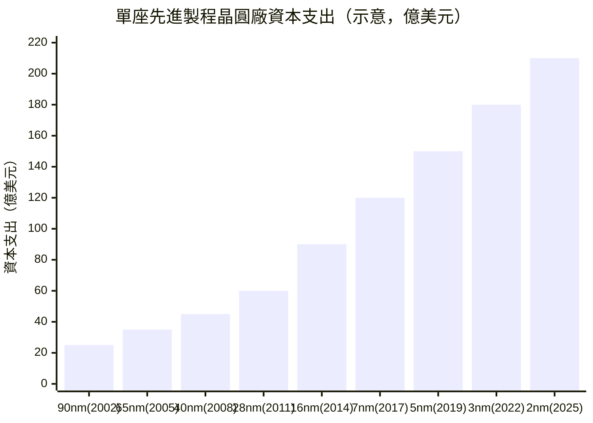
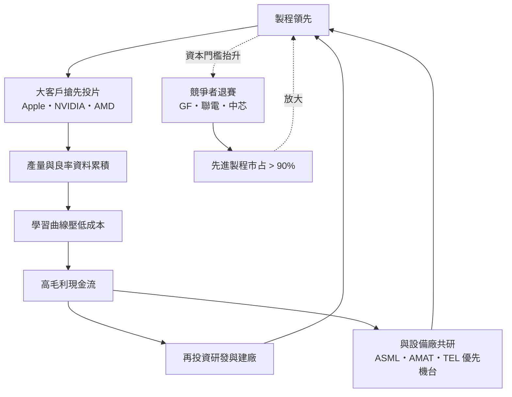

# 第五章之一：摩爾定律競速——從 90nm 到 3nm 的贏者全拿

> 侦查檔案編號：05.1　案發時間：2002–2026　案發地點：新竹→台南→全球

## 案情

2002 年，台積電以 90nm 製程擠進世界製程第一梯隊（見第二章末尾與科技史檔案 2002）。此後二十餘年，一場以「奈米」為單位的馬拉松在台南科學園區的無塵室裡悄然展開：65nm、40nm、28nm、16nm、7nm、5nm、3nm，直到 2025 年前後的 2nm 量產。終點線上站著的，只剩台積電一家——曾經群雄並起的晶圓代工業，收斂成一場「贏者全拿」的獨占局。

本案要偵辦的謎題是：**為什麼一場人人喊著「追趕摩爾定律」的競賽，最後變成了只有一個人能繼續跑的比賽？**

## 前因

清點 2002 年案發現場的既有物證：

1. **12 吋廠與資本門檻**：一座 12 吋廠造價 20–30 億美元，8 吋轉 12 吋使晶粒數提升 2.25 倍，規模經濟把二線廠直接擋在門外。
2. **飛輪已轉動**：製程領先 → 客戶搶先投片 → 產量與學習曲線 → 再投資製程。台積電自 2002 年起在每個新節點都比對手早 6–12 個月量產。
3. **政策背景**：2000 年「兩兆雙星」讓半導體的擴產有國家融資與租稅背書，面板與 DRAM 也在同一場賭局中下注——但三者的結局天差地遠（本章並陳）。
4. **競爭者名單**：聯電、中芯（SMIC）、三星、格羅方德（GlobalFoundries，2009 年自 AMD 分拆）。

疑點：所有人都拿到同樣的設備目錄，為何只有一家能持續踩上每一代節點？

## 線索與推理

### 線索一：資本支出的指數曲線

半導體的殘酷在於：**研發費用與單座廠成本隨節點推進呈指數上升**。歷代節點的資本支出大致可用下式逼近：

$$
\text{CAPEX}_n \approx \text{CAPEX}_0 \cdot e^{\alpha n}, \quad \alpha \approx 0.15\text{–}0.2 \;(\text{每節點})
$$

推論：當一座廠的造價從 25 億美元漲到 200 億美元以上，能負擔「同時蓋數座＋研發下一代」的公司，全球收斂為一家。**資本密集化本身就是淘汰機制**——摩爾定律競速不是技術賽，是一場燒錢耐力賽。

### 線索二：追趕者悖論的數學

追趕者投入研發追到節點 $n$ 時，領先者已量產 $n+1$ 。定義落後代數 $g$ ：

$$
g_{t+1} = \max\left(g_t,\; \frac{v_{\text{領先}}}{v_{\text{追趕}}} \cdot (t+1)\right) - \text{追趕進度}
$$

當領先者的學習曲線斜率更陡（量產經驗多）、現金流更肥（先進製程毛利 55% 以上）， $g$ 不減反增。物證：

| 年份 | 台積電 | 聯電 / 中芯 | 落後 |
|------|--------|------------|------|
| 2002 | 90nm | 130nm | 一代 |
| 2008 | 40nm | 65nm | 一代半 |
| 2014 | 16nm | 28nm | 兩代 |
| 2017 | 7nm（超越 Intel） | 28nm | 兩代以上 |

2010 年代聯電、格羅方德先後宣布停止追逐 7nm 以下；中芯受美國出口管制（2020 年 EUV 禁運）困於 7nm 之上。**退賽本身就是承認**：這場賽局的均衡解是「不玩」。

### 線索三：為什麼 2017 年超越 Intel 是分水嶺

Intel 靠 IDM 一體承擔「設計＋製造」，其 10nm 多次延期（2014→2019），而台積電以代工模式彙集 Apple、NVIDIA、AMD、高通等所有 fabless 的需求，研發攤提被分散到數十個客戶身上。以單位研發成本計：

$$
\overline{R\&D} = \frac{R\&D_{\text{總額}}}{\sum_j Q_j} \quad \Rightarrow \quad \text{客戶越多，單位研發成本越低}
$$

代工模式在先進製程時代反而比 IDM 更「輕」——這是張忠謀 1987 年商業計畫書寫不進去的遠期支票，在 2017 年兌現。

再往深挖一層：台積電的另一步關鍵棋，是 2009 年前後延攬 **蔣尚義與研發團隊**重整先進製程組織，並在 2011 年的 28nm 節點上同時提供 **Poly/SiON 與 HKMG（高介電金屬閘極）**兩條路線——客戶不必冒險遷移技術路徑。28nm 是半導體史上最長壽的甜蜜節點（至今仍大量用於車用與物聯網晶片），台積電在此節點拿下壓倒性市占，現金流自此與對手拉開「世代差」。物證鏈：

| 節點 | 量產年 | 台積電市占（該節點先進製程） | 關鍵技術 |
|------|--------|------------------------------|---------|
| 28nm | 2011 | 約八成 | HKMG 雙路線 |
| 16nm | 2014 | 約八成半 | FinFET 追平 Intel |
| 7nm | 2017 | 全球唯一量產 | DUV+ EUV 前置 |
| 5nm | 2019 | 全球唯一量產 | EUV 全面導入 |
| 3nm | 2022 | 全球唯一量產 | FinFET 最後一代 |

偵探註記：7nm 用 DUV 多重曝光即可達成，但台積電在 7nm 就開始少量使用 EUV、在 5nm 全面導入——**用不成熟的工具練手**，讓 5nm 時 EUV 良率已經爬完。這種「提前一代付學費」的紀律，是追趕者最難模仿的組織能力。

### 線索四：對照組——兩兆雙星的分岔

同一時期，台灣政府用相似工具支持的兩個「兆元產業」，走出了三種結局：

| 產業 | 資本密集度 | 產品差異化 | 結局 |
|------|-----------|-----------|------|
| 晶圓代工 | 極高 | 高（製程＋服務＋IP 生態） | 贏者全拿，飛輪持續 |
| 面板 | 高 | 低（同尺寸同規格，商品化） | 2008–2019 韓陸夾殺，價格戰絞肉機 |
| DRAM | 極高 | 幾乎零 | 2008 金融海嘯「雙 D 慘案」，力晶下市、茂德破產 |

偵探推論：**政策工具（資本＋園區＋租稅）不決定成敗，產業結構才決定**。晶圓代工的「製程＋服務」差異化與客戶黏著度，使資本投入能轉成持久的護城河；面板與 DRAM 的商品化則使資本投入只換來更深的價格戰泥淖。兩兆雙星是「發展型國家」最後一次大規模挑產業——它一半證明了模式的極限，另一半則意外澆灌出世界最強的公司。

進一步檢視面板與 DRAM 失敗的共同結構：兩者都是「**週期×商品**」產業，價格由全球產能決定而非由品牌決定。當一輪景氣來臨，所有廠商同時擴產，供給曲線右移的幅度永遠超過需求——這就是 DRAM 業著名的「潮汐陷阱」。以供需式表達：

$$
P_{t+1} = P_t \cdot \left(1 - \beta \cdot \frac{\Delta S_{\text{全行業擴產}}}{\Delta D_{\text{需求成長}}}\right)
$$

當 $\beta \gg 1$ （供給反應遠大於需求），價格崩跌不可逆。台灣 DRAM 五強（力晶、茂德、南亞科、華亞科、瑞晶）在 2008 年前的擴產軍備賽中，全部用**高槓桿**融資建 12 吋廠；金融海嘯一來，價格跌破現金成本，連續三年虧損使槓桿變成斷頭台——力晶 2012 年下市、茂德破產重整。而韓國三星用「**反向投資**」（景氣最差時擴產、用財閥資本撐過谷底）把台日廠一一擠出賽局。同一套國家資本工具，遇到同一個韓國對手，代工模式贏、記憶體模式輸——差別只在有沒有「差異化」這個乘數。

### 線索五：IC 設計的岔路——威盛的教訓與聯發科的迂迴

製造賽局收斂成一家，設計賽局卻走出了多強並立的另一條路。2001 年威盛與 Intel 的專利和解（詳見科技史檔案 2001）確立了「授權稅」法則：在別人的架構地盤上作戰，利潤函數裡永遠有一項 $C_{授權}$ ，把毛利壓到對手可容忍的邊緣。此後台灣 IC 設計的生存法則變成「**在巨頭的夾縫中找利基**」：聯發科（光碟機→手機）、聯詠（面板驅動 IC）、瑞昱（網路晶片）、晨星（電視晶片）——全部選擇 Intel、高通不做或不屑做的戰場。2003 年聯發科以 turnkey 方案破壞手機晶片市場（詳見科技史檔案 2003），把設計知識打包成商品，更證明了一件事：**在節點競賽之外，還存在「賣鏟子」與「賣整套鏟車」的第二條護城河**。製造的贏者全拿，與設計的利基多元，共同構成台灣半導體的雙支柱。

## 理論

### 贏者全拿的技術條件

$$
\text{贏者全拿} \iff \underbrace{\text{資本門檻}}_{\text{淘汰}} \times \underbrace{\text{學習曲線}}_{\text{累積}} \times \underbrace{\text{客戶黏著}}_{\text{鎖定}} > \text{市場可容納的利潤和}
$$

三個乘數中任何一項不足，市場就會容納兩家以上（如面板的兩虎、DRAM 的多強）。半導體先進製程是三者同時極大化的案例。這也是 2023 年後 AI 晶片荒的結構性根源：全世界的運算需求，湧向唯一能量產 5nm 以下晶片的出口。

### 飛輪的 mermaid 總圖

（見下方圖表）

### 摩爾定律本身的物理極限

本案的背景樂是摩爾定律（電晶體密度每兩年翻倍）。但 2010 年代後，這條定律進入「**經濟性衰退、物理性續命**」的階段：

$$
\text{每電晶體成本} = \frac{\text{晶圓成本（每代上升 30\text{--}50\%）}}{\text{晶粒數（每代上升）} \times \text{良率}}
$$

從 28nm 到 7nm，晶圓成本漲了近一倍，電晶體密度漲了約六倍，每電晶體成本仍在下降但斜率已鈍。3nm 之後，微影、蝕刻、材料的每一步都在與原子尺寸搏鬥（矽晶格常數 0.543nm——3nm 閘極已不足六個矽原子寬）。業界以三大續命術應對：

1. **先進封裝**：從「平面縮小」轉向「立體堆疊」（CoWoS、SoIC、3D stacking）——摩爾定律從微影接力給封裝。
2. **新材料**：GAA（環繞閘極）電晶體、背面供電（BSPDN）、2D 材料與碳基的前瞻研究。
3. **系統級創新**：Chiplet（小晶片分拆再組裝）——把「一顆大晶片」拆成良率更高的多顆小晶片，用封裝換微影。

推論：摩爾定律沒有死，但它已從「一家公司沿節點直線奔跑」變成「整條供應鏈的多棒接力」——而接棒區（先進封裝）恰好又落在台灣。這是 05.2 案件的技術前情。

## 後果

- 台積電先進製程（16nm 以下）市占在 2010 年代末突破九成，成為全球唯一能承接最尖端 AI 晶片（NVIDIA GPU、Google TPU）的工廠。
- 2020 年起的 CoWoS 先進封裝（見 05.2）接棒成為新瓶頸——「節點」的定義從微影延伸到封裝。
- 面板雙虎在 2010 年代後被韓廠 OLED 轉型與陸廠產能淹沒；DRAM 三強退出歷史舞台。台灣政府自此不再「挑產業」，改採 5+2、六大核心戰略等中性工具。
- 聯電 2019 年宣布不再追逐 12nm 以下；格羅方德 2018 年放棄 7nm——賽道上只剩一家選手，競賽本身消失，取而代之的是客戶對「唯一供應商」的依賴焦慮。
- 「贏者全拿」帶來地緣政治的集中性風險——本案的終局，將在下一個案件中揭曉。

## 反事實

- **若 2001 年景氣谷底台積電縮減資本支出**：12 吋與 90nm 的領先可能讓給三星（它確實以補貼在面板與 DRAM 上這樣做）。台灣可能成為「第二梯隊之首」而非唯一領跑者。
- **若兩兆雙星把同樣資源全部押在 DRAM**：2008 年雙 D 慘案將連帶拖垮台灣金融體系，矽盾不會存在。
- **若 Intel 在 2010 年代把代工開放給 Apple**：台積電的飛輪將失去最大燃料來源，2017 年的超車可能不會發生。歷史的偶然在於：Intel 的組織慣性（IDM 利潤函數）使它無法做出「替敵人的客戶服務」的決策。

## 冷案檔案

- 時間：2002–2026
- 案由：資本指數曲線 × 學習曲線 × 客戶鎖定 = 不可逆的贏者全拿
- 理論：飛輪效應（Flywheel Effect）的半導體具象化；「潮汐陷阱」解釋商品化產業的週期性覆滅
- 教訓：摩爾定律的真正淘汰者不是技術落後者，而是資產負債表不夠長的玩家。同一套國家工具，在差異化產業締造獨占，在商品化產業釀成雙 D 慘案——**政策永遠押注的是產業結構，不是產業名稱**。
