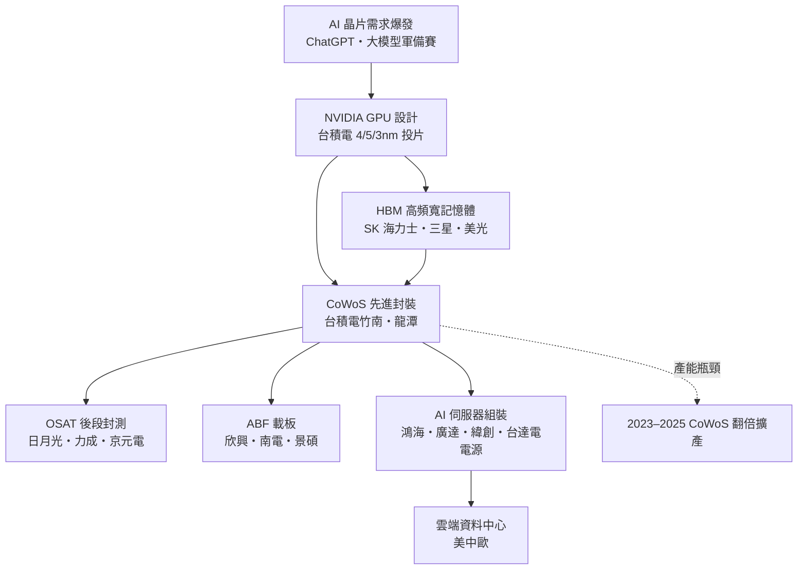
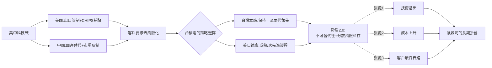

# 第五章之二：護國神山——地緣政治與台積電的全球化兩難

> 侦查檔案編號：05.2　案發時間：2018–2026　案發地點：新竹、華府、北京、東京、亞利桑那

## 案情

2018 年美中貿易戰開打，半導體從「商品」升格為「武器」。2020 年起，美國對華為實施晶片禁令、對中芯封鎖 EUV 設備；2022 年《CHIPS 法案》以 527 億美元補貼要求台積電赴亞利桑那設廠；2024 年起 AI 算力出口管制逐級加碼。同一時間，「矽盾」「護國神山」成為台灣社會的自我敘事：全台灣最先進的晶片，被視為阻嚇戰爭的經濟武器。

本案的謎題：**一座做生意的公司，為什麼會同時被兩個大國視為戰略資產？而「出海設廠」究竟是解險，還是拆掉自己的護城河？**

## 前因

1. **製程集中**：先進製程贏者全拿（見 05.1），全球 90% 以上最先進晶片在新竹與台南生產——1999 年九二一地震已預演過一次「單點故障」的全球衝擊。
2. **美中科技戰**：2018 年起，美國以實體清單、出口管制、設備禁運三件套，試圖切斷中國取得先進晶片的路徑；中國則以「國產替代」反制。
3. **AI 時代來臨**：2022 年底生成式 AI 爆發，NVIDIA GPU 與其 CoWoS 先進封裝成為全球搶購的算力期貨，台積電的戰略地位再上一層。
4. **「矽盾」論述**：Craig Addison 2001 年《Silicon Shield》提出——台灣掌握全球電子供應鏈核心，使各國有動機保衛台灣。
5. **前案伏筆**：1999 年九二一地震後，全球 DRAM 價格一夜波動、各大廠緊急調貨——那是世界第一次意識到「台灣停機＝全球停機」。二十年後的晶片荒（2020–2022）讓汽車業年減產逾千萬輛，把這個認知放大到國安層級。

疑點：如果矽盾有效，為何台灣反而開始焦慮？如果矽盾無效，為何美日都搶著要台積電去設廠？

## 線索與推理

### 線索一：矽盾的賽局結構——相互保證毀滅的經濟版

冷戰的 MAD（相互保證毀滅）邏輯是：雙方都有第二擊能力，先動手者必被報復。矽盾是它的**經濟版**：

$$
\text{威嚇力} = L_{\text{攻方}} \times L_{\text{世界}} \times L_{\text{台灣自身}}
$$

其中 $L$ 為開戰後各方損失的期望值。台灣晶圓廠一旦停擺，全球電子業（包括中國自身的手機、汽車、AI 產業）將承受以兆計的損失——攻擊台積電等於攻擊所有人的資產負債表。這是一個「同歸於盡的保險結構」。

但偵探必須指出矽盾的三個裂縫：

- **它只提高成本，不消滅動機**：若攻方的政治收益足夠大，經濟損失可以是被接受的代價。
- **美中「脫鉤」會侵蝕矽盾**：若中國自建晶片供應鏈、美國自建晶圓廠，台灣的不可替代性遞減——矽盾是**遞耗資產**。
- **晶片越重要，台灣越像「人質」**：1973 年石油危機中，產油國的下場是先被全球圍剿尋找替代方案。

### 線索二：赴美設廠的兩難矩陣

2020 年台積電宣布亞利桑那設廠，2023 年後熊本廠、德勒斯登廠相繼推進。每一步都同時有收益與代價：

| 決策 | 收益 | 代價 |
|------|------|------|
| 留在台灣擴產 | 學習曲線、供應鏈密度、成本最低 | 地緣風險全部集中一地，客戶不安 |
| 赴美設廠 | 政治保險、貼近客戶、取得補貼 | 成本高出 30–50%、工程師短缺、先進技術外流疑慮 |
| 赴日設廠 | 材料與設備聯盟、熊本供應鏈 | 只做成熟製程，稀釋不重 |
| 全面拒絕出海 | 護城河完整 | 政治不可行——美國以出口管制與補貼「勸說」 |

以兩難的淨現值表示：

$$
NPV_{\text{出海}} = \underbrace{V_{\text{政治保險}}}_{\text{難以量化但巨大}} - \underbrace{\Delta C_{\text{成本劣勢}}}_{30\text{–}50\%} - \underbrace{V_{\text{技術溢出風險}}}_{\text{折現率極高}}
$$

台積電的解法是「**等級分離**」：海外廠的製程永遠落後台灣本廠一至兩代（亞利桑那量產 4nm 時，台灣已量產 2nm）——把雞蛋放進多個籃子，但金雞蛋永遠留在家裡。

### 線索三：CoWoS 與 AI 供應鏈——封裝成為新矽盾

2022 年 11 月 ChatGPT 上線，兩個月內破億用戶，生成式 AI 需求瞬間引爆。但搶購 NVIDIA H100 的人很快發現：瓶頸不在電晶體，而在**先進封裝**。CoWoS（Chip-on-Wafer-on-Substrate）把 GPU 晶粒與 HBM 記憶體以 2.5D 方式封裝在同一片矽中介層上，以解決記憶體頻寬瓶頸——每一顆 AI 晶片都必須過這道手術。瓶頸的地理分布揭示了台灣的隱形深度：

推理：CoWoS 瓶頸使「封裝」從勞力密集的後段升格為技術密集的戰略環節——日月光與矽品（2018 年完成整合）成為全球 OSAT 雙巨頭，ABF 載板三強全是台商。**矽盾不只一座山，是一整條山脈**：從設計（聯發科天璣、NVIDIA 台灣研發）到微影、封裝、載板、電源、組裝，每一層都有台灣節點。但也因此，整條 AI 供應鏈的單點故障密度，比 2020 年更高。

值得偵探標記的歷史反差：封裝是台灣電子產業的**起點**（1964 年通用儀器來台，做的正是封裝）。六十年後，這個曾經被視為「低毛利後段」的環節，以 CoWoS 之名回到戰略舞台中央。產業史的迴圈，比偵探小說更講究伏筆。

### 線索四：美中科技戰的攻防棋譜

把 2018–2026 的管制措施整理成棋譜，可以看清雙方的博弈邏輯：

| 年份 | 美方動作 | 中方回應 | 對台影響 |
|------|---------|---------|---------|
| 2018 | 中興制裁案（後解除） | 啟動晶片自給戰略 | 台商開始評估回流與分散 |
| 2019–2020 | 華為實體清單、台積電斷供華為 | 華為囤貨、國產替代加速 | 台積電失去第二大客戶，但訂單被 Apple/NVIDIA 補上 |
| 2020 | 中芯無法取得 EUV | 全力自研光刻 | 中芯被鎖在先進製程門外 |
| 2022 | CHIPS 法案、設備與人員管制升級 | 成立大基金三期 | 補貼戰啟動，台積電赴美成本被部分對沖 |
| 2023 | AI 晶片出口管制（A100/H100 級） | 華為昇騰、國產 GPU | 台鏈被迫在兩套生態間選邊 |
| 2024–2025 | 管制逐級加碼、荷日設備廠加入 | 稀土/鎵鍺出口反制 | 合規成本上升，去風險化成為常態 |

棋譜顯示：美國的目標不是封死中國，而是**讓中國的先進算力落後 5–10 年**；中國的目標不是贏得今天，而是**在成熟製程與國產鏈上建立不可逆的存在**。台灣企業的處境，是棋盤本身。

### 線索五：晶片禁令的回力鏢

美國出口管制（華為禁令 2020、設備管制 2022、AI 晶片管制 2023/2024/2025 逐級升級）短期內重創中國先進製程（中芯被鎖在 EUV 之外），但也產生三個回力鏢效應：

1. 中國以國家資本全力投入國產替代（中芯 N+2、華為麒麟 7nm 的突破顯示圍堵有極限）。
2. 美國客戶損失中國市場營收，被迫要求台積電「去台化」分散產能。
3. 台灣企業在兩套管制體系之間（美國 OFAC／中國反制法）的合規成本與政治壓力同步上升。

## 理論

### 地緣折價與地緣溢價

$$
P_{\text{台股}} = P_{\text{基本面}} \times \left(1 - \rho_{\text{地緣風險}}\right)
$$

台積電長期享有本益比低於 Intel、NVIDIA 的「地緣折價」——市場為台海風險定價。而美日設廠補貼、客戶「去風險」訂單，則是客戶願意支付的「地緣溢價」。台灣的處境是：**生產上享規模經濟的極大值，資本上付風險貼水的極大值**。

### 出海的賽局總圖

### 護國神山的多層護城河模型

把 05.1 的贏者全拿條件擴充到地緣維度。台積電的總護城河：

$$
M_{\text{總}} = \underbrace{M_{\text{製程}}}_{\text{一至兩代領先}} \times \underbrace{M_{\text{封裝}}}_{\text{CoWoS/SoIC}} \times \underbrace{M_{\text{生態}}}_{\text{設計服務・IP・人才池}} \times \underbrace{M_{\text{信任}}}_{\text{二十年交貨紀錄}}
$$

連乘結構的含義：地緣衝擊若僅損害其中一項（如海外廠稀釋 $M_{\text{製程}}$ 的獨占性），只要其他三項仍在，總護城河呈**漸進折舊**而非斷崖。台積電赴海外設廠的實質，是主動用 $M_{\text{製程}}$ 的一部分，去購買地緣風險的分散——數學上等於「以獨占性換生存性」。而「等級分離」策略的巧妙在於：它只出售**上一代**的獨占性，把每一代的新增獨占性留在本廠，使折舊速度可控。

## 後果

- 2020–2026：台積電在美（亞利桑那三座廠）、日（熊本兩座廠）、德（德勒斯登）同步擴張，海外資本支出占比大增；台灣本廠同步推進 2nm（新竹寶山）與 1.4nm 研發。
- 美國 CHIPS 法案帶動全球補貼競賽（日本、歐盟、中國相繼跟進），半導體從自由貿易商品轉為國家安全物資。
- 台灣社會的「護國神山」敘事兩極化：既是榮耀，也是被綁架的焦慮——「神山出海」被質疑為「淘空矽盾」或「多餘的保險費」，真相在兩者之間。
- AI 晶片荒（2023–2025）使 CoWoS 與先進封裝產能成為新的國家級瓶頸，台灣封測與載板業迎來黃金年代。
- 台灣政府的政策工具隨之演化：從「挑產業」轉向「強化不可替代性」——半導體學院、人才專法、電力與水資源計畫、以及 2024 年後將 AI 產業鏈列為核心戰略。偵探註記：這些工具不再試圖「複製下一座神山」，而是承認神山只有一座，轉而**維護整條山脈的地質穩定**。

## 反事實

- **若美中未爆發科技戰**：台積電可能持續「技術中立」地同時服務華為與蘋果，營收更高，但台海開戰時的全球衝擊也將更徹底——沒有演習過的分散，意味著沒有任何備援。
- **若 2020 年台積電拒絕赴美**：短期毛利保住，但 CHIPS 法案補貼將轉投三星與 Intel，且美國可能以出口設備許可為槓桿強迫「技術授權」——消極抵抗的長期成本未必更低。
- **若中國在 2020 年前取得 EUV**：先進製程可能三分天下，矽盾的威嚇力腰斬，台灣的談判地位驟降——荷蘭 ASML 的出口許可，是這十年地緣史上最被低估的單一決策。

## 冷案檔案

- 時間：2018–2026
- 案由：經濟上的贏者，如何成為地緣上的人質；出海是保險還是拆牆
- 教訓：**矽盾的本質是「讓所有人輸不起」，但讓所有人輸不起的另一面，是所有人都想找替代品。**
