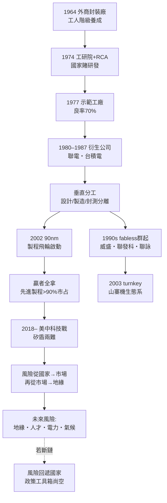
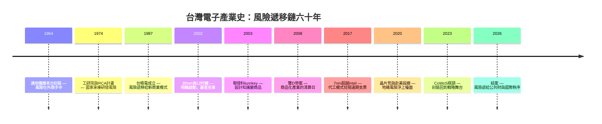

# 第五章之三：尾聲——台灣模式的本質、風險遞移鏈與未來

> 侦查檔案編號：05.3　案發時間：1964–2026　案發地點：一個北回歸線上的島嶼

## 案情（全案重構）

六十年的偵查到此結卷。回望全案，台灣電子產業史不是一連串獨立的成功故事，而是**一條環環相扣的因果鏈**：

$$
\text{技術移轉} \xrightarrow{\text{公部門承擔風險}} \text{衍生公司} \xrightarrow{\text{垂直分工}} \text{代工/設計分離} \xrightarrow{\text{摩爾定律}} \text{贏者全拿} \xrightarrow{\text{地緣政治}} \text{矽盾的兩難}
$$

每一節都以前一節的輸出為輸入：沒有 1964 年的封裝工人，就沒有 1976 年能吃下 RCA 技術的工程師；沒有工研院示範工廠，就沒有聯電與台積電；沒有專業代工模式，就沒有全球 fabless 的爆發；沒有製程贏者全拿，就不會有矽盾與護國神山的煩惱。

本章以三個總結性小節結案：全案重構、證據鏈檢驗、結案陳詞。

## 證據鏈之一：台灣模式的本質——風險遞移鏈

### 模式的運作機制

台灣模式的核心是一條**風險遞移鏈**：政府先賭、研發轉移、市場淘汰。每一代產業升級，都是一次風險從國家向市場的轉移：

| 階段 | 風險承擔者 | 案例 | 退出機制 |
|------|-----------|------|---------|
| 1. 研發賭注 | 國家（工研院預算） | RCA 計畫、次微米計畫 | 技術移轉後歸檔 |
| 2. 產業孵化 | 國家＋民間合資 | 台積電（行政院開發基金 48%）、力晶（台塑） | 衍生、民營化 |
| 3. 市場淘汰 | 股市與訂單 | 聯電轉型、威盛退出、雙 D 慘案 | 倒閉與下市 |
| 4. 全球競爭 | 純市場 | 台積電飛輪、聯發科天璣 | 退賽者消失 |

與他國比較，風險遞移的速度是關鍵差異：韓國財閥由國家持續補貼（風險不退出）、日本通產省指導（風險由財閥內部消化）、中國直接操盤（風險滯留國家資產負債表）。台灣政府在「賭對」後**退出**——行政院開發基金至今仍持有台積電少數股權，但從不干預經營。**敢賭、而且敢放手，是發展型國家的稀有能力。**

### 反面教材：不退出的下場

風險遞移鏈最有力的證據，來自「不遞移」的對照組：

- **DRAM**：政府與銀行團持續紓困拖到 2012 年，最終仍以力晶下市、茂德破產收場——風險在國家與金融體系內滯留十年，最後一次清算。
- **面板**：政府多次動用國發基金與銀行團馳援，把「雙虎」的退場延後了五年，代價是資源無法轉投資新產業。
- **對照：台積電**：1986 年國家出資 48%，1994 年後逐步釋股，行政院開發基金獲利了結數百億——**國家賺到錢、產業拿到資本、市場拿到定價權**，三方同時離場滿意。

推理：風險遞移鏈與「國家資本退出」是一體兩面。遞移不是免費的——它要求國家**放棄贏家的分成**（台積電若國有至今，其市值即國庫資產），換取「輸家的止損紀律」。台灣模式的精華不在政府會挑公司，而在政府**捨得賣掉挑中的公司**。

### 模式的數學表述

全案可用一條連乘式總結（呼應本書總綱）：

$$
\text{台灣電子業的成敗} = \underbrace{\text{國家承擔早期風險}}_{\text{1974–1987}} \times \underbrace{\text{垂直分工的模式創新}}_{\text{1987–2002}} \times \underbrace{\text{製程飛輪}}_{\text{2002–2017}} \times \underbrace{\text{地緣適應力}}_{\text{2018–}}
$$

連乘而非連加——任何一項為零，積便為零。兩兆雙星的面板與 DRAM 之敗，正是「國家風險承擔」缺乏後續乘數（差異化、飛輪）的失效案例；而它們的殘骸（人才、設備、供應鏈）部分被吸收進半導體主線，這也是遞移鏈的另一面。

### 風險遞移鏈的總圖

## 證據鏈之二：模式的三項成就與四道裂縫

### 成就（證物 A–C）

- **A. 深度垂直分工**：從 IC 設計、光罩、晶圓製造、封測、載板到系統組裝，全世界沒有第二個經濟體在 400 公里內配齊整條價值鏈——2023 年 CoWoS 瓶頸證明了這條山脈的不可替代。
- **B. 兩次模式輸出**：專業晶圓代工（1987）改寫了半導體的產業結構；turnkey 方案（2003）讓十億人第一次擁有手機。台灣的貢獻不只是「製造」，而是**商業模式的發明**。
- **C. 風險遞移的制度化**：工研院—園區—股市的三段式機制，使國家資源能精準投放又不至於套牢，這在發展型國家樣本中近乎孤例。

### 裂縫（證物 D–G）

**裂縫一：地緣風險的「遞移天花板」。** 風險鏈的最後一棒是「地緣政治」——這是任何一家公司、乃至任何市場機制都無法消化的風險。當風險大到遞無可遞，它會沿著鏈條**回滲**：股價的地緣折價、人才的外流意願、客戶的去風險訂單。台灣必須承認：矽盾是被動的保險，不是主動的安全。

量化地看，地緣風險在資產負債表與人口流動上都有可偵測的痕跡：台積電長期以低於美系同業的本益比交易（同一利潤、不同折價）；台灣人的實質資產大量配置於海外（保單、美股、房產）——資本在用腳投票。而 05.2 的結論在此接上：**出海設廠既是公司層級的對沖，也是國家層級的失血**。這個矛盾沒有代數解，只有動態管理。

**裂縫二：人才斷鏈。** 風險遞移鏈的第一環是人才（封裝工人→RCA 學徒→留美回流）。2020 年代的台灣面臨三重擠壓：少子化使工程師供給縮減；台積電海外廠分流內部人才；半導體薪資雖高但工時文化對新世代失去吸引力。以簡單的供需式表達：

$$
\frac{d(\text{工程師存量})}{dt} = \text{回流} + \text{本土畢業} - \text{退休} - \text{外流} - \text{海外派駐}
$$

此式在 2010 年代為正、2020 年代趨近於零——鏈條的第一環正在鬆動。補充兩個新變項：台積電海外廠的派駐需求（分流最資深的工程師），與中國、韓國對台灣半導體人才的挖角（薪酬可達本土三至五倍）。工研院—園區—回流的三段式人才機制，其對手已不再是「美國的高薪」，而是「全世界的搶人」。

**裂縫三：電力。** 晶圓廠是電力怪獸：一座 3nm 廠的用電堪比一座中型城市，2025 年半導體業用電占全台已近一成，AI 資料中心的加入使缺口更陡。台灣的電力系統（供電備轉率、電網集中度、能源轉型進度）已成為產業鏈上最脆弱的實體節點——九二一地震預演過地質風險，2021 年的兩次大停電預演過系統風險。

**裂縫四：氣候與水。** 晶圓廠日耗水以萬噸計，2021 年百年大旱使中科被迫水車應急。氣候變遷把「降雨隨機變數」變成「常態性約束」，而半導體的用水彈性極低：

$$
\text{停工損失} = \frac{\text{日產值}}{\text{日耗水}} \times \text{缺水天數} \quad \Rightarrow \quad \text{水資源是新的摩爾定律變數}
$$

**四道裂縫的共同點**：它們都不是「商業問題」，而是**公共財問題**——電網、水庫、學制、兩岸關係，沒有一項能由公司內部解決。風險遞移鏈走了一甲子，把風險從工研院的一間辦公室，遞移到了整個社會的公共選擇。下一棒承接者，只能是政治體制與國際環境本身。

## 結案陳詞

### 對核心謎題的最終回答

**一個沒有天然資源的小島，為什麼能成為全球電子硬體的中心？** 偵查結論：因為地理（太平洋航線與東亞供應鏈的中心點）、人才（留美回流與本土工程師的兩代接力）、政策設計（國家先賭、賭完放手）、與商業模式創新（垂直分工），四者**恰好**在一條時序上咬合。沒有任何一項是充分的，四項疊加才是充分的。

### 給未來的三個命題

1. **「台灣模式」不是終局，是進行式。** 風險遞移鏈的最後一環（地緣風險）超出了企業與市場的消化能力，接下來的接棒者只能是「國際秩序」——台灣的出路不在一座山多高，而在把這座山嵌入多少張相互依存的契約網（技術聯盟、客戶分散、多國設廠、供應鏈透明）。
2. **贏者全拿的另一面是「全有全無」。** 先進製程的集中，使台灣的榮景與風險共用同一個變數。對沖之道不是放棄領先（那是自廢矽盾），而是**領先的縱深**（2nm 領先海外一至兩代）＋**分工的廣度**（封裝、載板、系統的多節點並存）。延伸命題：台灣的下一個十年，價值鏈重心會從「微影的奈米」轉向「封裝的立體」與「系統的算力」——AI 供應鏈（見 05.2）已預告了這個重心遷移，台鏈必須在每一個新重心上預先卡位，而非事後追趕。
3. **下一位偵探要查的案子已經立案：** 2030 年代的台灣，能否在電力轉型、人才接棒與地緣驚濤中，讓這條六十年的風險遞移鏈再遞一棒？歷史沒有保證——但 1974 年那場早餐會報的與會者，也曾經沒有保證。

### 未來風險的優先序

偵探依「衝擊×機率×可緩解性」為四道裂縫排序：

| 風險 | 衝擊 | 機率（2030 年代視角） | 可緩解性 | 政策對應 |
|------|------|----------------------|---------|---------|
| 地緣衝突 | 極高 | 低但不可忽略 | 極低（單靠台灣無解） | 嚇阻＋契約網嵌入 |
| 人才斷鏈 | 高 | 高 | 中 | 半導體學院、移民專法、薪酬改革 |
| 電力缺口 | 高 | 高 | 中（十年尺度） | 電網韌性、多元能源、需量反應 |
| 氣候與水 | 中高 | 高 | 高（投資即可） | 再生水、蓄水設施、節水製程 |

偵探的最後一個推理：排序的意義在於**資源的分配順序**。電力與水是可以用錢和工程解決的（難在執行）；人才需要一代人的時間（難在決心）；地緣是唯一無法單方面解決的（難在運氣）。因此理性策略是：**先把可解的解掉，再談不可解的**——一個水電不穩、人才外流的社會，連「被地緣政治需要的價值」都維持不住。

### 全案卷宗總表

| 探案 | 謎題 | 答案的鑰匙 |
|------|------|-----------|
| 早餐會報（02.1） | 窮國為何賭半導體？ | 國家承擔不可保險的風險 |
| RCA 移轉（02.2） | 技術如何落地？ | 學徒制＋良率文化 |
| 竹科磁場（03.1） | 人才為何回流？ | 股票＋家庭基建 |
| 摩爾定律競速（05.1） | 為何只剩一家能跑？ | 資本指數×學習曲線×鎖定 |
| 護國神山（05.2） | 贏者為何成為人質？ | 矽盾=MAD 的經濟版，遞耗資產 |
| 尾聲（05.3） | 模式能否延續？ | 取決於風險鏈最後一棒的接棒者 |

### 尾聲的時間軸回顧

**本案結案，但風險仍在遞移。** 台灣電子產業史的下半場，主角已從工程師換成電網、氣候與條約——而偵探所能做的，是把線索留給下一位調查者。

## 冷案檔案

- 時間：1964–2026
- 案由：一條風險遞移鏈的六十年運行紀錄
- 最終教訓：**台灣模式的本質，是讓「願意賭的人」在對的時間賭對的東西，然後在贏的時候把籌碼還給市場。而這條鏈下一棒的名字，還沒有寫進任何一份計畫書。**
