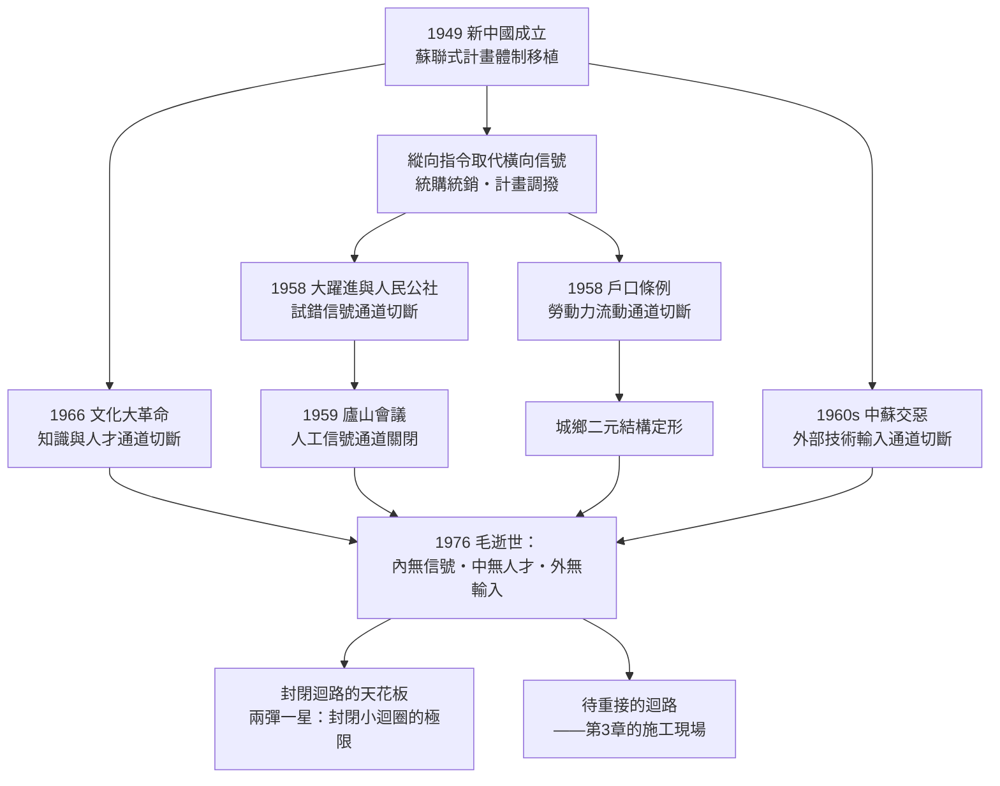

# 02 前史：為何毛澤東時代未能起飛

## 一、現場勘查：一個起飛條件最齊備的失敗案例

審理1978年之前的失敗，必須先承認一件常被忽略的事：毛澤東時代的中國，擁有發展經濟學開出的大部分標準處方。一個強大且滲透到村級的國家——這是格申克龍式趕超的頭號工具；主權完整、無外債、土改完成——戰後東亞各成功案例的共同起點；初等教育普及與公共衛生改善帶來的人口素質與預期壽命提升——人力資本的底座已經打好；甚至還有一個完整的蘇聯援建工業骨架（見 [../../世界史/中國現代史/1953-一五計劃與156項.md](../../世界史/中國現代史/1953-一五計劃與156項.md)）。

然而結果是：三十年間人均收入近乎停滯，1978年的人均GDP低於撒哈拉以南非洲平均，數億人仍在溫飽線以下。**工具箱是滿的，工程卻失敗了。** 這個反差正是本章的偵查對象。傳統敘事把失敗歸結為「政策錯誤的疊加」——大躍進的冒進、文革的動亂。這不錯，但停在現象層。本章要追問的是更深一層：為何這個體制的錯誤**無法被價格、市場或競爭發現並糾正**，以至於小錯積成大錯、大錯無人叫停？答案是本章的診斷書：**迴路被切斷了。**

## 二、起點：1949年的新中國與蘇聯式接線

1949年新中國成立（見 [../../世界史/亞洲史/1949-新中國成立.md](../../世界史/亞洲史/1949-新中國成立.md)）時，接手的是八年抗戰加四年內戰的殘破經濟與惡性通脹的廢墟（見 [../../世界史/中國現代史/1948-金圓券與惡性通脹.md](../../世界史/中國現代史/1948-金圓券與惡性通脹.md)）。新政權的選擇並不神祕：當時唯一的工業化成功模板是蘇聯的五年計劃（見 [../../世界史/俄羅斯史/1928-五年計劃與集體化.md](../../世界史/俄羅斯史/1928-五年計劃與集體化.md)），加上「一邊倒」的地緣格局（見 [../../世界史/中國現代史/1950-抗美援朝與一邊倒.md](../../世界史/中國現代史/1950-抗美援朝與一邊倒.md)），中國整套移植了蘇聯式計畫經濟：物資調撥取代市場交易，統購統銷壟斷糧食流通（見 [../../世界史/中國現代史/1953-統購統銷與糧票.md](../../世界史/中國現代史/1953-統購統銷與糧票.md)），企業成為行政單位，價格成為會計符號。

這一步本身有其歷史理性——動員資源搞重工業，蘇聯模式短期內確實有效。問題不在選了什麼模板，而在這個模板的內在結構：**它是一個只有縱向指令、沒有橫向信號的系統。** 這個結構特徵，在1958年被推向極致。

## 三、1958：以運動取代迴路的大躍進

1958年的大躍進與人民公社（見 [../../世界史/中國現代史/1958-大躍進與三年困難.md](../../世界史/中國現代史/1958-大躍進與三年困難.md)、[../../世界史/中國現代史/1958-人民公社與政社合一.md](../../世界史/中國現代史/1958-人民公社與政社合一.md)），慣常被講成一個關於謊言層層上報的故事——畝產放衛星、土法煉鋼、公共食堂。但從迴路的角度看，它暴露的是計畫經濟的**結構性失明**：

在市場經濟中，一項政策的錯誤會立即以價格、虧損、滯銷的形式回傳給決策者——這是「實驗⇒技術⇒理論」迴路在經濟領域的等價物：**試錯⇒信號⇒修正**。而在1958年的體制裡，這條通道不存在。產量數字由政治熱情逐級放大上報，鋼鐵指標由指標倒推出指標，糧食高產的「證據」反過來證明徵購量可以加倍。整個系統裡沒有一個部件能產生「這行不通」的客觀信號——唯一能傳遞真實資訊的渠道是幹部的良心與直言，而直言者已在1957年反右運動（見 [../../世界史/中國現代史/1957-反右運動.md](../../世界史/中國現代史/1957-反右運動.md)）中被系統性地消音。1959年廬山會議上彭德懷的意見書被鎮壓（見 [../../世界史/中國現代史/1959-廬山會議.md](../../世界史/中國現代史/1959-廬山會議.md)），標誌著最後一條人工信號通道也被關閉。其後的三年困難，本質上是**一個失去所有反饋通道的系統在盲飛中墜毀**。

同年頒布的戶口條例（見 [../../世界史/社會結構史/1958-戶口條例與城鄉二元.md](../../世界史/社會結構史/1958-戶口條例與城鄉二元.md)）則從另一端切斷迴路：它把農民固定在土地上，勞動力這個最重要的生產要素喪失了流動與議價的能力。城鄉二元結構就此定形——數億人的命運在出生時即被檔案決定。這一制度在1978年後仍長期存續，成為理解中國改革（農民工、土地財政、戶籍改革遲滯）的關鍵前置條件。

## 四、1966：迴路的第二次切斷——這次切的是人

大躍進證明了這個系統在經濟資訊上的失明，文革（見 [../../世界史/中國現代史/1966-文化大革命與十年動亂.md](../../世界史/中國現代史/1966-文化大革命與十年動亂.md)）則切斷了知識與人的傳承通道。大學停課、高考廢除、知識分子下放、研究機構癱瘓——「理論」這一環的儲備被直接損毀。如果說計畫經濟切斷的是迴路中的**信號線**（價格、利潤、試錯反饋），文革切斷的是**人才線**：即便明天市場開放，誰來經營、誰來核算、誰來談判、誰來看懂外國的技術手冊？

這兩次切斷的時間點值得並置：1958年切斷信號，1966年切斷人才，而1960年代中蘇交惡（見 [../../世界史/中國現代史/1969-中蘇交惡與珍寶島.md](../../世界史/中國現代史/1969-中蘇交惡與珍寶島.md)）又切斷了最後的外部技術輸入管道。到1970年代中期，中國的迴路是三重封閉的：**內無信號、中無人才、外無輸入。** 1976年毛逝世與政局劇變（見 [../../世界史/中國現代史/1976-毛逝世與懷仁堂政變.md](../../世界史/中國現代史/1976-毛逝世與懷仁堂政變.md)）之際，這台引擎的三重故障正是繼任者面對的完整現場。

## 五、封閉迴路的極限樣本：兩彈一星與蘇聯電腦

診斷需要一個對照組，以免「計畫經濟什麼都做不成」的稻草人結論。事實是：封閉迴路在**目標明確、路徑已知、舉國投入**的領域，可以達到驚人的高度——1964年原子彈、1967年氫彈、1970年衛星（見 [../../世界史/中國現代史/1964-兩彈一星.md](../../世界史/中國現代史/1964-兩彈一星.md)）。這不是矛盾，恰是診斷的確認：**「理論⇒理論」「實驗⇒實驗」「技術⇒技術」的封閉小迴圈依然在轉**，任務式的動員能夠沿著單一直線把既有知識推進到工程極限。缺的不是能力，而是**橫向通道**——兩彈一星的技術無法外溢成民用產業，因為沒有市場作為出口，沒有價格作為篩子，沒有企業作為載體。

國際對照組同樣有力。蘇聯在1950年代後期的電腦與控制論研究起步並不落後（見 [../../世界史/俄羅斯史/1958-蘇聯電腦與控制論.md](../../世界史/俄羅斯史/1958-蘇聯電腦與控制論.md)），某些領域一度與西方並駕齊驅；但封閉迴圈內的技術始終無法變成普及的產業——沒有晶片市場、沒有用戶反饋、沒有迭代競爭，三十年後全面落後，最終連體制本身一起崩解（見 [../../世界史/俄羅斯史/1991-蘇聯解體.md](../../世界史/俄羅斯史/1991-蘇聯解體.md)）。蘇聯證明了封閉迴路的天花板，中國在1978年的問題是：能否在撞上天花板之前重新接線。

## 六、排除法：常見解釋為何不夠

把幾種流行解釋放上偵查台逐一排除：

**「缺資本」論**——不成立。中國當時儲蓄率高達三成以上，問題不是沒有積累，而是積累被投入後**無法形成有效產出**；同樣的儲蓄率在1978年後轉化為世界史上最快的資本形成。缺的不是資本，是讓資本找到去處的信號系統。

**「缺技術」論**——不充分。兩彈一星證明任務式攻關的能力存在；更何況後發國家的技術本可引進，而引進通道被中蘇交惡與封閉意識形態人為關閉。技術短缺是**被切斷的結果**，不是初始原因。

**「人口太多」論**——方向相反。同一批人口在1978年後被稱為「人口紅利」。人口從負擔變紅利，改變的不是人，而是**人有沒有被接通到激勵與就業的迴路上**——這恰是戶口與公社體制切斷的部分。

**「缺乏企業家精神」論**——難以成立。僑鄉的商人傳統、溫州與潮汕的商業文化從未消失，只是被壓制；政策一旦鬆動，它們在一兩年內就爆發出來。精神一直在，缺的是允許它接電的插座。

四種解釋各捕獲一塊碎片，但都把「短缺」當成原因。反轉之後才看清：**這些短缺不是並列的原因，而是同一個切斷動作在不同部位留下的傷口。**

## 七、串聯與定論：不是「缺了什麼」，而是「什麼被切斷了」

至此可以寫出本章的驗屍報告。毛澤東時代未能起飛的根因，不在資源、技術或精神層面的匱乏，而在於蘇聯式體制從結構上就沒有橫向信號通道，而1958與1966兩場運動又相繼切斷了試錯反饋與知識傳承兩條應急通道。到1976年，這個國家擁有一台部件完好、傳動全斷的引擎——以及一個意外遺產：**三重封閉反而保留了完整的動員骨架**（黨組織、行政系統、國有廠礦），這副骨架在後來的改革中將被反向利用，成為動員市場的機器（第6章的伏筆）。

回到核心公式：本章貢獻的結論是——**五個乘數在1978年之前全部為零，且為零的方式是「被切斷」而非「不存在」**。這個區別是全書的樞紐：被切斷的東西可以重接，不存在的能力則必須從頭培養。中國的幸運（或說後發者的幸運）在於，它需要的是一次接線工程，而不是一次文明重建。

下一章進入施工現場：真理標準討論如何重接理論與現實，聯產承包如何重接勞動與報酬，經濟特區如何重接中國與世界。

## 小結

毛澤東時代起飛失敗的真相，不是缺少現代化的要素，而是切斷了讓要素相互作用的迴路：1958年的大躍進與戶口條例切斷經濟信號與勞動流動，1966年的文革切斷知識傳承，中蘇交惡切斷外部輸入。兩彈一星證明封閉小迴圈可以達到工程極限，蘇聯電腦的下場預告了封閉迴路的歷史天花板。用核心公式的語言說：**1978年之前，制度鬆綁這一乘數為零——但它是「被切斷的零」，不是「不存在的零」。** 這個診斷，決定了後來崛起故事的形態：那將是一次重新接線，而非一次白手起家。
