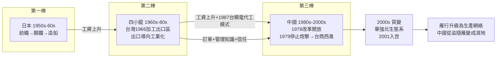

# 第四章　雁行時機：四小龍、台商與東亞生產網絡

> 探案的證物是一張時刻表：1966年高雄加工出口區開張、1987年台積電成立與解嚴開放探親、1979年金門停止炮擊。三件事各自獨立，卻在同一個十年前後排成一列——彷彿有人在替鄧小平的改革排程。這一章要追查的問題是：中國的崛起，有多少是制度的功勞，有多少是「趕上了班次」？

## 一、赤松要的雁行理論：產業像候鳥一樣遷徙

1930年代，日本經濟學家赤松要觀察日本的綿紡織業，提出「雁行形態論」：後發國家的產業發展像雁群飛行——領頭雁（先進國）的產業隨成本上升而讓位，追隨雁（後進國）承接產業、學習技術、再向下一梯次讓位（見 [1965-出口導向工業化](../../世界史/商業貿易史/1965-出口導向工業化.md)）。

雁行的數學骨架是產業梯度：設產業 $i$ 的利潤取決於工資 $w$ 與生產率 $A_i$ ，

$$\pi_i = (A_i - w)\, L_i$$

同一產業在低 $w$ 的經濟體獲利更高，於是資本與訂單沿著「日本→四小龍→東南亞與中國」的工資梯度，像水流一樣往低處移動。雁行不是比喻，是套利。

戰後東亞的雁群依次是：日本（1950s–60s）→ 韓國、台灣、香港、新加坡（1960s–70s）→ 中國（1980s–2000s）。中國的問題因此可以精確化為：**當雁群輪到下一棒時，中國是否正好站在接棒位置，且手是鬆開的？**

## 二、台灣1966加工出口區：雁行模式的原型機

台灣在1966年設立高雄加工出口區——世界第一個專為出口加工設計的關稅特區，外國原料免稅進口、成品全數出口，勞動密集產業在圍籬內與世界市場直接相連（見 [1966-加工出口區與經濟起飛](../../世界史/台灣史/1966-加工出口區與經濟起飛.md)）。此後十大建設補上電力、港口與高速公路的瓶頸（見 [1973-十大建設與石油危機](../../世界史/台灣史/1973-十大建設與石油危機.md)），台灣沿著「紡織→塑膠→電子」的梯次向上爬。

探案要點：加工出口區這個**制度模板**，正是後來經濟特區的前身。1980年的深圳特區在功能設計上與高雄加工出口區高度相似——這不是巧合，而是雁行理論中「制度與產業一起遷徙」的實例。台灣驗證了模板有效，中國把模板放大到千倍尺度。

## 三、1987台積電：代工模式把雁行升級為生產網絡

1987年，張忠謀在台灣創立台積電，開創純代工（foundry）商業模式：自己不設計晶片，只替所有設計公司製造（見 [1987-台積電成立](../../世界史/台灣史/1987-台積電成立.md)、[1987-台積電與代工模式](../../世界史/世界發展史/1987-台積電與代工模式.md)）。

代工模式的深遠意義，是把「產業整體遷徙」的雁行，升級為**可拆解的生產網絡**：晶片設計在美國、製造在台灣、組裝在中國、市場在全球。產品不再屬於某一隻雁，而是雁群共同搭建的供應鏈。拆解製造環節後，「 labor-intensive 的最後一里」——組裝、測試、封裝——正好是中國的比較優勢所在。

## 四、1979停止炮擊：政治解凍打通雁行的物理通道

雁行需要通道。1979年1月1日，中國國防部停止對金門炮擊，兩岸從熱戰狀態轉入對峙降級（見 [1979-停止炮擊與三通](../../世界史/金門廈門史/1979-停止炮擊與三通.md)）。1987年台灣解嚴並開放探親（見 [1987-解嚴與開放探親](../../世界史/台灣史/1987-解嚴與開放探親.md)），第一批台商以此為掩護踏上大陸土地；1990年代海滄、杏林設立台商投資區，台資以廈門為登陸灘頭（見 [1994-海滄台商投資區](../../世界史/金門廈門史/1994-海滄台商投資區.md)）。

時間點的巧合值得列成表：

| 年份 | 兩岸事件 | 雁行意義 |
|------|----------|----------|
| 1966 | 高雄加工出口區 | 模板驗證 |
| 1978 | 中國改革開放 | 需求端解禁 |
| 1979 | 停止炮擊 | 物理通道解凍 |
| 1987 | 台積電成立＋台灣開放探親 | 資本與訂單同時到位 |

台商攜帶的正是雁行最需要的三樣東西：現成的外銷訂單、標準化的廠房管理知識、與全球買家的信任關係。珠三角的「三來一補」工廠，本質上是台灣加工出口區在大陸的無數次複印。

## 五、雁行重組與華強北：從承接產業到重寫產業

雁行的最後一幕在中國發生質變。按照赤松要的原始劇本，中國應該像四小龍一樣承接、學習、再讓位。但2000年代深圳出現了第四幕：**自己變成雁群的生態系**。2008年前後，華強北以山寨機聞名（見 [2008-山寨機與華強北](../../世界史/中國現代史/2008-山寨機與華強北.md)）——聯發科的turnkey方案把手機設計模組化，華強北的電子市場把供應鏈粒度拆到「一小時內湊齊一部手機的全部零件」。

山寨常被視為負面詞，探案視角下卻是雁行理論沒有預言過的階段：產業集群密度高到創新的最適規模下降——不再需要跨國公司的科層組織，小團隊即可迭代產品。2001年中國入世（見 [2001-中國入世](../../世界史/商業貿易史/2001-中國入世.md)）之後，這種「網絡化製造能力」把中國從雁行的追隨雁，變成了同時容納多隻雁的濕地。

## 六、時機論的反事實：如果晚改革十年

現在執行連乘公式要求的反事實檢驗：假設鄧小平晚十年（1988年）才啟動改革，雁行窗口是否還開著？

**證據一：勞動成本的窗口。** 1978年中國製造業工資約為四小龍的十分之一。四小龍的工資在1980年代後半加速上漲，雁行理論要求的「梯度差」正被壓縮。若中國1988年才開放，第一波承接的將不是「轉移中的產業」，而必須與已經啟動的東南亞（泰國、馬來西亞、印尼）競標同一批訂單——承接價格與速度都會惡化。

**證據二：冷戰結束後的資本流向。** 1979—1989年，外資進入中國帶有強烈的地緣政治色彩：圍堵蘇聯的戰略夥伴關係，使西方資本與技術的輸出獲得政治背書。1991年蘇聯解體後（見 [1989-柏林牆倒塌](../../世界史/世界發展史/1989-柏林牆倒塌.md)），東歐與俄羅斯成為外資的新候選地，資本分流的競爭劇增。晚十年，中國的競爭者名單長一倍。

**證據三：人口紅利的相位。** 第五章將給出撫養比的數學——中國撫養比的最低點（最豐厚的紅利窗口）約在1990—2010年。改革若晚十年，勞動力最充沛的二十年將有一半耗在制度內耗上，紅利直接被截走一半。

用雁行的接受窗口寫成形式化條件。設承接成功率 $P$ 依賴工資差距 $D$ 與競爭者數量 $n$ ：

$$P = f\left(\frac{D}{n}\right), \qquad D\downarrow,\; n\uparrow \;\Rightarrow\; P\downarrow$$

1978年的 $D$ 巨大而 $n\approx 1$ （只有中國有此規模）；1988年之後 $D$ 減半而 $n$ 增為三倍以上。雁行窗口確實在關閉——「時機」不是修辭，是可計算的變量。

## 七、雁行梯次圖：三代雁的交接班

把本章證據整合成一張梯次圖。注意縱軸不是國家而是**產業梯次**——雁行理論的真正主語是產業，國家只是產業的暫時棲所。

## 小結

本章的探案結論：制度鬆綁（第三章）決定了中國「能不能接」，雁行時機決定了「來得及接」。赤松要的雁行理論提供了產業梯度移轉的劇本，台灣提供了模板（加工出口區）與樞紐（台積電代工網絡、台商資本），1979年的政治解凍提供了通道。三股線索在1978—1987年的十年內同時收攏——這是時間上的巧合，但**改革者的功勞正在於把巧合變成了抓住**：反事實檢驗顯示，晚十年，工資梯度收窄、資本流向分流、人口紅利過半，雁行窗口將明顯關閉。時機是連乘公式的第二項；下一章追查第三項——規模稟賦，那個讓中國不只「接住」雁行、還能「放大」雁行的變量。
