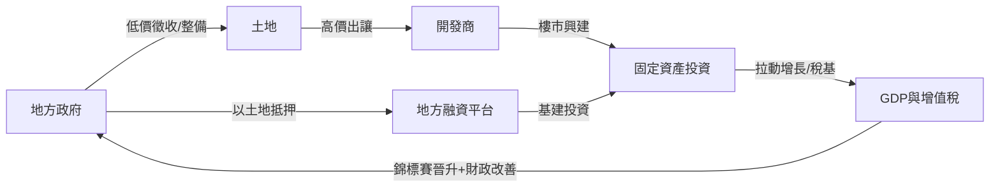
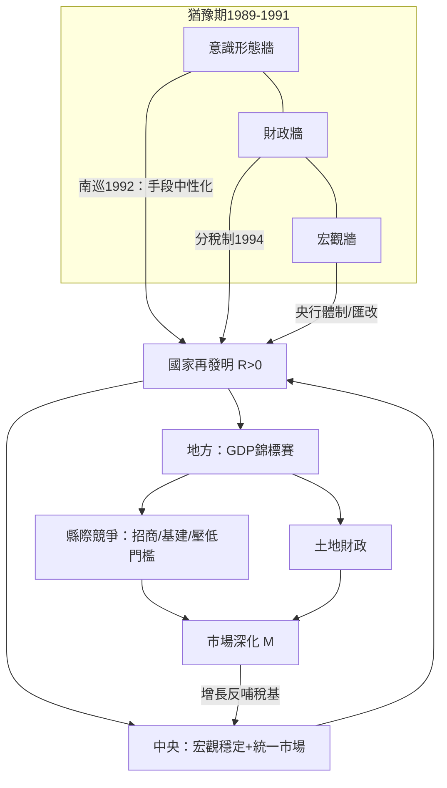

# 第六章　國家的再發明：南巡、分稅制與地方競爭

## 一、懸案：一個「不退出」的國家，為何反而釋放了市場？

連乘公式的第四項，是**國家再發明**。在前一章我們看到制度鬆綁如何把農民與鄉鎮企業放進市場；但一九八九年到一九九一年，這條迴路差點熄火。改革開放十年後，中國面臨的不是「國家太強所以市場長不出來」的老問題，而是一個更刁鑽的疑案：**一個不肯退場的國家，如何與市場共存，甚至成為市場的催化劑？**

蘇聯與東歐給出了第一種答案：國家退出。結果是休克療法——詳細對照見[1992-休克療法與憑證私有化](../../世界史/俄羅斯史/1992-休克療法與憑證私有化.md)。俄羅斯在1992年放開價格、發放憑證私有化，國家機器迅速癱瘓，寡頭接管了資產，產出在數年內腰斬。用迴路的語言說：蘇聯把「國家」這個變數直接歸零，以為市場會自動補位，但**市場本身就是國家行為的函數**——沒有產權執行、沒有契約法院、沒有宏觀穩定，市場只是一句口號。

中國的第二種答案，是把問題反轉：不問「國家要不要退出」，而問「**國家的行為模式要如何改寫**」。這一章的偵查，就是追蹤1992南巡、1994分稅制、地方錦標賽與土地財政這四條線索，看國家如何在**不退出**的前提下，把自己從「計畫的下達者」改造成「市場的基礎設施供應商」。

## 二、1989–1991：迴路的猶豫期

改革不是直線。1989年之後，政治氣候收緊，經濟政策搖擺：「治理整頓」壓縮信貸、清查私營企業、意識形態界線重現——「計畫」與「市場」孰為姓社姓資，成為高懸在所有地方官與企業家頭上的問號。鄉鎮企業貸款被抽緊，外資觀望，增長下滑。

這段猶豫期的意義，在探案上恰恰是**排除法**：它證明了單靠1980年代的放權讓利（制度鬆綁）不足以自我維持。鬆綁釋放的第一波增長動能，撞上了三堵牆：

1. **意識形態牆**：市場地位沒有正式定調，隨時可被政治翻案；
2. **財政牆**：財政包乾制下，中央收入佔比持續下滑，「兩個比重」（財政收入佔GDP、中央收入佔總財政）跌到歷史低點，中央政府瀕臨「要飯財政」；
3. **宏觀牆**：貨幣與匯率體系混亂，官價匯率與調劑市場匯率並存，套利與腐敗叢生。

任一堵牆不拆，連乘式裡的「國家再發明」一項就趨近於零。而連乘是零和積： $Y = B \times T \times S \times R \times O$ ，其中 $R \to 0$ 時，前兩章的一切成果都會被清零。

## 三、破案第一鑰：1992南巡——「計畫與市場都是手段」

1992年初，鄧小平以八十八歲高齡南下深圳、珠海、上海，發表一系列講話。核心一句是：**計畫多一點還是市場多一點，不是社會主義與資本主義的本質區別；計畫與市場都是經濟手段。** 詳見[1992-南巡講話與市場經濟](../../世界史/中國現代史/1992-南巡講話與市場經濟.md)。

這句話在制度經濟學上的分量，怎麼估計都不為過。它不是「 more market 」的政策宣示，而是**把市場從意識形態審判中除名**：手段中性化。當年十月，中共十四大正式確立「社會主義市場經濟」的改革目標。至此：

- 意識形態牆拆除——地方官員不再需要為「搞市場」承擔政治風險；
- 預期翻轉——外資與民間投資重新湧入，1992–1993年增長率衝上兩位數。

用連乘公式說，南巡是把 $R$ 從「猶豫期的負值區間」拉回正值的**臨界事件**。注意這裡的因果方向：不是市場壓力迫使國家讓步，而是**國家最高決策者主動為市場簽發了制度性許可證**。這正是「國家再發明」的第一個動作——改變的不是國家的體量，而是國家的**裁判規則**。

## 四、破案第二鑰：1994分稅制——財政聯邦制的數學

南巡解決了「敢不敢搞市場」，但沒解決「誰來付帳」。整頓後的1993年，中央財政佔比已跌到谷底，中央對地方幾乎喪失財政槓桿。1994年，朱鎔基主導**分稅制改革**，詳見[1994-分稅制與央行體制](../../世界史/中國現代史/1994-分稅制與央行體制.md)。其數學結構值得拆開看：

**改革前（財政包乾）**：地方向中央上繳一個談判出來的定額或比例，增量大頭留在地方。設地方增量收入為 $\Delta Y_l$ ，中央分成率為 $\alpha$ （且隨談判逐年走低），則中央激勵為：

$$G_c = \alpha \, \Delta Y_l, \quad \alpha \searrow$$

中央成了增長的旁觀者。

**改革後（分稅制）**：稅種三分——中央稅（關稅、消費稅）、地方稅（營業稅、個稅等）、共享稅（增值稅中央75%、地方25%；後所得稅六四分成），並設國稅局垂直徵收。中央激勵變成：

$$G_c = 0.75 \, VAT + \text{中央稅}, \quad \alpha \text{ 制度化、不再逐年流失}$$

同時配合**稅收返還**（以基期收入為基數返還地方，減少阻力），整體上是一個「集中增量、保護存量」的設計。財政學上，這接近錢穎一、溫加斯特等人所說的**維護市場的聯邦主義**（market-preserving federalism）：中央拿走足夠的錢來維持宏觀穩定與全國統一市場，地方保留足夠的剩餘索取權來發展經濟——**兩層政府各自對準一個激勵，互不越界**。

配套的第二刀是**央行體制**：1994年後政策性銀行剝離政策性貸款，1995年《人民銀行法》確立央行穩定幣值職責，1998年撤省分行、設九大跨區分行，切斷地方政府對貨幣發行的指染。貨幣這個變數，從地方博弈的工具變成了全國性公共財。

## 五、破案第三鑰：GDP錦標賽——縣際競爭與土地財政

分稅制的隱藏副作用，是把地方政府變成了**競爭性企業**。張五常在《中國的經濟制度》中提出的論點是：中國的縣，就像一個個提供「土地+基礎設施+行政服務」的商場，縣長像商場經理，以增值稅分成（25%）為租金收入，**用壓低地價、改善營商條件來招租**。全國兩千多個縣級單位互相搶投資，形成人類史上規模最大的制度性競爭實驗。

把這個結構寫成競爭式：設投資者面對 $n$ 個縣，各縣提供綜合條件 $q_i$ 、有效稅負 $\tau_i$ ，則投資落在：

$$i^* = \arg\max_j \; \pi(q_j, \tau_j)$$

縣際競爭迫使 $(q_j, \tau_j)$ 的組合不斷逼近投資者的無差異曲線。張五常的判斷是，這套「縣際競爭合約」是中國1990年代後增長的核心引擎之一——它讓「國家」不再是單一怪物，而是兩千多個**互相制衡的準公司**。

但錦標賽的燃料有一半來自**土地財政**：分稅制拿走了增值稅大頭，地方卻保留土地出讓金。1998年住房商品化改革之後，一套閉環成形：

這條迴路威力驚人——它把土地、金融、基建、官員晉升焊成一體，解釋了中國城市的爆炸式擴張；但也埋下債務、房價與圈地的長期代價。探案必須誠實記下：**再發明出來的國家，同時是引擎與漏洞**。

## 六、破案第四鑰：「國家⇒市場」的新通道——與蘇聯對照，與美國對照

現在可以把三個國家放在同一張解剖台上。

**蘇聯路線**：國家 $N \to 0$ 。休克療法假設市場 $M$ 是獨立變數，會自動補位。結果 $M$ 依賴的基礎設施（法治、宏觀、行政能力）全部跟著 $N$ 一起歸零，出現的是掠奪性秩序而非市場秩序。對照詳見[1992-休克療法與憑證私有化](../../世界史/俄羅斯史/1992-休克療法與憑證私有化.md)。

**中國路線**：國家 $N$ 不減少，而是**改變微分方程**。設市場發展速率為：

$$\frac{dM}{dt} = f(N) - g(N)$$

1980年代以前， $g(N)$ （國家的干擾、掠奪、計畫束縛）遠大於 $f(N)$ （國家的產權保護、基建、穩定）。南巡與分稅制的再發明，做的不是縮小 $N$ ，而是**調換 $f$ 與 $g$ 的係數**：讓同一個國家機器，從市場的阻力項變成動力項。這就是「國家⇒市場」的新通道——國家不改變大小，改變**行為模式**。

**美國路線**：跨書對照《美國為何崛起》第七章[07-科學動員：曼哈頓計劃、矽谷與登月](../美國為何崛起/07-科學動員：曼哈頓計劃、矽谷與登月.md)。美國的國家從不以計畫經濟的面目出現，但曼哈頓計劃、登月與國防高等研究計劃署（DARPA）證明：**國家作為迴路催化劑**——投入尖端需求、分攤風險、建構網絡，然後把成果外溢給私營部門（矽谷的半導體早期買主幾乎全是軍方）。

兩國的再發明方向相反、功能同構：

| | 美國 | 中國 |
|---|---|---|
| 國家角色 | 迴路催化劑（需求端引爆） | 迴路基礎設施（供給端鋪路） |
| 干預形式 | 訂單、研發補貼、任導向動員 | 分成合約、土地招商、晉升錦標賽 |
| 不變量 | 私有產權與市場定價 | 黨國體制與中央權威 |
| 再發明對象 | 國家從守夜人→風險投資人 | 國家從計畫者→競爭性基礎設施供應商 |

**再發明不是民營化，是行為模式的改寫。** 這是本章偵破的第一命題。

## 七、總圖：再發明迴路

連乘檢驗： $R$ 由零轉正之後，才撐得起下一章的第五項——**接入開放秩序** $O$ 。若國家仍是一部計畫機器，入世談判桌上的讓步就無從兌現；若沒有縣際競爭的承接能力，入世的關稅減讓也只是紙面承諾。第四項與第五項之間，是齒輪咬合。

## 小結

本章的偵查結論：中國沒有走「國家退出」的路，而是走了一條更精緻的路——**南巡定調（手段中性化）、分稅制改激勵（財政聯邦制）、錦標賽造競爭（兩千個縣級準公司）、土地財政供燃料**。同一部國家機器，被改寫成市場的動力項而非阻力項。蘇聯把 $N$ 歸零而市場未曾到場；美國用國家做催化劑點燃迴路；中國則用國家做基礎設施鋪設迴路。國家再發明 $R$ 由零轉正，連乘式的前三項才有了乘載其成果的骨架，並為下一章的終極變數——接入美國主導的開放秩序——備好了入場券。
