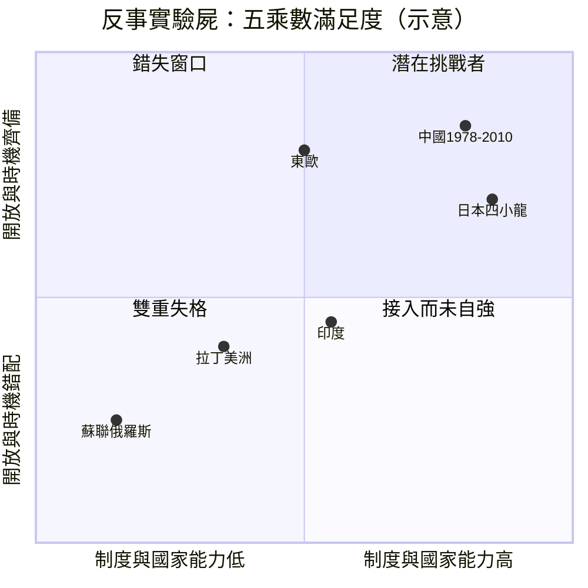

# 第八章　反事實檢驗：為何不是蘇聯、印度或拉美？

> 探案的最高法庭，不是找出誰做了什麼，而是排除所有「本來也可能是他」的嫌疑人。
> 五個乘數若有一個為零，積即為零——嫌疑人的名單，就此縮短。

## 一、驗屍方法：把連乘公式當成驗屍台

本書的核心論旨是一條連乘公式：

$$
\text{中國崛起} = \text{制度鬆綁} \times \text{雁行時機} \times \text{規模稟賦} \times \text{國家再發明} \times \text{接入開放秩序}
$$

連乘不是連加。連加的世界裡，缺一項還能用其他項補足；連乘的世界裡，**任何一項為零，全部歸零**。這正是問題反轉方法的用武之地：與其問「中國為何崛起」，不如問「為何不是蘇聯、印度、拉美、日本或東歐」——把每一個候選人抬上驗屍台，逐一檢查五個乘數的屍檢報告。

我們給每個候選者的五個乘數打分：正值（齊備）、弱值（有名無實）、負值（反向作用）、零值（根本缺席）。判定標準沿用本書前七章的定義，並與姊妹書《美國為何崛起》第八章對德國、蘇聯、日本的驗屍方法一脈相承（見[08-反事實檢驗：為何不是德國、蘇聯或日本](../美國為何崛起/08-反事實檢驗：為何不是德國、蘇聯或日本.md)）。

## 二、蘇聯／俄羅斯：制度鬆綁變成制度崩解

蘇聯擁有規模、資源、教育與超級大國地位——紙面上的乘數最漂亮，為何屍檢報告觸目驚心？

**第一刀：國家再發明為負值。** 蘇聯不是沒有嘗試鬆綁，而是鬆綁的方式摧毀了國家本身。1992年的[休克療法與憑證私有化](../../世界史/俄羅斯史/1992-休克療法與憑證私有化.md)在幾個月內放開價格、拋售國有資產，結果不是「制度鬆綁」，而是「制度崩解」：定價機制還沒長出來，計劃體系先被連根拔起。中國的雙軌制是「舊軌保底、新軌試行」；俄羅斯是「拆舊軌、新軌未鋪」。GDP在整個一九九〇年代縮水近半，工業產值跌得比大蕭條的美國還深。

**第二刀：私有化沒有創造所有權人，只創造了掠奪者。** 憑證私有化的設計初衷是讓每個公民成為股東，實際結果是集中到少數寡頭手中，配套的[證券私有化與西伯利亞油企](../../世界史/北亞史/1993-證券私有化與西伯利亞油企.md)與[俄羅斯黑手黨與私有化](../../世界史/俄羅斯史/1993-俄羅斯黑手黨與私有化.md)見證了「產權改革」淪為資產掠奪。國家再發明的乘數不是弱值，是**負值**——國家能力本身被私有化進程掏空。

**第三刀：帝國過擴張提前透支。** 早在崩解之前，[1979年蘇聯入侵阿富汗](../../世界史/歐亞交界史/1979-蘇聯入侵阿富汗.md)就暴露了帝國過擴張的代價：十年戰爭、財政失血、軍費擠佔民用部門。對照之下，中國在1979年恰好做了相反的選擇——對越戰爭速戰速退，把資源轉向經濟。同年分岔，一個走向擴張終局，一個走向鬆綁起點。

**第四刀：技術路線的自我設限。** [1958年蘇聯電腦與控制論](../../世界史/俄羅斯史/1958-蘇聯電腦與控制論.md)顯示，蘇聯並非沒有人才，而是計劃體制下的電腦產業選擇了「複製IBM、放棄自研」的追趕路線，最終在個人電腦時代全線出局。中央計劃能動員重工业，卻無法容忍分散試錯的創新。

**第五刀：石油地租掩蓋了改革必要。** [布里茲涅夫停滯與石油地租](../../世界史/俄羅斯史/1964-布里茲涅夫停滯與石油地租.md)說明，1970年代的油價暴漲讓蘇聯靠賣資源就能維持，改革動力被地租收入麻醉。等到1986年油價崩跌，體制已積重難返。

蘇聯驗屍結論：規模稟賦 ✓，接入開放秩序 ✗（冷戰對峙），制度鬆綁 ✗（崩解），國家再發明 **負值**，雁行時機 ✗（雁首位置早已讓給日本，自己不是承接者）。

## 三、印度：萬事俱備，只晚了十三年

印度是最令人惋惜的嫌疑人——它有中國的一切條件，卻慢了一步。

**規模稟賦 ✓。** 人口規模相當，且人口結構更年輕。[1947年印巴分治](../../世界史/亞洲史/1947-印巴分治.md)之後的印度繼承了英國留下的鐵路、文官系統與大學體系，[1966年綠色革命](../../世界史/亞洲史/1966-綠色革命.md)更解決了糧食安全——這是中國在1958年[大躍進](../../世界史/亞洲史/1958-大躍進與人民公社.md)中以慘烈代價才繞過的坑。

**但雁行時機 ✗——晚了十三年，窗口已半關。** 中國1978年[改革開放](../../世界史/世界發展史/1978-改革開放.md)時，正值四小龍工資上漲、勞動密集產業急尋承接地，雁行窗口大開。印度要到1991年國際收支危機逼出經濟自由化才鬆綁，此時四小龍的轉移潮已被中國吸收大半，勞動密集製造業的黃金承接期只剩尾巴。

**制度鬆綁弱值。** 民主體制下的印度，改革速度天然受限：許可證王國（License Raj）的拆除是逐項談判的結果，土地徵收、勞動法、基建審批至今仍是瓶頸。中國的體制能在五年內鋪完一條高速公路網，印度的一條走廊可以吵十年。民主不是不能發展，而是**改革速度的方差更大、週期更長**——在雁行窗口有時效性的賽局裡，速度本身就是乘數。

**開放秩序接入——走了一條繞道。** 印度避開勞動密集製造業，直接切入服務外包，[1999年Y2K與印度IT外包](../../世界史/世界發展史/1999-Y2K與印度IT外包.md)讓班加羅爾崛起。這證明了規模×教育×英語的制度資產可以變現，但服務業外包吸收的就業遠少於製造業——十億人口中真正被全球化動員的，是數百萬受過高等教育的精英，而非數億農村勞動力。

印度驗屍結論：規模 ✓、開放 ✓、國家能力弱值、鬆綁遲到、**時機歸零了大半**。連乘公式告訴我們：一個0.5的乘數，足以讓十億人的潛力只兌現一半。

## 四、拉丁美洲：進口替代的死胡同與華盛頓共識的教訓

拉美是第三個嫌疑人，它的驗屍報告揭示了一個反命題：**有市場、有資源、甚至早有改革，為何還是掉進陷阱？**

**第一刀：進口替代工業化的路線錯誤。** [1950年進口替代工業化](../../世界史/拉丁美洲史/1950-進口替代工業化.md)是拉美的戰略選擇：用關稅壁壘保護本土工業，替換進口。短期看工廠建起來了，長期看卻造出了一批永遠長不大、依賴補貼的低效企業。東亞的路線恰恰相反——出口導向，逼著企業到世界市場上搏殺。**接入開放秩序**這個乘數，拉美從戰略上就主動設成了弱值。

**第二刀：債務危機毀掉了十年。** [1982年拉美債務危機](../../世界史/拉丁美洲史/1982-拉美債務危機.md)爆發時，墨西哥宣布無法償債，整個區域失去國際資本市場准入近十年——恰逢中國改革開放、四小龍起飛的關鍵窗口。拉美的雁行時機不是沒有，是**被債務危機親手燒掉了**。

**第三刀：華盛頓共識矯枉過正。** 1990年代的[龍舌蘭危機與華盛頓共識](../../世界史/拉丁美洲史/1994-龍舌蘭危機與華盛頓共識.md)表明，速成式自由化同樣致命：墨西哥1994年比索崩盤，外資恐慌外逃。華盛頓共識開出的藥方（私有化＋自由化＋緊縮）與俄羅斯休克療法同源，犯了同一個錯——**把「鬆綁」當成「拆除」**，忘了市場需要國家來建造。中國的經驗恰好是鏡像：國家保著市場長大，而不是放任市場自生自滅。

**第四刀：NAFTA的未竟之功。** [1994年北美自由貿易協定](../../世界史/美洲史/1994-北美自由貿易協定.md)確實接通了墨西哥與美國市場，這是拉美最接近「接入開放秩序」的一次實驗。但 制造業承接需要的還有配套：基礎設施、產業鏈、治安與法治。墨西哥承接了汽車與家電組裝，卻始終沒有形成東亞式的全面產業升級——毒品戰爭、腐敗與非正式經濟，讓國家再發明乘數長期為弱值。

拉美驗屍結論：規模中值、時機錯失、鬆綁走極端、國家能力弱值、開放半開半關。中等收入陷阱不是宿命，而是**五乘數從未同時為正**的代數必然。

## 五、日本與四小龍：起飛在先，規模不足

第五組嫌疑人最有資格喊冤——他們比中國早起飛二十年。

**日本的悲劇是雁首的孤獨。** 日本引領了整個東亞雁行陣列，但一億人口的規模不足以承接「雁首＋工業強權」的雙重角色。1990年[日本泡沫崩潰](../../世界史/金融經濟史/1990-日本泡沫崩潰.md)之後，廣場協議以來的資產泡沫破裂，日本陷入「失落的三十年」——它的資本、技術與產業轉移能力反而**加速了**中國的崛起：日資工廠登陸大連、蘇州，把雁首的位置連同生產線一起讓了出去。

**四小龍的宿命是規模天花板。** 台灣、韓國、香港、新加坡的起飛驗證了出口導向模式的可行性，但兩千萬到五千萬人口的體量，決定了它們只能扮演承接者與跳板。1987年[台積電與代工模式](../../世界史/世界發展史/1987-台積電與代工模式.md)誕生於台灣，證明小規模經濟體可以爬到技術鏈頂端——但代工模式的本質是嵌入別人的體系，而非重設雁陣。

**1997年亞洲金融風暴**（[亞洲金融風暴](../../世界史/金融經濟史/1997-亞洲金融風暴.md)）再補一刀：雁行陣列中的中等經濟體，一旦資本帳開放過快，金融脆弱性會瞬間清空數十年積累。這提醒我們，「接入開放秩序」本身也有節奏問題——中國之所以在1997年逃過一劫，正是因為資本帳尚未開放，鬆綁是分層推進的。

日本與四小龍驗屍結論：五乘數幾乎齊備，唯獨**規模稟賦**撐不起雁首的角色。它們的崛起是真實的，只是它們的故事說明的是「雁行如何運作」，而中國的故事說明的是「雁陣如何換頭」。

## 六、東歐：自由來得太快，國家垮得太早

第六組嫌疑人是1989年的東歐。柏林牆倒塌時，東歐距離西歐市場最近、教育水準最高、工業基礎最完整（見[1989年柏林圍牆倒塌](../../世界史/歐洲史/1989-柏林圍牆倒塌.md)）。

但東歐的鬆綁同樣犯了俄羅斯式錯誤的變體：休克療法在波蘭相對成功（因為有完整的市場記憶與農業根基），在巴爾幹則釀成災難——1992年前後，南斯拉夫聯邦解體、內戰爆發，國家先於市場崩潰，經濟改革讓位給種族清洗。南斯拉夫曾是最開放的社會主義經濟體，其驗屍報告最觸目：**接入開放秩序的前提是先有一個秩序**，連乘公式裡的「國家再發明」若為零，開放只是敞開的傷口。

倖存的東歐國家（波蘭、捷克、波羅的海三國）最終靠**加入歐盟**補上了制度乘數——用外部制度框架替代自建的國家能力。這是一條真實的路，但它恰恰證明了我們的論點：東歐的成功是「接入」二字寫的，而它們接入的是一個現成的秩序，規模又不足以改寫秩序本身。

## 七、驗屍總表與結論：窗口為何極窄

把六組嫌疑人的屍檢報告併成一張總表：

| 候選者 | 制度鬆綁 | 雁行時機 | 規模稟賦 | 國家再發明 | 接入開放秩序 | 乘積 |
|---|---|---|---|---|---|---|
| 蘇聯／俄羅斯 | ✗（崩解） | ✗ | ✓ | **負值** | ✗ | 0 |
| 印度 | 弱（遲到13年） | ✗（半關） | ✓ | 弱 | ✓ | 趨近 0 |
| 拉丁美洲 | ✗（休克式） | ✗（債務危機） | 中 | 弱 | 弱值 | 趨近 0 |
| 日本＋四小龍 | ✓ | ✓ | **✗（規模不足）** | ✓ | ✓ | 大但封頂 |
| 東歐 | 部分 | ✓ | ✗ | ✗→靠歐盟補 | ✓（被動） | 小 |
| **中國** | **✓** | **✓** | **✓** | **✓** | **✓** | **極大** |

數學地說，五個乘數同時顯著為正的機率是各項機率的乘積。若每個乘數獨立滿足的機率只有六成，五者齊備的機率是 $0.6^5 \approx 7.8\%$ ；若任何一項可能跌成負值（如蘇聯的國家再發明），期望值還要再打折。**歷史的窗口不是為誰開的，而是恰好只有一個體在窗口開啟的瞬間站對了位置、帶齊了全部五件行李。**

### 小結

反事實驗屍排除了所有嫌疑人之後，剩下的結論反而清晰：中國的崛起不是「特殊論」的神蹟，而是**五乘數在1978–2008年間罕見地同時為正**的代數結果。蘇聯證明鬆綁不能等於拆除；印度證明時機有賞味期限；拉美證明進口替代與休克療法是同一枚硬幣的兩面；日本四小龍證明雁行有效但規模封頂；東歐證明接入需要秩序作前提。每一具屍體都在替中國的驗屍報告簽名：**簽名欄裡寫的，是「連乘公式，缺一歸零」。**

然而驗屍只回答了過去。下一章要問的是：這五個乘數，今天還各自為正嗎？——雁行終點若已到，連乘公式裡的第一個歸零項，會是哪一個？
