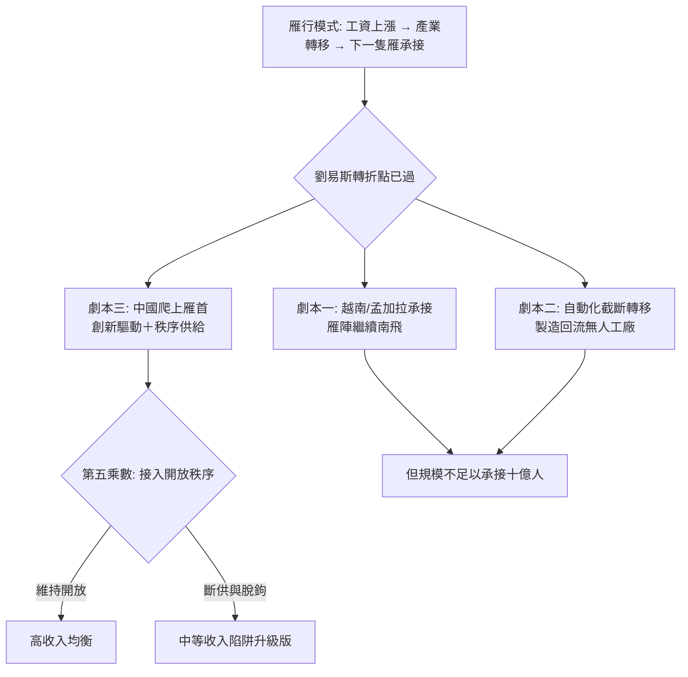

# 第九章　尾聲：雁行終點？中等收入陷阱與AI時代

> 每一個偵探故事都有最後一頁。但這一頁的兇手尚未落網——我們只知道，案發現場又出現了新的指紋。

## 一、劉易斯轉折點：無限勞動力供給的終結

本書前八章論證了一條連乘公式：中國崛起 = 制度鬆綁 × 雁行時機 × 規模稟賦 × 國家再發明 × 接入開放秩序。其中最強勁、也最脆弱的一項，是規模稟賦——具體說，是劉易斯模型描述的「無限勞動力供給」：數億農村剩餘勞動力湧入沿海工廠，工資被壓在低位數十年，構成勞動密集出口的比較優勢。

但無限供給是有存量的。2010年前後，中國跨過了**劉易斯轉折點**：農村可轉移勞動力見底，民工荒從季節現象變成常態，製造業工資連年以兩位數上漲。人口紅利在同一時期見頂——勞動年齡人口占總人口比重於2012年開始下降，此後一路下行；一胎化政策的長尾效應（出生高峰的祖輩進入退休年齡）疊加少子化，把人口結構從紅利推成負債。

用公式語言說：

$$
\text{規模稟賦} = \text{勞動力規模} \times \text{工資優勢}
$$

勞動力規模仍在，工資優勢卻隨劉易斯轉折點遞減——越南、孟加拉、埃塞俄比亞接過了縫紉機。雁行模式的基本邏輯是「工資上漲→產業轉移→下一隻雁承接」，而這個邏輯正要求中國把雁首位置讓出去。[2010年越南電子代工崛起](../../世界史/東南亞史/2010-越南電子代工崛起.md)就是雁陣換位的實景：三星、蘋果供應鏈的組裝環節持續南移，中國沿海與越南內陸之間，正在重演當年四小龍與中國沿海之間的故事。

## 二、中等收入陷阱：拉美先例的陰影

雁行的終點站有三個出口：爬上去（韓國、台灣、新加坡）、卡在半山（墨西哥、巴西、土耳其）、跌回去（阿根廷）。

第八章驗屍拉丁美洲時已指出：拉美的教訓不是資源不足，而是**五乘數從未同時為正**——進口替代錯失開放、債務危機燒掉時機、休克療法掏空國家。中等收入陷阱的機制正在於此：低收入階段的優勢（廉價勞動力）耗盡後，必須切換到高收入階段的引擎（創新、品牌、高端製造），而切換需要制度鬆綁與國家能力的再度共振。多數經濟體卡在兩段引擎之間——工資漲上去了，生產力沒跟上去。

中國2021年人均GDP突破一萬二千美元，站上了世界銀行定義的高收入門檻邊緣。但門檻是線，陷阱是坡：從中等收入到高收入的區間，正是勞動密集優勢耗盡、創新驅動尚未接棒的「斷檔區」。中國能否通過，取決於連乘公式其餘四項能否補上規模稟賦的退潮——其中國家再發明與接入開放秩序，是兩個最關鍵的變數。

## 三、一帶一路：從秩序接入者到秩序供給者

2013年，習近平提出絲綢之路經濟帶與21世紀海上絲綢之路，即[一帶一路與中亞](../../世界史/中亞史/2013-一帶一路與中亞.md)所記錄的宏圖：鐵路、港口、管線、電網與數位基建，沿古絲路走廊鋪開。這是本書框架裡一次深刻的位置轉換——

**中國前四十年的角色是「秩序接入者」**：加入WTO、接受現行規則、嵌入美國設計的開放秩序。這正是第五個乘數「接入開放秩序」的含義。而一帶一路標誌著嘗試轉換角色：從接入秩序，到**供給秩序**。

這一轉換的歷史對照，在姊妹書中有先例：美國在1944年以[布列頓森林體系](../../世界史/金融經濟史/1944-布雷頓森林.md)與GATT設計了戰後開放秩序，把自身崛起轉化為制度性霸權（見[09-尾聲：美元、資訊與霸權的未來](../美國為何崛起/09-尾聲：美元、資訊與霸權的未來.md)）。美國供給秩序的載體是規則與貨幣——布雷頓森林、美元循環、多邊貿易體制；中國供給秩序的載體則是實物與基建——鐵路、港口、電站與[數位絲路](../../世界史/亞洲史/2013-數位絲路.md)。

兩者的差異本身就是一個探案線索：

| 維度 | 美國（布雷頓森林/GATT） | 中國（一帶一路） |
|---|---|---|
| 供給載體 | 規則、貨幣、市場准入 | 基建、融資、產能 |
| 開放性 | 多邊規則、準入普遍化 | 雙邊協議、項目制 |
| 收益形式 | 制度租金（鑄幣稅、規則話語權） | 資源回報、地緣通道 |
| 內生張力 | 規則約束自己也約束他者 | 債務依賴與當地反彈 |

一帶一路是「第五個乘數」從接入轉向供給的實驗。實驗的成敗尚無定論——但它提示了一個重要事實：**雁行模式的前提，是有一個開放秩序可供接入；當接入者長大到足以動搖秩序本身，雁陣的頭雁與領飛的獵鷹就再也難以區分了。**

## 四、AI時代：雁行模式的地基正在被抽走

正當人口紅利退潮之際，第二重衝擊來自技術。

**第一重衝擊：深度學習與自動化。** 2012年[深度學習革命](../../科技史/科技發展史/2012-深度學習革命.md)之後，機器視覺、語音與預測能力快速逼近工廠線上的人工水準。勞動密集製造業的比較優勢建立在「人工比機器便宜」之上，而自動化正在系統性地削減這個差額。當機器比越南工人還便宜時，產業轉移的終點不再是下一個低收入國家，而是**回流發達國家的無人工廠**。雁行模式賴以成立的「梯次轉移」，第一次面臨被「跳躍取代」截斷的可能。

**第二重衝擊：ChatGPT與知識工作。** 2022年[ChatGPT與知識工作](../../世界史/世界發展史/2022-ChatGPT與知識工作.md)問世，把衝擊從工廠延伸到寫字樓。此前中國的升級路徑是「從組裝到設計、從製造到服務」——客服、外包、軟體工程正是服務化的階梯。生成式AI卻在壓低知識工作的邊際成本，使「人口規模×教育投入」的傳統升級公式被改寫：後發國家原本指望靠人口紅利換取製造業起飛、靠工程師紅利換取服務業升級，如今兩條階梯的地基同時鬆動（[AI與勞動市場](../../世界史/世界發展史/2024-AI與勞動市場.md)記錄了這場重塑的早期證據）。

**第三重衝擊：晶片卡點。** 1987年[台積電與代工模式](../../世界史/世界發展史/1987-台積電與代工模式.md)的教訓在此顯出全部分量：代工模式證明後發者可以爬到技術鏈頂端，但前提是嵌入一個開放的全球分工體系。而高端晶片——AI時代的蒸汽機——恰恰卡在最先進的製程、光刻機與EDA工具上，這些節點都在出口管制的射程之內。當「接入開放秩序」在關鍵技術上被單向斷供，第五個乘數就從「開放的收益」翻轉為「被開放的市場拒之門外」的風險。

三重衝擊指向同一個公式：

$$
\underbrace{\text{規模稟賦}}_{\text{人口退潮}} \times \underbrace{\text{雁行時機}}_{\text{被自動化截斷}} \times \underbrace{\text{接入開放秩序}}_{\text{晶片卡點}} \;\rightarrow\; ?
$$

## 五、雁行終點？三種劇本

把前四節的線索放進一張圖：

- **劇本一（雁陣南飛）**：越南、印度、孟加拉循環承接，中國以資本輸出與產業鏈主持人身份延續影響力。限制在於：沒有任何後發經濟體的規模足以整體承接中國的製造業存量——雁行模式解決了小型經濟體的起飛，卻沒有為十億人規模的經濟體準備降落傘。
- **劇本二（自動化截斷）**：AI與機器人使廉價勞動力失效，全球製造業進入「去勞動化」時代，雁行模式整體失效。中國受衝擊最深，因為它是雁行模式史上最大的乘客。
- **劇本三（爬上雁首）**：中國以創新驅動完成升級，並以一帶一路等載體從秩序接入者轉為秩序供給者。這是連乘公式全項為正的延續，但其成敗懸於第五個乘數——開放秩序是否繼續向中國開放。

## 六、連乘公式的自我審問：哪一項會先歸零？

尾聲的職責不是給出答案，而是把問題放到正確的位置上。回到本書公式：

$$
\text{中國崛起} = \text{制度鬆綁} \times \text{雁行時機} \times \text{規模稟賦} \times \text{國家再發明} \times \text{接入開放秩序}
$$

逐一盤點今天的乘數狀態：

1. **規模稟賦**——正在從正轉弱：人口見頂、工資上漲，但工程師規模與產業鏈完整度仍構成新型規模優勢。趨勢：緩慢減項。
2. **雁行時機**——已基本兌現完畢：這個乘數屬於歷史，1978–2008年的窗口不會重開。它不會「歸零」，只會退場。
3. **制度鬆綁**——存量資產：市場化框架仍在，但進一步鬆綁的邊際動能存疑。變數在政策選擇。
4. **國家再發明**——雙向變數：治理能力（基建、動員、產業政策）仍是強項，但效率與激勵的再平衡是持續課題。蘇聯的屍檢報告提醒我們，這一項可能變成**負值**。
5. **接入開放秩序**——正在弱化：晶片管制、脫鉤壓力、地緣對抗，使這個曾經最穩定的乘數變成了最不確定的乘數。

八個候選者的驗屍歷史告訴我們：歸零的方式從來不止一種。蘇聯死於國家再發明變負，拉美死於時機燒毀，東歐死於秩序缺席。而今天的問題是——**當第五個乘數「接入開放秩序」正在弱化，連乘公式裡，哪一項會先歸零？**

這不是修辭。連乘公式的殘酷之處在於：它不平均計分，不允許補考。四項為滿分、一項為零，結果仍為零。中國在鄧小平之後的崛起，靠的是五項同時為正的罕見窗口；未來的問題，則是這個窗口會以什麼方式重新關閉——或者，被重新打開。

### 小結

劉易斯轉折點已過，人口紅利見頂，勞動密集優勢正在讓渡給越南與南亞；中等收入陷阱的坡道上，中國站在前人跌倒最多的區段；AI時代同時抽走製造業與服務業的後發優勢；高端晶片的卡點，則把「接入開放秩序」從資產變成了負債的候選。一帶一路標誌著從秩序接入者到秩序供給者的雄心——如同1944年的美國——但秩序供給的成敗，恰恰取決於秩序是否還願意接納你。

雁行不會永遠飛行。探案的結案陳詞因此是一個問題，而非答案：**當連乘公式中的某一項率先歸零，歷史將如何記錄這一次的驗屍報告？**——這一頁，留給正在書寫它的這個時代。
