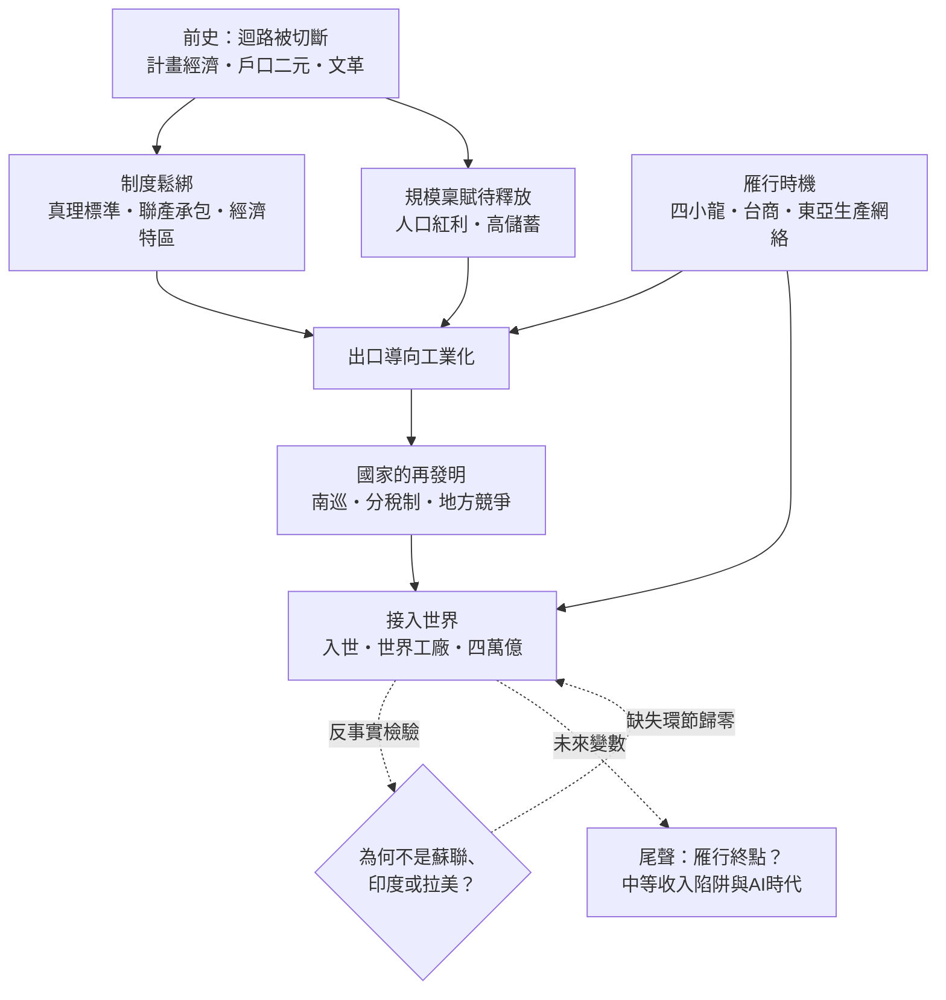

# 中國為何在鄧小平之後崛起——探案式重審1978年的世界史上最大規模脫貧

## 總序：一樁發生在1978年的歷史懸案

人類歷史上，從未有一個經濟體在這麼短的時間內，讓這麼多的人脫離貧窮。1981年，中國有超過八成的人口生活在極端貧困線以下；四十年後，這個比例趨近於零。這不是一個百分比的故事，而是約八億人的命運轉折。這件事本身不稀奇——後發國家追趕的故事並不少見。真正令史家著迷的，是案發現場的幾個反常細節：

第一，案發之時，中國是當時世界上最窮的大型經濟體之一。1978年中國人均GDP不到撒哈拉以南非洲的平均水準，與當年為了「超英趕美」而發動大躍進的那個雄心相比，是一記無聲的耳光。起點之低，使後來的攀升成為統計學上的極端值。

第二，帶來轉折的，不是政權更迭、不是殖民植入、不是戰爭重建——而是**同一個政黨、同一片土地、同一批人民**。前三十年與後三十年之間，沒有發生墨西哥式的革命，也沒有發生日本式的佔領改造。判若兩國的兩個時代，被一條幾乎沒有斷裂的連續性串在一起。這在比較史的意義上幾乎是孤例。

第三，路徑本身早已被驗證。日本與亞洲四小龍在1960到1980年代，已經把「出口導向工業化」這條雁行路徑走了一遍，證明它存在、可行、可以複製。戰後幾十個開發中國家都看見了這條路，卻只有中國以十億人口的規模接住它，並把它放大到改寫世界貿易版圖的程度。看見路的人很多，接得住路的人只有一個。

本書的偵查立場由此確立：**我們不問「中國為何曾經落後」（那是一百五十年來被問爛了的問題），而問「1978年前後，中國的土地上多了哪些缺一不可的環節」**。這是一個問題的反轉。反轉之後，答案不再是清點屈辱與檢討國民性，而是在時間軸上逐格比對：哪些條件原本就有、哪些條件在此刻才被接通、哪些條件是別人送上的（而且為何別人願意送上）。

### 分析框架：迴路的重新接線＋五個連乘項

本書延續姊妹書《美國為何崛起》（見 [../美國為何崛起/README.md](../美國為何崛起/README.md)）的分析傳統，以金觀濤的「理論—實驗—技術」三元迴路為骨架：科學理論指導實驗，實驗催生技術，技術的成功反哺理論與實驗投入，形成自我加速的循環。美國的故事，是把這個迴路以「管理」與「國家動員」放大到極致。

中國的故事則是迴路史的另一半：**一個曾經把迴路每一條通道都人為切斷的國家，如何在短短數年內重新接線**。毛澤東時代的計畫經濟體制裡，「理論⇒理論」「實驗⇒實驗」「技術⇒技術」的封閉小迴圈依然在轉（兩彈一星就是封閉迴路所能達到的極限樣本），但通道之間的橫向連接——實驗結果無法變成產品、技術進步無法反哺投入、價格信號不傳導任何資訊——全部被制度性切斷。1978年的改革開放，本質上不是「從無到有」，而是一次大規模的**重新接線**：真理標準討論重新接通理論與現實，聯產承包重新接通勞動與報酬，經濟特區重新接通中國與世界市場。

但僅有重新接線，解釋不了「為何崛起的是中國」。重新接線的國家很多——1980年代的蘇聯、印度、拉美各國都在做類似的事。中國的新變數在於，接線之後，**五個乘數恰好同時不為零**：

- **制度鬆綁**：把被切斷的迴路通道逐一接回，且鬆綁採取「試點—擴散」而非「休克」的方式，保留了國家的執行能力；
- **雁行時機**：四小龍的工資上漲恰好騰出了勞動密集型產業的轉移空間，中國開放之門開啟得**不早不晚**——早十年，門外沒有產業可承接；晚十年，機會已被東南亞分食；
- **規模稟賦**：全世界最大規模的剩餘勞動力、極高的儲蓄率、以及能在一代人時間內鋪完的基礎建設；
- **國家的再發明**：南巡確立市場方向不動搖，分稅制重組中央與地方的財政激勵，把地方官員變成追求GDP的「準企業家」——這是計畫經濟的組織遺產被反轉為市場動員的機器；
- **接入開放秩序**：2001年加入WTO，把中國的規模正式接上美國在戰後設計的開放貿易體系——歷史在此處露出了它最大的反諷：中國的崛起，恰恰是對《美國為何崛起》一書中「秩序供給」那一項的最大規模借用。

於是本書的核心論旨可以寫成一條連乘公式：

$$
\text{中國崛起}=\underbrace{\text{制度鬆綁}}_{\text{重新接線：真理標準}\cdot\text{聯產承包}\cdot\text{特區}}\times\underbrace{\text{雁行時機}}_{\text{四小龍升級讓出的位階}}\times\underbrace{\text{規模稟賦}}_{\text{人口紅利}\cdot\text{高儲蓄}\cdot\text{基建能力}}\times\underbrace{\text{國家再發明}}_{\text{南巡}\cdot\text{分稅制}\cdot\text{地方競爭}}\times\underbrace{\text{接入開放秩序}}_{\text{入世}\cdot\text{世界工廠}\cdot\text{美元體系}}
$$

這是連乘，不是連加。任何一項為零，積便為零——這正是「缺一不可」的數學表述。制度鬆綁而無雁行時機，得到的是1980年代的印度；有規模而無國家再發明，得到的是許多拉美大國；全部齊備而未接入開放秩序，得到的是1991年前的蘇聯與其經互會小圈子。本書第八章將逐一進行這場反事實驗屍檢。

### 全書因果鏈總圖

## 目錄

| 章 | 檔案 | 探案主題 |
|---|------|---------|
| 1 | [01-導論：問題的反轉——為何是1978？為何偏偏是中國](01-導論：問題的反轉——為何是1978？為何偏偏是中國.md) | 三個反常細節、問題的反轉、雁行理論與後發優勢 |
| 2 | [02-前史：為何毛澤東時代未能起飛](02-前史：為何毛澤東時代未能起飛.md) | 不是「缺了什麼」，而是「什麼被切斷了」 |
| 3 | [03-制度鬆綁：真理標準、聯產承包與經濟特區](03-制度鬆綁：真理標準、聯產承包與經濟特區.md) | 迴路重新接線的三個現場 |
| 4 | [04-雁行時機：四小龍、台商與東亞生產網絡](04-雁行時機：四小龍、台商與東亞生產網絡.md) | 為何開放之門開啟得不早不晚 |
| 5 | [05-規模稟賦：人口紅利、高儲蓄與基礎建設](05-規模稟賦：人口紅利、高儲蓄與基礎建設.md) | 十億人規模的乘數效應 |
| 6 | [06-國家的再發明：南巡、分稅制與地方競爭](06-國家的再發明：南巡、分稅制與地方競爭.md) | 計畫組織遺產反轉為市場動員機器 |
| 7 | [07-接入世界：入世、世界工廠與四萬億](07-接入世界：入世、世界工廠與四萬億.md) | 規模正式接上開放貿易秩序 |
| 8 | [08-反事實檢驗：為何不是蘇聯、印度或拉美](08-反事實檢驗：為何不是蘇聯、印度或拉美.md) | 逐一驗證「缺一不可」：誰缺了哪個環節 |
| 9 | [09-尾聲：雁行終點？中等收入陷阱與AI時代](09-尾聲：雁行終點？中等收入陷阱與AI時代.md) | 迴路是否會移轉？下一隻雁在哪裡 |

## 閱讀指引

- 各章以「一、」至「七、」小節推進，模擬偵查程序：現場 → 疑點 → 排除 → 串聯 → 定論。
- 行文中的相對連結指向本探案庫各冊（世界史、科技史），可循線深挖原始條目；對美國故事的平行引用，指向姊妹書 [../美國為何崛起/](../美國為何崛起/README.md)。
- 每章以「小結」收束，回到全書核心連乘公式，檢驗該章貢獻了哪一個乘數，以及該乘數為何在此刻、此地不為零。
- 閱讀順序建議：先讀第1章與第2章確立問題意識與「切斷」診斷，再按目錄順序推進；第8章為全書驗證樞紐，可在讀完第3至7章後重讀一遍。
