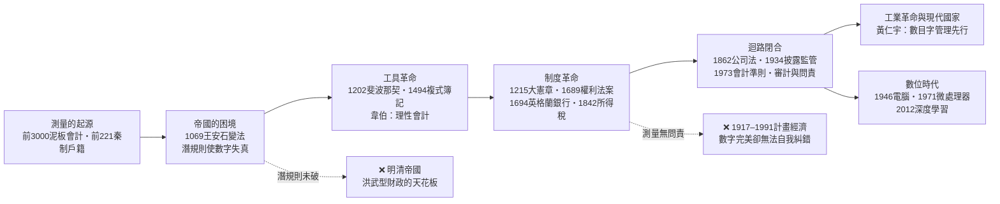

# 國家如何才能在數目字上管理

> How a State Can Be Managed by Numbers
> ——黃仁宇問題：從潛規則的泥沼到複式簿記的制度，再到「理論—實驗—技術—制度」的國家迴路

## 總序：一樁歷史懸案的偵查

黃仁宇在《萬曆十五年》與《中國大歷史》中反覆申說一個論斷：**中國傳統帝國之所以無法走向資本主義與工業革命，根本原因是它不能「在數目字上管理」（mathematically manageable）**——國家無法以真實、可核、統一的數字掌握土地、人口、財政與商業，只能靠道德文章與官僚裁量統治。他斷言：工業革命的基礎，是先讓國家能在數目字上管理；數目字管理是因，資本主義與工業化是果。

為何如此？又如何才能做到？這是本書要偵辦的懸案。

### 案發現場的四個證人

本書傳喚四位證人，讓他們的證詞互相對質、互相補全：

- **黃仁宇（問題提出者）**：現代國家的財政、稅收、軍事、商業必須被化約為可加總、可比對、可審計的數字，且下層結構（土地產權、商業習慣、民法）必須與上層的數字一一對應。明代帝國用「洪武型財政」——固定稅額、實物徵收、缺乏中層的商業與法律組織——把龐大帝國變成一筆糊塗帳。
- **吳思（病理學家）**：為何不能？因為**潛規則**。官場的真實運行規則藏在正式制度之下：層層加派、瞞上不瞞下、報喜不報憂、陋規灰色收入。正式的數字制度一旦經過這套潛規則的過濾器，到達中央時早已失真——皇帝看到的是全國官僚合謀上演的一齣戲。潛規則不是道德敗壞，而是**在監督成本極高、信息不對稱的科層體系中，理性人的均衡策略**。
- **韋伯（工具鑑定人）**：出路在哪？現代資本主義的標誌性工具是**複式簿記**——理性、可核、可稽核的會計技術。企業有了資產負債表，資本才能計算報酬率；同樣的技術放大到國家層面，就是預算制度、統計局、審計署、央行報表。韋伯說：沒有理性會計，就沒有理性資本主義；同理，沒有國家層級的「理性會計」，就沒有現代國家。
- **金觀濤（結構工程師）**：孤立的技術與制度都不夠。科技發展是「理論＋實驗＋技術＋制度」的**相互促進迴路**；國家能力亦然——統計（測量）、政策（理論）、執行（技術）、法治與問責（制度）必須扣成一個自我校準、自我糾錯的正反饋迴路。古代帝國有戶籍（泥板、秦制）、有變法（王安石），但測量與政策、執行與問責互不閉環，所以千年而不得數目字管理。

### 本書核心論旨

四份證詞疊起來，可以寫成一條因果鏈：

$$
\text{數目字管理}=\underbrace{\text{真實測量}}_{\text{統計・清丈・普查}}\times\underbrace{\text{理性會計}}_{\text{複式簿記・預算・審計}}\times\underbrace{\text{法治產權}}_{\text{下層結構與數字一一對應}}\times\underbrace{\text{信息迴路}}_{\text{揭露・問責・自我糾錯}}
$$

這是連乘，不是連加。**任何一項為零（或被潛規則腐蝕為零），積便為零。**吳思診斷的是第四項的潰爛——沒有真實的信息迴路，前三項都是紙上繁榮；韋伯供出的是第二項的工具；黃仁宇強調第三項的下層結構；金觀濤則指出，這四項必須像「理論—實驗—技術」一樣互相促進、閉環加速，國家才第一次「可計算」。

換句話說：**國家的數目字管理，就是國家版的科學革命。**帝國像古代技術——有工具、無迴路，只能靠經驗與道德修補；現代國家像近代科學——測量、假設、驗證、糾錯成為制度的日常。

### 全書因果鏈總圖

---

## 目錄（Wiki 書篇目）

### 第1章 導論：黃仁宇的診斷——為何工業革命以數目字管理為前提

* [1.1 「數目字上管理」的意思：可加總、可比對、可審計、可問責](../../世界史/世界發展史/1978-改革開放.md)（黃仁宇的下層結構論：土地產權、商業習慣與數字一一對應）
* [1.2 為何是前提：沒有數字就沒有投資、保險、債券與規模經濟](../../世界史/金融經濟史/README.md)（資本主義的計算性格）
* [1.3 對照組：洪武型財政——固定稅額、實物徵收、糊塗帳帝國](../../世界史/法律與制度史/-221-秦制與官僚帝國.md)（明清天花板的制度根源）

### 第2章 病理報告：吳思的潛規則——帝國為何在數目字上失能

* [2.1 潛規則的經濟學：信息不對稱下的官場均衡](../../世界史/法律與制度史/1532-馬基維利君主論.md)（層層加派、陋規、灰色收入的理性基礎）
* [2.2 報喜不報憂：數字失真的傳導機制](../../科技史/科技發展史/負面案例/README.md)（與科學造假同構：無外部核驗，則系統性說謊）
* [2.3 歷史實驗場：王安石變法為何敗給潛規則](../../世界史/法律與制度史/1069-王安石變法.md)（青苗法：好政策在科層過濾器中的變質）
* [2.4 皇帝的困境：監督成本與代理人問題](../../世界史/法律與制度史/1701-嗣位法與司法獨立.md)（為何道德說教救不了數字）

### 第3章 工具革命：韋伯與複式簿記——讓事實自己招供

* [3.1 測量的起源：泥板會計與神廟制度](../../世界史/法律與制度史/-3000-泥板會計與神廟制度.md)（數目字管理的六千年前身）
* [3.2 斐波那契《計算之書》：商業計算的數學化](../../科技史/科技發展史/1202-斐波那契算盤書.md)、[金融計算的誕生](../../科技史/金融計算/README.md)
* [3.3 1494 帕喬利複式簿記：韋伯命題的核心](../../世界史/法律與制度史/1494-複式簿記.md)（雙向核驗、利潤可計算、責任可追蹤；另見[金融計算版](../../科技史/金融計算/1494-Pacioli複式簿記.md)）
* [3.4 從帳房到國庫：預算、統計與國家會計的誕生](../../世界史/法律與制度史/1694-英格蘭銀行.md)（英格蘭銀行：國家第一次給自己記帳）

### 第4章 制度革命：讓潛規則失去藏身之處——法治、產權與問責

* [4.1 大憲章與權利法案：徵稅須經同意，數字須經審查](../../世界史/法律與制度史/1215-大憲章.md)、[1689-權利法案](../../世界史/法律與制度史/1689-權利法案與議會主權.md)
* [4.2 三權分立與司法獨立：裁判不在場上](../../世界史/法律與制度史/1748-孟德斯鳩三權分立.md)、[1832-改革法案](../../世界史/法律與制度史/1832-改革法案與議會民主.md)（打破官場自我評價的閉環）
* [4.3 所得稅與現代稅制：從包稅陋規到統一度量](../../世界史/法律與制度史/1842-所得稅與現代稅制.md)
* [4.4 公司法與有限責任：企業先於國家學會數目字管理](../../世界史/法律與制度史/1862-英國公司法與有限責任.md)
* [4.5 披露、審計與會計準則：強迫公開的資訊迴路](../../世界史/法律與制度史/1934-證券交易法與披露監管.md)、[1973-FASB](../../世界史/法律與制度史/1973-FASB與會計準則私有化.md)（對潛規則的制度性反制）

### 第5章 迴路結構：金觀濤框架下的國家能力——測量、政策、執行、糾錯的四環閉合

* [5.1 國家版的九通道：統計⇒政策⇒執行⇒問責的相互促進](../../科技史/科技發展史/README.md)（把理論—實驗—技術迴路映射到國家治理）
* [5.2 唐律與秦制：有測量無迴路的帝國](../../世界史/法律與制度史/0653-唐律疏議與律令制.md)（古代為何總是「單向鏈」）
* [5.3 明治維新：外壓強制下的迴路速成](../../世界史/法律與制度史/1868-明治維新.md)（戶籍、地租改正、預算制度的一次性安裝）
* [5.4 反面教材：計畫經濟——數字完美而無法糾錯的國家](../../世界史/法律與制度史/1917-俄國革命與計畫經濟.md)、[1991-蘇聯解體](../../世界史/法律與制度史/1991-蘇聯解體與轉型.md)（沒有市場價格與真實披露的「數目字管理」是空轉）
* [5.5 正面教材：新政與央行——用數據迴路對抗蕭條](../../世界史/法律與制度史/1933-新政與行政國家.md)、[1913-聯邦儲備](../../世界史/法律與制度史/1913-聯邦儲備與最後貸款人.md)

### 第6章 數位時代：電腦、網路與 AI——數目字管理的第二次革命

* [6.1 ENIAC 到微處理器：計算成本暴跌的複式簿記時刻](../../科技史/科技發展史/1946-ENIAC.md)、[1971-微處理器](../../科技史/科技發展史/1971-微處理器.md)
* [6.2 資料庫、感測器與即時統計：測量不再依賴官僚自報](../../科技史/科技發展史/1995-GPS.md)、[1969-ARPANET](../../科技史/科技發展史/1969-ARPANET.md)
* [6.3 AI 時代的潛規則 2.0：演算法也會報喜不報憂](../../科技史/科技發展史/2012-深度學習革命.md)（Goodhart 定律：當指標成為目標，指標即失真）
* [6.4 尾聲：國家能學會數目字管理嗎？——迴路不會自動閉合，問責不會自動降臨](../../世界史/世界發展史/2022-ChatGPT與知識工作.md)

---

## 三位證人如何拼成一張圖

**黃仁宇問「為何」，吳思答「為何不能」，韋伯給「工具」，金觀濤給「結構」。**

黃仁宇的斷言常被誤讀為技術決定論——彷彿有了統計局就有現代化。吳思的潛規則正是對這個樂觀的反駁：明代有黃冊、有魚鱗圖冊、有考成法，測量工具一樣不缺，但信息在科層金字塔的每一層都被私利改寫。**數目字管理的死敵不是缺乏數字，而是數字的失真**；失真的根源不在道德，而在制度：當信息的提供者不受信息的使用者核驗、當說謊的成本低於說實話的成本，潛規則就是穩態。

韋伯指出解鎖的工具：複式簿記的偉大不在記帳，而在**結構性的自我核驗**——每一筆交易都記兩次、每一個科目都有對帳，說謊需要造出兩套互相咬合的假帳，成本陡增。第4章接著把這個結構放大並制度化：獨立審計是複式簿記的司法化，議會預算審查是國家層級的對帳，披露監管是強制性的「公開實驗數據」。

金觀濤最後給出總裝圖：測量（實驗）、政策（理論）、執行（技術）、法治與問責（制度＋數學）四環，必須像科學革命一樣互相促進、閉環加速。計畫經濟的反例證明：只有數字而無糾錯迴路，數目字管理會退化為數目字表演；英國 1688–1914 的正例證明：四環閉合後，國家財政信用、戰爭動員與工業投資同時起飛——這正是黃仁宇所說「數目字管理先行，工業革命隨至」的機制。

## 與探案庫其他書的關係

- [工業革命為何出現在歐洲](../工業革命為何出現在歐洲/README.md)：本書的前傳——那本書解釋知識迴路為何點火，本書解釋國家能力迴路為何閉合；兩條迴路互為條件。
- [猶太文化與資本主義之精神](../猶太文化與資本主義之精神/README.md)：資本主義精神的複合起源——倫理與人力資本如何補足數目字管理所倚賴的誠信基礎。
- [美國為何崛起](../美國為何崛起/README.md)：數目字管理的高級形態——泰勒制、統計動員與國家科學體制。
- [科技發展史](../../科技史/科技發展史/README.md)：九通道迴路的方法論總庫，本書第5章是其向國家治理的推廣。
- [金融計算](../../科技史/金融計算/README.md)：複式簿記與商業數學的技術細節庫。

## 方法論聲明

本書以「推理探案」方式寫作：每章先立屍檢報告（歷史現象），再傳喚證人（黃仁宇、吳思、韋伯、金觀濤），最後拼出因果鏈並做反事實檢驗。所有理論主張均標註出處學派；所有歷史細節均以探案庫 wiki 為證據鏈。數目字管理不是西方專利，而是一組可遷移的制度技術——本書同時記錄成功安裝（英國、明治日本、戰後美國）與安裝失敗（明清、蘇聯）的完整病歷。
