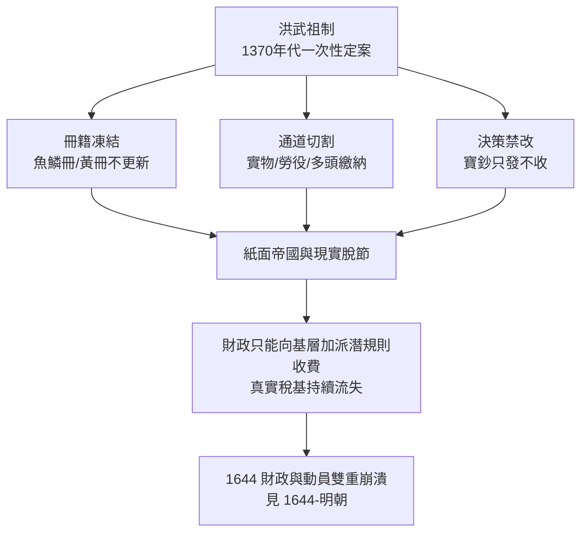

# 01.1 黃仁宇的斷言：為何國家必須在數目字上管理

## 一、案發現場：一道答不出來的考題

1980年代，旅美歷史學家黃仁宇在多部著作中反覆陳述一個近乎冒犯的斷言：**中國傳統社會從未有能力「在數目字上管理」（mathematically manageable）**——國家不以真實、可核驗的數字為基礎進行治理，而以道德訓誡、儒家意識形態與層層模糊的折衷來維持表面秩序。這個斷言的刺耳之處在於：它不是指控某個朝代治理不善，而是指控**整套兩千年的治理技術，從根上就缺了一件現代國家賴以運轉的基本工具**。

更刺耳的是它的推論。若「數目字上的管理」是現代國家的必要條件，那麼中國近代以來的一切挫敗——鴉片戰爭的潰敗、洋務運動的空轉、戊戌變法的夭折——都不必另找文明層面的神秘原因，只需要指向一個技術性事實：**這個國家連自己有多少田、多少丁、收多少稅、欠多少債，都說不清楚。** 一個說不清楚自己家底的國家，無論裝備多少洋槍洋炮，都只是在沙灘上蓋樓。

這樁懸案的現場，留下一組對照極其鮮明的證物。同一個十六世紀，當義大利城邦與荷蘭省議會能用複式簿記逐筆追蹤每一枚金幣的來龍去脈（見 [../../世界史/世界發展史/1494-複式簿記與理性化.md](../../世界史/世界發展史/1494-複式簿記與理性化.md)），大明帝國的戶部尚書卻對全國賦稅的實收數字心裡沒底。黃仁宇的《十六世紀中國之財政與稅收》正是這樁懸案的第一份系統性驗屍報告：他翻遍明代檔案後發現，**帝國的財政不是「管得差」，而是從設計上就拒絕被精確管理。** 本章的任務，是審理這份報告的核心證據。

## 二、命題本體：「數目字上管理」究竟指什麼

黃仁宇的命題常被簡化為「要重視數據」，這是嚴重的誤讀。「數目字上管理」是一整套治理技術的要求，至少包含三個層次，缺一即不成立。

**第一層：基層事實可以被測量。** 國家的稅基——土地、人口、產出——必須被持續、統一、可覆核地登記。測量的單位必須全國一致，測量的結果必須與現實對得上帳。這要求的不只是技術，更是**允許真實數字存在的政治空間**：地方官如實上報歉收，不會因此被問罪；如實上報墾田隱匿，不會因此打破整個官場的默契。

**第二層：數字可以逐級匯總並橫向核對。** 縣的數字能加成府，府的數字能加成省，戶部的總帳能與各省分帳互相勾稽。這要求行政體系內部存在**不受私人關係污染的資訊通道**——帳簿不認師生、不認同鄉、不認上下級的私人恩義。

**第三層：決策以數字為依據，並可被數字問責。** 加稅多少、開支多少、借債多少、償付能力幾何，都必須有量化依據；決策者的成敗，可以用事前定下的數字指標檢驗。這要求權力本身**願意把自己交給帳簿審判**——這是最難的一層，也是權力通常寧死不肯跨過的一道檻。

用一句話濃縮：**數目字上管理 = 真實測量 × 可稽核的通道 × 權力接受核算。** 三個因子相乘，任何一項為零，全式歸零。這個連乘結構是理解本書全部分析的起點：歷史上絕大多數國家的潰敗，不是三項全缺，而是**其中一項在不知不覺間悄悄歸零**。

## 三、對照現場一：洪武型財政——設計出來的「不可管理」

黃仁宇把明代財政體制命名為「洪武型財政」，因為它的基本架構由開國皇帝朱元璋在洪武年間一次性敲定，此後近三百年未曾根本改動。把它放到顯微鏡下，會發現它幾乎是「數目字上管理」三層要求的**逐條反命題**。

**反命題一：測量被凍結。** 明初魚鱗冊與黃冊確實完成過一次全國性的土地與人口登記——以十四世紀的技術條件論，這是驚人的成就。但登記完成後即被神聖化為「祖制」：土地易手而冊籍不改，人口生滅而戶額照抄，甚至出現整里整甲的戶口在紙面上延續百年的奇觀。**國家保留的，只是開國那一刻的快照，而非持續更新的影像。** 快照越久，與現實的偏差越大，而偏差越大，就越沒有人敢承認冊籍已廢——因為承認等於承認祖制失靈。

**反命題二：通道被切割。** 洪武體制的賦稅徵收被拆解為數百種實物與勞役：夏稅、秋糧、鹽課、茶課、里甲輪役、驛站徭役……每種都按原產地就近上繳，戶部從不統一經手貨幣化的總收支。州縣向幾十個不同衙門、在不同地點、以不同實物完成繳納，全國根本不存在一本可以總加的帳。**黃仁宇的名斷是：明代財政不是中央集權，而是「中央分權的碎片」——皇帝集權於人，而不集權於數。**

**反命題三：決策拒絕核算。** 寶鈔（紙幣）自洪武八年發行後，只印不收，數十年間貶值到不足面值百分之幾，朝廷卻始終不肯承認鈔法已敗、調整票面——因為承認即意味著修改祖制。軍鎮的屯田收入早已不足以養兵，衛所名冊上的兵額卻維持原數。**整個體制的穩定，以「不許數字講真話」為代價。**

## 四、對照現場二：現代財政國家——把權力關進帳簿

反過來看同時期開始在西歐成形的「財政國家」（fiscal state），會發現它恰恰是把黃仁宇的三層要求逐一制度化的過程。樣本取英格蘭：1694年英格蘭銀行成立（見 [../../世界史/世界發展史/1694-英格蘭銀行.md](../../世界史/世界發展史/1694-英格蘭銀行.md)），其真正革命性不在「發鈔」或「放款」，而在**國家的債務第一次被記錄在一份公開、可轉讓、逐筆可稽核的帳簿上**。政府借多少、欠誰、利率幾何、以何項稅收抵押，全是市場上人人可查的公共資訊。議會以此為槓桿取得預算審查權：**不公布真實帳目，就借不到低息的錢。**

這就是財政國家的核心機密：**市場本身成為最嚴厲的查帳員。** 一個隱匿財政實況的政府，其國債立刻被貼上風險溢價；一個如實核算的政府，能用兩三厘的利率借到戰爭經費。融資成本的差距，最終在戰場上兌現為勝負的差距。到十九世紀，這套技術又向前推進一步：國家開始以現代統計方式持續測量人口、出生、死亡、產出（見 [../../世界史/工業革命史/1837-戶籍統計與現代國家.md](../../世界史/工業革命史/1837-戶籍統計與現代國家.md)）——**快照被替換為連續攝影，冊籍被替換為資料庫。**

兩個現場並排，對照表如下：

| 維度 | 洪武型財政 | 現代財政國家 |
|---|---|---|
| 稅基登記 | 一次性快照，日後神聖不可改 | 持續測量，定期更新 |
| 收支形態 | 實物與勞役，多頭徵繳 | 貨幣化，統一國庫 |
| 帳目性質 | 無法總加，無從勾稽 | 複式簿記，公開可稽核 |
| 借債能力 | 名義上禁借，實際上以潛規則加派 | 公債市場，以信用定利率 |
| 權力約束 | 道德訓誡，事後清算 | 預算審查，事中核算 |

**結論不言自明：不是明朝的皇帝比英國的議員更腐敗，而是兩種治理技術的代差。** 在洪武型體制下，即使出現勤政的皇帝與清明的官員，體制仍然無法回答「今年全國實收幾何、可用幾何」這個最基本的問題；而在財政國家之下，即使政客貪婪如常，帳簿與市場也逼著他們在數字面前守規矩。

## 五、命題的偵查價值：一個可檢驗的衰敗判準

黃仁宇命題若只停在「中國為何落後」，便只是一種文明診斷。但若把它翻轉為通則，它就升級為一件威力強大的偵查工具：**國家衰敗的第一徵兆，是數目字管理能力的退化——而且退化總是從最不受監督的那一環開始。**

這個判準可以逐案檢驗：

- **明末**：黃冊名存實亡，加派（遼餉、剿餉、練餉）建立在早已失真的稅基上，真實承擔者逃入士紳的優免特權之下，帳面稅收與實際負擔的裂口由基層胥吏的灰色收費填補——王朝在最後一刻都拿不出一份可信的全國收支表（見 [../../世界史/國家滅亡史/1644-明朝.md](../../世界史/國家滅亡史/1644-明朝.md)）。
- **西班牙**：以美洲白銀抵押未來收入，王室屢次宣告破產（見 [../../世界史/國家滅亡史/1557-西班牙破產.md](../../世界史/國家滅亡史/1557-西班牙破產.md)）——帳面上記的是收入流，沒有人核算的是這條收入流對單一礦脈的致命依賴。
- **法國波旁王朝**：王室財政不透明到連國王自己都不清楚赤字規模，正是這種「不可核算性」使財政改革的每一次嘗試都引爆政治危機，最終以三級會議的形式走向崩潰（見 [../../世界史/國家滅亡史/1789-法國波旁王朝.md](../../世界史/國家滅亡史/1789-法國波旁王朝.md)）。
- **蘇聯**：計畫體制號稱以數字治理國家，指標卻層層失真——企業虛報產值、統計局配合政治修飾數據，最終連中央都無法判斷經濟的真實位置（見 [../../世界史/國家滅亡史/1991-蘇聯解體.md](../../世界史/國家滅亡史/1991-蘇聯解體.md)）。
- **清末**：海關是帝國唯一「數目字上管理」的機構，恰因主事者是外籍總稅務司而免於官場潛規則——這一反諷性的對照本身就是對命題的強力佐證（見 [../../世界史/國家滅亡史/1912-清朝.md](../../世界史/國家滅亡史/1912-清朝.md)）。

五個案發現場，一種共同死因。但黃仁宇命題只回答了「缺什麼」，尚未回答兩個更深的問題：**那套讓數字可信的技術，最初是如何被發明出來的？以及，數字為何總會悄悄失真——是誰、出於什麼動機，在系統內部切斷了真實回饋？** 前一問是第1.2節的任務：追查1494年那本改變世界的帳簿，與韋伯所說的「理性化」如何聯手約束權力。後一問則通往全書的核心機制：潛規則——那條在每一個潰敗案例中反覆現形的腐蝕通道。

## 本節要點

1. 黃仁宇命題的完整含義是三層連乘：**真實測量 × 可稽核通道 × 權力接受核算**，任一項歸零則整體歸零。
2. 洪武型財政是該命題的逐條反例：冊籍凍結、通道切割、決策禁改——**不是管得差，而是設計上拒絕被管理**。
3. 現代財政國家的關鍵躍升在於讓市場成為查帳員：**帳目可信度直接決定融資成本，融資成本直接決定國家存亡**。
4. 明末、西班牙、波旁法國、蘇聯、清末五案同構：**衰敗的共通前兆是國家喪失對自身真實數字的掌握**。
5. 命題留兩問：可信數字的技術起源（1.2節），與數字失真的內部動力（1.3節及全書）。

## 延伸對照

- [../../世界史/世界發展史/1494-複式簿記與理性化.md](../../世界史/世界發展史/1494-複式簿記與理性化.md)：黃仁宇所缺的那件工具，如何在同時代的歐洲被發明。
- [../../世界史/世界發展史/1694-英格蘭銀行.md](../../世界史/世界發展史/1694-英格蘭銀行.md)：公開帳簿、公債市場與議會預算權的連鎖。
- [../../世界史/工業革命史/1837-戶籍統計與現代國家.md](../../世界史/工業革命史/1837-戶籍統計與現代國家.md)：從一次性登記到持續統計的技術躍遷。
- [../../世界史/國家滅亡史/1644-明朝.md](../../世界史/國家滅亡史/1644-明朝.md)：洪武型財政三百年的最終清算。
- [../../世界史/國家滅亡史/1557-西班牙破產.md](../../世界史/國家滅亡史/1557-西班牙破產.md)、[../../世界史/國家滅亡史/1789-法國波旁王朝.md](../../世界史/國家滅亡史/1789-法國波旁王朝.md)：兩種「不可核算」的財政死法。
- [../../世界史/國家滅亡史/1991-蘇聯解體.md](../../世界史/國家滅亡史/1991-蘇聯解體.md)、[../../世界史/國家滅亡史/1912-清朝.md](../../世界史/國家滅亡史/1912-清朝.md)：二十世紀的兩個對照組。
