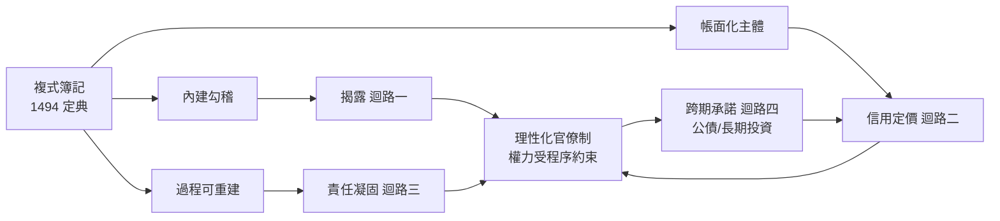

# 01.2 韋伯與複式簿記：理性化如何約束權力

## 一、案發現場：一本教科書與一次講座

1494年，威尼斯出版了一本數學教科書——盧卡·帕喬利的《算術、幾何、比與比例概要》。這部巨著中真正改變世界的，是其中短短三十六頁的「記帳與論算」一章：**複式簿記第一次被系統性地寫成可傳授的方法**。它不是發明——義大利商人們已實踐了兩三百年——而是「定典」：把散落各城邦的商業技藝，凝固為一套人人可學、可核對、可標準化的規則（見 [../../世界史/工業革命史/1494-複式簿記.md](../../世界史/工業革命史/1494-複式簿記.md)）。

四百年後，1904與1905年之交，德國社會學家韋伯在兩次演講中提出一個看似跳躍的論斷：**複式簿記與理性資本主義之間存在內在親和性**。一個企業若要計算利潤、評估風險、籌集資本，就必須有一套能夠把一切經濟活動化約為可計算數量的會記技術；而當這種計算精神從商行擴散到國家，就誕生了韋伯定義的現代官僚制——依規則辦事、依文書運作、依可核驗的紀錄問責的組織。

一個寫帳的方法，一個關於組織的理論，相隔四百年遙遙相認。本案要審理的問題是：**為什麼一套記帳規則，能夠成為約束權力的技術？它究竟約束了什麼、如何約束？** 這是理解黃仁宇命題「缺的那件工具」究竟是什麼的關鍵一步。

## 二、複式簿記的技術機密：讓每一筆交易自帶證人

複式簿記的規則極簡：**每筆交易同時記錄兩筆——一記來源（貸），一記去向（借），兩側金額必須相等。** 全部帳目匯入一張試算表，借貸不平即表示某處必有錯誤或弊情。這個「必須平衡」的約束，帶來三項此前任何人類記帳法都不具備的性質。

**性質一：內建勾稽，錯誤無處遁形。** 單式記帳只流水式記錄收支，錯記、漏記、重記都無從發現。複式記帳下，任何一筆帳都在兩處留下互為镜像的紀錄，**篡改一處必然造成不平**。舞弊者面對的不是審計員的火眼金睛，而是數學本身。

**性質二：財產從「實物」變成「帳面關係」。** 複式簿記把企業視為一個獨立的計算主體：資產、負債、資本、損益全部化約為帳戶之間的關係。這意味著**經營狀況第一次可以脫離老闆的記憶與現場的盤點，被完整地書寫、攜帶、審查**。一個從未踏進倉庫的合夥人或銀行家，可以憑一張資產負債表判斷一家商行的死活。

**性質三：過程可重建，責任可定位。** 帳簿連續記錄使任何時點的財務狀態都能從頭重算。出了問題，可以逐步回溯定位到具體某筆交易、某個經手人。**「事後誰都說不清」變成了「每一步都留有痕跡」**——這正是現代審計制度、乃至整個程序正義觀念的技術原型。

## 三、韋伯的躍升：從商行的帳房到國家的檔案櫃

韋伯的洞察在於看出：上述三項性質不只是商業技術，而是一種**普遍的組織原理**。他稱之為「理性化」（rationalization）——把一切活動化約為可計算、可預測、可依規則重複的程序，用「計算」取代「傳統」與「個人恩寵」作為組織運作的軸心。當這個原理搬進國家，現代官僚制便誕生了，其與傳統官僚制（包括中國的科舉官僚制）的分野極其清晰：

| 維度 | 傳統官僚（含科舉制） | 韋伯式理性官僚 |
|---|---|---|
| 任職依據 | 個人恩寵、科舉功名 | 依法任用、契約與職務說明 |
| 權力來源 | 來自上級的授與，可隨時收回 | 來自規則授予的職位，職務權限明文可查 |
| 行事依據 | 經義、慣例、上意揣摩 | 成文規章、標準程序 |
| 紀錄形態 | 奏摺、案牘，敘事性、選擇性 | 檔案、登記簿，連續性、可覆核 |
| 問責方式 | 道德評議、上級裁斷 | 依可核驗紀錄的職務責任 |

請注意最後兩行——**紀錄與問責，正是複式簿記三性質的國家版本**。韋伯式官僚制的本質，可以說是「把商行帳房的方法論放大為治理體制」：官員的每一次職務行為都應像一筆分錄，同時留下「誰批准」與「依何規則」兩側紀錄；整個行政系統像一本總帳，任何人都可以沿著文書痕跡回溯責任。

**理性化的殺傷力由此顯現：它把權力的行使從「人的裁量」翻轉為「程序的函數」。** 在傳統體制中，官員對上級負責，而上級本身就是權力來源，於是問責鏈的終點站著一個自己不受問責的人。在理性化體制中，官員對紀錄與規則負責，而紀錄與規則是外於任何個人的公共物件——**權力第一次有了一個不肯奉承它的對手。**

## 四、關鍵機制：簿記為何能「約束」權力

「約束權力」四字容易說得空洞，需要拆解為具體的作用迴路。複式簿記及其理性化後裔，至少透過四條迴路勒住權力：

**迴路一：揭露。** 帳目強制一切資源流動現形。國王可以專斷，但若其收支須記入公開帳簿，專斷的代價（每一筆濫用）都變成白紙黑字的證據。都鐸以降英格蘭的議會逐步取得撥款審查權，技術前提正是王室收支的帳冊化。

**迴路二：信用定價。** 資本市場把帳目品質轉譯為利率。隱匿、造假的政府須支付高額風險溢價，誠實核算的政府以低息融資。**市場用金錢獎懲會記誠實度，這是比任何監察御史都勤奮的常設審計機構。** 1694年英格蘭銀行成立後，這一機制全面接管英國財政（見 [../../世界史/世界發展史/1694-英格蘭銀行.md](../../世界史/世界發展史/1694-英格蘭銀行.md)）。

**迴路三：責任凝固。** 文書紀錄使「當時誰決定的」不再依賴記憶與口供。官員清楚自己的每個批示都會留檔、可被調閱，便會在裁量時自我節制。**預期被稽核，本身就是最廉價的約束。**

**迴路四：跨期承諾。** 權力最大的病灶是「人存政舉、人亡政息」。帳簿化的制度使政策承諾可以被後任、議會、債權人依原數追認或追責，國家因而能做出可信的長期承諾——而可信承諾正是公債市場、乃至一切長期投資的基石。

## 五、反面驗證：拒絕被核算的權力，各自的下場

一項技術的價值，看拒用者的下場最清楚。

**西班牙哈布斯堡王室**是拒核算的典型：以美洲白銀與未來稅收反覆抵押，1557年起屢次單方面宣布停止償付（見 [../../世界史/國家滅亡史/1557-西班牙破產.md](../../世界史/國家滅亡史/1557-西班牙破產.md)）。王室握有全歐最多的白銀，卻因為拒絕讓自己的債務與收支置於可稽核的規則之下，信用反覆崩盤，融資成本長期高於財政遠為透明的熱那亞與後起的荷蘭。**坐擁金山而死於信用的破產，是拒絕簿記最有力的反證。**

**法國波旁王朝**半推半就：財政帳目殘缺且各帳房互相保密，國王與大臣都不掌握全貌。不透明使每一次增稅都失去說服力，使每一個改革方案都在資訊黑暗中引發猜疑，最終財政危機直接引爆政治革命（見 [../../世界史/國家滅亡史/1789-法國波旁王朝.md](../../世界史/國家滅亡史/1789-法國波旁王朝.md)）。

**明代中國**則是系統性拒核算：如1.1節所示，洪武體制在設計上便凍結測量、切割通道。韋伯意義上的理性官僚制，在明代呈現一個深具反諷的形態——**科舉選出的官員素養極高，組織卻拒絕為他們配備會記技術**；胥吏掌握實際的錢糧文書知識，形成不受問責的技術壟斷階層。官員越是流動（任期短、迴避本籍），胥吏越是穩定，帳目真相就越是沉澱在無人能稽核的灰色地層裡。這正是吳思「潛規則」得以滋生的完美溫床——詳見1.3節與第2章。

## 六、本節定位：黃仁宇之問的下半段

至此可以明確回答1.1節留下的第一問：**「數目字上管理」缺的那件工具，就是複式簿記所代表的、內建勾稽與公開稽核的核算技術，以及韋伯所述、由這種技術精神擴展而成的理性官僚制。** 它不是簡單的「會記方法」，而是一整套讓事實強制現形、讓權力自我節制的社會技術。

但審理至此，一個更陰暗的問題浮出水面：**為什麼這套技術如此脆弱？** 明代不是沒有帳冊——魚鱗冊、黃冊、會計錄俱全；蘇聯不是沒有統計——報表體系之繁複冠絕人類史。帳簿與報表都在，數字卻整層整層地失真。顯然，**腐蝕不是發生在「有沒有數字」的層面，而是發生在「數字從基層流向決策層」的通道裡**：有人在中途截留、改寫、稀釋了真實回饋。是誰在改寫？出於什麼穩定的利益結構？為什麼連英明的統治者也無法拔除他們？——這就是1.3節必須開庭審理的被告：潛規則。

## 本節要點

1. 1494年帕喬利定典複式簿記：每筆交易雙側記錄、借貸必平，**舞弊面對的是數學而非審計員**。
2. 複式簿記三性質——內建勾稽、帳面化主體、過程可重建——構成現代審計與程序問責的技術原型。
3. 韋伯的躍升：把核算精神放大為理性官僚制，**權力從對人負責改為對紀錄與規則負責**，問責鏈的終點不再是另一個不受問責的人。
4. 約束權力的四條迴路：揭露、信用定價、責任凝固、跨期承諾；市場是比御史更勤奮的常設查帳員。
5. 西班牙、波旁法國、明代中國的財政困境同證反面：**拒絕被核算的權力，遲早為不透明支付天價**。
6. 帳簿在而數字失真——腐蝕發生於資訊通道而非資訊本身，被告「潛規則」即將到庭。

## 延伸對照

- [../../世界史/工業革命史/1494-複式簿記.md](../../世界史/工業革命史/1494-複式簿記.md)：帕喬利定典的技術細節與義大利城邦脈絡。
- [../../世界史/世界發展史/1494-複式簿記與理性化.md](../../世界史/世界發展史/1494-複式簿記與理性化.md)：從簿記到韋伯理性化的完整譜系。
- [../../世界史/世界發展史/1694-英格蘭銀行.md](../../世界史/世界發展史/1694-英格蘭銀行.md)：信用定價機制如何接管國家財政。
- [../../世界史/國家滅亡史/1557-西班牙破產.md](../../世界史/國家滅亡史/1557-西班牙破產.md)：坐擁白銀而死於信用的反面樣本。
- [../../世界史/國家滅亡史/1789-法國波旁王朝.md](../../世界史/國家滅亡史/1789-法國波旁王朝.md)：財政不透明如何引爆政治革命。
- [../../世界史/國家滅亡史/1644-明朝.md](../../世界史/國家滅亡史/1644-明朝.md)：有冊籍而無核算的東方對照組。
