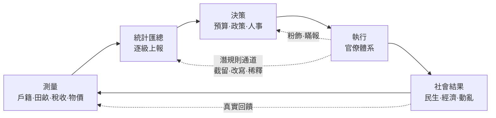
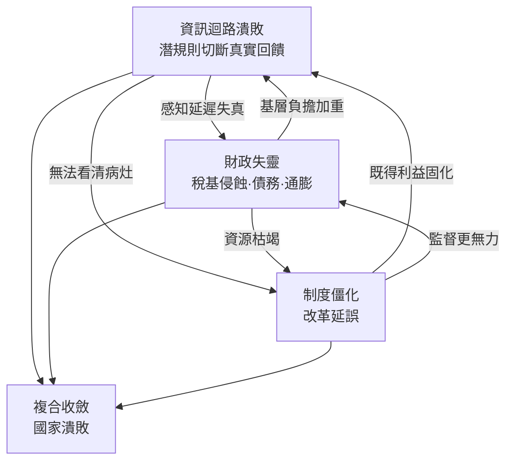

# 01.3 本書框架：金觀濤式治理迴路與吳思潛規則的腐蝕通道

## 一、最後一塊拼圖：兩個待審的被告

前兩節各審結了一案。1.1節確立了黃仁宇命題：國家必須在數目字上管理，且衰敗的第一徵兆是核算能力退化；1.2節查明了工具本身：複式簿記與韋伯式理性化如何讓數字可信、讓權力可稽核。但兩案都留下同一條懸而未決的線索：**魚鱗冊在、黃冊在、蘇聯的報表體系更在——帳簿俱全的國家照樣潰敗。** 顯然在「測量」與「決策」之間，存在一段黑暗的通道，真實數字在其中被系統性地劫走、改寫、稀釋。

本節傳喚兩位關鍵證人，接手這條線索。第一位是**吳思**，其《潛規則：中國歷史中的真實遊戲》以明清官場檔案證明：在正式制度之下，運行著一套不成文、卻人人遵行的真實規則——官吏憑藉合法傷害權索取灰色收入，正式的善政在執行層被偷換為潛規則的惡政。第二位是**金觀濤**，其「中國社會超穩定結構」研究提出：傳統中國以官僚政治為主幹，靠一組循環結構維持穩定，而王朝崩潰的機理藏在其控制系統的失靈之中。吳思提供的是**腐蝕的微觀力學**，金觀濤提供的是**迴路的系統結構**——兩者相扣，正好補齊本案缺的通道解剖學。

## 二、治理迴路：一個國家的神經系統

借用控制論與金觀濤的框架，任何治理體系都可抽象為一條迴路。國家如同生物體，不直接感知世界，而是透過神經系統的**測量—傳導—決策—執行—修正**循環來調節自身。迴路每一環都必須健康，任何一環的延遲、失真或中斷，都會讓整個機體在錯誤的方向上加速：

圖中實線是迴路應有的形態，虛線是本案的真兇。**健全的迴路要求回饋信號原封不動地回到決策層**；而實際運作的體制裡，執行層自己就是回饋信號的編輯者——官員既是運動員又是計分員。金觀濤對傳統王朝的診斷正是如此：官僚體系膨脹與腐敗使上層的調節指令層層衰減、下層的真實狀況層層失真，中央被迫以更強的干預與更密的監控補救，而更密的監控又擴大官吏的合法傷害權，進一步加劇失真——**迴路不是斷了，而是變成一台放大失真的回授機。**

## 三、潛規則的腐蝕通道：數字在哪裡被劫走

吳思的貢獻是精確回答「是誰、在哪一站、以什麼手段劫走了真實回饋」。潛規則對治理迴路的腐蝕，集中於三個站點：

**站點一：測量端的利益關聯。** 上報田畝、戶口、收成的人，其考成與前途恰由同一套數字決定。數字好看則升遷，數字難看則問責——於是瞞報災情、虛報墾田、浮誇產出成為個人理性。這不是個別官員的道德瑕疵，而是**考核制度自我綁架的結構性產物**。

**站點二：傳導端的層層抽水。** 吳思著名的「合法傷害權」概念指出：官吏擁有依正式程序給你造成傷害的能力，而這種能力可以在不違反任何明文的情況下用來交換財物。每一級衙門都是迴路上的一個閥門，信息與資源下來時被層層截留，訊息與民情上去時被層層粉飾。到達決策層的數字，是**每站都被修改過的連乘積**——若每一層只「美化」一成，十層之後帳面與真實已相差一倍有餘。

**站點三：執行端的偷換。** 正式政策在落地時被潛規則重新定義：朝廷的「攤丁入畝」到了縣里變成按人情攤派；賑災錢糧經手三層，落至災民所剩無幾。**決策層以為自己在執行A，社會實際接收的是B，而回饋上來的又是被修飾的A'——決策者在自己編織的資訊繭中施政。**

把三站合起來看，潛規則的本質浮現：**它是正式迴路之外的一條平行的私人迴路**——資源與資訊在正式通道中應有的流向，被私人利益網絡劫持重組。黃仁宇在明代財政檔案中看到的混沌、胥吏對錢糧文書的技術壟斷，正是這條私人迴路在「數目字」上的沉積物。

## 四、全書論旨：三重機制的複合收斂

至此，四位思想者的證詞可以合併結案。本書對「國家為何衰敗」的答案，濃縮為一條連乘公式：

$$
\text{國家衰敗}=\underbrace{\text{資訊迴路潰敗}}_{\text{潛規則切斷真實回饋}}\times\underbrace{\text{財政失靈}}_{\text{稅基侵蝕·債務·通膨}}\times\underbrace{\text{制度僵化}}_{\text{委託代理失靈·改革太遲}}
$$

**連乘的殺傷力在於機制間的互相餵養，而非單獨作惡：**

1. **資訊迴路潰敗是起搏器**。潛規則劫走真實回饋後，決策層對稅基流失、民生困頓、官員腐化的感知全面延遲且失真——**你先失去的是「知道自己正在衰敗」的能力**。
2. **財政失靈是內出血**。稅基在隱匿、優免、灰色收費的侵蝕下持續縮小，正稅不足則加派，加派驅動更多田畝詭寄與人口逃亡，稅基進一步縮小；缺口轉由借債與濫發貨幣填補，債務與通膨接棒——明朝的加派、西班牙的賴帳、波旁的赤字、蘇聯的印鈔，皆是同一內出血的不同分期（各案詳見第3–5章）。
3. **制度僵化是免疫失效**。委託—代理關係全面失靈：皇帝（委託人）無法監督官僚（代理人），因為監督所需的資訊本身已被代理人把持。改革因此面臨殘酷的時間窗：**愈早改革，利益集團愈弱、財政餘裕愈大；愈晚改革，既得利益愈盤根錯節、可用資源愈枯竭**。而諷刺的是——資訊迴路的潰敗恰恰使決策層在「還來得及」的年份裡相信「沒有問題」。三重機制於是咬合成一個自我加速的螺旋。

## 五、偵查路線：第2至第5章

全書以「驗屍對照組」的方式展開：先解剖死者，再解剖生還者。

- **第2章·解剖刀之一：資訊迴路潰敗**。以明末與蘇聯為主案，逐站追蹤真實數字被劫持的通道：魚鱗冊如何變成紙面帝國、蘇聯統計局如何配合政治修飾產值，並建立「失真指數」的案例標尺。
- **第3章·解剖刀之二：財政失靈**。審理西班牙1557年破產、波旁王朝1789年崩潰與清末財稅主權流失，聚焦同一病理的三種表現：收入單一化依賴、債務—信用螺旋、貨幣化逃債。
- **第4章·解剖刀之三：制度僵化**。以張居正改革、清代洋務與清末新政、蘇聯戈巴契夫改革為對照，檢驗「改革時間窗」命題：**改革是否成功，主要不由方案品質決定，而由啟動時點在利益固化曲線上的位置決定**。
- **第5章·綜合驗屍與反向案例**。將三重機制疊加於1644明朝、1912清朝、1991蘇聯三場總崩潰之上，檢驗連乘公式的解釋力；再以成功維持「數目字上管理」的國家（英格蘭—英國財政國家路線）作為反向對照，確認三項機制保持健康的國家為何得以穿越危機。

判定標準貫穿全書：**每個案例都必須回答三問——真實回饋在哪一站被劫走？財政缺口由誰以何方式填補？改革為何延誤、延誤到哪一年就再也來不及？** 三問皆答，驗屍才算完成。

## 六、方法論自白：四人的合成與張力

必須坦白：四份證詞並非天然相容，合成時需要明確裁斷。黃仁宇長於財政技術史，但其「數目字管理」帶有目的論氣息，易被誤讀為單線現代化；本書將其收緊為可檢驗的三層連乘判準，去除目的論。韋伯的理性化框架宏大，但韋伯本人對中國宗教與法律的論斷多依二手材料；本書只取其組織社會學的機制部分，不取其文化決定論。吳思的潛規則概念鋒利，但偏重靜態描述；本書將其動態化，嵌入治理迴路中定位腐蝕站點。金觀濤的超穩定結構善於解釋王朝的長期循環，但對現代財政技術著墨有限；本書以其迴路結構為骨架，把黃、韋的工具與吳的通道嵌進骨架的關節處。

合成後的立場可以一句話陳述：**黃仁宇告訴我們國家需要什麼器官，韋伯告訴我們器官如何協同，吳思告訴我們病變從哪裡侵入，金觀濤告訴我們病變如何沿系統擴散。** 缺任何一位，衰敗的完整病理都拼不出來。

## 本節要點

1. 治理是迴路而非命令鏈：**測量→統計→決策→執行→修正**，任一環失真即全身失調（金觀濤）。
2. 潛規則是正式迴路之外的私人平行迴路，腐蝕集中於三站：**測量端利益關聯、傳導端層層抽水、執行端政策偷換**（吳思）。
3. 全書核心公式：**衰敗 = 資訊迴路潰敗 × 財政失靈 × 制度僵化**；連乘的關鍵是三機制互相餵養的螺旋。
4. 資訊潰敗的首要後果是**先失去「知道自己正在衰敗」的能力**，因此改革總是太遲。
5. 第2–5章以明末、西班牙、波旁、清末、蘇聯五案驗屍，以財政國家路線為反向對照，每案必答三問。

## 延伸對照

- [../../世界史/國家滅亡史/1644-明朝.md](../../世界史/國家滅亡史/1644-明朝.md)：第2章主案——迴路潰敗與財政內出血的合流。
- [../../世界史/國家滅亡史/1991-蘇聯解體.md](../../世界史/國家滅亡史/1991-蘇聯解體.md)：二十世紀版迴路潰敗——統計體制下的全面失真。
- [../../世界史/國家滅亡史/1557-西班牙破產.md](../../世界史/國家滅亡史/1557-西班牙破產.md)、[../../世界史/國家滅亡史/1789-法國波旁王朝.md](../../世界史/國家滅亡史/1789-法國波旁王朝.md)：第3章財政失靈的兩個經典現場。
- [../../世界史/國家滅亡史/1912-清朝.md](../../世界史/國家滅亡史/1912-清朝.md)：第4章改革時間窗命題的核心檢體。
- [../../世界史/世界發展史/1694-英格蘭銀行.md](../../世界史/世界發展史/1694-英格蘭銀行.md)、[../../世界史/工業革命史/1837-戶籍統計與現代國家.md](../../世界史/工業革命史/1837-戶籍統計與現代國家.md)：第5章反向對照——迴路保持健康的生還者。
- [../../世界史/世界發展史/1494-複式簿記與理性化.md](../../世界史/世界發展史/1494-複式簿記與理性化.md)：全書工具箱的技術起點。
