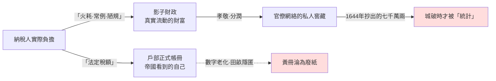
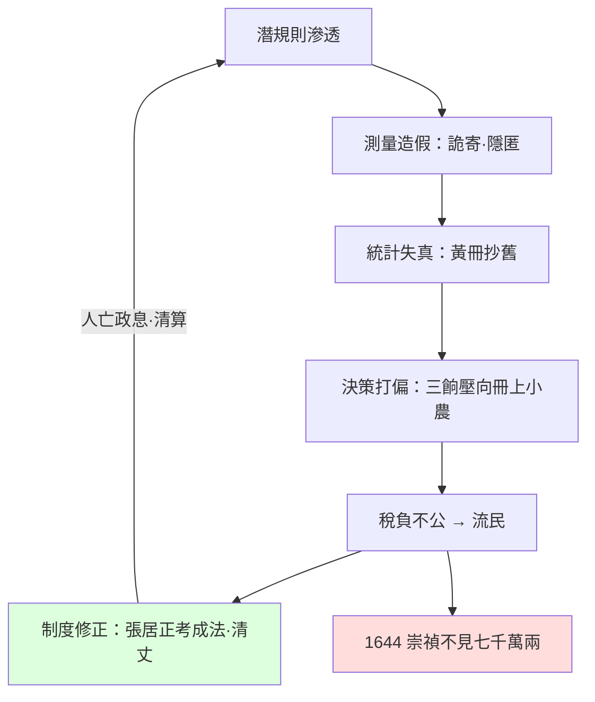

# 02.1 明朝的猝死：潛規則如何掏空帝國的帳簿

## 一、案發現場：一份對不上帳的帝國

1644年3月，李自成兵臨北京城下。崇禎皇帝在內廷敲鑼召集百官，無人應卯；他又去求勳戚國丈捐銀助餉，岳父周奎哭窮推諉，只肯捐一萬兩。三十八天後，李自成的部將劉宗敏夾棍伺候，從周奎家中抄出現銀**五十三萬兩**；整個北京城，被追贓拷餉刮出白銀**七千萬兩**以上。

七千萬兩是什麼概念？明帝國全年的正額稅入，折銀約四百萬兩上下；遼東前線拖欠的軍餉，不過區區數百萬兩。也就是說——**這個即將餓死的國家，其財富並沒有消失，只是不在帳上。** 它藏在勳戚的窖藏裡、官員的陋規裡、書吏的火耗裡，藏在一整套官方統計從未觸及的影子經濟中。崇禎不是沒有錢可用的皇帝，他是**不知道錢在哪裡**的皇帝。

這是本案的第一條驗屍線索：明帝國不是死於資源耗竭，而是死於**資訊迴路潰敗**——國家對自身財政與民間實況的「回饋通道」，早在城破之前幾十年就被切斷了。李自成攻進北京，等於是替這個帝國做了一次它在最後二十年裡從未做成的**全面資產盤點**。

## 二、看不見的稅：常例、火耗與陋規

吳思在《潛規則：中國歷史中的真實遊戲》裡，為這套影子系統做了法醫學式的解剖。他提出的核心概念是：**在正式制度之下，實際支配社會運行的，是一套寫不進公文、卻人人遵守的規則。** 明代的官場給它留下大量物證。

**常例。** 明代地方官進京朝覲考核，須向京官與吏部送上「常例」——這不是賄賂，是**制度化、明碼標價、按缺分優劣定額**的規費。縣令年入多少、知府打點幾何，在官場內部有近乎行情表的可預期性。海瑞是明帝國官場的異數：他拒收常例，靠俸祿過活，結果是同僚視之為怪獸——不是因為他清廉，而是因為他的存在讓整個行情表失去正當性。吳思指出一個殘酷的對稱：**拒絕潛規則的人會被系統淘汰，於是系統自我純化為虛假。**

**火耗。** 這是本案最精緻的物證。帝國徵稅收的是碎銀，州縣須熔鑄成錠解運上級，熔鑄必有損耗——於是徵稅時加收百分之幾的「火耗」。問題在於：**實際熔鑄損耗不到百分之一，法定加徵卻動輒百分之二十、三十，偏遠州縣甚至翻倍。** 差額去了哪裡？進了州縣官的私囊、書吏的孝敬、上級的規禮。火耗是完美的灰色稅：它不在戶部帳上，不需要預算審計，卻構成地方財政與官員收入的真實主體。

用現代語言說：明帝國存在**兩本帳**。一本是戶部的「黃冊—魚鱗冊—奏銷冊」體系，記載一個想像中的、田畝與丁口都對得上號的帝國；另一本是潛規則運行的真實帝國。兩本帳之間的裂縫，隨時間只能擴大不能收縮——因為所有整理兩本帳的人，都住在裂縫裡吃飯。

## 三、黃冊之死：統計體系的屍變

明帝國並非不重視數據——恰恰相反，它建了人類十五世紀最龐大的統計機器。太祖朱元璋設**黃冊**（全國戶口）與**魚鱗冊**（全國田畝），每十年大造一次，存檔於南京後湖黃冊庫，鼎盛時藏冊逾百萬冊。這是「測量→統計→決策→制度修正」迴路的一次雄心勃勃的基建。

驗屍結果令人心驚：這台機器幾乎從一開始就在**內部潰爛**。

- **測量層造假。** 里長造冊時，與戶主合謀隱匿丁口、攤派詭寄：富戶把田產掛在秀才（免役）、僧道名下，「一田二主」，正冊上的田畝與真實土地脫鉤。
- **統計層老花。** 黃冊十年一造，造冊經費被州縣剋扣，於是出現吳思式的黑色奇觀：**許多州縣直接抄舊冊充新冊**，把上一輪的姓名數字原樣謄抄，甚至死人名字照登百年。後湖黃冊庫的官員照單全收——因為查出來，得罪的是整條造冊鏈上的所有人。
- **決策層失明。** 到明中後期，皇帝面對的黃冊是這樣的：南方某些縣冊上的戶數比真實戶數多出數倍（以便分攤稅負），北方某些冊上的丁口百年不變。朝廷依此攤派鹽引、徭役、軍餉，每一項都精準地打在錯誤的位置上。

這正是黃仁宇在《萬曆十五年》裡的著名診斷：**明代帝國「以道德代替法律」，且「數目字管理不可得」。** 萬曆十五年（1587），整個帝國表面平靜，實則每一根數據神經都已壞死——皇帝不能知道國庫實數，首輔不能知道州縣實況，連清官海瑞也只能用道德訓誡去對抗一套他無法測量的系統。黃仁宇的深度在於指出：這不是哪個官員的墮落，而是**帝國沒有建立起能穿透潛規則的計量工具**（無獨立審計、無貨幣化的中層財政、無職業官僚的專業考覈），於是「數目字管理」永遠停在紙上。

## 四、唯一一次搶救：張居正與考成法

1580年前后，首輔張居正發動了帝國史上罕見的一次「迴路搶修」。

**考成法**：給各級官員建立三本帳，凡稽查徵稅、處理公務，逐月登記註銷，六科與內閣層層核對——這是企圖用**結果回饋**打通官僚體系的資訊閉環。**清丈田畝**：重新測量全國土地，萬曆九年清丈完成，查出隱匿田畝，全國徵稅田額由四百餘萬頃升至**七百餘萬頃**——注意，不是土地增多了，是**國家第一次看清了自己有多少土地**。隨後**一條鞭法**把名目繁雜的實物稅與徭役合併折銀，試圖把影子財政裡的火耗、里甲雜派一併陽光化。

張居正的搶修一度奏效：太倉積糧可支十年，帝國迴路重新通了電。但驗屍報告必須記錄隨後的每一個字：

1. **張居正死後被清算**。考成法被廢，清丈成果被擱置——因為這套系統得罪了所有靠裂縫吃飯的人，而張居正是唯一有政治資本壓制他們的人。
2. **繼任者學到的是反面教訓**：整理帳冊者身死名裂，瞞上欺下者平安富貴。這是對全帝國官僚最有效的一次**激勵設計**——反向的。
3. 此後七十年，帝國再無一次像樣的統計修正。萬曆三大征耗盡積蓄，遼餉、剿餉、練餉三餉加派，加的又是**正式帳上那個已經嚴重失真的稅基**——真實的富人躲在優免與詭寄之後，三餉的重量全部壓在冊子上的小農身上。**資訊失真直接轉化為稅負不公，稅負不公直接製造流民，流民直接供給李自成。**

可以說，1644年北京城破的因果鏈，起點在1580年代那台被拆掉的「考成法」機器上。用金觀濤的迴路語言：**測量（清丈）→統計（黃冊）→決策（加派）→制度修正（考成）四個環節，前兩個早已潰爛，第三個據此決策必然打偏，第四個被政治清算拆除——迴路整體歸零。**

## 五、驗屍結論與嫌犯指認

明帝國的猝死有三個常見嫌犯：外患（後金）、內亂（流寇）、天災（小冰期旱災）。本案不排除它們——但它們都只是**誘發因素**，不是病理機制。因為同樣的誘發在其他時段出現過，帝國都扛過去了；1644年的帝國扛不住，是因為它的免疫系統早已癱瘓，而免疫系統就是資訊迴路。

病理機制可以濃縮為一條定理：**潛規則的每一筆灰色收益，都是國家資訊迴路上的一次斷路；當斷路累積超過臨界點，國家對自身的感知就死了——它還會行動，但每一次行動都基於幻影。** 崇禎十七年換了五十位內閣大學士，誅殺總督總巡不可勝數，勤政到雞鳴而起——他是中國史上最勤奮、也最能體現「瞎子快跑」的皇帝。

本案同時為全書立下一條偵查判準：**判斷一個國家的健康程度，不看它的官方帳冊多麼漂亮，而看它有沒有能力讓帳冊變得難看。** 明帝國後期已經喪失了這個能力——誰把帳做實，誰就是帝國的敵人。下一節，我們把這條判準帶到二十世紀，檢視一場更驚人的案例：當整個國家的糧食報表都變成謊言時，會死多少人。

## 本節要點

1. 明帝國猝死的病理不在資源耗竭，而在**資訊迴路潰敗**：城破時抄出的七千萬兩白銀證明，財富存在，只是不在國家的帳上。
2. 潛規則（常例、火耗、陋規）構成**影子財政**：它維持系統運轉，同時切斷了國家與真實之間的回饋通道。
3. 黃冊—魚鱗冊體系的潰爛顯示：**沒有可信測量，再龐大的統計基建也只是廢紙堆**；抄舊冊充新冊是資訊系統屍變的典型症狀。
4. 張居正的考成法與清丈是一次成功的迴路搶修，但**人亡政息**——這證明迴路的存續需要制度保障，不能繫於一人。
5. 黃仁宇「數目字管理不可得」與金觀濤「測量→統計→決策→制度修正」迴路斷裂，是同一診斷的兩種語言。

## 延伸對照

- [../../世界史/國家滅亡史/1644-明朝.md](../../世界史/國家滅亡史/1644-明朝.md)——明帝國覆亡全程時間軸與多因素檢視。
- [../../世界史/國家滅亡史/1127-北宋.md](../../世界史/國家滅亡史/1127-北宋.md)——宋代財政數據化程度較高，卻亡於軍事決策，可對照「資訊尚存、決策失靈」的變型。
- [../../世界史/國家滅亡史/1912-清朝.md](../../世界史/國家滅亡史/1912-清朝.md)——晚清「火耗歸公」改革與攤丁入畝，是張居正式搶修的清代續篇。
- 參考書目：吳思《潛規則》《血酬定律》；黃仁宇《萬曆十五年》《十六世紀明代中國之財政與稅收》。
