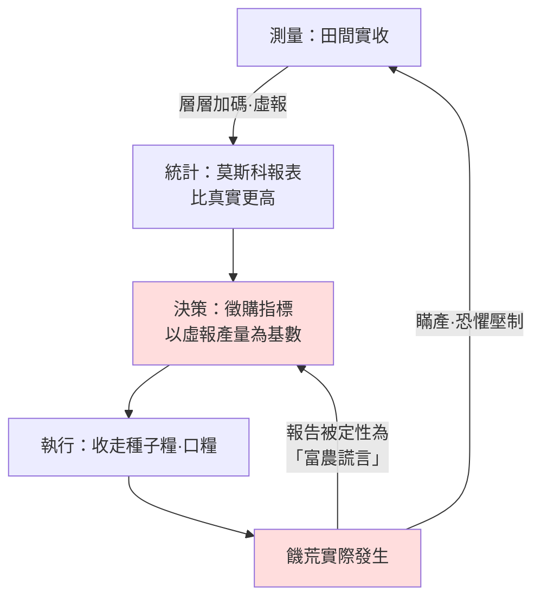

# 02.2 謊報的代價：饑荒、統計造假與三十年的沉默

## 一、案發現場：一張豐收的報表與一片空蕩的村莊

1932年冬，烏克蘭。莫斯科收到的報告是：集體農莊完成交糧計畫、地方存在「富農藏糧」、豐收在望。而現場是：整村整村的農戶沒有聲息，哨兵守在鐵路沿線攔截逃荒者，路面倒斃者無人收屍。1932–1933年，烏克蘭及周邊糧食產區餓死人數達數百萬之譜（學界估計自三百萬至七百萬以上，烏克蘭官方認定為種族滅絕性質的「霍洛多摩爾」）。

本案的偵查重點不在「糧食夠不夠」——這是政策層的問題——而在一個更基本的問題：**莫斯科當年到底知不知道村裡正在餓死人？** 法醫式抽絲剝繭後，答案分三層：底層的聲音被層層加碼的體制壓碎；中層的幹部不敢改數字，只敢改請示的措辭；頂層收到的是被機器過濾後的現實。斯大林「知道有饑荒」，但他同時深信（或選擇深信）**饑荒是富農與破壞分子的謊言**——這正是資訊潰敗最致命的形態：頂層不是沒有數據，而是數據的每一個可信度開關都被潛規則改寫了。

## 二、瞞產與虛報的雙向絞索

集體化體制催生了一對孿生謊言，方向相反、合力相同：

**向上：虛報豐收。** 每一級幹部的升遷、獎章乃至性命，繫於是否「完成並超額完成計畫」。於是交糧數字層層上浮——縣委為了顯得比鄰縣積極，上報產量高於實收；州委在縣委的數字上再加一層。到莫斯科，報表上的糧食比實際田裡長出來的還多。**徵購指標以虛報產量為基數下達，於是變成物理上不可能完成的任務**；幹部為了完成指標，收走農民的種子糧與口糧。

**向下：瞞產私分。** 與此同時，村莊與農莊又「瞞產」——把真實收成藏起來不報，以保口糧。於是體制內部出現荒謬的雙重帳：農莊主席白天帶隊挖地三尺找「富農藏糧」，夜裡自己就是藏糧者。**每個人都在瞞，每個人都知道別人在瞞，但沒有一個正式渠道可以承認「我們都在瞞」**——因為承認本身即為罪。吳思筆下的明代火耗，在這裡換裝重現：潛規則不能被說出，只能被執行。

用金觀濤的迴路語言，這是一幅完整的斷路圖：

注意這個迴路最惡毒的一筆：**饑荒的實況反饋回來時，被意識形態預先定性為謊言。** 這不是單純的技術斷路，而是斷路之上又加裝了「反回饋保險」——任何試圖接通迴路的人都會先被定罪。1932年烏克蘭共產黨幹部與蘇聯本地記者確曾以暗示、內參、私下通信等方式上報災情（史稱「寫信案」），結果是相關者遭清洗。訊息發出，迴路拒收。

## 三、孟加拉1943：資訊失靈的民主版本

把1932年的案例貼上「極權」標籤後，最常見的解釋是制度決定論。孟加拉大饑荒是對這種偷懶解釋的當頭一棒：**1943年的孟加拉處於英屬印度體制內——一個有報紙、有議會選舉、有新聞自由的殖民地憲政框架下，仍餓死了約兩三百萬人。**（見 [../../世界史/國家滅亡史/1943-孟加拉大饑荒.md](../../世界史/國家滅亡史/1943-孟加拉大饑荒.md)）

孟加拉案例的資訊病理與蘇聯不同源、卻同症：

1. **統計失靈**。印度政府在1942年沒有可信的糧食產量與庫存數據。1942年秋的孟加拉水稻遭遇黴菌（褐斑病）與颶風減產，但減產幅度是否足以構成大饑荒，學界（以阿馬蒂亞·森為代表）給出的驚人答案是：**1943年孟加拉的糧食總供給並未比往年低到饑荒程度**。饑荒的機制是森所謂「權利失效」（entitlement failure）——通貨膨脹、軍事採購搶購、運輸船隻被戰時徵用，使窮人的購買力在糧價暴漲中被碾碎。而帝國政府遲遲不肯承認饑荒、拒絕停止糧食出口與拒絕統一配給，部分依據的正是**一套系統性高估庫存、低估災情的戰時統計**。
2. **上層的敘事鎖死**。邱吉爾政府以戰爭優先、船運緊張為由壓下救援請求，並以孟加拉人「像兔子一樣繁殖」的說法為不干預背書。在此，切斷回饋的不是官員的恐懼，而是**殖民者對被殖民者苦難的預設性不信任**——窮人喊餓，官方語料庫裡只有「誇張」「囤積」「投機」三個詞。
3. **新聞自由也未能即時接通迴路**。《政治家報》記者辛哈（Baden-Powell? 不，是George Orwell所評論的那批報導之外）——確切地說，加爾各答媒體在1943年下半年拍下的街頭餓殍照片最終震動了輿論、迫使救濟啟動，但那已是災情高峰之後。**自由媒體這條回饋通道存在，卻被戰時審查與行政惰性延遲了整整一年——延遲，也是一種斷路。**

孟加拉动搖了「只要制度開放就不會有大饑荒」的天真公式。它顯示：**國家對自身病情的知覺，需要測量能力、行政誠實與回饋意願三者同時在線**；缺任何一項，數百萬人的死亡可以在議會與報紙的眼皮底下完成。

## 四、第三案：1949年前的中華民國——被通膨撕碎的帳本

第三個現場是法幣與金圓券時代的中華民國（見 [../../世界史/國家滅亡史/1949-中華民國大陸.md](../../世界史/國家滅亡史/1949-中華民國大陸.md)）。這裡的資訊潰敗呈現第三種形態：**帳目不是被謊報，而是被速度撕碎。**

抗戰勝利後，法幣發行量失控，物價以月計倍增。1948年8月金圓券改革，以行政命令凍結物價、限令兌換金銀外幣——這是一場典型的「以意志對抗數據」的行動：蔣經國在上海「打虎」，用警察與特務強制物價停在官方價位。但真實市場的訊號不會消失，只會轉入地下：**貨架清空、商品逃入黑市、實物交易取代貨幣**。官方帳面上物價穩定，是因為官方帳面已經不再對應任何交易。

1948年11月，行政院被迫放棄限價，物價一日數跳，金圓券在數月內淪為廢紙。驗屍要點：

- **財政數據與實體經濟脫鉤**：稅收以落後物價數月的名義值入帳，入帳時已無購買力——政府收到的是一串不斷蒸發的數字。
- **軍事與人事情報同樣失真**：前線部隊虛報兵額吃空餉、戰報報喜不報憂，南京得到的國共力量對比，與戰場實況的偏差逐年擴大。淮海戰役前，國防部內部已有中共間諜坐鎮作戰廳（郭汝瑰、劉斐），**帝國最核心的「內部資訊層」本身已被對方接入**。
- 結果是決策者以幻影作戰：蔣介石在日記中反覆困惑於「何以士無鬥志、民無歸心」，而這個問題的答案早在帳本與報表的每一個折角裡。

## 五、三案的合併偵查結論

三個現場，三種斷路方式，指向同一份病理報告：

| 案例 | 斷路機制 | 頂層為何看不見 |
|---|---|---|
| 烏克蘭1932 | 虛報＋瞞產＋意識形態定罪回饋 | 數據被改寫，且「饑荒」一詞本身被定義為謊言 |
| 孟加拉1943 | 統計失能＋殖民敘事＋回饋延遲 | 有通道，無意願，無準確測量 |
| 中華民國1948 | 通膨撕裂帳本＋吃空餉＋內部資訊被敵接入 | 帳面穩定是幻覺，連內部層都被穿透 |

三案的共同點可以用一句話寫進全書公式：**當「報告實況」的成本高於「報告謊言」的成本，國家就會在幾年之內完全失明——而饑荒、惡性通膨與軍事潰敗，只是失明的三種不同併發症。**

還有一個更沉默的細節必須記錄：**謊報者的沉默是雙向的。** 蘇聯體制內的知情者選擇沉默，不僅因為恐懼，還因為三十年間並無任何一次「說真話被獎勵」的先例可循；烏克蘭饑荒在蘇聯官方敘事中被封存近半世紀，1986年車諾比之前，「蘇聯從無大饑荒」仍是可印在教科書上的句子。資訊潰敗造成的傷害因此有兩次：第一次是災難發生時，第二次是**災難被從國家記憶中刪除時**——後者保證了前者可以重演。

## 本節要點

1. 烏克蘭大饑荒的機制核心是**雙向謊報**：上級虛報產量推高徵購指標，下級瞞產保命；饑荒實況反饋被意識形態預先定性為「富農謊言」，迴路被加裝了「反回饋保險」。
2. 孟加拉1943證明**憲政框架不自動保證資訊誠實**：測量能力、行政誠實、回饋意願三者缺一，饑荒照樣在報紙眼皮下發生。
3. 1949年前的中華民國展示了**通膨對統計的物理性摧毀**：帳本不是被謊言污染，而是被速度撕碎；軍事報表的吃空餉與報喜不報憂，使最高決策層以幻影作戰。
4. 資訊潰敗的傷害是雙重的：災難發生一次，災難被刪除記憶一次——後者是前者重演的保險單。
5. 統一判準：**當說謊比說真話便宜，國家失明；當失明持續三十年，連失明本身都會成為國家不能承認的事實。**

## 延伸對照

- [../../世界史/國家滅亡史/1932-烏克蘭大饑荒.md](../../世界史/國家滅亡史/1932-烏克蘭大饑荒.md)——霍洛多摩爾的時間軸、徵購數據與史學爭議。
- [../../世界史/國家滅亡史/1943-孟加拉大饑荒.md](../../世界史/國家滅亡史/1943-孟加拉大饑荒.md)——森的權利失效分析與戰時殖民行政。
- [../../世界史/國家滅亡史/1949-中華民國大陸.md](../../世界史/國家滅亡史/1949-中華民國大陸.md)——金圓券、通膨與軍事資訊戰全程。
- [../../世界史/國家滅亡史/1991-蘇聯解體.md](../../世界史/國家滅亡史/1991-蘇聯解體.md)——同一資訊體制的終局（詳見下一節）。
- 參考書目：安妮·艾普邦姆《紅色饑荒》；阿馬蒂亞·森《貧窮與饑荒》；楊奎松、馮客（Frank Dikötter）關於民國經濟史與解放戰爭的研究。
