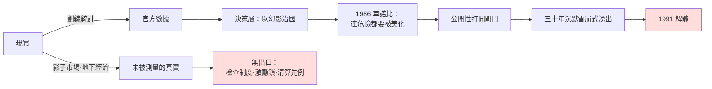

# 02.3 恐怖的資訊閉環：當沒有人敢說真話

## 一、案發現場：監控密度世界第一的國家，為何是第一個看不見自己的國家？

1989年秋，東柏林。史塔西（國安部）檔案館裡存著長達一百一十一公里書架的卷宗、數百萬張卡片：全國一千六百萬人口中，正式線人約十七至十九萬，若把所有「非正式合作者」計入，比例之高為人類監控史之最。按常理推論，這個國家應當擁有**史上最透明的社會**——每條街、每棟樓、每個工廠班組，都有耳朵。

一年多後的1990年10月，這個監控密度世界第一的國家**解體、併入鄰國，無一聲抵抗性的爆炸，只有一聲全國性的嘆息**（見 [../../世界史/國家滅亡史/1990-東德.md](../../世界史/國家滅亡史/1990-東德.md)）。而在它的教科書裡，直到倒台前夕，經濟仍在「穩步增長」、社會主義陣營「蒸蒸日上」。

本案的核心悖論由此成立：**資訊採集量最大化的政權，恰恰是真相擁有量最小化的政權。** 史塔西知道誰在罵領導人、誰在聽西方電台、誰家的兒子想移民；但它不知道——或者其組織結構決定了它**不可能讓上面知道**——經濟還剩幾口氣、民心的臨界點在哪裡、1989年6月北京發生的事對柏林牆內意味著什麼。監控悖論是本章要解剖的主體。

## 二、三種閉環：蘇聯、東德、紅色高棉的病理分型

### 分型一：蘇聯——年鑑學派式的「劃線統計」與洩壓閥的鏽死

蘇聯的資訊體制可以稱為「劃線統計」：**國家統計委員會把現實切成可上報的格子，凡落入格子的被精確計量，凡在格子之外的等於不存在。** 工廠的噸位、里程、台數被記到小數點；產品的品質、需求的真實結構、勞動者的真實意願——落在格子外，於是整個體制對它們**結構性失明**。

蘇聯的回饋閉環有三道鎖：

1. **第一道鎖：組織激勵。** 計畫指標即政治任務，報告欠收等於自毀前程。這是2.2節烏克蘭案機制的常態化：虛報不是例外，是職務要求。
2. **第二道鎖：意識形態預審。** 任何不符合「帝國主義危機加深、社會主義必然勝利」框架的訊息，被定義為政治問題而非事實問題。中央情報局1970年代靠**衛星照片與小麥收購量推算蘇聯糧食歉收**，再回頭對照，發現蘇聯領導層獲得的農業數據比美國分析師手裡的還要失真——**敵人比國王更了解王國**，這是封閉體制最辛辣的註腳。1972與1975年，蘇聯兩度秘密向美國大量採購穀物，國內同時宣傳豐收。
3. **第三道鎖：清算先例。** 赫魯雪夫1956年的秘密報告證明了一件事：揭露前任的謊言，代價是整個陣營的信心地震（匈牙利事件）。此後，蘇共高層對「打開檔案」懷有集體性恐懼——**真相被視為武器而非營養**。勃列日涅夫時代，體制選擇了穩定壓倒真相，停滯（zastoi）一詞後來成為對那十八年的官方解剖結論。

到1980年代，蘇聯的資訊系統已出現典型的「屍變徵候」：地下經濟規模龐大（估算占GDP一至兩成）卻完全不在統計內；計畫部門用**兩套價格**——真實稀缺度只在影子市場上表達；書報檢查（glavlit）把「社會不滿」從印刷品裡刪得乾乾淨淨，於是官方輿論呈現的是一個沒有抱怨者的蘇聯。1986年車諾比事故是總爆發：事故後官方沉默了三天，基輔照常舉行五一遊行——**體制連「危險本身」都要按流程美化**。戈巴契夫事後說，車諾比讓他看清了整個制度的性質，「改革」（glasnost，公開性）正是從這次資訊大潰堤上建立起來的。但接線太晚：公開性一旦打開，三十年沉默累積的真相以雪崩方式湧出，直沖1991年的解體（見 [../../世界史/國家滅亡史/1991-蘇聯解體.md](../../世界史/國家滅亡史/1991-蘇聯解體.md)）。

### 分型二：東德——監控悖論

東德是本案最精緻的標本：**資訊採集的極大化與真相傳導的極小化同時成立。** 機制上有三個環環相扣的病症：

- **線人的報告是「態度」而非「狀況」**。史塔西的線人被訓練去記錄誰「敵對」「消極」「不可靠」，他們的報告天然以忠誠度為座標軸，而非以經濟與民生實況為座標軸。於是國安部積累了關於**誰可能叛變**的百科全書，卻對**國家為何要人叛變**一無所知。
- **越往上，訊息越純**。每一級在呈報時自動濾掉不利內容——不是因為命令，而是因為呈報壞消息的幹部會先被問「你的單位為什麼會出現這種現象」。層層過濾後，昂納克1989年10月（柏林牆倒塌前二十天）還在慶祝共和國四十週年、宣告形勢大好。**監控機器的產出是安全感的證明文件，不是世界的鏡子。**
- **「安全」本身成為國家的唯一績效指標**。當政權的全部正當性訴求收縮為「比西邊更穩定」，那麼任何顯示不穩定的訊息都構成對政權敘事的攻擊。東德因此陷入完美的自證迴圈：監控證明穩定，穩定證明監控必要。1989年夏天，匈牙利開放邊界、成千上萬東德人經奧地利出走，這個最大的社會事實，東德官方媒體幾乎不予報導——**用不報導來對抗現實**，是封閉體制最後的、也是最自殺性的武器。

### 分型三：紅色高棉——閉環的極端形態

1975–1979年的民主柬埔寨，是資訊閉環的純粹實驗室（見 [../../世界史/國家滅亡史/1979-紅色高棉.md](../../世界史/國家滅亡史/1979-紅色高棉.md)）：驅散城市、廢除貨幣、消滅市場與書寫、焚燬圖書、以年齡與階級成分取代一切專業。這不是蘇聯式「統計失真」，而是**對測量行為本身的取締**——當S-21監獄把拷問供詞作為唯一「情報」來源時，資訊系統已退化為恐怖的自我繁殖：逼供產生「間諜名單」，名單產生新的被捕者，新的被捕者產生新的名單。**閉環裡唯一被測量的變量是恐懼本身，而恐懼的指數增長最終吞噬了系統自身。**四年間全國人口損失近四分之一；這個政權最後是被外部軍隊終結的——閉環之內，連崩潰都無法被感知和記錄。

## 三、合併驗屍：閉環的一般定理

三型並置，可提煉出一條貫穿全章的定理：

$$
\text{真相保有量}=\underbrace{\text{採集量}}_{\text{監控、報表、偵查}}\times\underbrace{\text{傳導率}}_{\text{敢不敢報、願不願聽}}\times\underbrace{\text{接受率}}_{\text{頂層能否承認}}
$$

蘇聯、東德、紅色高棉的共同點不在採集量——採集量分別是高、極高、極端——而在**傳導率與接受率趨近於零**。吳思的潛規則理論在此完成最後一塊拼圖：潛規則不只存在於官僚與民間之間，它最終**穿透統治核心**，使獨裁者也成為資訊的囚徒。這是全書公式中「資訊迴路潰敗」項的完整病理：

- 明代：潛規則在**財政層**切斷迴路（2.1節）；
- 饑荒案：潛規則在**統計層**切斷迴路（2.2節）；
- 本節：潛規則在**認知層**切斷迴路——統治者失去的不再只是帳目，而是**對世界與對自己的全部知覺**。

還須記錄閉環的第三重傷害：**它同時摧毀修正的可能性。** 金觀濤迴路的最後一環「制度修正」，前提是承認現狀有錯；而封閉體制的意識形態把「承認錯誤」本身定義為政權自殺。於是體制只剩兩個選項：鎖死到猝死（東德、蘇聯），或由外力終結（紅色高棉）。資訊閉環因此不僅是衰敗的症狀，它是**封死了所有退路的路障**。

## 四、反事實檢驗：1980年代的兩次「開口」

本案的偵查嚴謹性要求檢驗：閉環是否真的不可逆？

反例一：**中國1978**。同一個共產黨、同一套列寧主義組織，鄧小平以「實事求是」重新定義政治正確——把「承認現實」從政治風險變成政治資本。安徽省委書記萬里對小崗村包產到戶的處理是教科書式的迴路搶修：面對既成事實的「瞞產私分」升級版（暗中分田），他不查辦、不表態，而是**向上報告實情並建議合法化**。潛規則第一次被「招安」為正式規則，迴路重新通電（此為本書姊妹案例，詳見第8章對照）。

反例二：**蘇聯1985–1991**。戈巴契夫證明反向的操作順序同樣致命：先開輿論閘門（公開性）而不先改變經濟激勵與組織利益，三十年積壓的真相以崩塌而非修正的方式湧出。**同樣是重新接線，中國接上的是利益迴路，蘇聯接上的是怨恨迴路——接線順序決定生死。**

兩個反例合起來，恰好證明本案定理而非削弱它：閉環的致命之處不在於「曾經封閉」，而在於**開口的時間窗極窄**——太晚開，累積的真實已超過體制的承重極限。

## 本節要點

1. **監控悖論**：東德以人類史上最高的線人密度，實現了對自身崩潰的最大失明——採集的是「態度」，丟失的是「狀況」。
2. 蘇聯「劃線統計」與三道迴路鎖（激勵、意識形態預審、清算先例）證明：**敵人比國王更了解王國**——CIA對蘇聯穀物的估算勝過蘇共中央的案頭材料。
3. 紅色高棉是閉環的純粹形態：**取締測量本身**，以恐懼的自我繁殖替代一切資訊，最終連崩潰都無人記錄。
4. 統一公式：真相保有量 = 採集量 × 傳導率 × 接受率；封閉體制敗在後兩項趨零。
5. 1978中國與1985蘇聯的反事實對照證明：**閉環可解，但開口時間窗極窄；接線順序（先利益還先怨恨）決定重生或解體。**

## 延伸對照

- [../../世界史/國家滅亡史/1991-蘇聯解體.md](../../世界史/國家滅亡史/1991-蘇聯解體.md)——公開性、車諾比與解體的資訊史脈絡。
- [../../世界史/國家滅亡史/1990-東德.md](../../世界史/國家滅亡史/1990-東德.md)——史塔西檔案、1989年夏出走潮與和平革命。
- [../../世界史/國家滅亡史/1979-紅色高棉.md](../../世界史/國家滅亡史/1979-紅色高棉.md)——S-21與極端閉環的社會實驗。
- [../../世界史/國家滅亡史/1992-南斯拉夫.md](../../世界史/國家滅亡史/1992-南斯拉夫.md)——媒體民族主義：封閉體制的另一種出口（仇恨動員）。
- 參考書目：吳思《潛規則》；安東尼·賈德（Anne Applebaum）《鐵幕》；Timothy Garton Ash關於東歐1989的記錄；金觀濤、劉青峰《興盛與危機》。
