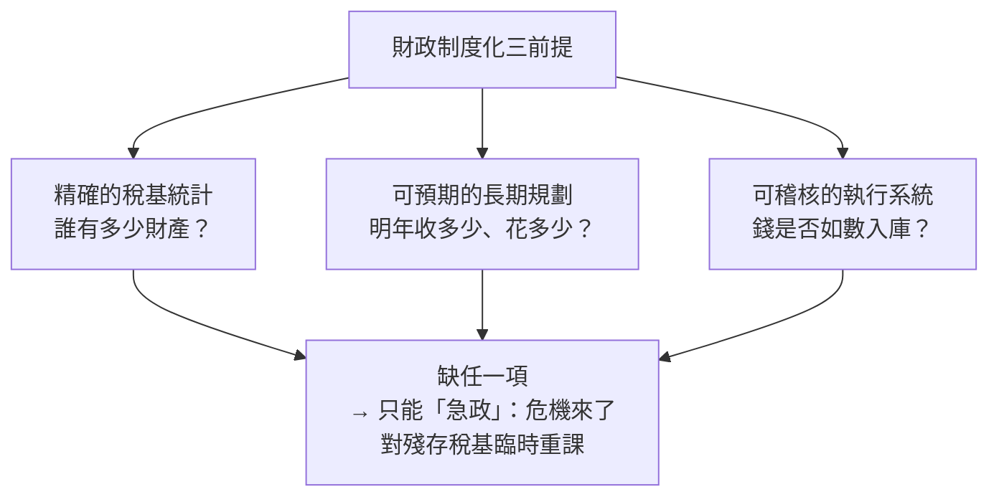

# 03.1 急政與攤派：為何帝國總在最後一分鐘加稅

## 一、案發現場：三個帝國，同一份驗屍報告

翻開帝國滅亡史的卷宗，會發現一個令人不安的模式：**幾乎每個大帝國的最後歲月，財政記錄上都留下同一次手術的刀痕——危機爆發後的倉促加稅。** 這不是巧合，而是一種結構性病症的反覆發作。

**現場一：秦。** 秦帝國在統一後的十五年間，同時維持著北築長城、南戍五嶺、修馳道、建阿房的四大工程，加上戍卒三十萬、刑徒七十萬的動員規模。這些開支沒有任何一套常態化的財政制度去支應，只能靠臨時性的賦斂與徭役攤派——「收泰半之賦」（收取三分之二的收成）。當陳勝吳廣因大雨誤期而揭竿時，帝國發現自己的稅基已經被自己榨乾了（見 [../../世界史/國家滅亡史/-0207-秦朝.md](../../世界史/國家滅亡史/-0207-秦朝.md)）。

**現場二：隋。** 隋煬帝的大運河與三征高句麗，本質上是同一劇本的重演。大業年間，帝國同時進行著人類史上最大規模的工程與戰爭動員——征遼之役單次發兵一百一十三萬，民夫為兵員的數倍。這些開支同樣繞過任何制度化的稅收安排，以急政與攤派直接落在戶上。山東、河北首先崩潰，成為起義的火藥庫（見 [../../世界史/國家滅亡史/0618-隋朝.md](../../世界史/國家滅亡史/0618-隋朝.md)）。

**現場三：唐。** 安史之亂後的唐帝國，病灶更精細：戶籍制度崩壞導致稅基「蒸發」——均田制下農民逃亡，戶口帳面上的數字與實際人口脫鉤，租庸調的征收對象越來越少，而帝國的開支卻越來越大。等到朝廷驚覺，能課的只剩那些逃無可逃的殘存稅戶；藩鎮截留了地方賦稅，中央實際能摸到的錢更少。兩稅法（780年）本質上是一次承認現實的改革——不再追人，改按資產課稅——但它来得太晚，且在藩鎮割據下無法真正落實（見 [../../世界史/國家滅亡史/0907-唐朝.md](../../世界史/國家滅亡史/0907-唐朝.md)）。

三個現場，相隔千年，驗屍報告卻驚人地相似。這迫使我們提出本章的偵查問題：**為什麼帝國總是「最後一分鐘」才加稅？為什麼不能早一點、慢一點、制度化一點？**

## 二、嫌疑人：不是「不夠聰明」，而是「無法在數目字上管理」

黃仁宇在《萬曆十五年》與《中國大歷史》中提出了一個關鍵診斷：傳統帝國的根本缺陷，在於**無法以「數目字管理」**——國家缺乏一套精確、統一、可稽核的財政統計與貨幣工具，因此無法進行理性化的資源配置與長期財政規劃。

這個診斷解釋了「最後一分鐘」的必然性。財政制度化需要三個前提，而傳統帝國三者俱缺：

1. **稅基統計失真。** 帝國的戶籍與田畝登記在承平時期就開始腐蝕：豪強隱戶、寺廟占田、官僚免稅特權、農民逃亡——帳面稅基與實際稅基的差距逐年擴大。朝廷並非不知道，而是**沒有工具與動力去清查**：清查觸動既得利益，成本高於收益，於是歷代選擇擱置。

2. **缺乏信用工具。** 帝國不能舉債（見 3.2 節），因此戰爭與大工程只能「現收現付」。和平時期儲備有限，危機一來，唯一的选择是立即加稅。

3. **執行層層滲漏。** 從中央到州縣，每一層行政都會截留一部分。「潛規則」（吳思語）不是腐敗的例外，而是系統的常態——實際稅負遠高於法定稅負，而法定收入遠低於實際征收。

**於是出現了本章的核心死結：** 平時，稅基被潛規則與特權侵蝕得千瘡百孔；危機來臨，朝廷無法向被侵蝕的部分（豪強、特權、隱戶）課稅，只能對「逃不掉的殘存稅基」重課——自耕農、小工商。而重課的後果，恰恰是把這批人推進逃亡、投獻（投靠豪強以求庇護）、乃至起義的行列，**讓殘存稅基進一步萎縮**。這是一個自我強化的死亡螺旋：

$$
\text{稅基侵蝕} \xrightarrow{\text{危機}} \text{對殘存稅基重課} \rightarrow \text{更多逃亡與投獻} \rightarrow \text{稅基更小} \rightarrow \text{更重的攤派} \rightarrow \cdots
$$

## 三、死結的解剖：以唐為標本

唐帝國的後半生，是這個死結最完整的標本，值得逐層解剖。

**第一層：均田制——制度的前提是一張精確的地圖。** 均田制配合租庸調，其運作前提是國家掌握每一丁的授田記錄與戶籍。這是一個需要持續維護的「資料庫」。承平百年後，人口增長、土地買賣、逃戶投獻，使這張地圖與現實的偏差越來越大。天寶年間的帳面戶數與實際戶數之間，存在著數百萬的「幽戶」與「客戶」——他們活在帝國的稅冊之外。

**第二層：安史之亂——壓力測試揭露所有裂縫。** 戰爭需要錢，而帳冊已不可靠。朝廷的第一反應不是改革稅制，而是「急政」：加征青苗錢、鹽鐵專賣擴張、甚至賣官鬻爵。劉晏的鹽法改革確實高效（民產、官收、商運、商銷，以最少的官僚機構抽取最大的專賣利潤），但專賣收入本質上是**隱蔽的消費稅**，其負擔同樣落在殘存稅基身上。

**第三層：兩稅法——承認現實，而非重建地圖。** 780年楊炎推行兩稅法，核心是「戶無主客，以見居為簿；人無丁中，以貧富為差」——停止追蹤人丁，改按現有資產分等課稅。這是務實的：它把已經蒸發的稅基「就地合法化」，按實際財富重新分配稅負。但兩個致命傷使它未能成為真正的制度化轉折：

- **它仍是行政命令而非制度基礎設施。** 兩稅法依賴中央對地方的有效節制，而藩鎮恰恰是中央節制的反面。河朔三鎮戶口、賦稅不上供，兩稅法在帝國近半的疆土上是空文。
- **它以錢定額、以物折納，卻沒有穩定的貨幣制度。** 錢重物輕時，農民實際負擔加重——「錢荒」成為兩稅法之下反覆發作的危機。無法在數目字上管理的國家，連「按錢課稅」這個最基本的操作都做不穩。

**第四層：藩鎮截留——財政聯邦主義的反面。** 藩鎮體制的本質，是中央用「讓渡財權」換取軍事安撫。這在短期內穩定了局勢，長期卻使中央財政萎縮為帝國的一角。晚唐朝廷養不起足夠的神策軍，只能再對殘存州縣加征——螺旋繼續轉動，直到黃巢。**黃巢本人，就是鹽稅走私網絡中長出來的勢力**：帝國的急政（鹽鐵專賣的高額利潤）親手餵養了自己的掘墓人。

## 四、對照組：為何有人不在最後一分鐘加稅

要證明「最後一分鐘加稅」是制度病症而非歷史宿命，需要對照組。同一時代的拜占庭帝國，靠著一套職業化的稅務官僚系統與定期土地清查，把帝國壽命延續了千年；而1694年的英格蘭，則展示了現代方案的誕生——議會擔保的國債與英格蘭銀行（見 [../../世界史/世界發展史/1694-英格蘭銀行.md](../../世界史/世界發展史/1694-英格蘭銀行.md)），使政府能在危機來臨前以可持續的利率借錢，**把「急政」替換為「信用」**。

對照組揭示：帝國的問題不在於「加不加稅」，而在於**加稅的方式是否被制度化所中介**。制度化的稅收系統能夠：（1）在和平時期就摸清稅基；（2）將稅負公平地攤在全部財富上，而非只壓在逃不掉的人身上；（3）以信用平滑危機支出，避免一次性榨取。三者缺一，危機來臨時就只剩「最後一分鐘」這一個選項。

## 五、通則：急政不是原因，是病徵

本章的偵查結論需要精確表述。急政與攤派**不是**帝國衰亡的原因——它們是病徵。真正的病灶是：

1. **稅基的資訊失靈**（國家不知道、也無法知道誰有多少財富）；
2. **特權的否決權**（被侵蝕的部分恰是無法觸碰的部分）；
3. **信用工具的缺席**（無法借錢，只能現榨）。

三者共同構成黃仁宇意義上的「無法在數目字上管理」。當國家失去了對自身財政的精確感知，它的每一次危機應對都只能是盲目的重擊——而重擊的方向，恰恰指向體制內最弱勢、最有生產力、也最能一走了之的那群人。**帝國不是被最後一擊打死的；是在最後一擊之前，早已把能撐住自己的人趕走了。**

回到全書公式：這正是「財政失靈」與「資訊迴路潰敗」的第一次交乘。稅基侵蝕（財政）與帳冊失真（資訊）本質上是同一件事的兩面；而「制度僵化」則表現為：每一代統治者都看得見問題，卻無一能觸動特權結構完成改革——楊炎看到了，但他只能提出一張無法執行的地圖。

## 本節要點

- 秦、隋、唐三個帝國的滅亡現場，財政驗屍報告同構：危機爆發後的倉促加稅與攤派，而非制度化籌款。
- 「最後一分鐘加稅」的必然性來自三個前提的缺失：精確稅基統計、長期財政規劃、可稽核執行系統——即黃仁宇所謂「無法以數目字管理」。
- 核心死結：平時稅基被潛規則侵蝕 → 危機時只能對殘存稅基（自耕農）重課 → 驅使後者逃亡、投獻、起義 → 稅基進一步萎縮。急政是死亡螺旋的加速器，不是起點。
- 唐代標本顯示：兩稅法是「承認現實」而非「重建地圖」，在藩鎮截留與貨幣不穩下無法制度化；鹽鐵專賣的急政親手餵養了黃巢。
- 對照組（拜占庭稅務系統、1694年英格蘭信用制度）證明：問題不在加稅本身，在於加稅是否被制度化所中介。

## 延伸對照

- [../../世界史/國家滅亡史/-0207-秦朝.md](../../世界史/國家滅亡史/-0207-秦朝.md)：急政攤派的極端案例——四大工程與「泰半之賦」。
- [../../世界史/國家滅亡史/0618-隋朝.md](../../世界史/國家滅亡史/0618-隋朝.md)：大運河與三征高句麗的動員型財政崩潰。
- [../../世界史/國家滅亡史/0907-唐朝.md](../../世界史/國家滅亡史/0907-唐朝.md)：戶籍崩壞、兩稅法與藩鎮截留的完整標本。
- [../../世界史/國家滅亡史/1644-明朝.md](../../世界史/國家滅亡史/1644-明朝.md)：明末三餉加派——同款死結的晚期復發。
- [../../世界史/國家滅亡史/1912-清朝.md](../../世界史/國家滅亡史/1912-清朝.md)：清末財政與海關現代化的局部例外。
- [../../世界史/世界發展史/1694-英格蘭銀行.md](../../世界史/世界發展史/1694-英格蘭銀行.md)：對照組——信用制度化如何取代急政。
