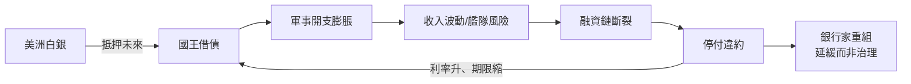

# 03.2 債務之牆：從西班牙破產到希臘危機

## 一、案發現場：最富的國家，破產的次數最多

1547年，神聖羅馬帝國皇帝查理五世——統治著歐洲史上首個「日不落帝國」的君主——窮到無法支付軍餉。不是因為收成不好，不是因為戰爭失敗，而是因為**他即將第四次暫停償還債務**。十年後的1557年，其子腓力二世正式宣布停付，西班牙帝國的破產成為常態：1557、1560、1575、1596——加上1607年腓力三世，帝國在其黃金時代五次違約（見 [../../世界史/國家滅亡史/1557-西班牙破產.md](../../世界史/國家滅亡史/1557-西班牙破產.md)）。

這是本案的第一個反常細節：**當時世界上最富的國家，同時也是破產次數最多的國家。** 波托西銀山的白銀源源流入塞維亞（見 [../../世界史/世界發展史/1545-波托西銀礦與價格革命.md](../../世界史/世界發展史/1545-波托西銀礦與價格革命.md)），美洲白銀約占全球產量的大半，而這個坐擁全球硬通貨的帝國，卻要靠熱那亞銀行家的過橋貸款度日。

四百五十年後，同一案發現場以不同布景重演：2010年，希臘——一個剛剛靠假帳目混入歐元區的政府——被揭發其赤字遠高於申報數字，主權債務危機引爆，成為歐元區第一塊倒下的骨牌（見 [../../世界史/國家滅亡史/2009-希臘債務危機.md](../../世界史/國家滅亡史/2009-希臘債務危機.md)）。而2012年，希臘對私人債權人執行了和平時期最大規模的主權違約重組。

**兩個現場的共同謎團：債務本身並不殺人——殺人的是什麼？**

## 二、偵查主線：債之牆的砌法

先把本案的核心命題寫清楚：**國債不是問題，不可信的國債才是。** 一堵「債務之牆」的坍塌，從來不是由負債總額單獨決定，而是由三個變數的乘積決定：

$$
\text{債務危機} = f\left(\frac{\text{債務存量}}{\text{經濟產出}},\ \frac{\text{利息成本}}{\text{財政收入}},\ \underbrace{\frac{1}{\text{制度信用}}}_{\text{決定利率與展期能力}}\right)
$$

分母中的「制度信用」是關鍵項。它決定了國家能否在債務到期時**以合理利率展期**——而展期，正是國債與私債的本質區別：只要債權人相信你會還、能還，牆就砌得起來；一旦信任崩潰，即使債務不高，牆也會倒。

西班牙的案例將顯示：缺乏制度信用支撐的債務，無論多麼富有都砌成危牆；英格蘭的對照將顯示：有了制度信用，高得多的債務卻砌成堡壘。

## 三、嫌疑人一：西班牙——白銀餵養的信用怪獸

**案情重構。** 西班牙哈布斯堡王朝的財政結構，是一個「收入波動巨大、開支剛性、借貸渠道繞過本國制度」的三重畸形：

1. **收入端：一次性的、不可預期的礦產財富。** 美洲白銀以艦隊制運抵，年收入波動劇烈。國王把未來數年的白銀收入**提前抵押**給銀行家換取現金——這不是現代意義的舉債，而是變相的資產預售。
2. **開支端：帝國的軍事承諾遍布荷蘭、德意志、地中海，剛性且不斷膨脹。** 白銀是波動的，戰爭是剛性的，缺口只能靠借。
3. **制度端：沒有議會為債務背書。** 國王的債是「國王的債」，不是「國家的債」。銀行家的抵押物是未來的運銀船，而非任何制度化的稅收擔保。

**致命的邏輯閉環：** 白銀流入越多 → 國王越容易借到錢 → 戰爭規模越大 → 對未來白銀收入的抵押越深 → 一旦艦隊延誤或沉沒，整個融資鏈斷裂 → 停付違約 → 銀行家提高利率並縮短期限 → 下一次違約更快到來。

熱那亞銀行家們發明了精巧的過橋交易（以即期匯票置換長期債券，將違約風險轉化為匯率風險），使違約後的融資得以重建——但這只是延緩，不是治理。**五次違約的共同結構是：白銀是收入的全部想像，信用是白銀的影子。影子一旦脫鉤，牆即傾塌。**

**驗屍結論：** 西班牙不是死於負債，而是死於**負債方式的原始**——沒有常備的、可議價的、有制度擔保的債務市場，國王的信用只能寄生於一次性的礦產流。財富越大，槓桿越兇，牆塌得越響。

## 四、嫌疑人二：波旁法國——帳目不透明與否決集集團

1789年，引爆法國大革命的導火線不是饑荒，而是一場**財政公開的失敗**（見 [../../世界史/國家滅亡史/1789-法國波旁王朝.md](../../世界史/國家滅亡史/1789-法國波旁王朝.md)）。

**案情重構。** 波旁王朝的債務總額其實不算離譜——它遠低於同時期英國的債務與產出之比。英國在拿破崙戰爭中的債務一度超過GDP的200%，法國大革命前僅約GDP的60%上下。**但英國借得起，法國借不起。** 差別在利率：英國政府能以3–4%的利率借長期債，法國王室卻要付出高得多的成本。為什麼？

1. **帳目不透明。** 法國王室的財政是秘密。沒有公開的預算、沒有審計、沒有議會監督。杜爾哥與內克爾先後試圖公布或整理帳目，都被宮廷否決——因為帳目的透明，意味著特權階層免稅特權的曝光。
2. **特權階層的否決權。** 教士與貴族占有的土地財富相當可觀，卻幾乎不納直接稅。每一次財政改革（杜爾哥1776、卡洛訥1786、顯貴會議1787）都死於特權集團的抵制。國王無力向最有錢的人徵稅，只能繼續借。
3. **否決的代價由利率支付。** 市場看得懂這個結構：一個無法向本國最富有階層課稅的王室，違約風險必然更高。於是利率更高、期限更短、利息負擔更重，財政危機自我加速。

**1789年的引爆點因此有了精確的財政解讀：** 當路易十六被迫召開三級會議籌款時，他想要的是錢，而第三等級要的是**帳目與否決權的翻轉**。國王無法在不觸動特權的情況下得到前者，也無法在不讓出权力的情況下保住後者。**財政透明化的談判破裂之日，就是舊制度的死期。** 法國大革命在本質上，是一場「誰來為國王的債務買單」的談判破裂。

## 五、對照組：英格蘭銀行——把債務變成制度的奇蹟

1694年英格蘭銀行的成立，是本案最關鍵的對照實驗（見 [../../世界史/世界發展史/1694-英格蘭銀行.md](../../世界史/世界發展史/1694-英格蘭銀行.md)）。它做對了三件事：

1. **議會擔保。** 光榮革命後，國王的債變成議會授權的「國債」——償還不再取決於某個君主的意志，而取決於代表納稅人的立法機關。這一個制度安排，把違約風險從「君主會不會賴帳」變成「英國會不會亡國」——前者經常發生，後者極少發生。利率應聲下降。
2. **稅收抵押。** 每筆國債都有議會指定的專項稅收作為償債來源。債權人拿到的不是國王的承諾，而是具體、可稽核的稅入流——這正是西班牙與法國所缺的「抵押物」。
3. **長期市場的複利效應。** 信用 → 低利率 → 可持續的高負債 → 戰爭勝利 → 財政與貿易擴張 → 更強的信用。這個正迴路使英國能用別人的錢打贏整個18世紀的戰爭。**「金融革命」先於工業革命，不是偶然：國債市場建立了現代信用的全套基礎設施。**

1844年的皮爾銀行法（見 [../../世界史/工業革命史/1844-皮爾銀行法.md](../../世界史/工業革命史/1844-皮爾銀行法.md)）則是這套制度向貨幣紀律方向的延伸——信用制度化之後，還需要規則化的約束。

## 六、嫌疑人三：阿根廷與希臘——違約循環與假統計

**阿根廷：主權違約的慣性。** 1983年（見 [../../世界史/國家滅亡史/1983-阿根廷債務與惡性通膨.md](../../世界史/國家滅亡史/1983-阿根廷債務與惡性通膨.md)）以降，阿根廷陷入了「借入外幣債務 → 匯率或貿易衝擊 → 違約或貨幣崩潰 → 高通膨 → 重整 → 再借」的循環。其財政結構的病灶與西班牙同構：**收入端依賴波動性極大的初級產品出口稅，開支端剛性且政治化，制度端缺乏讓債權人「可以相信」的財政規則。** 2001年的世紀違約，是這個循環的又一次循環，而非例外。

**希臘：歐元區內的假統計。** 希臘的案例展示「制度信用」的另一面：借來的制度不足以替代自有的紀律。加入歐元區給了希臘德國級別的利率——這是歐元「制度信用」的輸血。但希臘的財政實況（龐大的公務員系統、逃稅文化、退休金承諾）與帳面數字長期脫節，赤字靠統計粉飾。**歐元提供的低利率，恰恰放大了假帳的危害**：市場不加分辨地以德國利率借錢給希臘，直到2009年真相揭穿，信用一次性坍塌。這是「資訊迴路潰敗 × 財政失靈」的教科書式交乘——假帳（資訊失靈）直接轉化為債務危機（財政失靈）。

## 七、通則：牆與堡壘的分界線

綜合四個現場，本案的偵查結論可以寫成一條通則：

**債務之牆是否坍塌，不取決於砌得多高，而取決於地基是否制度化。** 制度化地基的三根樁：公開可稽核的帳目、代表納稅人的償債擔保、對最有錢階層的有效課稅能力。西班牙與阿根廷缺三樣，波旁法國缺兩樣半（有特權否決、無透明帳目、課稅能力殘缺），希臘有形式而無實質（帳目是假的），唯有英格蘭三樣俱全——於是同一堵牆，一邊是危牆，一邊是堡壘。

回到全書公式：本節完成了「財政失靈」與「資訊迴路潰敗」的第二次交乘。西班牙的艦隊依賴、法國的秘密帳房、希臘的假統計，本質上都是**國家失去了讓外界校驗自己財政真實性的資訊迴路**——而當信用市場無法校驗，它只能以更高的利率對沖不確定性，最終以拒絕展期的方式投票。債務危機，是市場對失靈資訊迴路的集中清算。

## 本節要點

- 西班牙帝國五次破產：世界最富的國家破產次數最多，因為其信用寄生於波動的美洲白銀，沒有制度化擔保——財富越大，槓桿越兇。
- 波旁法國的債務與產出之比遠低於英國，卻先崩潰：帳目不透明 + 特權階層否決改革 → 高利率 → 財政危機自我加速；三級會議是「誰為國王的債買單」的談判破裂。
- 英格蘭銀行的對照實驗：議會擔保 + 專項稅收抵押 + 信用正迴路，使英國能以低利率承擔高得多的債務——「金融革命」先於工業革命。
- 阿根廷展示違約的慣性循環；希臘展示借來的制度信用（歐元低利率）如何放大假統計的危害。
- 通則：債牆是否坍塌不取決於高度，取決於地基——公開帳目、償債擔保、對富人的課稅能力。國債不是問題，不可信的國債才是。

## 延伸對照

- [../../世界史/國家滅亡史/1557-西班牙破產.md](../../世界史/國家滅亡史/1557-西班牙破產.md)：五次違約與熱那亞信用網絡的完整案情。
- [../../世界史/國家滅亡史/1789-法國波旁王朝.md](../../世界史/國家滅亡史/1789-法國波旁王朝.md)：財政透明化談判的破裂與革命。
- [../../世界史/國家滅亡史/1983-阿根廷債務與惡性通膨.md](../../世界史/國家滅亡史/1983-阿根廷債務與惡性通膨.md)：主權違約循環的現代樣本。
- [../../世界史/國家滅亡史/2009-希臘債務危機.md](../../世界史/國家滅亡史/2009-希臘債務危機.md)：歐元區內的假統計與信用坍塌。
- [../../世界史/世界發展史/1545-波托西銀礦與價格革命.md](../../世界史/世界發展史/1545-波托西銀礦與價格革命.md)：白銀收入端波動性的源頭。
- [../../世界史/世界發展史/1694-英格蘭銀行.md](../../世界史/世界發展史/1694-英格蘭銀行.md)：對照組——信用制度化三樁。
- [../../世界史/工業革命史/1844-皮爾銀行法.md](../../世界史/工業革命史/1844-皮爾銀行法.md)：信用制度化向貨幣紀律的延伸。
