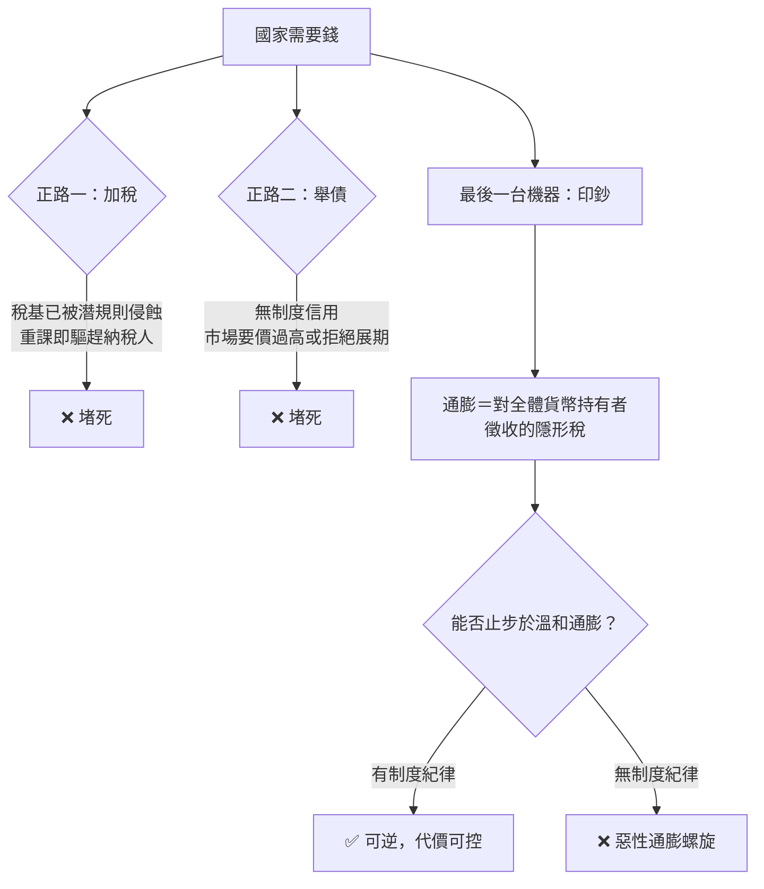

# 03.3 印鈔的終點：惡性通膨與政權合法性

## 一、案發現場：鈔票比紙便宜的那一天

每一場惡性通膨都有一個標誌性的瞬間——不是統計數字，而是一幅畫面。

**現場一：杭州，十三世紀。** 南宋以會子為主要流通紙幣。初期有「本金」（發行準備），有界（分期回收舊鈔）的兌換安排。但隨著對金、對蒙戰爭的軍費膨脹，朝廷一再「展界」——延長舊鈔流通而不回收——並無準備地增印。到了末年，會子貶值到民間「以八百十八界會子買十八界會子一貫」的地步，十五界與十八界會子同時流通、互相打折。紙幣的信用，在朝廷自己手裡一章一章蓋掉了（見 [../../世界史/國家滅亡史/1279-南宋.md](../../世界史/國家滅亡史/1279-南宋.md)）。

**現場二：柏林，1923年。** 魏瑪共和國的賠償負擔、魯爾占領的消極抵抗開支（政府印鈔支付罷工工人的工資），使德國馬克的印刷機成為唯一的財政工具。物價以月率數十倍的速度翻漲：一條麵包的價格從數十馬克漲到以「億」計。工人的工資每天發放兩次，下班後家人騎自行車到廠門口取錢，飛奔去花掉。**用鈔票糊牆、生火，比買燃料便宜**——那一刻，貨幣作為社會契約的載體死亡了（見 [../../世界史/國家滅亡史/1933-魏瑪共和國.md](../../世界史/國家滅亡史/1933-魏瑪共和國.md)）。

**現場三：北京，1910年前後。** 清末的財政同樣在崩潰路上：戰爭賠款、新政開支、地方攤派，加上各省官銀錢號與外國銀行發行的紙幣參差雜陳。宣統年間的幣制改革議而未行，白銀與紙鈔的混亂成為王朝財政失序的縮影。1911年鐵路國有化引發的保路運動，表面是鐵路糾紛，底層是朝廷用一紙命令沒收民間資產以換取財政空間的絕望舉措（見 [../../世界史/國家滅亡史/1912-清朝.md](../../世界史/國家滅亡史/1912-清朝.md)）。

三個現場，一個共同動作：**當稅基榨乾、債務無門時，政府轉向了最後一台機器——印鈔機。**

## 二、偵查主線：印鈔是財政絕望的「最後形式」

本節的偵查命題：**印鈔從來不是一項經濟政策，而是一項財政措施——是國家在稅收與舉債兩條正路都被堵死後，對自己的貨幣徵收的隱形稅。**

把它放進第3章的財政序列裡看，印鈔的位置精確而清晰：

這就是為什麼惡性通膨在歷史上幾乎只發生於**弱制度國家**：它需要三個前提同時成立——（1）政府支出剛性且無法削減（戰爭、賠償、贍養體制內集團）；（2）稅收系統失靈（見 3.1 節）；（3）無法以可信利率舉債（見 3.2 節）。三者齊備，印鈔機成為唯一還聽話的工具。

## 三、通膨稅的算術：一場靜默的沒收

用現代財政學的語言，印鈔的收入即「鑄幣稅」：

$$
\text{鑄幣稅收入} \approx \frac{\pi}{1+\pi}\times \frac{M}{P}
$$

其中 $\pi$ 是通膨率， $M/P$ 是實質貨幣餘額。這條公式的殘酷之處在於：**鑄幣稅不是線性的。** 溫和通膨時，政府確實能靠印鈔獲得真實購買力；但通膨率越高，民眾越快把錢換成實物或外幣，實質貨幣餘額 $M/P$ 越萎縮——政府印得越多，能收到的「稅」反而越少。最終到達拉弗式的頂點之後，**印刷機仍在轉動，收入卻歸於零，只剩下物價在飛漲**。魏瑪末期與南宋末期的會子，正是停在這條曲線的右側：印鈔已收不到錢，只是燃燒信用。

更致命的是這筆隱形稅的**稅負分配**：

| 階層 | 通膨中的處境 |
|---|---|
| 政府債務人 | 實質債務被通膨抹平——印鈔的真正動機 |
| 持有實物、外匯者 | 相對受損輕微，甚至受益 |
| 薪水階級、領養老金者 | 實質收入被逐月沒收 |
| 持有國債與儲蓄的中產 | 一生儲蓄歸零 |

換言之，**惡性通膨是一次靜默的、不由法律授權的財產重分配**——從最守規則的人（儲蓄者、契約持有者）手中，轉移到最靠近印鈔機的人（政府及其債務、投機者）手中。這正是它在政治上的爆炸性所在。

## 四、通膨如何殺死合法性：三段傳導

財政失靈演變為政權崩潰，中間的傳導鏈有三段。

**第一段：契約之死。** 貨幣是社會中最廣泛的一份契約——你今天交出的勞動，承諾著未來可兌換的購買力。通膨不是物價問題，是**政府對全體國民的系統性賴帳**。會子展界、馬克印鈔，本質上都是朝廷以行政手段撕毀契約。一次可以諒解，反覆則教會所有人：**在這個國家，承諾不值錢。**

**第二段：中產之滅。** 依 3.2 節的邏輯，財政健康賴以維繫的是「逃不掉的殘存稅基」；而惡性通膨恰恰以最大烈度打擊這批人——儲蓄被清零的中產，是秩序最忠實的支柱，也是革命的火藥。魏瑪的儲蓄中產在1923年破產，十年後他們成為納粹黨最龐大的票倉之一。**摧毀一個政權的方式，未必是武裝起義；只需讓最支持秩序的人再也無法從秩序中獲利。**

**第三段：替代貨幣與替代權威的出現。** 當國家貨幣死亡，民間會自發用實物、外幣、私票交易——這是對國家主權的日常性否定。南宋民間折價使用會子、魏瑪以美元與以物易物為市，都意味著**國家的「數目字」已經無人再信**。而當政府試圖用管制、匯率官方牌價、禁用外幣來強撐時，黑市成為第二政府。貨幣的死亡，是國家對社會控制力的臨終心電圖。

## 五、對照組：為何有人停得下來

要證明「印鈔的終點」不是宿命，仍需對照組。1923年底，德國以地租馬克（以全國土地為抵押的新幣）加嚴格的財政緊縮止住了惡性通膨——說明**只要政治意志與某種「錨」存在，螺旋可以斬斷**。英格蘭銀行體系（見 [../../世界史/世界發展史/1694-英格蘭銀行.md](../../世界史/世界發展史/1694-英格蘭銀行.md)）則展示了更根本的解法：貨幣發行與財政開支之間被制度性隔離——議會管借債與課稅，銀行管發鈔與貼現，兩者各有規則、互相制衡。1844年皮爾銀行法更以立法形式限制信用發行（見 [../../世界史/工業革命史/1844-皮爾銀行法.md](../../世界史/工業革命史/1844-皮爾銀行法.md)）。

對照組揭示的通則是：**印鈔機失控與否，取決於「誰能按下停止鍵」是否制度化。** 南宋的朝廷、魏瑪初年的內閣、清末的度支部，共同點是停止鍵握在同一個急著花錢的政府手裡。現代貨幣制度的全部要義，就是把停止鍵移出花錢者的手——移到一個獨立、可問責、按規則運作的機構手中。

## 六、回到現場：三個現場的終局對照

- **南宋**：會子信用崩壞與財政崩壞同步完成。賈似道的公田法（強制收購大地主田產、以貶值的會子與度牒支付）是最後的急政——同時得罪了稅基與貨幣持有者。帝國在貨幣與田制雙重破產中迎接崖山。
- **魏瑪**：1923年的通膨被止住，但社會契約的信任已被燒穿。儲蓄階層的毀滅、對「十一月罪人」的怨恨敘事、以及「寧要強人也不要混亂」的公眾心理，為1933年的終局預付了首期。**惡性通膨殺死的不是當年的魏瑪，是十年後的魏瑪。**
- **清末**：財政失序與幣制混亂是王朝合法性流失的慢變數；鐵路國有化的「財政自救」點燃了壓垮王朝的保路運動——又一次，自救的動作精準地砸向了自己僅存的合法性支柱。

三個終局共同驗證本章連續三節的收斂結構：

$$
\underbrace{\text{稅基侵蝕}}_{3.1}\ \times\ \underbrace{\text{信用崩塌}}_{3.2}\ \times\ \underbrace{\text{貨幣信任毀滅}}_{\text{本節}}\ \Longrightarrow\ \text{合法性歸零}
$$

印鈔不是第三個獨立的死因，而是前兩者的**兌現形式**：當稅收（實體財政）與債務（未來財政）都失去對象與對手盤，政府只剩下把未來整體變現——以通膨的方式向全體貨幣持有者借一筆永遠不還的債。而這筆債的利息，由政權的合法性支付。

## 本節要點

- 印鈔不是經濟政策而是財政措施：稅收與舉債兩條正路堵死後，對自己貨幣徵收的隱形稅。
- 鑄幣稅非線性：通膨越高，實質貨幣餘額越萎縮，印鈔收入歸零而物價仍飛漲——南宋末年會子與魏瑪末期馬克都停在曲線右側。
- 通膨稅的負擔分配極度不公平：債務人（政府）受益，儲蓄中產被沒收——這是一次無法律授權的財產重分配。
- 合法性死亡的三段傳導：契約之死（政府系統性賴帳）→ 中產之滅（秩序支柱破產，如魏瑪儲蓄階層與納粹票倉）→ 替代貨幣與黑市（社會日常性否定國家主權）。
- 對照組（地租馬克、英格蘭銀行、皮爾銀行法）：關鍵在「停止鍵」是否制度化——移出花錢者之手，螺旋可斬斷。
- 印鈔是 3.1 稅基侵蝕與 3.2 信用崩塌的兌現形式；三節連乘收斂於合法性歸零。

## 延伸對照

- [../../世界史/國家滅亡史/1279-南宋.md](../../世界史/國家滅亡史/1279-南宋.md)：會子展界、無準備增印與公田法的貨幣—財政雙重破產。
- [../../世界史/國家滅亡史/1933-魏瑪共和國.md](../../世界史/國家滅亡史/1933-魏瑪共和國.md)：惡性通膨、中產毀滅與十年後的政治終局。
- [../../世界史/國家滅亡史/1912-清朝.md](../../世界史/國家滅亡史/1912-清朝.md)：清末幣制混亂與鐵路國有化的財政自救失敗。
- [../../世界史/國家滅亡史/1983-阿根廷債務與惡性通膨.md](../../世界史/國家滅亡史/1983-阿根廷債務與惡性通膨.md)：債務危機與通膨螺旋的現代複合案例。
- [../../世界史/世界發展史/1694-英格蘭銀行.md](../../世界史/世界發展史/1694-英格蘭銀行.md)：對照組——發鈔與財政的制度性隔離。
- [../../世界史/工業革命史/1844-皮爾銀行法.md](../../世界史/工業革命史/1844-皮爾銀行法.md)：貨幣發行紀律的立法化。
- [../../世界史/世界發展史/1545-波托西銀礦與價格革命.md](../../世界史/世界發展史/1545-波托西銀礦與價格革命.md)：硬通貨時代的前車——金屬幣貶值與價格革命。
