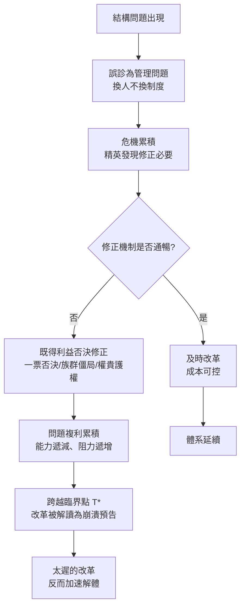

# 04.2 改革太遲：當結構問題被拖成生存問題

## 一、案發現場：三份遲到的處方

這一節的現場，留下的不是屍體，而是三份處方——每一份都開對了藥，只是開晚了。

**處方一：波蘭立陶宛的1791年5月3日憲法。** 這一天，波蘭—立陶宛聯邦通過了歐洲第一部成文憲法（僅晚於美國憲法），廢除讓國家癱瘓近百年的自由否決權（liberum veto），建立世襲君主制與現代化的行政、軍事體制。這是一次近乎教科書水準的自我診斷與自我手術。問題只有一個：此時聯邦已在1772年被俄、普、奧第一次瓜分，國家的軍事與財政能力連執行憲法都勉強。第二年，俄軍入侵，憲法派戰敗；1795年，聯邦被第三次瓜分，從地圖上消失。**診斷正確，開刀太晚——病人死於麻醉尚未起效的治療。**（見 [../../世界史/國家滅亡史/1795-波蘭立陶宛.md](../../世界史/國家滅亡史/1795-波蘭立陶宛.md)）

**處方二：奧匈帝國的「帝國還能再拖」學說。** 1907年，奧匈終於實現男性普選，這是對族群僵局的正確藥方之一；但帝國議會的多數聯盟已無法在德意志人、馬札爾人、捷克人、南斯拉夫人之間穩定組成，任何結構性改革——財稅分攤、軍隊語言、聯邦化方案——都會被某一族群視為背叛而否決。1867年奧匈折衷方案之後的半個世紀裡，帝國的統治菁英其實知道結構有病，主流策略卻是「以時間換空間」：先過了這一屆預算再說。1914年，拖到極限的結構在薩拉熱窩的一聲槍響中，把帝國拖進了一場它既無財政能力也無內部共識支撐的大戰（見 [../../世界史/國家滅亡史/1918-奧匈帝國.md](../../世界史/國家滅亡史/1918-奧匈帝國.md)）。

**處方三：清帝國的1906年宣示預備立憲。** 平心而論，1906至1911年間清廷的改革方案並不空泛：派大臣出洋考察、宣布預備立憲、頒布《欽定憲法大綱》、設議院籌備處、組責任內閣。診斷同樣正確——1905年日俄戰爭後朝野已有共識：立憲的小日本打敗了專制的大俄國，制度必須改。問題依然只有一個：1906年距離太平天國戰爭暴露財政破產已過半個世紀，距離甲午戰敗已十一年，距離庚子之變已六年。1911年5月，清廷終於組成內閣，十三名閣員中滿族九人、皇族七人——史稱「皇族內閣」。三個月後，鐵路國有化引爆保路運動；五個月後，武昌槍響。**處方開出之日，病人已經起了殺心。**（見 [../../世界史/國家滅亡史/1912-清朝.md](../../世界史/國家滅亡史/1912-清朝.md)）

三份處方指向同一條歷史規律，也是本節要證明的核心命題：**結構問題不會因為拖延而消失，它只會按複利累積利息；而利息的計算方式，是改革所需的能力隨時間遞減、改革遭遇的阻力隨時間遞增，直到需求與能力永遠錯開。**

## 二、為什麼改革總是太遲：三段式延誤的機制分析

「改革太遲」不是一句道德譴責，而是可以拆解成機械結構的因果鏈。以下用一個通用模型解剖延誤的三個階段。

### 階段一：症狀期——問題被定義為「管理問題」

結構問題在早期總是穿著管理問題的外衣出現：稅收短收是官員不力，軍隊戰力下降是訓練鬆弛，財政緊張是開支浪費。這個誤診有其組織邏輯：**把問題歸因於「人」，就不需要動「制度」；而動制度的成本由統治集團全體承擔，動人的成本只由少數倒楣者承擔。** 波蘭貴族把聯邦的衰弱歸咎於歷任國王的無能，而非liberum veto本身；奧匈菁英把議會癱瘓歸咎於「煽動家」，而非雙元結構的先天缺陷；清廷在甲午之前把危機歸咎於「船不夠堅、砲不夠利」。

### 階段二：否決期——修正機制被既得利益鎖死

當結構問題大到無法再裝成管理問題，制度修正的議題就會浮上檯面——而這正是本書第4章的核心關口：**金觀濤迴路中，「制度修正」環節能否轉動，決定了國家是自我更新還是滑向崩潰。** 在三個案例中，這個環節都卡在同一個位置：

- **波蘭：否決被寫進法律。** liberum veto規定，聯邦議會（Sejm）任何一名議員喊出「Nie pozwalam」（我不允許），即可否決本次議會的全部決議。這個制度源於貴族對王權的防范——防的是暴君，殺的是國家。十八世紀，外國列強學會了花錢買通一名議員來否決一切：俄國只需每年賄賂少數「金票貴族」，就能讓聯邦的軍備、財政、外交改革全部歸零。**一票否決權本質上把國家的修正能力外包給了任何出價最高的人。** 波蘭的案例最徹底地演示了「制度僵化」的學理含義：不是改革失敗，而是連「嘗試改革」這件事本身在制度上不可能。
- **奧匈：否決被族群結構鎖定。** 1867年折衷方案把帝國切成奧地利與匈牙利兩半，馬札爾貴族在內萊塔尼亞獲得實質否決權；議會內部，任何法案都需要跨族群聯盟，而族群政黨的生存依賴於向本族群證明「我沒有出賣你們」。結果是一種結構性僵局：**每一個決策者都理性，集體卻什麼都決定不了。** 帝國在最後幾十年靠緊急命令權（Paragraph 14）繞過議會治理——這是讓機器空轉而非修理機器的典型拖延術。
- **清廷：否決權掌握在「被改革的對象」手裡。** 預備立憲的每一個步驟——諮議局、資政院、責任內閣——都需要由滿清權貴集團來執行，而立憲的全部意義正是削減這個集團的壟斷權力。1908年光緒與慈禧相繼去世後，主持改革的攝政王載灃既無威望也無實力壓制親貴集團；1911年皇族內閣的組成，等於改革主持者親手在處方上簽下「本處方作廢」。漢族督撫與立憲派紳商由此得出結論：**這個體制連自己許諾的改革都不會兌現，那麼兌現的唯一途徑是更換體制。**

### 階段三：倒數期——改革的收益重新定價

延誤的最後階段有一個殘酷的數學性質。在早期，改革對統治集團是「長期收益 vs 短期成本」的交易，拖延尚可理解；但隨著危機累積，改革的性質發生突變：

$$
\text{改革時機} < T^* \Rightarrow \text{改革是精英內部利益的再分配}
$$
$$
\text{改革時機} > T^* \Rightarrow \text{改革是精英退出權的提前公告}
$$

跨越臨界點 $T^*$ 之後，任何改革在所有利益相關者眼中都不再是「讓國家變好」的措施，而是「體制即將崩潰」的官方確認。1906至1911年的清廷即是最精確的標本：1906年宣布預備立憲，各地士紳的反應不是欣慰而是加速組黨結社、購股鐵路、把資產與子侄送進新秩序的預備陣地——他們聽懂了言外之意：**朝廷在為退場做準備，跟進者得利，遲到者陪葬。** 每一項改革措施都在為革命招募群眾，這就是「改革太遲」的吊詭：太遲的改革比不改革更危險。

### 延誤的完整機械圖

## 三、對照組：明治維新為何沒有太遲

如果「改革太遲」有規律，那麼檢驗這個規律的最佳方法是尋找反例——一個在臨界點之前完成手術的案例。日本提供了這個反例。

江戶幕府面臨的結構問題與清帝國高度相似：財政依附於與現實脫節的米本位、門閥化的人事體系、對外壓力下的治理失能（第4.1節已詳）。1853年佩里來航與清帝國的庚子之變性質相同——外部壓力暴露內部虛弱。然而1868年的結果截然相反（見 [../../世界史/世界發展史/1868-明治維新.md](../../世界史/世界發展史/1868-明治維新.md)）。

差異可以在三個變數上精確定位：

**第一，改革主體的位置不同。** 清廷的改革必須由「被改革的對象」（滿洲權貴）主持；而日本推翻幕府的力量來自體系外——薩摩、長州等西南強藩與下級武士。這些改革者在幕藩體制中是被邊緣化的，因此**沒有需要保衛的既得利益，只有需要奪取的改革紅利**。第4.1節的結論在此得到反證：官僚自我服務集團不可能自我手術，手術只能由體制外或半體制外的力量執行。

**第二，否決機制是否存在。** 日本的傳統政治結構中，大名與武士雖有反抗先例（如尊王攘夷運動），卻沒有波蘭式的一票否決制度，也沒有奧匈式的族群僵局——改革派在倒幕戰爭中用兩年時間清除了否決者，此後廢藩置縣、徵兵令、地租改正一路推行，舊武士的反叛（西南戰爭，1877）被新式徵兵軍隊鎮壓。**及時改革的本質，是在既得利益組織起有效否決之前完成關鍵手術。**

**第三，緊迫感的時間錨點不同。** 日本的危機錨定在「黑船」這一具體的、可感知的羞辱事件上，全國精英形成「再不改就要變成印度」的共享緊迫感；清廷的危機則被鴉片戰爭以降的一系列半吊子挫敗稀釋成「漸進學習」，每一次失敗都換來一個更小的改革——洋務、維新、新政——每一個都比上一個正確，每一個都比需要的更晚。

必須誠實地補上一筆：明治的成功亦有運氣與規模的成分——日本是小國，改革的一次性總成本較低；西南強藩在地理與財政上恰好能對抗幕府。這些條件清廷一項也不具備。但規模與運氣解釋的是難度，不解釋方向；**方向上的差異——由誰主持改革、否決機制是否存在、危機是否被壓縮成單一錨點——才是本節模型真正要檢驗的變數。**

## 四、波蘭案的最後一課：太遲的改革為何引來瓜分

在三個案例中，波蘭的結局最極端，也最有理論價值，因為它展示了一個常被忽略的動態：**太遲的改革不僅對內加速解體，還會對外改變鄰國的計算。**

俄普奧三國對波蘭的第一次瓜分（1772），本質上是對「一個無法自我修復的國家」的資產預先分割。此後波蘭的每一次改革嘗試，都被鄰國解讀為風險信號：一個正在恢復機能的波蘭，比一個確定癱瘓的波蘭更危險。1791年憲法因此直接觸發了俄國的入侵與1793年第二次瓜分；1794年柯斯丘什科起義則引來第三次瓜分——**聯邦在四年內用兩次最認真的自救行動，換來了從地圖上消失的結局。** 這不是說改革錯了，而是揭示了一個冷峻的機制：當拖延把國家的「可修復性」耗盡，改革窗口的另一側站著的不是康復，而是清算。改革的正確時機不在危機爆發之後，而在「鄰居還沒有把你列為資產」之前。

## 五、本節要點

1. 「改革太遲」是一個有內部機械結構的過程，分為誤診期（結構問題被裝成管理問題）、否決期（修正機制被既得利益鎖死）、倒數期（改革被重新定價為崩潰預告）三段。
2. 否決期的三種典型形態：波蘭的liberum veto（否決權可被外國收購）、奧匈的族群僵局（每個決策者理性、集體癱瘓）、清廷的權貴護權（改革主持者即被改革對象）。
3. 存在改革臨界點 $T^*$ ：越過之後，改革的政治效果反轉——太遲的改革比不改革更危險，因為它被所有利益相關者解讀為體制崩潰的官方確認，1906–1911年的清廷是精確標本。
4. 明治維新作為對照組證明：及時改革的關鍵變數是改革主體的位置（體制外力量）、否決機制能否被快速清除、以及危機能否被壓縮為單一時間錨點——而非改革方案的品質。
5. 太遲的改革還會對外改變鄰國計算：波蘭案顯示，當國家失去「可修復性」，其改革行動本身可能成為被瓜分的觸發器。

## 六、延伸對照

- [../../世界史/國家滅亡史/1795-波蘭立陶宛.md](../../世界史/國家滅亡史/1795-波蘭立陶宛.md)：liberum veto的起源、被收購的歷程與三次瓜分。
- [../../世界史/國家滅亡史/1918-奧匈帝國.md](../../世界史/國家滅亡史/1918-奧匈帝國.md)：族群僵局、議會癱瘓與緊急命令統治。
- [../../世界史/國家滅亡史/1912-清朝.md](../../世界史/國家滅亡史/1912-清朝.md)：從洋務到皇族內閣的半世紀延誤時間線。
- [../../世界史/世界發展史/1868-明治維新.md](../../世界史/世界發展史/1868-明治維新.md)：對照組——臨界點之前完成的手術。
- [../../世界史/國家滅亡史/1868-江戶幕府.md](../../世界史/國家滅亡史/1868-江戶幕府.md)：被改革推翻的舊體制側的病理（見第4.1節）。
- [../../世界史/國家滅亡史/1115-遼朝覆滅之路.md](../../世界史/國家滅亡史/1115-遼朝覆滅之路.md)：帝國晚期改革窗口關閉的東亞案例，可與金朝（[../../世界史/國家滅亡史/1234-金朝.md](../../世界史/國家滅亡史/1234-金朝.md)）並讀。
